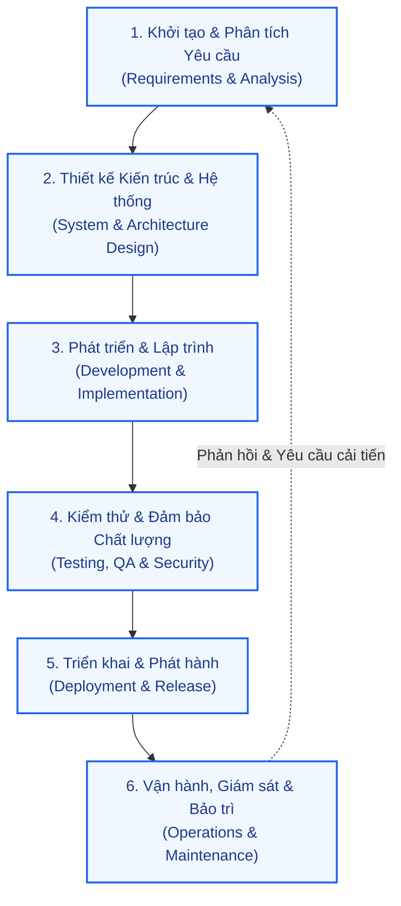

# QUY TRÌNH PHÁT TRIỂN PHẦN MỀM (SOFTWARE DEVELOPMENT LIFE CYCLE - SDLC)

Tài liệu này chuẩn hóa toàn bộ vòng đời phát triển phần mềm (SDLC) áp dụng cho dự án, kết hợp mô hình **Agile/Scrum** với khung bảo mật **DevSecOps**, làm rõ trách nhiệm của các bộ phận liên quan và sản phẩm đầu ra (deliverables) ở từng giai đoạn.

---

## 1. Sơ đồ Tổng quan Vòng đời SDLC

---

## 2. Chi tiết Các Giai đoạn SDLC

### Giai đoạn 1: Khởi tạo & Phân tích Yêu cầu (Requirements & Analysis)

* **Mục tiêu:** Tiếp nhận đề bài, khảo sát nghiệp vụ thực tế, xác định phạm vi dự án, phân tích tính khả thi và chuẩn hóa toàn bộ yêu cầu chức năng và phi chức năng.
* **Bộ phận liên quan:**
  * **Chủ trì (Accountable):** Business Analyst (BA) / Product Owner (PO).
  * **Phối hợp (Consulted/Informed):** Stakeholders (Khách hàng, Đại diện Nghiệp vụ), System Architect, QA Lead, Project Manager (PM).
* **Hoạt động chính:**
  1. Phỏng vấn các bên liên quan, thu thập tài liệu mẫu (các mẫu sao kê, biểu mẫu tài chính, báo cáo mong muốn).
  2. Lập ma trận ánh xạ trường dữ liệu (Data Field Mapping Matrix).
  3. Viết tài liệu đặc tả yêu cầu người dùng (User Stories) kèm tiêu chí chấp nhận (Acceptance Criteria) theo cú pháp Gherkin (`Given/When/Then`).
  4. Đánh giá tính khả thi về mặt kỹ thuật, ước tính thời gian và lập kế hoạch bàn giao (Release Plan).
* **Sản phẩm đầu ra (Deliverables):**
  * 📄 **Tài liệu Đặc tả Yêu cầu Nghiệp vụ & Sản phẩm (`PRODUCT_SPEC.md` / SRS / PRD):** Danh sách User Stories có mã định danh truy vết (`REQ-xxx`).
  * 📊 **Ma trận Ánh xạ Dữ liệu (Data Mapping Matrix):** Đặc tả chi tiết nguồn dữ liệu, đích đến, quy tắc biến đổi và làm sạch.
  * 📋 **Bộ Tiêu chí Chấp nhận (Acceptance Criteria):** Chuẩn hóa dưới dạng Gherkin cho từng tính năng.
  * 🎯 **Biên bản Họp & Thống nhất Phạm vi (Scope Baseline & Sign-off).**
* **Cổng nghiệm thu (Exit Criteria / Definition of Ready - DoR):**
  * Toàn bộ User Story được đánh giá đạt DoR (mô tả rõ ràng, có AC, có dữ liệu mẫu minh họa, đã được PO/Tech Lead phê duyệt).

---

### Giai đoạn 2: Thiết kế Kiến trúc & Hệ thống (Architecture & System Design)

* **Mục tiêu:** Chuyển hóa các yêu cầu nghiệp vụ thành bản thiết kế kỹ thuật hoàn chỉnh, đảm bảo tính mở rộng (scalability), hiệu năng cao, bảo mật và toàn vẹn dữ liệu.
* **Bộ phận liên quan:**
  * **Chủ trì (Accountable):** System Architect / Solution Architect.
  * **Phối hợp (Consulted/Informed):** Data Engineer, Backend/Frontend Lead, Security Specialist, DevOps Engineer.
* **Hoạt động chính:**
  1. Thiết kế kiến trúc tổng thể (System Architecture, Component Diagram, Data Flow Diagram).
  2. Thiết kế mô hình cơ sở dữ liệu (ERD - Chuẩn hóa 3NF), cấu trúc bảng, chỉ mục (Indexing), phân vùng (Partitioning) và chiến lược lưu trữ (Object Storage + CSDL quan hệ).
  3. Thiết kế hợp đồng giao tiếp API (API Contracts) theo chuẩn OpenAPI/Swagger 3.0.
  4. Thiết kế cơ chế xử lý bất đồng bộ (Message Queue, Worker, Dead Letter Queue - DLQ).
  5. Đánh giá mô hình đe dọa bảo mật (Threat Modeling) và các biện pháp bảo vệ dữ liệu nhạy cảm.
* **Sản phẩm đầu ra (Deliverables):**
  * 📐 **Tài liệu Thiết kế Kiến trúc Phần mềm (Software Architecture Document - SAD / HLD):** Sơ đồ khối, luồng dữ liệu, hạ tầng.
  * 🗄️ **Mô hình Dữ liệu & Bản script DDL (Database Schema & Migration Scripts):** File thiết kế ERD và mã nguồn DDL khởi tạo bảng, ràng buộc toàn vẹn.
  * 📜 **Đặc tả Hợp đồng API (OpenAPI Specification / Postman Collection):** Quy chuẩn Endpoint, Request Body, Response Schema, Error Codes.
  * 🔒 **Tài liệu Đánh giá Rủi ro & Kiến trúc Bảo mật (Security & Threat Modeling Document).**
* **Cổng nghiệm thu (Exit Criteria):**
  * Bản thiết kế kiến trúc và hợp đồng API được các Tech Lead, Security Specialist và Dev Team duyệt (Architecture Review Sign-off).

---

### Giai đoạn 3: Phát triển & Hiện thực hóa (Implementation & Development)

* **Mục tiêu:** Viết mã nguồn sạch, an toàn, tối ưu hiệu năng dựa trên đúng bản thiết kế và hợp đồng API đã ban hành.
* **Bộ phận liên quan:**
  * **Chủ trì (Accountable):** Đội ngũ Lập trình viên (Backend Developers, Frontend Developers, Data Engineers).
  * **Phối hợp (Consulted/Informed):** System Architect (hướng dẫn kỹ thuật), QA/Tester (làm rõ ca kiểm thử), DevOps (hỗ trợ môi trường).
* **Hoạt động chính:**
  1. Khởi tạo cấu trúc dự án, cấu hình môi trường phát triển (Local & Dev Environment).
  2. Xây dựng lõi xử lý dữ liệu (ETL / Data Parser): cơ chế đọc Stream Chunking, ép kiểu Decimal độ chính xác cao, deduplication canonical hash.
  3. Xây dựng giao diện người dùng (UI/UX) và tích hợp API: upload đa tầng, kiểm tra Magic Bytes, hiển thị tiến độ (SSE/WebSocket), xuất báo cáo an toàn.
  4. Lập trình Unit Test đồng hành (TDD hoặc kiểm thử đơn vị song song).
  5. Thực hiện quy trình Code Review chéo qua Pull Request / Merge Request.
* **Sản phẩm đầu ra (Deliverables):**
  * 💻 **Mã nguồn dự án (Source Code):** Quản lý trên Git Repo, phân nhánh theo GitFlow/Trunk-based.
  * 🧪 **Bộ kiểm thử đơn vị (Unit Tests Suite):** Đo lường tỷ lệ bao phủ (Coverage) đạt chỉ tiêu $\ge 85\%$.
  * 📑 **Tài liệu Kỹ thuật Nội bộ (Developer Guide / README):** Hướng dẫn cài đặt, cấu hình biến môi trường (`.env.example`), cấu trúc mã nguồn.
  * 🔄 **Bản script di trú dữ liệu (Database Migrations):** Đảm bảo có thể chạy tự động lên/xuống (up/down).
* **Cổng nghiệm thu (Exit Criteria):**
  * Toàn bộ mã nguồn vượt qua Static Code Analysis (Linter, SonarQube không có bug nghiêm trọng hoặc lỗ hổng bảo mật mức High/Critical).
  * Pull Request được ít nhất 1 Peer Reviewer và 1 Tech Lead phê duyệt.

---

### Giai đoạn 4: Kiểm thử & Đảm bảo Chất lượng, Bảo mật (Testing, QA & Security)

* **Mục tiêu:** Đảm bảo phần mềm hoạt động chính xác theo nghiệp vụ, không có lỗi tiềm ẩn, đáp ứng tiêu chuẩn hiệu năng và an toàn thông tin trước khi lên môi trường thật.
* **Bộ phận liên quan:**
  * **Chủ trì (Accountable):** QA / QC Engineers, Security Specialists.
  * **Phối hợp (Consulted/Informed):** BA/PO (nghiệm thu UAT), Developers (sửa lỗi - bug fixing), DevOps (môi trường Staging).
* **Hoạt động chính:**
  1. Lập Kế hoạch Kiểm thử (Test Plan) và thiết kế Kịch bản Kiểm thử (Test Cases, Test Matrix).
  2. Thực hiện Kiểm thử Chức năng (Functional Testing), Kiểm thử Tích hợp (Integration Testing), Kiểm thử Biên dữ liệu (Boundary/Negative Testing).
  3. Tự động hóa kiểm thử (Automation Testing - API & E2E Tests).
  4. Kiểm thử Hiệu năng & Tải trọng (Performance, Load & Stress Testing).
  5. Đánh giá An toàn Thông tin (Security Auditing, DAST, SAST, kiểm tra SQLi, Formula Injection, BOLA/IDOR, RBAC).
  6. Điều phối kiểm thử nghiệm thu người dùng (UAT - User Acceptance Testing).
* **Sản phẩm đầu ra (Deliverables):**
  * 📋 **Tài liệu Kế hoạch & Kịch bản Kiểm thử (Test Plan & Test Cases Matrix).**
  * 🤖 **Bộ kịch bản kiểm thử tự động (Automation Test Scripts).**
  * 🐞 **Danh sách Báo cáo Lỗi (Defect / Bug Tracking Log trên Jira/GitHub Issues).**
  * 📊 **Báo cáo Kết quả Kiểm thử (Test Summary Report):** Tỷ lệ Passed/Failed, độ bao phủ kiểm thử, thống kê lỗi.
  * 🛡️ **Báo cáo Đánh giá An toàn Thông tin (Security Assessment & Vulnerability Scan Report).**
  * ✍️ **Biên bản Nghiệm thu UAT (UAT Sign-off Report):** Xác nhận đồng ý phát hành từ phía Product Owner/Khách hàng.
* **Cổng nghiệm thu (Exit Criteria / Definition of Done - DoD):**
  * 100% ca kiểm thử quan trọng (Critical & Major) đều PASSED; không còn tồn tại lỗi độ nghiêm trọng Blocker/Critical.
  * Đạt chỉ số chất lượng yêu cầu (Zero High/Critical Vulnerabilities).

---

### Giai đoạn 5: Triển khai & Phát hành (Deployment & Release Management)

* **Mục tiêu:** Đưa phần mềm lên môi trường UAT/Staging và Production một cách tự động, an toàn, ổn định và không làm gián đoạn người dùng (Zero Downtime).
* **Bộ phận liên quan:**
  * **Chủ trì (Accountable):** DevOps / SRE Team, Release Manager.
  * **Phối hợp (Consulted/Informed):** Tech Lead, System Architect, Developers, QA Lead, Product Owner.
* **Hoạt động chính:**
  1. Xây dựng và duy trì đường ống tự động CI/CD (Continuous Integration / Continuous Deployment).
  2. Đóng gói ứng dụng (Containerization qua Docker, Helm Charts, Kubernetes Manifests).
  3. Thực hiện di trú CSDL (Database Migration Execution) và kiểm tra tương thích ngược.
  4. Áp dụng chiến lược triển khai an toàn (Blue/Green Deployment hoặc Canary Release).
  5. Thiết lập kế hoạch dự phòng và quy trình quay lui (Rollback Plan) khi xảy ra sự cố.
  6. Kiểm thử khói sau phát hành (Sanity / Smoke Testing trên Production).
* **Sản phẩm đầu ra (Deliverables):**
  * 🚀 **Gói phát hành phần mềm (Release Artifacts):** Docker Images (có gán version tag cụ thể), thư viện build.
  * ⚙️ **Đường ống CI/CD (CI/CD Pipeline Configurations):** GitHub Actions / GitLab CI script.
  * 📜 **Tài liệu Kế hoạch Phát hành & Kịch bản Rollback (Release & Rollback Plan).**
  * 📝 **Thông báo Phát hành & Nhật ký Thay đổi (Release Notes / Changelog):** Tóm tắt tính năng mới, lỗi đã sửa, hướng dẫn cấu hình.
  * ✅ **Biên bản Xác nhận Triển khai Thành công (Deployment Checklist & Smoke Test Sign-off).**
* **Cổng nghiệm thu (Exit Criteria):**
  * Môi trường Production ổn định, Smoke Test hoàn tất thành công, không phát sinh lỗi nghiêm trọng sau 2 giờ đầu vận hành.

---

### Giai đoạn 6: Vận hành, Giám sát & Bảo trì (Operations, Monitoring & Maintenance)

* **Mục tiêu:** Duy trì tính sẵn sàng (Availability) và độ tin cậy (Reliability) của hệ thống theo chỉ tiêu SLA; phát hiện sớm sự cố và tiếp nhận phản hồi để liên tục cải tiến.
* **Bộ phận liên quan:**
  * **Chủ trì (Accountable):** SRE / DevOps / IT Operations Team.
  * **Phối hợp (Consulted/Informed):** Technical Support L1/L2, Developers, BA/PO (cho các yêu cầu phát sinh mới).
* **Hoạt động chính:**
  1. Giám sát hệ thống thời gian thực (Real-time APM: CPU, RAM, Disk I/O, độ trễ API, tỷ lệ lỗi HTTP 5xx qua Prometheus, Grafana, Datadog).
  2. Thu thập và phân tích tập trung Log (Centralized Logging qua ELK Stack / Loki).
  3. Cảnh báo tự động (Alerting qua Slack/Telegram/PagerDuty) khi các chỉ số vượt ngưỡng cảnh báo.
  4. Thực hiện sao lưu định kỳ dữ liệu (Automated Database Backup) và diễn tập khôi phục sau thảm họa (Disaster Recovery - DR).
  5. Tiếp nhận sự cố (Incident Management), phân loại, xử lý nóng (Hotfix) và viết báo cáo nguyên nhân gốc rễ (Post-Mortem / RCA).
* **Sản phẩm đầu ra (Deliverables):**
  * 📈 **Bảng điều khiển Giám sát Trực quan (Monitoring & APM Dashboards).**
  * 📑 **Báo cáo Sức khỏe Hệ thống & SLA (System Health & Uptime Monthly Report).**
  * 🗃️ **Bản sao lưu Dữ liệu & Nhật ký Lưu trữ (Database & Object Storage Backup Snapshots).**
  * 📖 **Sổ tay Vận hành & Khắc phục Sự cố (Operational Runbooks / Troubleshooting Guide).**
  * 🔍 **Báo cáo Phân tích Sự cố & Hành động Khắc phục (Incident Post-Mortem / RCA Report).**

---

## 3. Ma trận Phân công Trách nhiệm (RACI Matrix)

* **R (Responsible):** Bộ phận trực tiếp thực thi công việc.
* **A (Accountable):** Bộ phận chịu trách nhiệm cuối cùng và có quyền phê duyệt.
* **C (Consulted):** Bộ phận được tham vấn ý kiến chuyên môn.
* **I (Informed):** Bộ phận được thông báo cập nhật tiến độ và kết quả.

| Giai đoạn SDLC | Product Owner (PO) | Business Analyst (BA) | System Architect (SA) | Development Team | QA / Security Team | DevOps / SRE Team | Project Manager (PM) |
| :--- | :---: | :---: | :---: | :---: | :---: | :---: | :---: |
| **1. Khởi tạo & Phân tích Yêu cầu** | **A** | **R** | C | C | C | I | C |
| **2. Thiết kế Kiến trúc & Hệ thống** | I | C | **A / R** | C | C | C | I |
| **3. Phát triển & Lập trình** | I | C | C | **A / R** | C | C | C |
| **4. Kiểm thử & Đảm bảo Chất lượng** | C (UAT) | C | I | C (Fix bug) | **A / R** | C | C |
| **5. Triển khai & Phát hành** | I | I | C | C | C (Smoke) | **A / R** | C |
| **6. Vận hành & Giám sát** | I | I | C | C (Hotfix) | I | **A / R** | I |

---

## 4. Bảng Tổng hợp Sản phẩm Đầu ra (Deliverables Checklist)

| STT | Giai đoạn SDLC | Tên Sản phẩm Đầu ra | Định dạng / Nơi lưu trữ | Bộ phận Chịu trách nhiệm |
| :---: | :--- | :--- | :--- | :--- |
| 1 | **Phân tích Yêu cầu** | Tài liệu Đặc tả Yêu cầu (`PRODUCT_SPEC.md` / SRS) | Markdown / Wiki / Jira | Business Analyst (BA) |
| 2 | | Ma trận Ánh xạ Dữ liệu (Mapping Matrix) | Excel / Markdown Docs | Business Analyst (BA) |
| 3 | | Bộ Tiêu chí Chấp nhận (Gherkin AC) | Jira / Gherkin Feature file | Business Analyst (BA) |
| 4 | **Thiết kế Hệ thống** | Tài liệu Kiến trúc Hệ thống (HLD / SAD) | Markdown / Draw.io / Mermaid | System Architect |
| 5 | | Lược đồ CSDL & Scripts DDL | `.sql` / DB Diagram | System Architect |
| 6 | | Bản đặc tả API Chuẩn mực (OpenAPI 3.0) | `openapi.yaml` / Swagger | System Architect / Tech Lead |
| 7 | **Phát triển** | Mã nguồn phần mềm hoàn chỉnh | Git Repository (GitLab/GitHub) | Developers (Data/BE/FE) |
| 8 | | Bộ kiểm thử đơn vị (Unit Tests $\ge 85\%$) | Source Code Repo | Developers |
| 9 | | Tài liệu Hướng dẫn Cài đặt & Vận hành Dev | `README.md`, `.env.example` | Developers |
| 10 | **Kiểm thử & QA** | Kế hoạch & Kịch bản Kiểm thử (Test Cases) | Test Management Tool / Sheet | QA / QC Specialist |
| 11 | | Kịch bản Kiểm thử Tự động (Auto Tests) | Code Repo (`/tests`) | QA Automation Engineer |
| 12 | | Báo cáo Đánh giá An toàn Thông tin (Security) | PDF Report / Issue Tracker | Security Specialist |
| 13 | | Biên bản Nghiệm thu UAT | UAT Sign-off Document | Product Owner & QA |
| 14 | **Triển khai** | Bản dựng đóng gói ứng dụng | Docker Image Registry | DevOps / SRE |
| 15 | | Kịch bản CI/CD & Triển khai tự động | `.github/workflows` / `.gitlab-ci.yml` | DevOps / SRE |
| 16 | | Release Notes & Kế hoạch Rollback | Markdown / Wiki | Release Lead / DevOps |
| 17 | **Vận hành** | Bảng giám sát hiệu năng thời gian thực | Grafana / Datadog Dashboards | SRE / Operations |
| 18 | | Nhật ký Sự cố & Báo cáo Hậu kiểm (Post-Mortem) | Incident Log / Wiki Docs | SRE & Dev Team |

---

## 5. Quy chuẩn Cổng Chất lượng (Quality Gates & Transition Criteria)

Để đảm bảo chất lượng phần mềm không bị suy thoái qua từng bước chuyển giao, các cổng kiểm soát (Quality Gates) bắt buộc phải được kích hoạt tự động hoặc bán tự động:

1. **Gate 1 - Definition of Ready (DoR) [Requirements -> Design/Dev]:**
   * Yêu cầu nghiệp vụ rõ ràng, không mâu thuẫn, có đầy đủ dữ liệu mẫu và tiêu chí nghiệm thu rõ ràng (Gherkin format).
2. **Gate 2 - Architecture & Contract Gate [Design -> Dev]:**
   * Schema CSDL được chuẩn hóa 3NF, hợp đồng API (OpenAPI 3.0) được đóng băng trước khi tiến hành code song song Front-end và Back-end.
3. **Gate 3 - Pull Request & Code Quality Gate [Dev -> QA]:**
   * Vượt qua Linting, Unit Test đạt độ phủ $\ge 85\%$, không có lỗ hổng bảo mật SAST mức High/Critical, có ít nhất 1 Peer Review chấp thuận.
4. **Gate 4 - Definition of Done (DoD) & UAT Gate [QA -> Release]:**
   * 100% ca kiểm thử chức năng Passed, không còn bug mở mức độ Blocker/Critical, hoàn thành kiểm thử an toàn thông tin và nhận xác nhận UAT từ Product Owner.
5. **Gate 5 - Production Readiness & Smoke Gate [Release -> Operations]:**
   * Tự động hóa quá trình deploy qua CI/CD, có sẵn kịch bản Rollback trong trường hợp khẩn cấp, các kiểm tra Smoke Test trên Production hoàn tất thành công.

