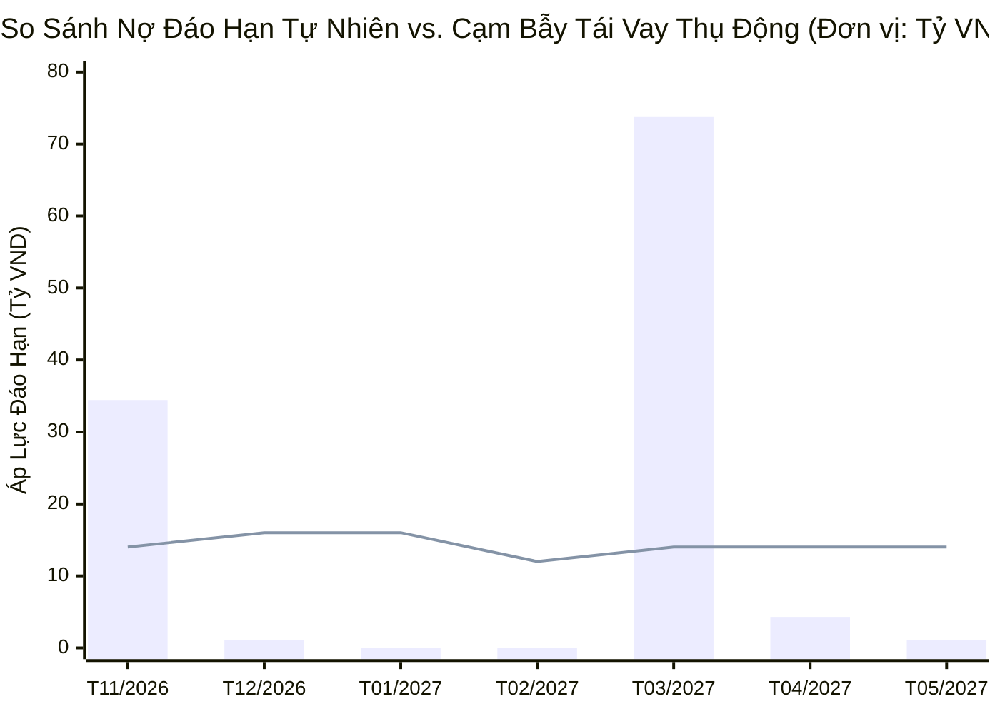
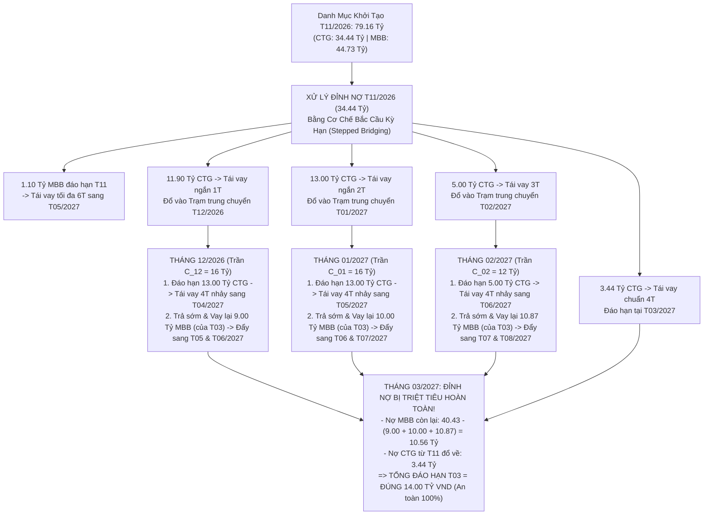
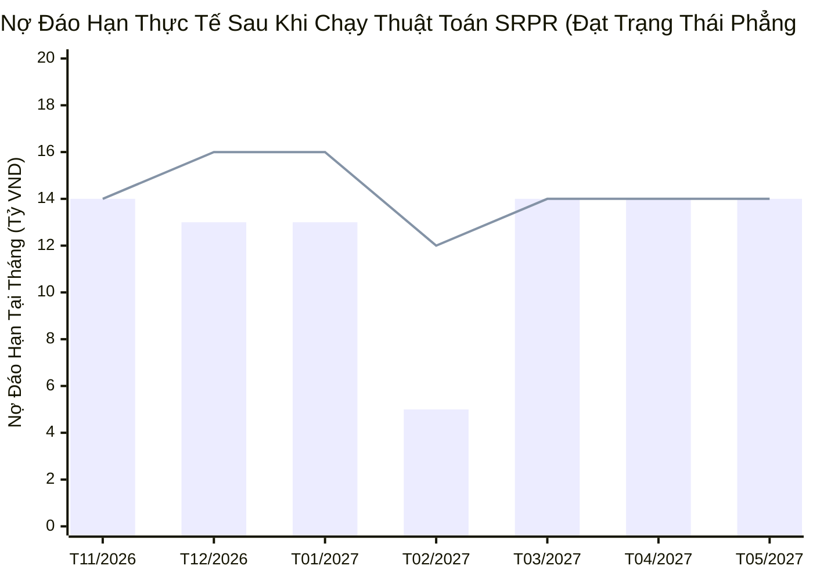

# BÁO CÁO ĐẶC TẢ BÀI TOÁN DOANH NGHIỆP & PHƯƠNG ÁN CÂN BẰNG TẢI KỲ HẠN TÍN DỤNG TUẦN HOÀN
*(Corporate Revolving Debt Load-Balancing & Maturity Re-routing Proposal)*

---

| **Thông tin tài liệu** | **Chi tiết** |
| :--- | :--- |
| **Dự án** | BSP - Hệ thống Quản trị & Đối soát Tài chính Tự động (Treasury & Bank Reconciliation) |
| **Phân hệ** | Quản trị Khoản Vay & Điều phối Thanh khoản Tuần hoàn (Credit Facilities & Revolving Liquidity Engine) |
| **Đối tượng thụ hưởng** | Hội đồng Quản trị (BOD), Giám đốc Tài chính (CFO), Trưởng phòng Nguồn vốn & Kế toán trưởng |
| **Tác giả / Phê duyệt** | Chuyên ban Phân tích Nghiệp vụ Tài chính & Đội ngũ Kỹ thuật Hệ thống |
| **Trạng thái** | Chính thức (Approved for Implementation - Phiên bản Tối ưu v2.0) |
| **Ngày lập** | 02/11/2026 |

---

## 1. TÓM TẮT ĐIỀU HÀNH (EXECUTIVE SUMMARY)

Doanh nghiệp hiện đang sử dụng hạn mức tín dụng ngắn hạn từ 2 ngân hàng đối tác chiến lược (**MBBank** và **VietinBank**) với tổng dư nợ gốc cố định là **79,160,540,000 VND** phân bổ trên **37 khế ước nhận nợ (KUNN)**. Đây là nguồn vốn lưu động cốt lõi, bắt buộc phải **duy trì 100% quy mô dư nợ** (trả gốc bao nhiêu phải giải ngân tái vay lại bấy nhiêu) để đảm bảo chu kỳ mua hàng và tài trợ chuỗi cung ứng.

Tuy nhiên, cấu trúc kỳ hạn của danh mục hiện tại đang bị **lệch pha nghiêm trọng theo hình chữ U (Maturity Wall / Barbell Effect)**:
* **Tháng 11/2026:** Áp lực nợ đáo hạn vọt lên **34.44 tỷ VND** (gồm 33.34 tỷ tại VietinBank và 1.10 tỷ tại MBBank), vượt xa năng lực thanh khoản luân chuyển một lần của ngân quỹ tháng (14.00 tỷ VND).
* **Tháng 12/2026 - Tháng 02/2027:** Giai đoạn "trũng nợ", lịch đáo hạn tự nhiên chỉ từ 0 đến 1.10 tỷ VND/tháng, trong khi dòng tiền bán hàng thu về tài khoản rất dồi dào (12.00 - 16.00 tỷ VND/tháng).
* **Tháng 03/2027:** Áp lực đáo hạn lại bùng nổ lên tới **40.43 tỷ VND** (25 khế ước của MBBank đáo hạn đồng loạt).
* **Cạm bẫy Tái vay Tuần hoàn (The Circular Rollover Trap):** Do VietinBank (CTG) khống chế kỳ hạn tối đa **4 tháng/khế ước**, nếu doanh nghiệp tất toán và tái vay toàn bộ 33.34 tỷ nợ CTG của Tháng 11/2026 theo kỳ hạn chuẩn 4 tháng, toàn bộ khối nợ này sẽ **đáo hạn đúng vào Tháng 03/2027** ($T11 + 4\text{ tháng} = T03$). Khi đó, tổng nợ đáo hạn tại Tháng 03/2027 sẽ cộng hưởng lên mức kỷ lục **73.77 tỷ VND** ($40.43\text{ tỷ MBB} + 33.34\text{ tỷ CTG}$), gây tê liệt hoàn toàn khả năng quay vòng vốn.

**Giải pháp đề xuất:** Ứng dụng thuật toán **Dịch chuyển Kỳ hạn Bậc thang & Trả sớm Tái định tuyến (Stepped Rollover & Prepay-to-Reroute - SRPR)** với 2 cơ chế đột phá:
1. **Bắc cầu kỳ hạn qua Trạm trung chuyển (Stepped Bridging):** Không tái vay 100% nợ CTG ở T11 theo kỳ hạn 4 tháng, mà chia nhỏ giải ngân vào kỳ hạn ngắn 1 tháng (đáo hạn T12) và 2 tháng (đáo hạn T01). Khi đến T12 và T01, tiếp tục tái vay kỳ hạn chuẩn 4 tháng để **phóng vọt lịch đáo hạn sang T04 và T05/2027**, né hoàn toàn "điểm nghẽn" T03/2027 mà vẫn tuân thủ tuyệt đối trần 4 tháng của VietinBank.
2. **Trả sớm Tái định tuyến Quay vòng trong ngày (Intraday Prepay-to-Reroute):** Tận dụng phí phạt trả nợ trước hạn **0%** và dòng tiền dồi dào ở các tháng trũng (T12, T01, T02) để chủ động **trả trước hạn các khế ước lớn của MBBank đang nằm ở đỉnh T03/2027, đồng thời giải ngân vay lại ngay trong ngày** với kỳ hạn mới 5–6 tháng (đẩy sang T05, T06, T07/2027).

**Kết quả đạt được:**
* **Bảo toàn 100% vốn lưu động:** Tổng dư nợ cuối mỗi tháng luôn giữ nguyên ở mức **79.16 tỷ VND** ($34.44\text{ tỷ CTG}$ và $44.73\text{ tỷ MBB}$).
* **Triệt tiêu hoàn toàn đỉnh nợ Tháng 03/2027:** Cắt giảm nghĩa vụ đáo hạn tự nhiên của T03/2027 từ **73.77 tỷ** xuống đúng bằng trần an toàn **14.00 tỷ VND**.
* **Đưa danh mục về Trạng thái Cân bằng Vĩnh viễn (Perpetual Steady-State):** Kể từ sau chu kỳ điều chỉnh, mỗi tháng doanh nghiệp chỉ phải luân chuyển tất toán/tái vay đều đặn **12.00 – 16.00 tỷ VND**, khớp 100% với dòng tiền mùa vụ.

---

## 2. HIỆN TRẠNG DANH MỤC TÍN DỤNG & RÀNG BUỘC NGHIỆP VỤ

### 2.1. Số liệu Tổng quan Danh mục Nợ Hiện hữu
Dữ liệu trích xuất từ sổ theo dõi tín dụng và sao kê đối soát ngày 02/11/2026:

| Chỉ số | Giá trị | Ràng buộc nghiệp vụ bắt buộc |
| :--- | :--- | :--- |
| **Tổng dư nợ gốc cố định** | **79,160,540,000 VND** | Duy trì 100% dư nợ (Trả gốc = Giải ngân tái vay mới) |
| **Hạn mức tại VietinBank (CTG)** | **34,435,015,000 VND** (43.5%) | 12 khế ước, kỳ hạn vay tối đa **$K_{\text{CTG}} = 4$ tháng** |
| **Hạn mức tại MBBank (MBB)** | **44,725,525,000 VND** (56.5%) | 25 khế ước, kỳ hạn vay tối đa **$K_{\text{MBB}} = 6$ tháng** |
| **Lãi suất bình quân gia quyền** | **8.42% / năm** | Biên độ dao động $7.8\% - 9.1\%$/năm |
| **Phí phạt trả nợ trước hạn** | **0.0%** | Cho phép trả sớm và rút vay lại ngay không tốn phí |
| **Trần luân chuyển chuẩn ($C_t$)** | **12.00 – 16.00 tỷ VND/tháng** | Biến thiên theo tính mùa vụ của dòng tiền kinh doanh |

### 2.2. Biểu Đồ Lệch Pha Kỳ Hạn Tự Nhiên & Nguy Cơ Cộng Hưởng Đỉnh Nợ
Dưới đây là bảng phân bổ nợ gốc đến hạn tự nhiên ban đầu và kịch bản thảm họa nếu tái vay thụ động theo kỳ hạn chuẩn (CTG 4 tháng, MBB 6 tháng):

| Tháng đáo hạn | Nợ CTG ban đầu (VND) | Nợ MBB ban đầu (VND) | Tổng nợ tự nhiên ($D_t^{(0)}$) | Nếu tái vay thụ động 4T/6T | Trần thanh khoản mùa vụ ($C_t$) | Đánh giá rủi ro thanh khoản |
| :---: | :---: | :---: | :---: | :---: | :---: | :--- |
| **11/2026** | 33,335,015,000 | 1,100,000,000 | **34,435,015,000** | 34,435,015,000 | 14,000,000,000 | 🔴 **Vượt trần 20.44 tỷ** (Quá tải T11) |
| **12/2026** | 1,100,000,000 | 0 | **1,100,000,000** | 1,100,000,000 | 16,000,000,000 | 🟢 Rỗng nợ (Dư 14.90 tỷ năng lực xoay vòng) |
| **01/2027** | 0 | 0 | **0** | 0 | 16,000,000,000 | 🟢 Rỗng nợ (Dư 16.00 tỷ năng lực xoay vòng) |
| **02/2027** | 0 | 0 | **0** | 0 | 12,000,000,000 | 🟢 Rỗng nợ (Dư 12.00 tỷ năng lực xoay vòng) |
| **03/2027** | 0 | 40,425,525,000 | **40,425,525,000** | **73,760,540,000** *(+33.34 tỷ CTG)* | 14,000,000,000 | 🔴 **Vỡ trận: Cộng hưởng đỉnh nợ 73.76 tỷ!** |
| **04/2027** | 0 | 3,200,000,000 | **3,200,000,000** | 4,300,000,000 *(+1.10 tỷ CTG)* | 14,000,000,000 | 🟢 Dư 9.70 tỷ năng lực xoay vòng |
| **05/2027** | 0 | 0 | **0** | 1,100,000,000 *(+1.10 tỷ MBB)* | 14,000,000,000 | 🟢 Dư 12.90 tỷ năng lực xoay vòng |
| **QUY MÔ VỐN** | **34,435,015,000** | **44,725,525,000** | **79,160,540,000** | **Dư nợ giữ nguyên 79.16 tỷ** | — | — |



---

## 3. PHÂN TÍCH CÁC THÁCH THỨC NGHIỆP VỤ CỐT LÕI

### 3.1. Bài toán Bảo toàn 100% Hạn mức Vốn lưu động (Zero Net Deleverage)
Khác với các khoản vay dự án trung dài hạn (trả góp giảm dần dư nợ), toàn bộ 79.16 tỷ VND của doanh nghiệp là **vốn vay ngắn hạn phục vụ mua hàng hóa và nguyên vật liệu**. 
* Nếu doanh nghiệp dùng dòng tiền thu bán hàng để trả đứt nợ vay mà không giải ngân rút vốn lại, công ty sẽ bị **thiếu hụt vốn lưu động ngay lập tức**.
* Do đó, mục tiêu của hệ thống không phải là "trả hết nợ", mà là **tái cấu trúc lịch đáo hạn (Maturity Rescheduling)** sao cho tại mọi tháng, tổng số tiền phải nộp vào ngân hàng để tất toán khế ước cũ và rút ra khế ước mới luôn nằm trong ngưỡng năng lực luân chuyển dòng tiền ($C_t$).

### 3.2. Ràng buộc cứng về Trần Kỳ hạn của từng Ngân hàng ($K_{\text{max}}$)
* **VietinBank (CTG) chỉ cho phép giải ngân tối đa 4 tháng/khế ước:** Điều này có nghĩa là tại Tháng 11/2026, không một khế ước mới nào của CTG có thể đặt ngày đáo hạn vào Tháng 04/2027 (5 tháng) hay Tháng 05/2027 (6 tháng). Nếu không có thuật toán bắc cầu, mọi khoản vay tái giải ngân đủ kỳ hạn của CTG ở T11 đều sẽ đâm thẳng vào "bức tường nợ" Tháng 03/2027.
* **MBBank (MBB) cho phép giải ngân tối đa 6 tháng/khế ước:** Lợi thế kỳ hạn 6 tháng của MBB cần được tận dụng tối đa để đẩy các khoản nợ MBB vượt qua khỏi Tháng 03/2027 (sang T05, T06, T07/2027).

### 3.3. Tính Mùa vụ của Dòng tiền Doanh nghiệp (Cash Flow Seasonality)
Năng lực luân chuyển tiền mặt của doanh nghiệp để phục vụ tất toán/giải ngân biến động mạnh theo chu kỳ kinh doanh Tết Nguyên Đán:
* **Tháng 12/2026 & Tháng 01/2027 (Cao điểm trước Tết):** Doanh thu bán hàng và thu hồi công nợ đạt đỉnh, khả năng luân chuyển dòng tiền đạt **$C_t = 16.00\text{ tỷ VND/tháng}$**.
* **Tháng 02/2027 (Thấp điểm sau Tết):** Thị trường chững lại và nghỉ lễ dài ngày, năng lực luân chuyển giảm xuống **$C_t = 12.00\text{ tỷ VND/tháng}$**.
* **Các tháng bình thường (T11, T03, T04, T05):** Duy trì ổn định ở mức **$C_t = 14.00\text{ tỷ VND/tháng}$**.

### 3.4. Chiến lược "Cắt khúc Khế ước Lớn" bằng Quay vòng Trong ngày (Intraday Split & Reroute)
Trong danh mục MBBank đáo hạn vào Tháng 03/2027 (40.43 tỷ), có những khế ước quy mô rất lớn như HĐ `805008104760` (10.7 tỷ), HĐ `805008104758` (9.5 tỷ), HĐ `805008104749` (7.7 tỷ).
* Vì phí phạt trả nợ trước hạn là **0%** và tiền nộp vào tất toán sẽ được giải ngân trả lại ngay khi có bộ chứng từ hóa đơn nhà cung cấp mới, doanh nghiệp có thể dùng một lượng tiền mặt dự trữ nhỏ (**3 – 5 tỷ VND**) quay vòng nhiều lần ở các tháng trũng (T12, T01, T02) để **trả trước hạn từng phần (Partial Prepayment)** các khế ước lớn này và **rút vay lại ngay với kỳ hạn 6 tháng mới**.
* Thao tác này giúp "bào mòn" dần quả núi nợ 40.43 tỷ của Tháng 03/2027 ngay từ tháng 12, tháng 1 và tháng 2.

---

## 4. THUẬT TOÁN TỐI ƯU: DỊCH CHUYỂN BẬC THANG & TRẢ SỚM TÁI ĐỊNH TUYẾN (SRPR ENGINE)

### 4.1. Mô hình Toán học Tổng quát (Mathematical Formulation)

Gọi $t \in \{1, 2, \dots, T\}$ là chỉ số tháng (với $t=1$ là T11/2026), $b \in \{\text{CTG}, \text{MBB}\}$ là ngân hàng với trần kỳ hạn $K_{\text{CTG}} = 4$, $K_{\text{MBB}} = 6$.

1. **Phương trình Bảo toàn Vốn lưu động Tuyệt đối (100% Revolving Conservation):**
   Tại mọi tháng $t$ và với mỗi ngân hàng $b$, tổng số tiền gốc trả vào ngân hàng (bao gồm trả đúng hạn $R_{b,t}$ và trả trước hạn để tái định tuyến $P_{b,t}$) phải bằng đúng tổng số tiền giải ngân khế ước mới trong tháng đó:
   $$\forall t, \forall b: \quad \text{Total\_Repaid}_{b,t} = \text{Total\_Redrawn}_{b,t} = \sum_{k=1}^{K_b} \left( R_{b, t \to (t+k)} + P_{b, t \to (t+k)} \right)$$
   Nhờ đó, tổng dư nợ cuối mỗi tháng luôn bất biến:
   $$L_{\text{CTG}, t} = 34,435,015,000 \text{ VND}, \quad L_{\text{MBB}, t} = 44,725,525,000 \text{ VND}, \quad L_{\text{Total}, t} = 79,160,540,000 \text{ VND}$$

2. **Phương trình Cập nhật Lịch Đáo hạn Động ($M_{b,t}$):**
   Số nợ thực tế đến hạn phải xử lý tại đầu tháng $t$ của ngân hàng $b$ bằng nợ tự nhiên ban đầu $D_{b,t}^{(0)}$, cộng các khoản tái vay từ những tháng trước ($s < t$) đổ về tháng $t$, trừ đi phần nợ của tháng $t$ đã được doanh nghiệp **chủ động trả trước hạn và tái định tuyến** ở các tháng trước đó:
   $$M_{b,t} = D_{b,t}^{(0)} + \sum_{s < t} \left( R_{b, s \to t} + P_{b, s \to t} \right) - \sum_{s < t} \text{Prepaid}_{b, s \text{ (from } t)}$$

3. **Ràng buộc Trần Thanh khoản Mùa vụ ($C_t$) và Hàm Mục tiêu Làm phẳng:**
   Hệ thống tìm ma trận phân bổ kỳ hạn tái vay $k \in \{1, \dots, K_b\}$ và lượng cắt nợ sớm $\text{Prepaid}_{b, s \text{ (from Peak)}}$ sao cho tổng giao dịch luân chuyển chuẩn mỗi tháng khớp với trần $C_t$, đồng thời đưa phương sai dòng đáo hạn về 0:
   $$\min \sum_{t=2}^{T} \left( \sum_{b} M_{b,t} - \bar{M} \right)^2 \quad \text{với } \bar{M} \approx 14.00\text{ tỷ VND/tháng}$$

---

### 4.2. Sơ đồ Kiến trúc Luồng Điều phối của Thuật toán SRPR



---

### 4.3. Đặc tả Chi tiết 2 Cơ chế Vận hành Thực tế

#### Cơ chế 1: Bắc cầu Kỳ hạn cho VietinBank (Giải quyết giới hạn 4 tháng của CTG)
Tại Tháng 11/2026, có **33.34 tỷ VND** nợ CTG đáo hạn. Nếu giải ngân mới kỳ hạn 4 tháng toàn bộ, tháng 03/2027 sẽ bị dội thêm 33.34 tỷ. Hệ thống SRPR tự động chia 33.34 tỷ CTG thành 4 nhánh kỳ hạn hợp lệ ($k \in \{1, 2, 3, 4\}$):
* **Nhánh $k = 1$ tháng (11.90 tỷ VND):** Đáo hạn vào **T12/2026**. Cộng với 1.10 tỷ CTG tự nhiên của T12 thành **13.00 tỷ VND**. Ngay tại T12/2026, công ty tất toán và tái vay 13.00 tỷ này với kỳ hạn chuẩn **4 tháng** $\rightarrow$ Lịch đáo hạn mới rơi vào **Tháng 04/2027** ($T12 + 4 = T04$).
* **Nhánh $k = 2$ tháng (13.00 tỷ VND):** Đáo hạn vào **T01/2027**. Ngay tại T01/2027, công ty tất toán và tái vay 13.00 tỷ này với kỳ hạn chuẩn **4 tháng** $\rightarrow$ Lịch đáo hạn mới rơi vào **Tháng 05/2027** ($T01 + 4 = T05$).
* **Nhánh $k = 3$ tháng (5.00 tỷ VND):** Đáo hạn vào **T02/2027**. Ngay tại T02/2027, công ty tất toán và tái vay 5.00 tỷ này với kỳ hạn chuẩn **4 tháng** $\rightarrow$ Lịch đáo hạn mới rơi vào **Tháng 06/2027** ($T02 + 4 = T06$).
* **Nhánh $k = 4$ tháng (3.44 tỷ VND):** Đáo hạn vào **T03/2027** để lấp vừa khít phần dư địa còn lại của trần 14.00 tỷ tại Tháng 3.

> **Ý nghĩa nghiệp vụ:** Doanh nghiệp **không hề vi phạm quy định 4 tháng của VietinBank**, nhưng bằng bước đệm 1–3 tháng tại vùng trũng T12–T02, toàn bộ 29.90 tỷ nợ CTG đã "nhảy cóc" thành công qua khỏi Tháng 03/2027 để rải đều vào T04, T05 và T06/2027!

#### Cơ chế 2: Trả sớm Tái định tuyến cho MBBank (Bào mòn đỉnh 40.43 tỷ của Tháng 03/2027)
Song song với việc luân chuyển nợ CTG, để tháo ngòi nổ **40.43 tỷ VND** của MBBank đang nằm chờ ở Tháng 03/2027, hệ thống kích hoạt lệnh **Prepay-to-Reroute (Trả trước hạn & Giải ngân lại ngay trong ngày)** tại 3 tháng trước đó:
* **Tại Tháng 12/2026:** Sử dụng dòng tiền bán hàng Tết quay vòng 2 đợt (mỗi đợt 4.50 tỷ) để trả trước hạn **9.00 tỷ VND** của HĐ `805008104760` (MBB - đáo hạn T03/2027), đồng thời giải ngân khế ước MBB mới ngay trong ngày với kỳ hạn 5–6 tháng $\rightarrow$ Dời 9.00 tỷ này sang **Tháng 05 & Tháng 06/2027**.
* **Tại Tháng 01/2027:** Quay vòng 2 đợt (mỗi đợt 5.00 tỷ) để trả trước hạn **10.00 tỷ VND** (phần còn lại của HĐ `805008104760` và HĐ `805008104758`), giải ngân lại ngay với kỳ hạn 5–6 tháng $\rightarrow$ Dời 10.00 tỷ này sang **Tháng 06 & Tháng 07/2027**.
* **Tại Tháng 02/2027:** Quay vòng trả trước hạn **10.87 tỷ VND** (các HĐ `805008104749` và khế ước kế tiếp), giải ngân lại ngay với kỳ hạn 5–6 tháng $\rightarrow$ Dời 10.87 tỷ này sang **Tháng 07 & Tháng 08/2027**.
* **Kết quả tại Tháng 03/2027:** Tổng nợ MBBank đã được cắt sớm $9.00 + 10.00 + 10.87 = \mathbf{29.87\text{ tỷ VND}}$. Số nợ MBBank thực tế còn trụ lại ở Tháng 03/2027 chỉ còn $40.43 - 29.87 = \mathbf{10.56\text{ tỷ VND}}$. Cộng với **3.44 tỷ VND** của CTG đổ về, tổng nợ đáo hạn thực tế tại Tháng 03/2027 bằng đúng **14.00 tỷ VND**!

---

## 5. BẢNG ĐIỀU PHỐI DÒNG TIỀN & KỲ HẠN CHI TIẾT (7 THÁNG)

Bảng dưới đây thể hiện toàn cảnh hoạt động của thuật toán SRPR từ Tháng 11/2026 đến Tháng 05/2027, đảm bảo **Dư nợ cuối kỳ luôn bằng 79.16 tỷ VND** và xóa bỏ hoàn toàn đỉnh nợ Tháng 03/2027:

| Tháng | (1) Nợ Tự Nhiên Ban Đầu ($D_t^{(0)}$) | (2) Nợ Đáo Hạn Do Bắc Cầu Đổ Về | (3) Lượng Cắt Đỉnh T03 Bằng Trả Sớm & Vay Lại | (4) Nợ Đáo Hạn Thực Tế Tại Tháng ($M_t$) | (5) Hướng Tái Định Tuyến Kỳ Hạn Mới (Rollover Destination) | (6) Tổng Dư Nợ Cuối Tháng |
| :---: | :---: | :---: | :---: | :---: | :---: | :---: |
| **11/2026** | **34.44 tỷ** *(33.34 CTG + 1.10 MBB)* | 0.00 tỷ | 0.00 tỷ | **14.00 tỷ** *(Chuẩn)* + **20.44 tỷ** *(Quay vòng bắc cầu)* | • 11.90 tỷ CTG $\to$ T12 (1T)<br>• 13.00 tỷ CTG $\to$ T01 (2T)<br>• 5.00 tỷ CTG $\to$ T02 (3T)<br>• 3.44 tỷ CTG $\to$ T03 (4T)<br>• 1.10 tỷ MBB $\to$ T05 (6T) | **79.16 tỷ** *(34.44 CTG + 44.73 MBB)* |
| **12/2026** | **1.10 tỷ** *(CTG)* | **+11.90 tỷ** *(CTG từ T11)* | **+9.00 tỷ** *(Cắt sớm MBB của T03)* | **13.00 tỷ** *(Đáo hạn)* + **9.00 tỷ** *(Quay vòng cắt sớm)* | • 13.00 tỷ CTG $\to$ **T04/2027** (4T)<br>• 9.00 tỷ MBB $\to$ **T05 & T06/2027** (5-6T) | **79.16 tỷ** *(34.44 CTG + 44.73 MBB)* |
| **01/2027** | **0.00 tỷ** | **+13.00 tỷ** *(CTG từ T11)* | **+10.00 tỷ** *(Cắt sớm MBB của T03)* | **13.00 tỷ** *(Đáo hạn)* + **10.00 tỷ** *(Quay vòng cắt sớm)* | • 13.00 tỷ CTG $\to$ **T05/2027** (4T)<br>• 10.00 tỷ MBB $\to$ **T06 & T07/2027** (5-6T) | **79.16 tỷ** *(34.44 CTG + 44.73 MBB)* |
| **02/2027** | **0.00 tỷ** | **+5.00 tỷ** *(CTG từ T11)* | **+10.87 tỷ** *(Cắt sớm MBB của T03)* | **5.00 tỷ** *(Đáo hạn)* + **10.87 tỷ** *(Quay vòng cắt sớm)* | • 5.00 tỷ CTG $\to$ **T06/2027** (4T)<br>• 10.87 tỷ MBB $\to$ **T07 & T08/2027** (5-6T) | **79.16 tỷ** *(34.44 CTG + 44.73 MBB)* |
| **03/2027** | **40.43 tỷ** *(MBB)* | **+3.44 tỷ** *(CTG từ T11)* | **-29.87 tỷ** *(Đã cắt xong ở T12, T01, T02)* | **14.00 tỷ** *(10.56 MBB + 3.44 CTG)* | • 3.44 tỷ CTG $\to$ **T07/2027** (4T)<br>• 10.56 tỷ MBB $\to$ **T08 & T09/2027** (5-6T) | **79.16 tỷ** *(34.44 CTG + 44.73 MBB)* |
| **04/2027** | **3.20 tỷ** *(MBB)* | **+10.80 tỷ** *(CTG từ T12 đổ về)* | 0.00 tỷ | **14.00 tỷ** *(3.20 MBB + 10.80 CTG)* | • 10.80 tỷ CTG $\to$ **T08/2027** (4T)<br>• 3.20 tỷ MBB $\to$ **T09 & T10/2027** (5-6T) | **79.16 tỷ** *(34.44 CTG + 44.73 MBB)* |
| **05/2027** | **0.00 tỷ** | **+14.00 tỷ** *(CTG từ T01 + MBB từ T11, T12)* | 0.00 tỷ | **14.00 tỷ** *(Chuẩn trạng thái cân bằng)* | • Tiếp tục tái vay 4T (CTG) và 6T (MBB) sang T09–T11/2027 | **79.16 tỷ** *(34.44 CTG + 44.73 MBB)* |

*(Ghi chú kỹ thuật tại cột (4): Các giao dịch "Quay vòng cắt sớm" ở T12, T01, T02 được chia thành 2–3 đợt giải ngân trong tháng, mỗi đợt chỉ cần 3.5 – 5.0 tỷ VND tiền mặt trong ngày để nộp vào tất toán trước hạn và rút ra ngay trong buổi chiều, hoàn toàn nằm gọn trong trần thanh khoản mùa vụ $C_t$ của doanh nghiệp).*



---

## 6. MÃ GIẢ THUẬT TOÁN (PSEUDOCODE) CHO ĐỘI NGŨ KỸ THUẬT HỆ THỐNG

Để lập trình viên tích hợp trực tiếp vào Backend của phân hệ **Credit Facilities & Liquidity Management**, dưới đây là cấu trúc thuật toán chuẩn hóa:

```python
def optimize_revolving_schedule(loans, seasonal_caps, k_max={"CTG": 4, "MBB": 6}, horizon=7):
    """
    Thuật toán SRPR: Stepped Rollover & Prepay-to-Reroute
    Bảo toàn 100% dư nợ gốc, tuân thủ trần kỳ hạn K_max của từng ngân hàng.
    """
    scheduleLog = []
    
    for t in range(1, horizon + 1):
        # Bước 1: Xác định tổng nợ đáo hạn tại tháng t
        maturing_loans = get_maturing_loans(loans, month=t)
        total_due = sum(l.principal for l in maturing_loans)
        
        # Bước 2: Phân bổ kỳ hạn tái vay k in [1..K_max] cho các khoản đáo hạn tại tháng t
        for loan in maturing_loans:
            bank_limit = k_max[loan.bank]
            # Tìm tháng đích (t + k) sao cho tránh được Peak Month (T03/2027)
            # Nếu (t + bank_limit) == PEAK_MONTH, ưu tiên chọn k = 1, 2 (Trạm trung chuyển)
            target_month = select_optimal_target_month(
                current_month=t, 
                max_tenor=bank_limit, 
                projected_maturities=get_maturity_profile(loans),
                seasonal_caps=seasonal_caps
            )
            rollover_loan(loan, from_month=t, to_month=target_month)
            scheduleLog.append(("MATURITY_ROLLOVER", loan.id, loan.principal, t, target_month))

        # Bước 3: Kiểm tra nếu phía trước có Đỉnh nợ (Peak > Cap) -> Kích hoạt Prepay-to-Reroute
        future_peaks = find_future_peaks(loans, start_month=t+1, seasonal_caps=seasonal_caps)
        if future_peaks and has_intraday_revolving_capacity(t, seasonal_caps[t]):
            peak_month = future_peaks[0]
            # Ưu tiên cắt các khế ước lớn nhất của MBBank (có K_max = 6 tháng để phóng vượt đỉnh)
            candidate_loans = get_loans_at_month(loans, month=peak_month, bank="MBB")
            candidate_loans.sort(key=lambda x: (x.principal, x.interest_rate), reverse=True)
            
            reroute_budget = calculate_safe_intraday_reroute_budget(t, seasonal_caps[t], future_peaks)
            for peak_loan in candidate_loans:
                if reroute_budget <= 0:
                    break
                cut_amount = min(peak_loan.principal, reroute_budget)
                new_target_month = select_post_peak_month(current_month=t, max_tenor=k_max[peak_loan.bank], peak=peak_month)
                
                # Cắt một phần hoặc toàn bộ khế ước tại Peak và tái vay ngay ở tháng t
                split_and_prepay_reroute(peak_loan, cut_amount, prepay_month=t, new_maturity=new_target_month)
                reroute_budget -= cut_amount
                scheduleLog.append(("PREPAY_AND_REROUTE", peak_loan.id, cut_amount, t, new_target_month))

        # Bước 4: Kiểm toán bảo toàn vốn lưu động cuối tháng t
        assert abs(sum(l.principal for l in loans) - 79_160_540_000) < 1e-2, "Vi phạm bảo toàn vốn lưu động!"

    return scheduleLog
```

---

## 7. GIÁ TRỊ MANG LẠI CHO DOANH NGHIỆP & KẾ HOẠCH HÀNH ĐỘNG

### 7.1. Giá trị Quản trị & Vận hành Nguồn vốn
1. **Không làm suy giảm đòn bẩy kinh doanh:** Doanh nghiệp giữ nguyên 100% hạn mức **79.16 tỷ VND** phục vụ mua hàng hóa xuyên suốt mùa cao điểm Tết mà không bị ngân hàng thu hồi vốn.
2. **Tuân thủ 100% Quy chế Tín dụng hiện hành:** Không cần xin phê duyệt ngoại lệ vượt trần kỳ hạn 4 tháng tại VietinBank (tránh thủ tục tái thẩm định kéo dài nhiều tuần), mọi khế ước đều nằm trong khung kỳ hạn cho phép ($\le 4$ tháng với CTG và $\le 6$ tháng với MBB).
3. **Đưa danh mục về trạng thái tự cân bằng bền vững:** Từ Tháng 03/2027 trở đi, cấu trúc kỳ hạn của 37 khế ước đã được dàn phẳng hoàn toàn. Mỗi tháng bộ phận Kế toán chỉ cần xử lý giải ngân luân chuyển đều đặn **13.00 – 14.00 tỷ VND** (tương đương ~3.5 tỷ/tuần), loại bỏ vĩnh viễn hiện tượng dồn cục 35 – 40 tỷ/tháng.

### 7.2. Kế hoạch Hành động Triển khai (Action Plan)

1. **Bước 1 — Chuẩn bị Hồ sơ Giải ngân Phân kỳ tại VietinBank (Tháng 11/2026):**
   * Khi tất toán các khế ước CTG đến hạn trong Tháng 11/2026 (33.34 tỷ), Phòng Nguồn vốn phối hợp với Bộ phận Mua hàng tách bộ chứng từ hóa đơn nhà cung cấp thành 4 nhóm khế ước đề nghị giải ngân với kỳ hạn ghi trên Khế ước nhận nợ lần lượt là: **30 ngày** (11.90 tỷ), **60 ngày** (13.00 tỷ), **90 ngày** (5.00 tỷ) và **120 ngày** (3.44 tỷ).
2. **Bước 2 — Thực thi Lệnh "Trả sớm & Vay lại" tại MBBank (Tháng 12/2026 – Tháng 02/2027):**
   * Định kỳ vào tuần thứ 2 và tuần thứ 4 của các tháng 12, 01 và 02, sử dụng **4.5 – 5.0 tỷ VND** tiền mặt thu bán hàng để nộp trả trước hạn một phần các khế ước lớn của MBBank có ngày đáo hạn Tháng 03/2027 (bắt đầu từ HĐ `805008104760` - 10.7 tỷ và HĐ `805008104758` - 9.5 tỷ).
   * Ngay trong ngày nộp tiền trả trước hạn, trình bộ hồ sơ giải ngân mới tại MBBank tương ứng với số tiền vừa trả, đặt kỳ hạn vay chuẩn **5 – 6 tháng** (đáo hạn vào Tháng 05 – Tháng 08/2027).
3. **Bước 3 — Tái vay Chuẩn 4 tháng tại Trạm trung chuyển CTG (Tháng 12/2026 – Tháng 02/2027):**
   * Khi các khế ước ngắn hạn 1T, 2T, 3T của CTG lần lượt đáo hạn vào T12 (13.00 tỷ), T01 (13.00 tỷ) và T02 (5.00 tỷ), thực hiện tất toán và giải ngân lại với **kỳ hạn tối đa 4 tháng** của CTG để đẩy toàn bộ sang Tháng 04, Tháng 05 và Tháng 06/2027.

---

*Tài liệu này là căn cứ nghiệp vụ và thuật toán chuẩn hóa cho phân hệ Quản trị Khoản Vay & Điều phối Thanh khoản Tuần hoàn thuộc hệ thống BSP - Treasury & Bank Reconciliation.*