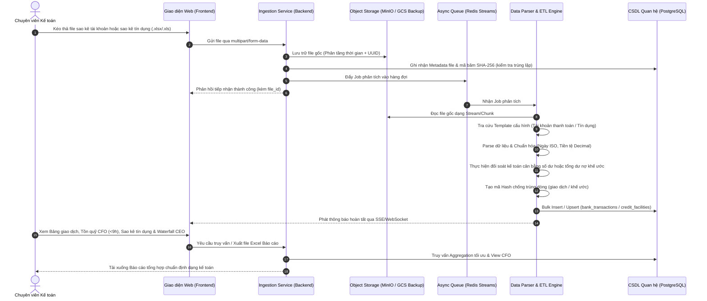
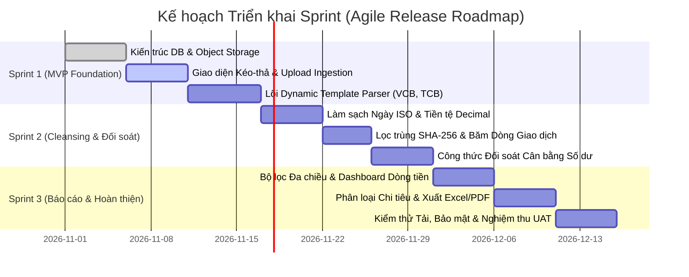

# TÀI LIỆU YÊU CẦU NGHIỆP VỤ (BUSINESS REQUIREMENTS DOCUMENT - BRD)

> **Dự án:** Hệ thống Xử lý & Báo cáo Sao kê Ngân hàng Tự động (Bank Statement Processing & Reporting System)  
> **Phương pháp quản lý:** Agile / Scrum  
> **Mã dự án:** `BSP-2026`  
> **Trạng thái:** Bản chính thức (Approved Baseline)  
> **Chủ trì (Product Owner / Lead BA):** Business Analyst Team (`@BusinessAnalyst`)  
> **Tài liệu tham chiếu liên quan:** [`docs/Bank_Mapping_Matrix.md`](./Bank_Mapping_Matrix.md), [`docs/SAD.md`](./SAD.md), [`agent/PRODUCT_SPEC.md`](../agent/PRODUCT_SPEC.md), [`agent/common_rules.md`](../agent/common_rules.md), [`Software Development Life Cycle (SDLC)`](../Software%20Developmemt%20Life%20Cycle%20SDLC/SDLC.md)

---

## 1. Kiểm soát Phiên bản & Lịch sử Thay đổi (Document Control)

| Phiên bản | Ngày cập nhật | Người thực hiện | Tóm tắt nội dung thay đổi |
| :---: | :---: | :---: | :--- |
| **0.1.0** | 2026-10-25 | `@BusinessAnalyst` | Bản phác thảo yêu cầu nghiệp vụ sơ bộ từ khảo sát khách hàng |
| **1.0.0** | 2026-10-29 | `@BusinessAnalyst` | Chuẩn hóa toàn bộ nội dung từ `PRODUCT_SPEC.md` sang tài liệu BRD theo chuẩn Agile: Bổ sung Tầm nhìn, Epics, User Stories, Gherkin AC, Quy tắc đối soát và Release Roadmap |
| **1.1.0** | 2026-10-29 | `@BusinessAnalyst` | Đồng bộ với `docs/Bank_Mapping_Matrix.md`: Cập nhật 7 mẫu sao kê thực tế (`MBB_CORP`, `MBB_PERSONAL`, `MBV_CORP`, `VPB_CORP`, `TPB_CORP`, `CTG_EFAST`, `SHB_CORP`), 5 chế độ đối soát (`MODE_1`..`MODE_5`), công thức `dedup_hash` 6 thành phần, trạng thái `BALANCED`/`DISCREPANCY`, và cơ chế Mở rộng Đa Doanh nghiệp (Multi-Entity Isolation) |
| **1.2.0** | 2026-10-30 | `@BusinessAnalyst` | Bổ sung `US-04.9`: Cho phép chỉnh sửa trực tiếp Số dư Lũy kế (`running_balance`) tại một dòng giao dịch bất kỳ trên Bảng Giao dịch làm mốc chuẩn (Anchor Balance) để tự động tính toán lan truyền 2 chiều (xuôi & ngược) cho toàn bộ chuỗi giao dịch của tài khoản đó, giải quyết triệt để bài toán Sổ phụ Cá nhân MBBank (`MODE_4_TOTAL_FLOW_ONLY`) không in số dư trên file |
| **1.3.0** | 2026-10-30 | `@BusinessAnalyst` | Nâng cấp toàn diện `US-06.2` (Báo cáo Tồn quỹ & Điều hành Thanh khoản CFO): Hỗ trợ đa kỳ (`TODAY`, `YESTERDAY`, `WTD`, `MTD`, `ALL`, `CUSTOM`) với 5 cột biến động (`opening_balance`, `total_inflow`, `total_outflow`, `closing_balance`, `net_change`), phân cấp 2 Khối nguồn tiền (`CORPORATE`, `SPECIAL_CASH`, loại bỏ quỹ tiền mặt khỏi tổng tồn quỹ), loại trừ luân chuyển nội bộ trên KPI hợp nhất, bộ 3 chỉ số quản trị (Tỷ trọng %, Trạng thái Đối soát, Độ tươi dữ liệu), Biểu đồ phân bổ, Drill-down giao dịch tại chỗ và Xuất Excel Báo cáo Tồn quỹ (`/reports/cfo/export-excel`) |
| **1.4.0** | 2026-10-31 | `@BusinessAnalyst` | Đồng bộ toàn diện theo sản phẩm thực tế: Chuẩn hóa 2 Khối nguồn tiền tồn quỹ CFO, bổ sung đầy đủ EPIC-07 (Quản lý & Đối soát Sao kê Khoản vay Tín dụng `CTG_LOAN_XLS`, `MBB_LOAN_LD_XLSX`), hoàn thiện US-07.1..US-07.3 và tích hợp chỉ số Thanh khoản Ròng (Net Liquidity) trước 9h sáng |
| **1.5.0** | 2026-11-02 | `@BusinessAnalyst` | Đính chính phân loại mẫu sao kê tín dụng `Vay_LD (1).xlsx`: Cập nhật mã mẫu từ `BIDV_LOAN_LD_XLSX` (BIDV) thành `MBB_LOAN_LD_XLSX` (Ngân hàng TMCP Quân Đội - MB) theo phản hồi người dùng. |
| **1.6.0** | 2026-11-02 | `@BusinessAnalyst` | Mở rộng EPIC-07 bổ sung US-07.4: Giao diện Nhập Lẻ Khoản Vay & Quản lý nợ từ các Ngân hàng, Công ty tài chính, Công ty cho thuê tài chính ngoài các file sao kê tự động; hỗ trợ đa dạng loại hình cấp tín dụng và bộ lọc đa chiều. |
| **1.7.0** | 2026-11-02 | `@BusinessAnalyst` | Mở rộng EPIC-07 bổ sung US-07.5 (Hình thức trả lãi MONTHLY/END_OF_TERM & Ngày trả lãi hằng tháng), US-07.6 (Tính toán số lãi cần trả theo quy định hiện hành Thông tư 14/2017/TT-NHNN Actual/365), và US-07.7 (Liên kết Bộ hồ sơ giải ngân khoản vay lưu trữ tại Object Storage). |
| **1.8.0** | 2026-11-02 | `@BusinessAnalyst` | Bổ sung `US-07.8` (Phân hệ Kế hoạch Trả nợ & Làm phẳng Dòng tiền Tín dụng - Debt Smoothing Engine): Tự động phân bổ nợ đến hạn hàng tháng, hỗ trợ chế độ Cố định đều & Tùy chỉnh theo mùa vụ kinh doanh, chiến lược chia nhỏ khoản nợ lớn, đảo nợ với thời hạn tối đa (MB 6T, CTG 4T), phí phạt trả trước mặc định 0%, bảo đảm dư nợ mọi tháng luôn nằm an toàn dưới trần khả năng chi trả. |
| **1.9.0** | 2026-11-02 | `@BusinessAnalyst` | Bổ sung `US-07.9` (Phân hệ Đối soát Giao dịch Trả nợ & Tự động Giảm trừ Dư nợ Gốc/Lãi - Debt Repayment Reconciliation Engine): Tự động lọc các khoản chi từ sao kê ngân hàng đã phân loại Trả nợ, đối chiếu với khoản vay qua số khế ước, khung chia gốc - lãi thông minh (nút chọn 100% gốc), tự động giảm trừ nợ gốc tương ứng, và lưu nhật ký lịch sử trả nợ theo đúng thời điểm giao dịch thực tế. |
| **1.10.0** | 2026-11-02 | `@BusinessAnalyst` | Tối ưu hóa toàn diện `US-07.8` theo Thuật toán SRPR v2.0 (Stepped Rollover & Prepay-to-Reroute Engine): Cam kết sau khi cắt nợ (trả trước hạn/trả đúng hạn) đều được giải ngân vay lại đúng bằng số tiền gốc đã cắt; cơ chế Bắc cầu kỳ hạn CTG (1T, 2T, 3T, 4T) né trần 4 tháng và Cắt nợ MBB trong ngày ở các tháng trũng (T12, T01, T02), triệt tiêu đỉnh nợ T03/2027 từ 73.76 tỷ về đúng 14.00 tỷ VND. |
| **1.11.0** | 2026-11-02 | `@BusinessAnalyst` | Bổ sung `US-07.10` (Bóc tách Hóa đơn Điện tử XML & Đối soát Hóa đơn Giải ngân) và `US-07.11` (Chuẩn hóa 3 Cột Dư Nợ Gốc Ban Đầu, Đã Trả Gốc, Dư Nợ Gốc Hiện Tại và Ghi nhớ Tự động Danh mục Tổ chức / Loại Hồ sơ Mới). |
| **1.12.0** | 2026-11-03 | `@BusinessAnalyst` | Tái cấu trúc Quy tắc Parse Sao kê Tín dụng & Động cơ Đối soát Trả nợ Ngân hàng (US-07.9 & US-07.11): Xác lập cột Dư nợ trên file là Dư nợ tại thời điểm xuất file (Snapshot Balance at `statement_date`), file không có dư nợ ban đầu; phân định giao dịch Pre-Snapshot (hoàn nguyên gốc ban đầu, chống trừ 2 lần) và Post-Snapshot (giảm trừ hiện tại). |
| **1.13.0** | 2026-11-04 | `@BusinessAnalyst` | Bổ sung `US-07.12`: Màn hình Chi tiết Khế ước & Bộ Lọc Đa Chiều Từng Cột (Per-Column Filters) phục vụ tra cứu chuyên sâu danh mục nợ, bóc tách dòng tiền hoàn nguyên nợ gốc/lãi, hỗ trợ 1-chạm sao chép số khế ước và lọc theo ngân hàng, trạng thái tất toán, số tiền, lãi suất, ngày giải ngân/đáo hạn. |

---

## 2. Bối cảnh Kinh doanh & Tầm nhìn Dự án (Business Context & Vision)

### 2.1. Vấn đề Thực tế & Nỗi đau Doanh nghiệp (Problem Statement & Pain Points)
Hiện nay, các bộ phận Tài chính - Kế toán tại các doanh nghiệp và tổ chức phải đối mặt với áp lực lớn trong việc thu thập và đối soát sao kê tài khoản ngân hàng:
- **Nhập liệu thủ công (Manual Data Entry):** Mỗi tháng kế toán phải tải và rà soát thủ công hàng chục file sao kê Excel/CSV từ nhiều ngân hàng khác nhau (Vietcombank, Techcombank, ACB, BIDV, MBBank,...), dẫn đến hao tốn hàng trăm giờ làm việc.
- **Cấu trúc phân tán, không đồng nhất:** Mỗi ngân hàng phát hành một định dạng sao kê riêng biệt (tọa độ cột khác nhau, định dạng ngày tháng đa dạng, quy ước số âm trong ngoặc đơn, header/footer phức tạp).
- **Rủi ro sai lệch số dư & sót giao dịch:** Việc tính toán thủ công rất dễ xảy ra sai sót, đặc biệt khi có hàng ngàn giao dịch phát sinh mỗi ngày, gây khó khăn trong việc phát hiện gian lận hoặc thất thoát tài chính.
- **Trùng lặp dữ liệu (Duplicate Ingestion):** Chưa có cơ chế nhận diện giao dịch trùng lặp khi người dùng upload nhiều lần file sao kê chứa các khoảng thời gian giao thoa.
- **Thiếu báo cáo quản trị tức thời:** Ban lãnh đạo không thể theo dõi biến động dòng tiền ròng (Net Cash Flow) theo thời gian thực để ra quyết định kinh doanh.

### 2.2. Tầm nhìn Sản phẩm (Product Vision)
Xây dựng một nền tảng Web tự động hóa toàn diện quy trình tiếp nhận file sao kê ngân hàng thô, bóc tách dữ liệu theo mẫu ngân hàng linh hoạt, làm sạch và chuẩn hóa tự động, đối soát kế toán cân bằng số dư với độ chính xác tuyệt đối 100%, đồng thời cung cấp hệ thống báo cáo dòng tiền trực quan, đa chiều giúp kế toán và nhà quản lý nắm bắt sức khỏe tài chính trong nháy mắt.

### 2.3. Mục tiêu Kinh doanh & Đo lường Thành công (Business Goals & Success Metrics)

| Mã | Mục tiêu Kinh doanh (Business Goal) | Chỉ số Đo lường (KPI / Success Metric) |
| :---: | :--- | :--- |
| **BG-01** | Tiết giảm thời gian xử lý sao kê của bộ phận kế toán | Giảm $\ge 90\%$ thời gian xử lý và đối soát sổ sách thủ công |
| **BG-02** | Đảm bảo tính toàn vẹn và chính xác số học tài chính | Độ chính xác đối soát số dư đạt **100%**; không chấp nhận sai số làm tròn |
| **BG-03** | Hiệu năng xử lý file lớn | Xử lý file sao kê từ 10.000 đến 50.000 dòng trong thời gian $\le 30$ giây |
| **BG-04** | Ngăn chặn gian lận và trùng lặp | Nhận diện và cảnh báo **100%** file và dòng giao dịch trùng lặp |
| **BG-05** | Khả năng mở rộng mẫu ngân hàng mới | Cấu hình thêm mẫu sao kê ngân hàng mới chỉ qua file cấu hình JSON/YAML trong $\le 15$ phút, không cần viết lại mã nguồn |

---

## 3. Phân tích Các bên Liên quan & Chân dung Người dùng (Stakeholders & User Personas)

### 3.1. Ma trận Các bên Liên quan (Stakeholder Matrix)

| Vai trò | Đại diện Thực tế | Kỳ vọng & Trách nhiệm chính trong dự án | Mức độ ảnh hưởng |
| :--- | :--- | :--- | :---: |
| **Tổng Giám đốc (CEO)** | **Bà Nguyễn Thị Lan Anh** | - Nhận báo cáo phân tích tỷ trọng, cơ cấu khoản thu và khoản chi hàng ngày.<br>- Cung cấp dữ liệu sao kê tài khoản cá nhân MBBank (dùng cho luồng rút/nhập quỹ tiền mặt công ty). | Quyết định cao nhất |
| **Giám đốc Tài chính (CFO)** | **Ông Trần Ngọc Tuấn** | - Theo dõi tức thời tổng số tiền tồn quỹ hôm nay (Khối 1: TK Doanh nghiệp + Khối 2: TK Ủy quyền CEO, không tính quỹ tiền mặt).<br>- Giám sát an toàn thanh khoản, nghĩa vụ nợ tín dụng đến hạn và thanh khoản ròng. | Rất cao |
| **Chuyên viên Tài chính (Primary End-User)** | **Chị Nghiêm Lê Cẩm Nhung** | - Người trực tiếp tải file sao kê từ $\ge 7$ ngân hàng mỗi ngày và các file sao kê khoản vay tín dụng.<br>- Cần tự động hóa làm sạch, đối chiếu số dư, phân loại thu/chi, theo dõi luồng tiền rút từ TK cá nhân MBBank, đối soát nợ vay và tự động sinh biểu đồ báo cáo cho 2 sếp. | Trọng tâm phục vụ |
| **Development & Architecture Team** | Multi-Agent System | - Xây dựng hệ thống tự động bóc tách $\ge 7$ mẫu sao kê tài khoản và các mẫu sao kê tín dụng (VietinBank, MB), xử lý bóc tách tài khoản cá nhân MBBank, tự động tính tồn quỹ 2 khối ngân hàng, giám sát nghĩa vụ nợ và xuất dashboard. | Thực thi kỹ thuật |

### 3.2. Chân dung Người dùng Thực tế (User Personas)

#### Persona 1: Chị Nghiêm Lê Cẩm Nhung - Chuyên viên Tài chính (Primary End-User)
- **Họ tên & Vai trò:** Nghiêm Lê Cẩm Nhung – Chuyên viên Tài chính.
- **Khối lượng công việc:** Hàng ngày phải truy cập hơn 7 ngân hàng thương mại để tải file sao kê; theo dõi thêm biến động số dư tài khoản cá nhân tại MBBank của Tổng Giám đốc Nguyễn Thị Lan Anh (dùng để rút tiền mặt về quỹ).
- **Mục tiêu:**
  - Tự động hóa khâu gom file, làm sạch và chuẩn hóa dữ liệu từ $\ge 7$ ngân hàng thành bảng dữ liệu tập trung.
  - Tự động đối chiếu số dư từng tài khoản, tự động bóc tách và đối soát sao kê khoản vay tín dụng (VietinBank, MB).
  - Tự động tính tổng tồn quỹ hợp nhất theo 2 khối tài khoản ngân hàng (Doanh nghiệp & Ủy quyền CEO, không tính tiền mặt).
  - Tự động phân loại dòng tiền theo mục đích thu/chi.
  - Tự động vẽ biểu đồ trực quan hóa để gửi báo cáo đúng giờ cho CFO Trần Ngọc Tuấn và CEO Nguyễn Thị Lan Anh.
- **Nỗi đau (Pain Points):**
  - Mất hàng giờ copy/paste, chỉnh sửa định dạng thủ công giữa các mẫu ngân hàng khác nhau và các báo cáo khoản vay tín dụng.
  - Dễ sót hoặc nhầm lẫn khi đối soát số dư giữa tài khoản công ty, tài khoản cá nhân MBBank rút tiền mặt và các khế ước vay.
  - Mất thêm thời gian vẽ biểu đồ thủ công trên Excel trước khi gửi báo cáo cho cấp quản lý.

#### Persona 2: Ông Trần Ngọc Tuấn - Giám đốc Tài chính (CFO)
- **Thời hạn báo cáo (SLA / Deadline):** Báo cáo sẵn sàng **trước 9h00 sáng mỗi ngày**.
- **Chỉ số quan tâm số 1:** 
  1. Tổng số tiền tồn quỹ khả dụng hôm nay = **Khối 1 (Tài khoản Doanh nghiệp) + Khối 2 (Tài khoản Ủy quyền CEO)** (loại bỏ phần quỹ tiền mặt khỏi tổng tồn quỹ).
  2. Thanh khoản Ròng (Net Liquidity) = **Tổng tồn quỹ khả dụng - Nghĩa vụ nợ gốc & lãi vay đến hạn kỳ tới**.
- **Mức độ chi tiết yêu cầu:** Cần nhìn thấy **cả con số tổng tồn quỹ hợp nhất, bảng chi tiết số dư từng tài khoản** trong toàn bộ $\ge 7$ ngân hàng, và **tổng quan nghĩa vụ nợ tín dụng theo từng ngân hàng**.

#### Persona 3: Bà Nguyễn Thị Lan Anh - Tổng Giám đốc (CEO)
- **Đặc thù tài khoản cá nhân MBBank:** Toàn bộ $100\%$ giao dịch phát sinh trên tài khoản cá nhân MBBank đều là chi phí phục vụ hoạt động của công ty (không có chi tiêu cá nhân), dùng làm kênh rút tiền mặt/tạm ứng công ty.
- **Định dạng báo cáo mong muốn:** **Biểu đồ Thác nước (Waterfall Chart)** phân rã chi tiết (breakdown) từng cấu phần tạo nên dòng tiền: Số dư đầu kỳ $\rightarrow$ Các cấu phần Khoản thu $\rightarrow$ Các cấu phần Khoản chi $\rightarrow$ Số dư cuối kỳ.
- **Khung thời gian phân tích:** Báo cáo xem theo **lũy kế tuần (WTD - Week to Date)** và **lũy kế tháng (MTD - Month to Date)**.

---

## 4. Phạm vi Dự án (Project Scope - MoSCoW Framework)

```
┌─────────────────────────────────────────────────────────────────────────────────┐
│                           PHẠM VI DỰ ÁN (PROJECT SCOPE)                         │
├───────────────────────────────────────┬─────────────────────────────────────────┤
│ [MUST HAVE - Bắt buộc hoàn thành]     │ [SHOULD HAVE - Khuyến nghị thực hiện]   │
│ - Upload kéo thả (.xlsx, .xls, .csv)  │ - Tự động nhận diện ngân hàng bằng AI   │
│ - Lưu MinIO nội bộ + GCS backup       │ - Cảnh báo giao dịch bất thường        │
│ - Parser đọc động theo mẫu ngân hàng   │ - Xuất báo cáo PDF đồ họa chuyên nghiệp │
│ - Bóc tách sao kê tín dụng & khoản vay│ - Tích hợp webhook thông báo qua Slack  │
│ - Làm sạch ngày (ISO), tiền (Decimal) ├─────────────────────────────────────────┤
│ - Đối soát số dư: ĐK + Thu - Chi = CK │ [COULD / WON'T HAVE - Tương lai / Ngoài]│
│ - Đối soát tổng dư nợ khế ước vay LD  │ - Kết nối trực tiếp Open Banking API    │
│ - Băm SHA-256 chống trùng file & dòng │ - Tự động ký số báo cáo thuế điện tử    │
│ - Báo cáo tồn quỹ CFO (2 khối NH)     │                                         │
│ - Giám sát nghĩa vụ nợ & Net Liquidity│                                         │
│ - Waterfall CEO, Rule UI, xuất Excel  │                                         │
│ - Lưu trữ DB với Decimal(18,2)        │                                         │
└───────────────────────────────────────┴─────────────────────────────────────────┘
```

---

## 5. Luồng Nghiệp vụ Đầu-Cuối (End-to-End Business Workflow)

Quy trình nghiệp vụ thực tế diễn ra qua các giai đoạn được chuẩn hóa:



---

## 6. Cấu trúc Epics & Yêu cầu Chi tiết (Agile Epic & User Story Breakdown)

Hệ thống được tổ chức thành **7 Epics nghiệp vụ cốt lõi**:

### EPIC-01: Tiếp nhận & Tải File Sao kê (Web Ingestion & File Upload)
* **Mục tiêu:** Cung cấp trải nghiệm tải file đơn giản, an toàn và tức thời cho kế toán.

#### US-01.1: Kéo thả và Chọn Định dạng File
* **User Story:** Là một *Chuyên viên Kế toán*, tôi muốn *kéo thả hoặc duyệt chọn file sao kê từ máy tính với định dạng `.xlsx`, `.xls` hoặc `.csv`*, để *tôi có thể nạp dữ liệu vào hệ thống mà không cần chuyển đổi định dạng thủ công*.
* **Độ ưu tiên:** Must Have (`P0`)
* **Tiêu chí chấp nhận (Acceptance Criteria - Gherkin):**
  ```gherkin
  Scenario: Upload file đúng định dạng thành công
    Given Người dùng đã truy cập màn hình Upload Sao Kê
    When Người dùng kéo thả một file có đuôi hợp lệ (.xlsx, .xls, .csv) với dung lượng <= 25MB
    Then Hệ thống hiển thị tên file, dung lượng và cho phép bấm nút "Tiến hành xử lý"

  Scenario: Từ chối file sai định dạng hoặc vượt quá dung lượng
    Given Người dùng ở màn hình Upload
    When Người dùng cố ý tải file có định dạng không được hỗ trợ (.pdf, .exe, .zip) hoặc dung lượng > 25MB
    Then Hệ thống chặn tải lên và hiển thị thông báo lỗi rõ ràng cho người dùng
  ```

#### US-01.2: Lựa chọn hoặc Tự động Nhận diện Ngân hàng Phát hành
* **User Story:** Là một *Chuyên viên Kế toán*, tôi muốn *lựa chọn ngân hàng phát hành (Vietcombank, Techcombank, ACB, BIDV, MBBank...) từ danh sách thả xuống hoặc để hệ thống tự nhận diện*, để *hệ thống áp dụng đúng mẫu bóc tách của ngân hàng đó*.
* **Độ ưu tiên:** Must Have (`P0`)
* **Tiêu chí chấp nhận (AC):**
  ```gherkin
  Scenario: Chọn ngân hàng thủ công từ danh sách
    Given Người dùng đã chọn file sao kê
    When Người dùng chọn ngân hàng "Vietcombank" từ dropdown
    Then Hệ thống gắn mã ngân hàng VCB vào yêu cầu upload

  Scenario: Tự nhận diện ngân hàng qua thông tin tiêu đề
    Given Người dùng để chế độ "Tự động nhận diện"
    When Hệ thống quét dòng tiêu đề thấy từ khóa "Ngân hàng TMCP Ngoại thương Việt Nam"
    Then Hệ thống tự động gán mẫu Vietcombank và hiển thị huy hiệu xác nhận cho người dùng
  ```

#### US-01.3: Theo dõi Trạng thái Xử lý Thời gian thực (Real-time Progress)
* **User Story:** Là một *Chuyên viên Kế toán*, tôi muốn *nhìn thấy tiến trình xử lý từng bước (Đang tải lên $\rightarrow$ Đang đọc dữ liệu $\rightarrow$ Đang đối soát $\rightarrow$ Hoàn tất)*, để *tôi nắm được trạng thái công việc và biết khi nào dữ liệu sẵn sàng*.
* **Độ ưu tiên:** Should Have (`P1`)
* **Tiêu chí chấp nhận (AC):**
  ```gherkin
  Scenario: Cập nhật thanh tiến trình theo thời gian thực
    Given File đang được xử lý ở worker ngầm
    When Worker hoàn thành bước "Parsing" và chuyển sang "Reconciliation"
    Then Màn hình của người dùng tự động nhảy trạng thái mà không cần tải lại trang
  ```

---

### EPIC-02: Lưu trữ File Gốc & Quản lý Siêu dữ liệu (Raw File Archival & Metadata)
* **Mục tiêu:** Bảo toàn bằng chứng gốc của sao kê phục vụ thanh kiểm tra, đối soát và pháp lý.

#### US-02.1: Lưu trữ Bản sao File Gốc Bất biến (Immutable Archiving)
* **User Story:** Là một *Kiểm toán viên / Kế toán trưởng*, tôi muốn *toàn bộ file gốc tải lên được lưu nguyên bản trên kho lưu trữ riêng biệt (Object Storage)*, để *luôn có file gốc làm bằng chứng đối chiếu khi có tranh chấp*.
* **Độ ưu tiên:** Must Have (`P0`)
* **Tiêu chí chấp nhận (AC):**
  - File gốc lưu trữ theo đường dẫn phân tầng thời gian: `/bank_statements/{YYYY}/{MM}/{UUID}_{original_name}`.
  - Tuyệt đối không lưu file nhị phân vào bảng dữ liệu SQL; chỉ lưu đường dẫn URI và metadata.

#### US-02.2: Chống Trùng lặp File qua Mã Băm SHA-256
* **User Story:** Là một *Kế toán viên*, tôi muốn *hệ thống cảnh báo ngay nếu tôi vô tình upload cùng một file sao kê đã tồn tại*, để *tránh việc xử lý thừa thãi hoặc ghi nhận dữ liệu trùng*.
* **Độ ưu tiên:** Must Have (`P0`)
* **Tiêu chí chấp nhận (AC):**
  ```gherkin
  Scenario: Phát hiện file trùng lặp hoàn toàn
    Given File sao kê A đã được nạp thành công vào hệ thống với mã băm SHA-256 "abc123xyz"
    When Một người dùng khác tải lên file có nội dung y hệt sinh ra cùng mã SHA-256 "abc123xyz"
    Then Hệ thống từ chối xử lý, thông báo: "File sao kê này đã được tải lên trước đó vào ngày DD/MM/YYYY"
  ```

---

### EPIC-03: Động cơ Đọc theo Cấu hình Mẫu Ngân hàng (Dynamic Bank Template Parser)
* **Mục tiêu:** Linh hoạt bóc tách dữ liệu theo nhiều mẫu ngân hàng khác nhau mà không phải sửa mã nguồn hệ thống.

#### US-03.1: Bóc tách Siêu dữ liệu Header & Footer của File & Định danh Đa Pháp nhân (Multi-Entity)
* **User Story:** Là một *Chuyên viên Kế toán*, tôi muốn *hệ thống tự động trích xuất động các thông tin định danh Pháp nhân (Tên Doanh nghiệp/Chủ TK, Số TK, Mã số thuế/CIF, Kỳ sao kê, Số dư đầu kỳ, Số dư cuối kỳ)*, để *tự động điền vào hồ sơ sao kê và cho phép dùng chung một mẫu sao kê để quét dữ liệu tách biệt cho nhiều doanh nghiệp khác nhau*.
* **Độ ưu tiên:** Must Have (`P0`)
* **Tiêu chí chấp nhận (AC):**
  - Trích xuất động (`Entity-Agnostic`) bộ định danh `(account_number, account_holder, tax_code)` từ Header để định tuyến và cô lập dữ liệu theo từng Doanh nghiệp/Pháp nhân.
  - Trích xuất hoặc nội suy chính xác Số dư đầu kỳ ($S_{start}$) và Số dư cuối kỳ ($S_{end}$) theo 5 chế độ (`MODE_1` $\rightarrow$ `MODE_5`) quy định tại [`docs/Bank_Mapping_Matrix.md`](./Bank_Mapping_Matrix.md).
  - Ghi nhận thông tin kỳ sao kê (`statement_period_start`, `statement_period_end`).

#### US-03.2: Bóc tách Bảng Dòng Giao dịch theo Mẫu Động (Config-driven Universal Parser)
* **User Story:** Là một *Lập trình viên / Quản trị viên*, tôi muốn *định nghĩa tọa độ cột, từ khóa tiêu đề đồng nghĩa (`canonical_header_aliases`) và dòng bắt đầu bằng file cấu hình `bank_templates_config.yaml`*, để *xử lý chính xác 7 mẫu sao kê thực tế hiện có (`MBB_CORP`, `MBB_PERSONAL`, `MBV_CORP`, `VPB_CORP`, `TPB_CORP`, `CTG_EFAST`, `SHB_CORP`) và bổ sung bất kỳ ngân hàng mới nào trong $\le 15$ phút mà không cần sửa mã nguồn*.
* **Độ ưu tiên:** Must Have (`P0`)
* **Cấu trúc trường dữ liệu bắt buộc phải bóc tách / nội suy:**
  1. Ngày giao dịch (`transaction_date`) & Ngày hạch toán/giá trị (`value_date`).
  2. Số tài khoản (`account_number`) & Chủ tài khoản/Pháp nhân (`account_holder`).
  3. Số phát sinh Nợ (`debit_amount` - Tiền ra / Chi).
  4. Số phát sinh Có (`credit_amount` - Tiền vào / Thu).
  5. Số dư lũy kế sau giao dịch (`running_balance` - bóc tách trực tiếp hoặc nội suy lũy kế đối với mẫu khuyết cột như `SHB_CORP_XLS`, `MBB_PERSONAL_XLSX`).
  6. Số tham chiếu / Mã bút toán giao dịch (`reference_number`).
  7. Nội dung diễn giải chi tiết giao dịch kết hợp thông tin đối ứng (`description`).
  8. Đối tượng thụ hưởng hoặc đối tượng chuyển (`counter_party` - nếu không có trong sao kê thì để trống).

---

### EPIC-04: Làm sạch, Lọc trùng & Đối soát Cân bằng Số dư (Cleansing & Reconciliation)
* **Mục tiêu:** Đảm bảo dữ liệu tài chính sạch 100%, chuẩn hóa và được đối soát cân bằng kế toán chặt chẽ.

#### US-04.1: Chuẩn hóa Định dạng Ngày tháng & Thời gian
* **User Story:** Là một *Chuyên viên Kế toán*, tôi muốn *toàn bộ ngày giao dịch được chuẩn hóa về định dạng ISO 8601*, để *dễ dàng tìm kiếm và đồng bộ giữa các ngân hàng*.
* **Độ ưu tiên:** Must Have (`P0`)
* **Quy tắc chuyển đổi:**
  - `DD/MM/YYYY` $\rightarrow$ `YYYY-MM-DD`
  - `DD-MM-YYYY HH:mm:ss` $\rightarrow$ `YYYY-MM-DDTHH:mm:ss`
  - `YYYY/MM/DD` $\rightarrow$ `YYYY-MM-DD`

#### US-04.2: Chuẩn hóa Dữ liệu Tiền tệ & Kế toán Âm
* **User Story:** Là một *Kế toán viên*, tôi muốn *hệ thống tự động loại bỏ ký hiệu tiền tệ (`VND`, `$`), dấu chấm phẩy phân cách, và đổi số âm ngoặc đơn `(1,000,000)` thành `-1000000`*, để *phép tính số học không bao giờ bị lỗi*.
* **Độ ưu tiên:** Must Have (`P0`)
* **Tiêu chí chấp nhận (AC):**
  - Chuyển đổi chính xác các dạng chuỗi tiền tệ phức tạp:
    - `"1.250.000,50"` $\rightarrow$ `1250000.50`
    - `" (5,000,000) "` $\rightarrow$ `-5000000.00`
    - `"- 250.000 VND"` $\rightarrow$ `-250000.00`
  - Bắt buộc lưu trữ dưới kiểu số chính xác cao (`DECIMAL(18, 2)`).

#### US-04.3: Tự động Đối soát Cân bằng Kế toán Số dư (5-Mode Balance Reconciliation)
* **User Story:** Là một *Kế toán trưởng*, tôi muốn *hệ thống tự động tính toán đối soát giữa số dư đầu kỳ, tổng thu, tổng chi và số dư cuối kỳ theo 5 chế độ đối soát linh hoạt (`MODE_1` $\rightarrow$ `MODE_5`)*, để *phát hiện tức thì nếu file sao kê bị thiếu dòng hoặc bị tẩy xóa kể cả với các ngân hàng không in cột số dư lũy kế hoặc không in số dư đầu/cuối kỳ*.
* **Độ ưu tiên:** Must Have (`P0`)
* **Công thức nghiệp vụ đối soát chuẩn (Chi tiết 5 chế độ tại [`docs/Bank_Mapping_Matrix.md`](./Bank_Mapping_Matrix.md#72-ma-trận-5-chế-độ-đối-soát-cân-bằng-kế-toán-reconciliation_mode)):**
  $$\text{Số dư cuối kỳ tính toán} = \text{Số dư đầu kỳ (hoặc nội suy)} + \sum \text{Phát sinh Có (Thu)} - \sum \text{Phát sinh Nợ (Chi)}$$
  $$\Delta = |\text{Số dư cuối kỳ thực tế} - \text{Số dư cuối kỳ tính toán}|$$
* **Tiêu chí chấp nhận (AC):**
  ```gherkin
  Scenario: Đối soát khớp hoàn toàn (Cân bằng)
    Given File sao kê có Số dư đầu kỳ = 10.000.000, Tổng Thu = 5.000.000, Tổng Chi = 3.000.000
    When Hệ thống tính toán Số dư cuối kỳ = 12.000.000 trùng khớp 100% với Số dư cuối kỳ ghi trên file (delta = 0.00)
    Then Trạng thái đối soát của file (reconciliation_status) là "BALANCED" (Hợp lệ)

  Scenario: Phát hiện chênh lệch đối soát
    Given File sao kê có chênh lệch delta > 0.00
    When Hệ thống hoàn thành tính toán
    Then Trạng thái đối soát của file (reconciliation_status) là "DISCREPANCY", bật cờ cảnh báo màu đỏ, lưu giá trị discrepancy_amount = delta để kế toán rà soát

  Scenario: Phát hiện khoảng trống dữ liệu sao kê (Data Gap / Lệch số dư ĐK - CK)
    Given Tài khoản có số dư cuối kỳ của file sao kê trước khác số dư đầu kỳ của file sao kê sau, hoặc số dư sau giao dịch chốt kỳ trước khác số dư mở đầu kỳ hiện tại
    When Hệ thống tính toán Báo cáo Tồn quỹ Hợp nhất
    Then Hệ thống tự động căn chỉnh Số dư đầu kỳ theo số dư mở sổ của sao kê thực tế để số dư cuối kỳ khớp chính xác 100% với ngân hàng
    And Bật cờ cảnh báo has_data_gap ("Lệch số dư ĐK/CK") kèm mô tả chi tiết số tiền chênh lệch giữa hai mốc kỳ sao kê
  ```

#### US-04.4: Lọc Trùng lặp Giao dịch (Transaction Deduplication - 6-Tuple Hash)
* **User Story:** Là một *Kế toán viên*, tôi muốn *hệ thống tự động loại bỏ hoặc cảnh báo các giao dịch bị trùng lặp giữa các lần upload nhưng không nhận nhầm các bút toán tách Phí/VAT có cùng mã tham chiếu*, để *tránh việc ghi nhận doanh thu/chi phí 2 lần hoặc bỏ sót phí ngân hàng*.
* **Độ ưu tiên:** Must Have (`P0`)
* **Thuật toán băm định danh giao dịch 6 thành phần (Deduplication Hash):**
  $$\text{dedup\_hash} = \text{SHA256}(\text{account\_number} \parallel \text{"|"} \parallel \text{transaction\_date\_iso} \parallel \text{"|"} \parallel \text{debit\_amount} \parallel \text{"|"} \parallel \text{credit\_amount} \parallel \text{"|"} \parallel \text{reference\_number} \parallel \text{"|"} \parallel \text{running\_balance})$$
  - Nếu `dedup_hash` đã tồn tại trong CSDL trên cùng `account_id` $\rightarrow$ Bỏ qua (`ON CONFLICT DO NOTHING`) hoặc gắn cờ `is_duplicate = TRUE`.

#### US-04.5: Đối chiếu Dòng tiền Mặt qua Tài khoản Cá nhân Chủ Doanh nghiệp (Bà Nguyễn Thị Lan Anh - MBBank)
* **User Story:** Là một *Chuyên viên Tài chính (Chị Cẩm Nhung)*, tôi muốn *toàn bộ giao dịch phát sinh trên tài khoản MBBank của bà Nguyễn Thị Lan Anh được tự động ghi nhận 100% là chi phí hoạt động của công ty (kênh chi tiền mặt/tạm ứng)*, để *được cộng dồn vào dòng tiền chi và đối chiếu quỹ tiền mặt công ty mà không cần phân loại loại trừ chi tiêu cá nhân*.
* **Độ ưu tiên:** Must Have (`P0`)
* **Tiêu chí chấp nhận (AC):**
  - Bóc tách toàn bộ giao dịch trên sao kê MBBank của bà Lan Anh; mặc định 100% là giao dịch công ty.
  - Phân tách rõ ràng giữa tiền mặt tại quỹ (Cash on Hand) và số dư các tài khoản thanh toán ngân hàng (Bank Balance).
  - **Công thức tự động tính Quỹ tiền mặt (`cash_ledger`):**
    $$\text{Tồn quỹ tiền mặt} = \sum \text{Rút tiền mặt từ Ngân hàng ("RUT TIEN" / INFLOW)} - \sum \text{Nộp tiền mặt vào Ngân hàng ("NOP TIEN" / OUTFLOW)}$$

#### US-04.6: Giao diện Tự Quản lý & Tạo mới Quy tắc Phân loại Thu/Chi (Self-Service Rule Management UI)
* **User Story:** Là một *Chuyên viên Tài chính (Chị Cẩm Nhung)*, tôi muốn *có một màn hình giao diện trực quan để tự tay tạo danh mục Thu/Chi và tự thiết lập các quy tắc nhận diện linh hoạt (kết hợp cả từ khóa nội dung, tài khoản ngân hàng và ngưỡng số tiền)*, để *hoàn toàn chủ động kiểm soát logic phân loại dữ liệu tài chính theo đúng đặc thù riêng của công ty*.
* **Độ ưu tiên:** Must Have (`P0`)
* **Tiêu chí chấp nhận (AC):**
  - **Quản lý Danh mục (CRUD Categories):** Cho phép người dùng tự thêm mới, sửa tên, xóa các danh mục Thu và danh mục Chi theo ý muốn.
  - **Quy tắc Điều kiện Nâng cao (Advanced Rule Builder):** Hỗ trợ thiết lập điều kiện kết hợp logic (`AND` / `OR`):
    - *Nội dung giao dịch:* Chứa / Không chứa danh sách từ khóa (không phân biệt hoa/thường, không phân biệt có/không dấu).
    - *Tài khoản ngân hàng:* Áp dụng riêng cho 1 hoặc nhiều tài khoản ngân hàng cụ thể.
    - *Ngưỡng số tiền:* Lớn hơn (`>`), Nhỏ hơn (`<`), hoặc Nằm trong khoảng (`Min - Max`).
    - *Loại phát sinh:* Chỉ áp dụng cho chiều Thu (Phát sinh Có) hoặc chiều Chi (Phát sinh Nợ).
  - **Điều khiển & Thứ tự Ưu tiên:** Cho phép bật/tắt (toggle active) từng quy tắc và kéo thả sắp xếp thứ tự ưu tiên áp dụng.
  - **Áp dụng Tức thời & Chạy lại (Re-apply):** Có nút "Áp dụng cho dữ liệu hiện tại" để chạy lại toàn bộ quy tắc mới lên các giao dịch cũ trong quá khứ (không đè lên các dòng đã phân loại thủ công).
  - **Trạng thái Chưa phân loại (Uncategorized):** Giao dịch nào không khớp với bất kỳ quy tắc nào do người dùng tạo sẽ được đưa vào nhóm "Chưa phân loại" để chị Nhung lọc và bổ sung từ khóa mới trên giao diện.

#### US-04.7: Phân loại Thủ công & Cơ chế Khóa Ghi đè (Manual Categorization & Override Protection)
* **User Story:** Là một *Chuyên viên Tài chính (Chị Cẩm Nhung)*, tôi muốn *có thể tự phân loại thủ công trực tiếp trên bảng cho những giao dịch cá biệt/không theo quy luật, và các dòng này phải được hệ thống khóa bảo vệ không bị chạy lại quy tắc tự động ghi đè*, để *tôi xử lý trọn vẹn 100% các bút toán ngoại lệ mà không sợ bị mất công làm lại*.
* **Độ ưu tiên:** Must Have (`P0`)
* **Tiêu chí chấp nhận (AC):**
  - **Gán nhãn trực tiếp (Inline Tagging):** Tại bảng dữ liệu giao dịch, cột "Danh mục" là một dropdown tìm kiếm nhanh. Chị Nhung có thể click vào và chọn danh mục cho từng dòng chỉ bằng 1 thao tác.
  - **Gán nhãn hàng loạt (Bulk Tagging):** Cho phép tích chọn nhiều ô checkbox ở các dòng giao dịch khác nhau và bấm "Gán danh mục hàng loạt".
  - **Cơ chế Khóa ghi đè (`IS_MANUAL_OVERRIDE`):** Khi một giao dịch được người dùng phân loại thủ công, hệ thống đánh dấu cờ bảo vệ. Mỗi khi bấm "Chạy lại quy tắc tự động", hệ thống **tuyệt đối giữ nguyên** danh mục người dùng đã chọn bằng tay, chỉ quét các dòng chưa được gán nhãn hoặc được gán tự động trước đó.

#### US-04.8: Quản lý Ghi chú Nội bộ cho Từng Giao dịch (Internal Transaction Notes / Memos)
* **User Story:** Là một *Chuyên viên Tài chính (Chị Cẩm Nhung)*, tôi muốn *nhập ghi chú nội bộ (Note) trực tiếp vào từng dòng giao dịch trên bảng*, để *lưu lại lý do thu/chi, số hóa đơn chứng từ kèm theo hoặc người đề xuất thanh toán phục vụ giải trình sau này*.
* **Độ ưu tiên:** Must Have (`P0`)
* **Tiêu chí chấp nhận (AC):**
  - Cung cấp cột "Ghi chú nội bộ" (`internal_note`) trên bảng giao dịch, hỗ trợ click sửa trực tiếp (Inline Edit) và tự động lưu.
  - Cho phép tìm kiếm/lọc giao dịch theo từ khóa trong cột Ghi chú nội bộ.
  - Ghi chú này được lưu vĩnh viễn trong CSDL cùng giao dịch và tự động kết xuất ra báo cáo Excel khi xuất file.

#### US-04.9: Hiệu chỉnh Điểm neo Số dư Lũy kế & Lan truyền Tự động 2 Chiều (Anchor Running Balance Recalculation)
* **User Story:** Là một *Chuyên viên Tài chính (Chị Cẩm Nhung)*, tôi muốn *bấm sửa trực tiếp Số dư Lũy kế (`running_balance`) tại bất kỳ một dòng giao dịch nào trên Bảng Giao dịch và lấy con số đó làm mốc chuẩn (Anchor)*, để *hệ thống tự động tính toán lại toàn bộ số dư lũy kế của các giao dịch trước và sau thuộc cùng tài khoản đó (đặc biệt với các mẫu sổ phụ cá nhân như `MBB_PERSONAL_XLSX` không in cột số dư cũng như không có số dư đầu/cuối kỳ trên file Excel)*.
* **Độ ưu tiên:** Must Have (`P0`)
* **Công thức lan truyền 2 chiều từ giao dịch điểm neo $k$ có số dư chuẩn $B_k$:**
  - **Chiều xuôi về tương lai ($i = k+1 \dots n$):**
    $$B_i = B_{i-1} + \text{credit\_amount}_i - \text{debit\_amount}_i$$
  - **Chiều ngược về quá khứ ($i = k-1 \dots 1$):**
    $$B_i = B_{i+1} - \text{credit\_amount}_{i+1} + \text{debit\_amount}_{i+1}$$
  - **Đồng bộ Tài khoản & Sao kê:**
    $$\text{opening\_balance} = B_1 - \text{credit\_amount}_1 + \text{debit\_amount}_1, \quad \text{current\_balance} = B_n$$
* **Tiêu chí chấp nhận (AC - Gherkin):**
  ```gherkin
  Scenario: [REQ-CLEAN-005] Hiệu chỉnh điểm neo Số dư Lũy kế tại 1 dòng và tự động tính lại toàn chuỗi giao dịch của tài khoản
    Given Tài khoản MBBank Cá nhân "0869596789" có 207 dòng giao dịch được nạp từ mẫu "MBB_PERSONAL_XLSX" (không có số dư trên file)
    When Người dùng bấm vào ô "Số dư Lũy kế" của một dòng giao dịch k trên Bảng Giao dịch và nhập số dư thực tế B_k
    Then Hệ thống cập nhật running_balance của dòng k bằng B_k (kiểu DECIMAL(18,2))
    And Tự động tính lại running_balance cho toàn bộ các giao dịch sau dòng k (cộng Có trừ Nợ) và trước dòng k (trừ Có cộng Nợ) của cùng account_id
    And Tự động đồng bộ opening_balance, current_balance của tài khoản trên bảng bank_accounts và bank_statement_files với discrepancy_amount = 0.00 VND
    And Ghi nhận nhật ký kiểm toán "ANCHOR_RUNNING_BALANCE_UPDATED" vào bảng audit_logs
  ```

---

### EPIC-05: Lưu trữ Dữ liệu Bền vững & Chuẩn xác (High-Precision Data Persistence)
* **Mục tiêu:** Đảm bảo toàn bộ giao dịch được nạp vào Cơ sở dữ liệu với độ chính xác số học tối đa và lưu vết kiểm toán đầy đủ.

#### US-05.1: Lưu trữ Độ Chính xác Tiền tệ Cao (`DECIMAL(18, 2)`)
* **User Story:** Là một *Hệ thống Kế toán*, tôi cần *lưu trữ số tiền với kiểu `DECIMAL(18, 2)` / `NUMERIC(18, 2)`*, để *không xảy ra lỗi trôi số làm tròn đặc thù của kiểu dấu phẩy động nhị phân (`FLOAT`, `DOUBLE`)*.
* **Độ ưu tiên:** Must Have (`P0`)

#### US-05.2: Truy vết Nguồn gốc & Lịch sử Xử lý (Audit Trail)
* **User Story:** Là một *Kiểm toán viên*, tôi muốn *từng dòng giao dịch phải gắn liền với mã định danh file gốc (`file_id`) cùng lịch sử thao tác của người nạp*, để *dễ dàng truy xuất ngược về văn bản gốc khi cơ quan kiểm toán yêu cầu*.
* **Độ ưu tiên:** Must Have (`P0`)

---

### EPIC-06: Báo cáo Dòng tiền, Lọc Đa chiều & Xuất Dữ liệu (Reporting, Analytics & Export)
* **Mục tiêu:** Cung cấp bức tranh tài chính toàn diện, tìm kiếm giao dịch đa chiều và xuất file phục vụ nộp báo cáo.

#### US-06.1: Bộ Lọc Giao dịch Đa tiêu chí
* **User Story:** Là một *Chuyên viên Kế toán*, tôi muốn *lọc giao dịch theo nhiều tiêu chí đồng thời (Khoảng thời gian, Số tài khoản ngân hàng, Loại thu/chi, Khoảng tiền từ - đến, Từ khóa nội dung diễn giải)*, để *nhanh chóng tra cứu bút toán cụ thể khi đối chiếu công nợ khách hàng*.
* **Độ ưu tiên:** Must Have (`P0`)

#### US-06.2: Báo cáo Tồn Quỹ Hợp Nhất & Điều Hành Thanh Khoản Gửi CFO (Ông Trần Ngọc Tuấn - Trước 9h00 Sáng)
* **User Story:** Là *Giám đốc Tài chính (Ông Trần Ngọc Tuấn)*, tôi muốn *trước 9h00 sáng mỗi ngày truy cập Báo cáo Tồn quỹ đa kỳ (`TODAY`, `YESTERDAY`, `WTD`, `MTD`, `ALL`, `CUSTOM`) hiển thị đầy đủ 5 cột biến động (Số dư Đầu kỳ $\rightarrow$ Tổng Thu $\rightarrow$ Tổng Chi $\rightarrow$ Số dư Cuối kỳ $\rightarrow$ Chênh lệch ròng $\pm$ %) được phân cấp rõ theo 2 Khối tài khoản ngân hàng (Khối 1: TK Doanh nghiệp, Khối 2: TK Ủy quyền CEO; không tính phần quỹ tiền mặt vào báo cáo tồn quỹ), có khả năng loại trừ luân chuyển nội bộ trên KPI Thu/Chi hợp nhất, kiểm tra trạng thái đối soát/độ tươi từng tài khoản, bấm Drill-down xem ngay giao dịch phát sinh và xuất file Excel Báo cáo Tồn quỹ chuẩn kế toán*, để *nắm bắt tức thì cấu trúc thanh khoản ngân hàng và duyệt lệnh chi chính xác 100%*.
* **Độ ưu tiên:** Must Have (`P0`)
* **Tiêu chí chấp nhận (AC):**
  - Dữ liệu luôn sẵn sàng trước 9h00 sáng sau khi chị Nhung nạp file; bảo toàn tuyệt đối $\text{Số dư Đầu kỳ} + \text{Tổng Thu} - \text{Tổng Chi} = \text{Số dư Cuối kỳ}$ ($\Delta = 0.00\text{ VND}$) trên từng tài khoản, từng khối và dòng Tổng cộng Hợp nhất.
  - Báo cáo **bỏ phần tiền mặt tại quỹ, không cộng tiền mặt vào tổng tồn quỹ**; phân nhóm bảng tồn quỹ thành **2 Khối tài khoản ngân hàng** có dòng Tiểu tổng (Subtotal) từng khối và Tổng cộng Hợp nhất (Khối 1 + Khối 2):
    1. **Khối 1:** Tài khoản Thanh toán Doanh nghiệp (`CORPORATE`) — hỗ trợ lọc nhanh theo Ngân hàng (`bank_code`) và Pháp nhân/Chủ TK (`account_holder`).
    2. **Khối 2:** Tài khoản Ủy quyền CEO (`SPECIAL_CASH` - MBBank cá nhân Bà Nguyễn Thị Lan Anh).
  - Ở từng dòng tài khoản hiển thị đúng Thu/Chi thực tế theo sao kê; trên KPI & dòng Tổng hợp nhất có nút bật/tắt **"Loại trừ luân chuyển nội bộ"** để tách bạch dòng tiền Thu/Chi thực với bên ngoài.
  - Hiển thị đầy đủ bộ 3 chỉ số quản trị trên từng tài khoản: (1) Tỷ trọng `%` trên tổng tồn quỹ kèm thanh tiến trình, (2) Trạng thái đối soát (`BALANCED`, `DISCREPANCY`, `UNANCHORED`), (3) Ngày giao dịch mới nhất và số lượng giao dịch trong kỳ.
  - Hỗ trợ biểu đồ trực quan (Cơ cấu phân bổ tiền theo ngân hàng & So sánh Thu - Chi theo tài khoản), bấm vào bất kỳ dòng tài khoản nào sẽ mở rộng (Inline Drill-down) danh sách giao dịch trong kỳ kèm nút nhảy sang trang Sổ Giao Dịch đã lọc sẵn tài khoản, và nút **Xuất Excel Báo cáo Tồn quỹ CFO** (`/api/v1/reports/cfo/export-excel`).

#### US-06.3: Báo cáo Biểu đồ Thác nước (Waterfall Chart) Thu - Chi Gửi CEO (Bà Nguyễn Thị Lan Anh)
* **User Story:** Là *Tổng Giám đốc (Bà Nguyễn Thị Lan Anh)*, tôi muốn *xem biểu đồ Thác nước (Waterfall Chart) phân rã chi tiết từng cấu phần Thu và Chi theo lũy kế Tuần (WTD) và lũy kế Tháng (MTD)*, để *thấy rõ dòng tiền biến động từ số dư đầu kỳ qua các khoản thu/chi chính đến số dư cuối kỳ*.
* **Độ ưu tiên:** Must Have (`P0`)
* **Tiêu chí chấp nhận (AC):**
  - Render biểu đồ Waterfall: Cột xuất phát (Số dư đầu kỳ) $\rightarrow$ Các thanh nổi màu xanh (Các khoản thu: Bán hàng, Thu nợ, Thu khác...) $\rightarrow$ Các thanh chìm màu đỏ (Các khoản chi: Lương, Nhà cung cấp, Thuế, Lãi vay, Chi tiền mặt qua MBBank...) $\rightarrow$ Cột kết thúc (Số dư cuối kỳ).
  - Hỗ trợ chuyển đổi nhanh giữa chế độ xem: **Lũy kế Tuần (WTD)** và **Lũy kế Tháng (MTD)**.

#### US-06.4: Xuất Báo cáo Excel Định dạng Kế toán Chuẩn Mực & PDF
* **User Story:** Là một *Chuyên viên Tài chính (Chị Cẩm Nhung)*, tôi muốn *xuất bảng giao dịch và báo cáo tổng hợp ra file Excel (`.xlsx`) được định dạng sẵn chuẩn mực kế toán*, để *tôi có thể in ấn, lưu trữ hồ sơ kiểm toán hoặc gửi ngay cho các phòng ban mà không phải căn chỉnh lại bằng tay*.
* **Độ ưu tiên:** Must Have (`P0`)
* **Tiêu chí chấp nhận (AC):**
  - **Định dạng Ngày tháng:** Chuẩn `DD/MM/YYYY` (hoặc `DD/MM/YYYY HH:mm:ss`), căn giữa ô.
  - **Định dạng Số tiền:** Chuẩn số kế toán với dấu phân cách hàng nghìn rõ ràng (`#,##0` hoặc `#,##0.00`), căn phải ô, có định dạng số âm rõ ràng (`-1,000,000`).
  - **Dòng Tổng cộng (Total Row):** Cuối bảng có dòng `TỔNG CỘNG` in đậm, sử dụng công thức tự động (`SUBTOTAL` hoặc `SUM`) cho các cột Thu, Chi, Số dư.
  - **Cột Ghi chú Nội bộ:** Đính kèm đầy đủ nội dung cột Ghi chú (`internal_note`) và Danh mục phân loại đã gán.
  - **An toàn Bảo mật:** Sanitize và escape ký tự mở đầu (`=`, `+`, `-`, `@`) đối với dữ liệu văn bản để triệt tiêu lỗ hổng Formula/CSV Injection.

---

## 7. Yêu cầu Phi Chức năng (Non-Functional Requirements - NFRs)

| Mã NFR | Danh mục | Yêu cầu Kỹ thuật Cốt lõi | Chỉ số Định lượng (Metric) |
| :---: | :--- | :--- | :--- |
| **NFR-01** | **Accuracy (Độ chính xác)** | Sai số số học trong mọi phép tính tổng, hiệu, đối soát bằng 0 | Sai số = 0 VND; $100\%$ Decimal |
| **NFR-02** | **Performance (Hiệu năng)** | Đọc file streaming theo từng chunk nhỏ (500–1.000 dòng); không nạp toàn bộ file vào RAM gây tràn bộ nhớ | Bộ nhớ RAM tối đa $\le 512\text{MB}$ khi đọc file 50.000 dòng |
| **NFR-03** | **Security (Bảo mật)** | Chống SQL Injection, XSS và Formula Injection khi xuất Excel | $100\%$ Parameterized Query, Escape ký tự nhạy cảm |
| **NFR-04** | **Availability (Độ sẵn sàng)** | Xử lý file qua Background Worker; người dùng không bị treo trình duyệt khi file nặng | Thời gian phản hồi API Upload $\le 2$ giây |
| **NFR-05** | **Integrity (Toàn vẹn)** | Tính nguyên tử (ACID Transaction): nếu lỗi giữa chừng, tự động rollback toàn bộ dữ liệu của file đó | Không để sót bản ghi mồ côi (Zero Orphan Records) |

---

### EPIC-07: Quản lý & Đối soát Sao kê Khoản vay Tín dụng (Credit Facilities & Loan Disbursements)
* **Mục tiêu:** Cho phép nạp, tự động bóc tách, đối soát tổng dư nợ và theo dõi nghĩa vụ trả nợ gốc/lãi của các khoản vay tín dụng (VietinBank eFAST, MB Vay/LD...).

#### US-07.1: Tiếp nhận & Tự động Nhận diện Mẫu Sao kê Tín dụng
* **User Story:** Là một *Kế toán viên*, tôi muốn *kéo thả file sao kê khoản vay (.xls, .xlsx) lên hệ thống*, để *hệ thống tự động phát hiện mẫu VietinBank hoặc MB mà không cần cấu hình thủ công*.
* **Độ ưu tiên:** Must Have (`P0`)
* **Tiêu chí chấp nhận (AC - Gherkin):**
  ```gherkin
  Scenario: [REQ-CREDIT-001] Nạp file sao kê danh sách khoản vay VietinBank eFAST
    Given File Excel "danh-sach-tai-khoan-tien-vay(31-10-2026 08_54_00).xls" định dạng BIFF8
    When Kế toán nạp file vào màn hình Sao kê Tín dụng
    Then Hệ thống tự động nhận diện mẫu "CTG_LOAN_XLS"
    And Bóc tách đúng 19 khoản vay với tổng dư nợ 30,355,015,000 VND
    And Đánh dấu trạng thái đối soát là "BALANCED" (Khớp 100%)
  ```

#### US-07.2: Quản lý Danh mục Khoản vay & Lịch Nghĩa vụ Nợ đến hạn
* **User Story:** Là một *Giám đốc Tài chính (CFO)*, tôi muốn *xem danh sách tổng hợp các khoản vay/khế ước hiện hành cùng lịch trả nợ gốc và lãi sắp tới (trong 7 ngày, 30 ngày)*, để *chủ động cân đối dòng tiền và thanh khoản ròng trước 9h sáng*.
* **Độ ưu tiên:** Must Have (`P0`)
* **Tiêu chí chấp nhận (AC - Gherkin):**
  ```gherkin
  Scenario: [REQ-CREDIT-002] Xem lịch trả nợ gốc và lãi đến hạn
    Given Hệ thống đã nạp các khoản vay từ VietinBank và MB
    When CFO truy cập bảng điều khiển Sao kê Tín dụng
    Then Hệ thống hiển thị tổng dư nợ gốc hợp nhất
    And Hiển thị danh sách các khoản vay có ngày trả gốc/lãi gần nhất
    And Cho phép lọc theo ngân hàng, nhóm nợ và khoảng thời gian đáo hạn
  ```

#### US-07.3: Tích hợp Nghĩa vụ Nợ Tín dụng vào Báo cáo Thanh khoản Ròng CFO (Net Liquidity)
* **User Story:** Là *Giám đốc Tài chính (Ông Trần Ngọc Tuấn)*, tôi muốn *Dashboard CFO tự động tích hợp số liệu dư nợ vay và nghĩa vụ nợ đến hạn từ phân hệ Sao kê Tín dụng*, để *giám sát chỉ số Thanh khoản Ròng (Net Liquidity = Tổng tồn quỹ hợp nhất - Nghĩa vụ nợ gốc & lãi đến hạn)*.
* **Độ ưu tiên:** Must Have (`P0`)
* **Tiêu chí chấp nhận (AC - Gherkin):**
  ```gherkin
  Scenario: [REQ-CREDIT-003] Giám sát Thanh khoản Ròng trên CFO Dashboard
    Given CFO đã truy cập màn hình Tồn Quỹ CFO (<9h)
    When Hệ thống tải số liệu Tồn quỹ ngân hàng hợp nhất và Tóm tắt Nghĩa vụ Nợ từ API "/loans/summary"
    Then Dashboard hiển thị thẻ KPI Dư nợ gốc hiện tại, Nghĩa vụ nợ đến hạn trong 7 ngày và 30 ngày
    And Hiển thị Chỉ số Thanh khoản Ròng = Tổng tồn quỹ hợp nhất - Nghĩa vụ nợ đến hạn kỳ tới
    And Cho phép bấm liên kết chuyển nhanh sang màn hình "Sao Kê Tín Dụng" để tra cứu chi tiết khế ước
  ```

#### US-07.4: Nhập Lẻ & Quản Lý Khoản Nợ / Vay từ Các Ngân Hàng, Công Ty Tài Chính, Cho Thuê Tài Chính
* **User Story:** Là một *Chuyên viên Tài chính (Chị Cẩm Nhung)*, tôi muốn *nhập thêm các khoản nợ lẻ từ các ngân hàng, công ty tài chính, công ty cho thuê tài chính ngoài các file sao kê tự động*, để *quản lý toàn diện 100% danh mục nghĩa vụ nợ của doanh nghiệp trên cùng một hệ thống*.
* **Độ ưu tiên:** Must Have (`P0`)
* **Tiêu chí chấp nhận (AC - Gherkin):**
  ```gherkin
  Scenario: [REQ-CREDIT-004] Nhập lẻ khoản nợ từ Công ty Tài chính / Cho thuê Tài chính
    Given Người dùng ở màn hình "Theo dõi khoản vay" (Sao Kê Tín Dụng)
    When Người dùng nhấn nút "Nhập Lẻ Khoản Vay"
    And Chọn loại tổ chức ("BANK", "FINANCE_COMPANY", "LEASING_COMPANY", "OTHER")
    And Điền thông tin số hợp đồng, dư nợ gốc, lãi suất và lịch trả nợ kỳ tới (không yêu cầu nhập lãi cộng dồn)
    And Hệ thống tự động tính toán lãi cộng dồn / dự trả theo Thông tư 14/2017/TT-NHNN và hiển thị read-only
    And Nhấn "Lưu Khoản Vay"
    Then Hệ thống lưu khoản nợ vào cơ sở dữ liệu với cờ is_manual=true và accrued_interest tự động tính
    And Khoản nợ lập tức hiển thị trên Bảng Danh mục Khoản vay với huy hiệu phân loại tương ứng
    And Tổng dư nợ và nghĩa vụ trả nợ trên các thẻ KPI và CFO Dashboard tự động cộng dồn số liệu mới
  ```

#### US-07.5: Thiết Lập Hình Thức Trả Lãi & Ngày Trả Lãi Hằng Tháng
* **User Story:** Là một *Chuyên viên Tài chính (Chị Cẩm Nhung)*, tôi muốn *thiết lập hình thức trả lãi (Hằng tháng hoặc Cuối kỳ) và ngày trả lãi hằng tháng (1 - 31) cho từng khoản vay*, để *hệ thống theo dõi chính xác lịch nghĩa vụ nợ lãi của doanh nghiệp*.
* **Độ ưu tiên:** Must Have (`P0`)
* **Tiêu chí chấp nhận (AC - Gherkin):**
  ```gherkin
  Scenario: [REQ-CREDIT-005] Thiết lập hình thức trả lãi hằng tháng hoặc cuối kỳ
    Given Khoản vay tín dụng đang hoạt động trong danh mục theo dõi khoản vay
    When Người dùng mở form chỉnh sửa hoặc thêm khoản vay
    And Chọn Hình thức trả lãi là "MONTHLY" (Hằng tháng) và nhập Ngày trả lãi hằng tháng là 25 (hoặc chọn VietinBank mặc định cố định ngày 5)
    Then Hệ thống lưu trữ interest_payment_method="MONTHLY" và monthly_interest_due_day=25 (hoặc 5 đối với CTG)
    And Bảng danh mục hiển thị huy hiệu "Hằng tháng (ngày 25)" (hoặc "Hằng tháng (ngày 5)")
    When Người dùng đổi sang hình thức "END_OF_TERM" (Cuối kỳ)
    Then Hệ thống cập nhật interest_payment_method="END_OF_TERM"
    And Bảng danh mục hiển thị huy hiệu "Cuối kỳ"
  ```

#### US-07.6: Tính Toán Số Lãi Cần Trả Theo Quy Định Hiện Hành Của Pháp Luật (Thông Tư 14/2017/TT-NHNN)
* **User Story:** Là một *Giám đốc Tài chính (CFO)*, tôi muốn *hệ thống tự động tính toán số tiền lãi cần trả cho từng khoản vay theo đúng quy định hiện hành của pháp luật Việt Nam (Thông tư 14/2017/TT-NHNN)*, để *đối chiếu chính xác với thông báo nợ của ngân hàng và chủ động dòng tiền thanh toán*.
* **Độ ưu tiên:** Must Have (`P0`)
* **Công thức nghiệp vụ (Quy định tại Điều 5 Thông tư 14/2017/TT-NHNN):**
  $$\text{Số tiền lãi} = \frac{\sum (\text{Số dư thực tế} \times \text{Số ngày duy trì số dư thực tế} \times \text{Lãi suất tính lãi (\%/năm)})}{365}$$
  - Cơ sở tính thời gian: Một năm tính 365 ngày (`Actual / 365`).
  - Thời hạn tính lãi: Xác định từ ngày giải ngân (hoặc ngày liền kề sau ngày kết thúc kỳ tính lãi trước) đến hết ngày liền kề trước ngày thanh toán hết khoản vay (tính ngày đầu, bỏ ngày cuối của kỳ tính lãi).
  - Với hình thức `MONTHLY`: Tính số lãi của kỳ tháng tới hạn dựa trên số ngày thực tế trong chu kỳ trả lãi hàng tháng.
  - Với hình thức `END_OF_TERM`: Tính tổng số lãi phải thanh toán vào ngày đáo hạn dựa trên số ngày vay thực tế từ ngày giải ngân đến ngày đáo hạn.
* **Tiêu chí chấp nhận (AC - Gherkin):**
  ```gherkin
  Scenario: [REQ-CREDIT-006] Tính lãi chính xác theo Thông tư 14/2017/TT-NHNN
    Given Khoản vay có dư nợ gốc 2,050,000,000 VND, lãi suất 8.7000%/năm, hình thức trả lãi MONTHLY ngày 21
    When Hệ thống tính toán số lãi cần trả kỳ tháng có 31 ngày (từ 21/08 đến 21/09)
    Then Số tiền lãi được tính chính xác là (2,050,000,000 * 0.087 * 31) / 365 = 15,147,534.25 VND
    And Hiển thị tại cột "Lãi Cần Trả (TT14)" trên Bảng Danh mục Khoản vay

  Scenario: [REQ-CREDIT-006B] Tự động tính lãi cộng dồn, không yêu cầu người dùng điền tay
    Given Người dùng mở form tạo mới hoặc chỉnh sửa khoản vay
    When Người dùng nhập hoặc điều chỉnh Dư nợ gốc hiện tại, Lãi suất, Hình thức trả nợ hoặc Kỳ hạn
    Then Hệ thống tự động tính toán số Lãi cộng dồn / dự trả theo công thức TT14 (Actual/365)
    And Trường "Lãi Cộng Dồn / Dự Trả" trên form ở trạng thái Read-Only có badge "Hệ thống tự tính"
    And Tuyệt đối không yêu cầu người dùng phải tự điền hoặc tính nhẩm lãi cộng dồn
  ```

#### US-07.7: Liên Kết Bộ Hồ Sơ Giải Ngân Khoản Vay Lưu Trữ Tại Object Storage
* **User Story:** Là một *Chuyên viên Tài chính (Chị Cẩm Nhung)*, tôi muốn *mỗi khoản vay phải được liên kết với một bộ hồ sơ giải ngân (hợp đồng tín dụng, khế ước nhận nợ, biên bản giải ngân, chứng từ hóa đơn/UNC) được lưu trữ trên Object Storage*, để *dễ dàng tra cứu, kiểm toán và bảo quản an toàn lâu dài*.
* **Độ ưu tiên:** Must Have (`P0`)
* **Tiêu chí chấp nhận (AC - Gherkin):**
  ```gherkin
  Scenario: [REQ-CREDIT-007] Tải lên và tra cứu bộ hồ sơ giải ngân khoản vay theo từng loại chứng từ trên Object Storage
    Given Khoản vay hợp đồng "805008104760" tại VietinBank
    When Người dùng nhấn nút "Hồ sơ" tại dòng khoản vay trên Bảng Danh mục hoặc mở form Khoản vay
    Then Hệ thống mở giao diện Bộ hồ sơ giải ngân phân tách theo 5 loại chứng từ độc lập: Hợp đồng tín dụng, Khế ước nhận nợ LD, Chứng từ sử dụng vốn (Hóa đơn/UNC), Tài sản thế chấp và Phê duyệt/Khác
    When Người dùng chọn danh mục "Hóa đơn & UNC" và tải lên file "Hoa_don_mua_hang_001.pdf"
    Then File được tự động gán loại "INVOICE" và lưu trữ tại Object Storage đường dẫn "disbursement_dossiers/CTG/805008104760/{uuid}_{filename}"
    And Thông tin tài liệu được ghi nhận vào bảng "disbursement_documents"
    And Số lượng tài liệu hiển thị trên badge "Hồ sơ (1)" và badge danh mục "Hóa đơn & UNC (1)" được cập nhật ngay lập tức
    And Cho phép tải xuống (Download) hoặc xóa tài liệu có ghi nhận Audit Log

  Scenario: [REQ-CREDIT-008] Bổ sung loại hồ sơ / chứng từ mới tùy biến linh hoạt
    Given Người dùng đang mở Bộ hồ sơ giải ngân tại form Khoản vay hoặc modal Nhập hồ sơ
    When Người dùng nhấn nút "+ Thêm loại hồ sơ" trên thanh tab danh mục
    Then Hệ thống hiển thị modal cho phép nhập Tên chứng từ, Tên viết tắt, Mã định danh và kèm gợi ý nhanh các nhóm phổ biến (Thư bảo lãnh, Biên bản nghiệm thu, Hồ sơ pháp lý, Bảo hiểm, Phương án KD)
    When Người dùng xác nhận tạo loại chứng từ mới
    Then Hệ thống tự động bổ sung danh mục mới vào thanh Tab, ghi nhớ vào bộ lưu trữ và kích hoạt tab này để người dùng tải tệp lên ngay lập tức
  ```

#### US-07.8: Phân Hệ Kế Hoạch Trả Nợ & Điều Phối Thanh Khoản Tín Dụng Tuần Hoàn (SRPR Debt Smoothing & Re-borrowing Engine v2.0)
* **User Story:** Là một *Giám đốc Tài chính (Ông Trần Ngọc Tuấn - CFO)* và *Chuyên viên Tài chính (Chị Cẩm Nhung)*, tôi muốn *hệ thống ứng dụng thuật toán Dịch chuyển Kỳ hạn Bậc thang & Trả sớm Tái định tuyến trong ngày (SRPR), đảm bảo sau khi cắt nợ (trả trước hạn/trả đúng hạn) vẫn vay lại đúng số tiền gốc đó với kỳ hạn phù hợp*, để *sau khi thực thi, dư nợ đến hạn của mỗi tháng luôn nằm dưới trần khả năng chi trả của công ty, khắc phục triệt để tình trạng đỉnh nợ lệch pha (chữ U), hóa giải cạm bẫy tái vay 4 tháng của VietinBank và bảo toàn vốn lưu động phục vụ kinh doanh*.
* **Độ ưu tiên:** Must Have (`P0`)
* **Quy tắc Nghiệp vụ (Business Rules):**
  1. **Nguyên tắc Vay lại Đúng Gốc sau khi Cắt nợ (100% Re-borrowing Match):**
     - Mọi khoản nợ bị cắt/trả (dù là trả trước hạn để tái định tuyến hay tất toán đúng hạn) đều phải được giải ngân vay lại đúng bằng số tiền gốc đã cắt ($R_{\text{reborrow}} = P_{\text{cut}}$) với khế ước mới kèm ngày đáo hạn tương ứng.
  2. **Tối ưu theo trần (Capacity-Constrained Smoothing) – áp dụng chung mọi ngân hàng, tính động từ danh mục khoản vay trong CSDL (không cố định số liệu):**
     - Kỳ kế hoạch: 7 tháng bắt đầu từ tháng hiện tại; khoản vay quá hạn hoặc chưa có ngày trả được tính vào tháng đầu tiên.
     - Khi tất toán đúng hạn, phần vay lại ($r \times P$) được chia vào các tháng đáo hạn mới trong giới hạn kỳ hạn tối đa của ngân hàng (MBB: `mb_tenor_months`, CTG: `ctg_tenor_months`, ngân hàng khác: giá trị nhỏ hơn), ưu tiên kỳ hạn dài và chỉ lấp vào phần trần còn trống của tháng đích.
  3. **Trả trước hạn & vay lại trong ngày để cắt đỉnh:** Nếu tháng $m$ vượt trần, hệ thống trả trước hạn một phần nợ của tháng $m$ tại các tháng trước còn dư trần, vay lại ngay với ngày đáo hạn sau tháng $m$. Thứ tự chọn khế ước theo `strategy` (AVALANCHE: lãi cao trước; SNOWBALL: khoản nhỏ trước; SPLIT_LARGE_LOANS/BALANCED: khoản lớn trước). Phí phạt = số tiền trả trước × `prepayment_penalty_rate`; lãi tiết kiệm chỉ tính trên phần không vay lại.
  4. **Cảnh báo trung thực:** Nếu không có phương án đưa tháng nào đó về dưới trần (ví dụ nợ đến hạn tháng đầu đã vượt trần), tháng đó được đánh dấu `OVER_CAPACITY` (`is_safe = False`) và hiển thị cảnh báo; tuyệt đối không tự hạ số liệu để báo đạt.
  5. **Bảo đảm trần an toàn (Safety Invariant):** Tại mọi tháng $t$, dư nợ thanh toán thực tế sau phân bổ luôn thỏa mãn $D_t^{\text{allocated}} \le C_t$.
* **Tiêu chí chấp nhận (AC - Gherkin):**
  ```gherkin
  Scenario: [REQ-CREDIT-008] Mô phỏng Kế hoạch trả nợ theo trần chi trả
    Given Danh mục khoản vay đang hoạt động trong CSDL
    When Người dùng chọn kịch bản "SRPR_OPTIMAL" với ngưỡng chi trả C VND/tháng
    Then Mọi số liệu (nợ đến hạn, đỉnh nợ, vay lại) được tính lại từ dữ liệu hiện tại, kể cả khoản vay vừa nhập
    And Với mọi tháng t: allocated_payment_amount <= C_t khi tồn tại phương án khả thi
    And Toàn bộ số tiền gốc đã cắt được vay lại theo reborrow_rate
    And peak_debt_after <= peak_debt_before (phương án tái vay nguyên khối)
    And Tháng không thể đưa về dưới trần được đánh dấu is_safe = False kèm cảnh báo
  ```

### US-07.9: Đối soát Giao dịch Trả nợ & Tự động Giảm trừ Dư nợ Gốc/Lãi (Debt Repayment Reconciliation & Balance Reduction Engine)
* **User Story:** Là một *Chuyên viên Tài chính - Kế toán (Chị Cẩm Nhung)* và *Giám đốc Tài chính (CFO - Ông Trần Ngọc Tuấn)*, tôi muốn *hệ thống tự động lọc các giao dịch chi từ sao kê ngân hàng đã phân loại là "Trả nợ", cung cấp giao diện trực quan đối chiếu với khoản vay qua số khế ước kèm khung chia Gốc - Lãi thông minh (nút chọn 100% gốc), tự động giảm trừ nợ gốc tương ứng và ghi nhận nhật ký lịch sử trả nợ theo đúng thời điểm giao dịch thực tế*, để *dư nợ các khoản vay luôn được cập nhật chính xác, không cần tính toán thủ công và đảm bảo tính toàn vẹn kiểm toán*.
* **Độ ưu tiên:** Must Have (`P0`)
* **Quy tắc Nghiệp vụ (Business Rules):**
  1. **Lọc tự động giao dịch chi Trả nợ:**
     - Tự động quét và hiển thị các khoản chi (`debit_amount > 0`) đã được phân loại vào danh mục `Trả nợ` (Category ID = 25 hoặc tên danh mục chứa "Trả nợ").
     - Loại trừ các giao dịch đã được đối soát thành công (dựa trên bảng `loan_repayment_history`).
  2. **Gợi ý khế ước thông minh (Regex Parser):**
     - Quét nội dung `description` để bóc tách số khế ước (VietinBank 12 số `80xxxxxxxxxx`, MBBank `LDxxxxxxxxxx`, `040MAZS...`) và số tiền gốc/lãi có sẵn trong diễn giải.
     - Tự động hiển thị huy hiệu gợi ý và gán khế ước tương ứng trong danh mục `credit_facilities`.
  3. **Khung chia Gốc & Lãi (Split Principal & Interest):**
     - Đẳng thức bắt buộc: $\text{Số tiền trả gốc} + \text{Số tiền trả lãi} = \text{Tổng tiền giao dịch chi}$ (`DECIMAL(18, 2)`).
     - Cung cấp nút tiện ích 1-click **[100% Trả Gốc]**: Gán toàn bộ số tiền là trả nợ gốc một chạm (`principal_amount = debit_amount`, `interest_amount = 0.00`).
     - Cung cấp nút tiện ích 1-click **[100% Trả Lãi]**: Gán toàn bộ số tiền là trả lãi một chạm (`interest_amount = debit_amount`, `principal_amount = 0.00`).
     - **Hỗ trợ Lãi âm khi Tất toán (Negative Interest / Interest Rebate):** Khi khách hàng tất toán khế ước vay, ngân hàng có thể thoái thu / hoàn lãi cộng dồn dưới dạng số âm (ví dụ VietinBank: Lai cong don: -888,657 VND trên giao dịch chi 920.111.343 đ của nợ gốc 921.000.000 đ). Hệ thống cho phép điền số lãi âm, thỏa mãn $\\text{principal} + \\text{interest} = \\text{total}$, hỗ trợ nút 1-chạm **[Tất toán gốc (Số dư hiện tại)]** và tự động tính lãi âm bù trừ tương ứng.
     - Cơ chế cân bằng tự động 2 chiều: Khi người dùng sửa ô Gốc thì ô Lãi tự động cập nhật và ngược lại.
     - **Hiển thị trực quan 2 cột Trả gốc & Trả lãi trên bảng:** Hiển thị số tiền trả gốc và trả lãi gợi ý ngay trên 2 cột riêng biệt của bảng đối soát (cạnh cột số tiền chi ra), giúp kế toán đối chiếu nhanh mà không cần mở giao diện chỉnh sửa inline.
  4. **Phân loại Thời điểm Đối soát & Cơ chế Giảm nợ / Hoàn nguyên Gốc (Pre vs Post Snapshot):**
     - **Bản chất file Sao kê Tín dụng:** Cột "Dư nợ hiện tại" / "Dư nợ gốc hiện tại" trên file Excel (VietinBank eFAST, MBBank Vay/LD...) là **Dư nợ tại thời điểm xuất file** ($T_{\text{snapshot}}$ - `statement_date`), **KHÔNG PHẢI** là dư nợ ban đầu giải ngân. File sao kê nhập vào hoàn toàn không có cột dư nợ ban đầu.
     - **Nhóm 1: Giao dịch Trả nợ Trước hoặc Tại ngày Xuất file ($T_{\text{tx}} \le T_{\text{snapshot}}$ - Pre-Snapshot Repayment):**
       - Khoản nợ gốc này ngân hàng đã trừ trong quá khứ để ra số dư snapshot trên file.
       - Hệ thống **KHÔNG ĐƯỢC GIẢM TRỪ TIẾP** vào dư nợ hiện tại snapshot (triệt tiêu lỗi trừ 2 lần - Double Deducting).
       - Giao dịch này dùng để **HOÀN NGUYÊN (RECONSTRUCT)** Dư nợ gốc ban đầu:
         $$\text{original\_principal\_balance} = \text{snapshot\_principal\_balance} + \sum_{T_{\text{tx}} \le T_{\text{snapshot}}} \text{principal\_repaid}$$
       - Không bị chặn bởi điều kiện trả gốc $\le$ dư nợ hiện tại (cho phép nhận gốc kể cả khi số tiền trả nợ lớn hơn số dư còn lại trên file xuất).
       - Cộng dồn vào `total_repaid_principal` và `repaid_before_snapshot`.
     - **Nhóm 2: Giao dịch Trả nợ Sau ngày Xuất file ($T_{\text{tx}} > T_{\text{snapshot}}$ - Post-Snapshot Repayment):**
       - Khoản nợ gốc phát sinh sau mốc snapshot của ngân hàng.
       - Hệ thống **GIẢM TRỪ TRỰC TIẾP** vào Dư nợ hiện tại:
         $$\text{current\_principal\_balance}_{\text{new}} = \text{current\_principal\_balance}_{\text{old}} - \text{principal\_amount}$$
       - Ràng buộc: Số tiền trả gốc không được vượt quá dư nợ gốc hiện tại.
       - Khi dư nợ gốc giảm về đúng bằng 0 VND: Tự động chuyển trạng thái khoản vay sang `status = 'SETTLED'` (Tất toán).
       - Cộng dồn vào `total_repaid_principal` và `repaid_after_snapshot`.
     - **Bảo toàn Đẳng thức Kế toán Tuyệt đối:**
       $$\text{current\_principal\_balance} = \text{original\_principal\_balance} - \text{total\_repaid\_principal}$$
  5. **Nhật ký Lịch sử Trả nợ chuẩn kiểm toán:**
     - Ghi nhận vào bảng `loan_repayment_history` với trường `repayment_date` **chính xác bằng thời điểm giao dịch trên sao kê** (`transaction_date`), bảo toàn đúng thời gian phát sinh dòng tiền thực tế.
     - Ghi nhận `AuditLog` hệ thống với action `REPAYMENT_RECONCILED`.
  6. **Cơ chế Hoàn tác Đối soát (Rollback):**
     - Cho phép kế toán hủy đối soát: Khôi phục lại dư nợ gốc ($\text{current\_principal\_balance} += \text{principal\_amount}$), phục hồi trạng thái `ACTIVE` nếu khoản vay đang `SETTLED`, xóa bản ghi `loan_repayment_history` và ghi `AuditLog` với action `REPAYMENT_ROLLBACK`.
  7. **Tìm kiếm & Lọc đồng bộ cả hai Tab:**
     - Thanh tìm kiếm phía trên (`searchTerm`) lọc dữ liệu đồng bộ cho cả tab *Chờ đối soát* và tab *Nhật ký lịch sử trả nợ*.
     - Hỗ trợ tìm kiếm theo số khế ước, diễn giải sao kê ngân hàng, mã ngân hàng, số tham chiếu giao dịch và ghi chú đối soát.
  8. **Bộ lọc Ngân hàng Tự động Toàn diện (Dynamic Bank Filter):**
     - Dropdown lọc ngân hàng được tổng hợp động từ tất cả tài khoản ngân hàng thực tế, khế ước khoản vay và các giao dịch phát sinh (VietinBank CTG, MBBank MBB, TPBank TPB, VPBank VPB, MBV, SHB, BIDV, EVF, VCB,...), đảm bảo không bao giờ bị thiếu lựa chọn ngân hàng có dữ liệu trong hệ thống.
* **Tiêu chí Chấp nhận (Acceptance Criteria - Gherkin):**
  ```gherkin
  Scenario: Đối soát giao dịch chi trả nợ và giảm trừ nợ gốc thành công với nút 100% Gốc
    Given Giao dịch sao kê ID 3045 có số tiền chi 5,000,000,000 VND phân loại danh mục "Trả nợ"
    And Khoản vay khế ước "805007289545" đang có dư nợ gốc hiện tại là 5,000,000,000 VND
    When Kế toán mở modal đối soát và bấm nút "[100% Trả Gốc]"
    Then Trường trả gốc tự động điền 5,000,000,000 VND và trường trả lãi tự động điền 0 VND
    When Kế toán bấm "Xác nhận đối soát & Giảm nợ"
    Then Dư nợ gốc của khoản vay "805007289545" giảm về 0 VND và trạng thái chuyển sang "SETTLED"
    And Hệ thống ghi nhận vào "loan_repayment_history" với repayment_date đúng bằng transaction_date của giao dịch 3045
    And Giao dịch 3045 chuyển sang trạng thái đã đối soát và không còn xuất hiện trong danh sách chờ
  ```

### US-07.10: Bóc tách Hóa Đơn Điện Tử XML & Đối Soát Hóa Đơn Giải Ngân
* **User Story:** Là một *Chuyên viên Tài chính - Kế toán (Chị Cẩm Nhung)*, tôi muốn *khi tải lên hồ sơ giải ngân dạng hóa đơn (file XML và PDF), hệ thống tự động đọc nội dung file XML để cộng tổng số tiền thanh toán trên hóa đơn và đối soát với dư nợ gốc của khoản vay, nếu tổng tiền hóa đơn nhỏ hơn dư nợ gốc thì hiển thị cảnh báo thiếu hóa đơn*, để *kịp thời bổ sung hồ sơ chứng minh mục đích sử dụng vốn vay theo quy định của ngân hàng và tránh rủi ro bị thu hồi nợ trước hạn*.
* **Độ ưu tiên:** Must Have (`P0`)
* **Quy tắc Nghiệp vụ (Business Rules):**
  1. **Định dạng file hóa đơn:** Hồ sơ chứng minh mục đích sử dụng vốn giải ngân bao gồm cả file XML và PDF (theo chuẩn NĐ 123/2020/NĐ-CP và TT 78/2021/TT-BTC).
  2. **Bóc tách XML tự động:** Hệ thống tự động đọc nội dung file XML để trích xuất số hóa đơn (`SHDon`), ký hiệu (`KHHDon`), ngày lập (`NLap`), người bán, và tổng số tiền thanh toán (`TgTTTBSo` hoặc `TotalPayment` / `TgTToan` / tổng tiền chưa thuế + thuế).
  3. **Đối soát & Báo động thiếu hóa đơn:**
     - Tính tổng số tiền trên toàn bộ các hóa đơn XML đính kèm khoản vay.
     - So sánh với dư nợ gốc ban đầu giải ngân (`original_principal_balance`) hoặc dư nợ gốc hiện tại.
     - Nếu $\text{Tổng tiền HĐ XML} < \text{Dư nợ gốc}$: Hệ thống hiển thị cảnh báo đỏ/vàng `⚠️ Cảnh báo: Thiếu hóa đơn giải ngân! Còn thiếu X đồng` kèm số tiền thiếu hụt chính xác.
     - Nếu $\text{Tổng tiền HĐ XML} \ge \text{Dư nợ gốc}$: Hệ thống hiển thị trạng thái `✅ Đủ HĐ XML (100% bao phủ)`.
* **Tiêu chí Chấp nhận (Acceptance Criteria - Gherkin):**
  ```gherkin
  Scenario: Cảnh báo thiếu hóa đơn giải ngân khi tổng tiền hóa đơn XML nhỏ hơn dư nợ gốc
    Given Khoản vay khế ước "805007289545" có dư nợ gốc là 5,000,000,000 VND
    When Kế toán tải lên file hóa đơn XML "HD_001.xml" với tổng tiền thanh toán là 3,200,000,000 VND
    Then Hệ thống tự động đọc file XML và ghi nhận tổng tiền hóa đơn là 3,200,000,000 VND
    And Bảng danh sách khoản vay hiển thị cảnh báo "⚠️ Thiếu HĐ (-1,800,000,000 ₫)"
    When Kế toán tải bổ sung file hóa đơn XML "HD_002.xml" với số tiền 2,000,000,000 VND
    Then Tổng tiền hóa đơn nâng lên 5,200,000,000 VND (lớn hơn dư nợ gốc 5 tỷ)
    And Cảnh báo thiếu hóa đơn biến mất, thay bằng huy hiệu xanh "✅ Đủ HĐ XML"
  ```

### US-07.11: Chuẩn Hóa 3 Cột Dư Nợ Gốc & Ghi Nhớ Tự Động Danh Mục Tổ Chức / Loại Hồ Sơ Mới
* **User Story:** Là một *Giám đốc Tài chính (CFO)* và *Chuyên viên Tài chính (Chị Cẩm Nhung)*, tôi muốn:
  1. *Trên bảng danh mục khoản vay, cột Dư nợ gốc ban đầu là không đổi, giá trị thay đổi là Dư nợ gốc hiện tại (Gốc hiện tại = Gốc ban đầu - Đã trả gốc), và Dư nợ gốc hiện tại theo thời gian là mốc chuẩn để tính tiền lãi*;
  2. *Khi tôi đã nhập một tổ chức tín dụng mới hoặc bổ sung một loại hồ sơ mới, hệ thống phải tự động lưu và bổ sung tổ chức/loại hồ sơ đó vào danh sách gợi ý cho các lần sau*,
  để *thông tin nợ luôn phản ánh đúng bản chất tài chính và việc nhập liệu ngày càng tiện lợi, nhanh chóng*.
* **Độ ưu tiên:** Must Have (`P0`)
* **Quy tắc Nghiệp vụ (Business Rules):**
  1. **Bộ ba cột số dư nợ gốc trên bảng:**
     - **Dư Nợ Gốc Ban Đầu (`original_principal_balance`):** Giá trị cố định không đổi kể từ thời điểm giải ngân.
     - **Đã Trả Gốc (`total_repaid_principal`):** Tổng lũy kế số tiền nợ gốc đã trả từ các giao dịch sao kê ngân hàng.
     - **Dư Nợ Gốc Hiện Tại (`current_principal_balance`):** $\text{Gốc hiện tại} = \text{Gốc ban đầu} - \text{Đã trả gốc}$.
  2. **Mốc tính lãi theo thời gian:** Tiền lãi phát sinh theo Thông tư 14/2017/TT-NHNN được tính toán chuẩn xác trên cơ sở `current_principal_balance` theo số ngày thực tế trong kỳ tính lãi.
  3. **Tự động ghi nhớ tổ chức tín dụng:** Khi kế toán lưu một khoản vay lẻ với đơn vị cấp tín dụng mới (Ngân hàng, Cty tài chính, Cho thuê tài chính, Tổ chức khác), hệ thống tự động ghi nhớ và đưa vào danh sách gợi ý cho tất cả các lần tạo/lọc khoản vay tiếp theo.
  4. **Tự do bổ sung loại hồ sơ giải ngân:** Cho phép kế toán bấm "+ Thêm loại hồ sơ" để tạo các nhóm chứng từ tùy biến ngoài 5 loại mặc định, hệ thống tự động tạo tab độc lập và ghi nhớ vào danh mục.
* **Tiêu chí Chấp nhận (Acceptance Criteria - Gherkin):**
  ```gherkin
  Scenario: Hiển thị 3 cột dư nợ gốc và tính lãi trên dư nợ gốc hiện tại
    Given Khoản vay "HD-2026-01" có dư nợ gốc ban đầu 10,000,000,000 VND
    And Kế toán đã đối soát giao dịch trả gốc 2,000,000,000 VND
    Then Cột "Dư Nợ Gốc Ban Đầu" hiển thị cố định "10,000,000,000 ₫"
    And Cột "Đã Trả Gốc" hiển thị "-2,000,000,000 ₫"
    And Cột "Dư Nợ Gốc Hiện Tại" hiển thị "8,000,000,000 ₫ (Còn 80.0%)"
    And Tiền lãi dự trả theo Thông tư 14 được tính toán trên mốc 8,000,000,000 VND thay vì 10 tỷ ban đầu
  ```

---

### US-07.12: Chi Tiết Khế Ước & Bộ Lọc Đa Chiều Từng Cột (Contract Details & Column Filtering)
* **Mô tả:** Là Kế toán theo dõi vay & CFO, tôi muốn có màn hình tra cứu danh mục toàn bộ khế ước tín dụng với bộ lọc riêng biệt cho từng cột và bảng dòng tiền đối soát chi tiết, để tôi có thể nhanh chóng tra cứu, đối chiếu dư nợ, sao chép số khế ước và nắm rõ lịch sử trả nợ của từng khoản vay.
* **Quy tắc Nghiệp vụ (Business Rules):**
  1. **Bảng tổng hợp khế ước 10 cột dữ liệu:** Ngân hàng, Số khế ước, Dư nợ gốc ban đầu, Tổng nợ gốc đã trả, Dư nợ gốc hiện tại, Lãi suất, Lãi ước tính, Tổng lãi đã trả, Ngày giải ngân, Ngày đáo hạn.
  2. **1-chạm sao chép nhanh số khế ước:** Mỗi hàng có nút sao chép (kèm thông báo "Đã sao chép!"), tiện lợi cho việc tra cứu chéo trên các hệ thống core ngân hàng.
  3. **Bộ lọc đa chiều từng cột (Per-Column Filters):** Hàng lọc chuyên dụng nằm ngay dưới header, cho phép kết hợp đồng thời:
     - *Ngân hàng:* Dropdown các ngân hàng phát sinh thực tế.
     - *Số khế ước:* Lọc theo chuỗi ký tự khế ước.
     - *Dư nợ gốc / Đã trả gốc / Lãi ước tính / Tổng lãi đã trả:* Lọc theo số tiền (hỗ trợ nhập có hoặc không dấu chấm).
     - *Dư nợ gốc hiện tại:* Dropdown lọc nhanh theo trạng thái (`Tất cả nợ`, `Còn nợ (> 0)`, `Tất toán (= 0)`).
     - *Lãi suất:* Lọc theo tỷ lệ phần trăm (vd: 8.5).
     - *Ngày giải ngân / Ngày đáo hạn:* Lọc linh hoạt theo ngày/tháng/năm (vd: 10/3, 2026).
  4. **Điều khiển bộ lọc:** Nút bật/tắt hiển thị dòng lọc, huy hiệu đếm số lượng bộ lọc đang áp dụng và nút "Xóa lọc" 1-chạm để đặt lại tất cả.
* **Tiêu chí Chấp nhận (Acceptance Criteria - Gherkin):**
  ```gherkin
  Scenario: Lọc danh sách khế ước theo trạng thái nợ và ngân hàng
    Given Danh mục có 81 khế ước từ 6 ngân hàng khác nhau
    When Kế toán chọn Ngân hàng là "Ngân hàng TMCP Quân Đội (MB)"
    And Chọn Dư nợ gốc hiện tại là "Còn nợ (> 0)"
    Then Hệ thống hiển thị đúng các khế ước thỏa mãn cả hai điều kiện
    And Thanh công cụ hiển thị "Hiển thị X / 81 khế ước" kèm huy hiệu "2" bộ lọc đang bật
  ```

---

## 8. Tiêu chuẩn Sẵn sàng (DoR) & Hoàn thành (DoD)

### 8.1. Định nghĩa Sẵn sàng (Definition of Ready - DoR)
Một User Story chỉ được đưa vào Sprint Planning khi thỏa mãn:
1. Có mô tả nghiệp vụ rõ ràng theo cú pháp `As a... I want to... So that...`.
2. Có đầy đủ Tiêu chí chấp nhận (Acceptance Criteria) viết theo cú pháp Gherkin (`Given / When / Then`).
3. Có file mẫu sao kê ngân hàng thực tế hoặc dữ liệu mock tương ứng để kiểm thử.
4. Được System Architect thẩm định không vi phạm các nguyên tắc kỹ thuật trong [`agent/common_rules.md`](../agent/common_rules.md).

### 8.2. Định nghĩa Hoàn thành (Definition of Done - DoD)
Một User Story chỉ được xem là "Done" và sẵn sàng đóng khi:
1. Mã nguồn hoàn tất, tuân thủ Clean Code và không vi phạm bảo mật.
2. Unit Test đạt độ bao phủ $\ge 85\%$ ([`agent/05_qa_security_spec/rules.md`](../agent/05_qa_security_spec/rules.md)).
3. Vượt qua toàn bộ kịch bản kiểm thử AC trong tài liệu này.
4. Đã qua Code Review và được ít nhất 1 Peer Reviewer + Tech Lead phê duyệt.
5. Kiểm thử thành công trên môi trường Staging với dữ liệu mock lớn.

---

## 9. Kế hoạch Phát hành Dự kiến (Agile Release Plan & Sprints)



| Sprint | Thời lượng | Trọng tâm bàn giao (Goal & Deliverables) |
| :---: | :---: | :--- |
| **Sprint 1 (MVP)** | 2 tuần | Khung kiến trúc CSDL quan hệ (hỗ trợ Multi-Entity), hạ tầng Object Storage lưu file gốc, giao diện kéo-thả upload và động cơ Universal Config-Driven Parser bóc tách 7 mẫu sao kê thực tế (`MBB_CORP`, `MBB_PERSONAL`, `MBV_CORP`, `VPB_CORP`, `TPB_CORP`, `CTG_EFAST`, `SHB_CORP`) kèm khả năng mở rộng Zero-Code cho VCB, TCB, BIDV, ACB. |
| **Sprint 2** | 2 tuần | Pipeline chuẩn hóa dữ liệu (ngày ISO, tiền Decimal), cơ chế chống trùng lặp file & dòng giao dịch bằng SHA-256, module đối soát kế toán cân bằng số dư tự động kèm cảnh báo sai lệch. |
| **Sprint 3** | 2 tuần | Màn hình Dashboard trực quan hóa dòng tiền ròng, bộ lọc đa tiêu chí, phân loại chi phí tự động theo từ khóa, chức năng xuất file Excel/PDF an toàn và nghiệm thu UAT toàn hệ thống. |

