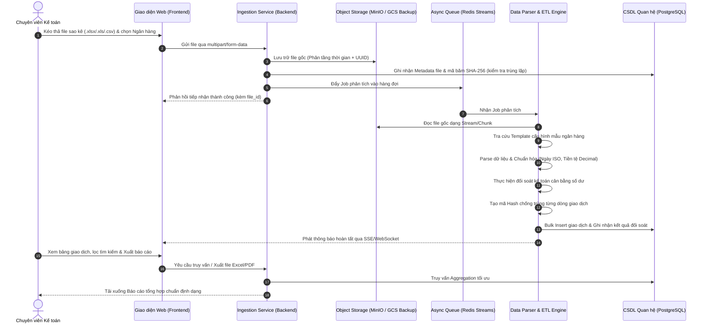
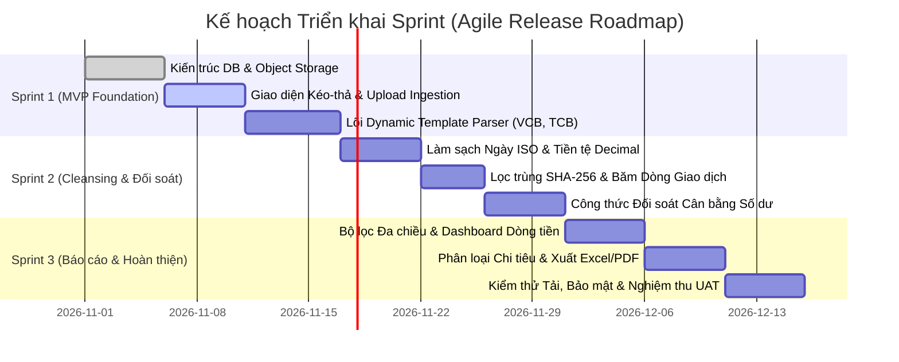

# TÀI LIỆU YÊU CẦU NGHIỆP VỤ (BUSINESS REQUIREMENTS DOCUMENT - BRD)

> **Dự án:** Hệ thống Xử lý & Báo cáo Sao kê Ngân hàng Tự động (Bank Statement Processing & Reporting System)  
> **Phương pháp quản lý:** Agile / Scrum  
> **Mã dự án:** `BSP-2026`  
> **Trạng thái:** Bản chính thức (Approved Baseline)  
> **Chủ trì (Product Owner / Lead BA):** Business Analyst Team (`@BusinessAnalyst`)  
> **Tài liệu tham chiếu liên quan:** [`docs/Bank_Mapping_Matrix.md`](./Bank_Mapping_Matrix.md), [`docs/SAD.md`](./SAD.md), [`agent/PRODUCT_SPEC.md`](../agent/PRODUCT_SPEC.md), [`agent/common_rules.md`](../agent/common_rules.md), [`Software Development Life Cycle (SDLC)`](../Software%20Developmemt%20Life%20Cycle%20SDLC/SDLC.md)

---

## 1. Kiểm soát Phiên bản & Lịch sử Thay đổi (Document Control)

| Phiên bản | Ngày cập nhật | Người thực hiện | Tóm tắt nội dung thay đổi |
| :---: | :---: | :---: | :--- |
| **0.1.0** | 2026-10-25 | `@BusinessAnalyst` | Bản phác thảo yêu cầu nghiệp vụ sơ bộ từ khảo sát khách hàng |
| **1.0.0** | 2026-10-29 | `@BusinessAnalyst` | Chuẩn hóa toàn bộ nội dung từ `PRODUCT_SPEC.md` sang tài liệu BRD theo chuẩn Agile: Bổ sung Tầm nhìn, Epics, User Stories, Gherkin AC, Quy tắc đối soát và Release Roadmap |
| **1.1.0** | 2026-10-29 | `@BusinessAnalyst` | Đồng bộ với `docs/Bank_Mapping_Matrix.md`: Cập nhật 7 mẫu sao kê thực tế (`MBB_CORP`, `MBB_PERSONAL`, `MBV_CORP`, `VPB_CORP`, `TPB_CORP`, `CTG_EFAST`, `SHB_CORP`), 5 chế độ đối soát (`MODE_1`..`MODE_5`), công thức `dedup_hash` 6 thành phần, trạng thái `BALANCED`/`DISCREPANCY`, và cơ chế Mở rộng Đa Doanh nghiệp (Multi-Entity Isolation) |
| **1.2.0** | 2026-10-30 | `@BusinessAnalyst` | Bổ sung `US-04.9`: Cho phép chỉnh sửa trực tiếp Số dư Lũy kế (`running_balance`) tại một dòng giao dịch bất kỳ trên Bảng Giao dịch làm mốc chuẩn (Anchor Balance) để tự động tính toán lan truyền 2 chiều (xuôi & ngược) cho toàn bộ chuỗi giao dịch của tài khoản đó, giải quyết triệt để bài toán Sổ phụ Cá nhân MBBank (`MODE_4_TOTAL_FLOW_ONLY`) không in số dư trên file |
| **1.3.0** | 2026-10-30 | `@BusinessAnalyst` | Nâng cấp toàn diện `US-06.2` (Báo cáo Tồn quỹ & Điều hành Thanh khoản CFO): Hỗ trợ đa kỳ (`TODAY`, `YESTERDAY`, `WTD`, `MTD`, `ALL`, `CUSTOM`) với 5 cột biến động (`opening_balance`, `total_inflow`, `total_outflow`, `closing_balance`, `net_change`), phân cấp 3 Khối nguồn tiền (`CORPORATE`, `SPECIAL_CASH`, `CASH_LEDGER`), loại trừ luân chuyển nội bộ trên KPI hợp nhất, bộ 3 chỉ số quản trị (Tỷ trọng %, Trạng thái Đối soát, Độ tươi dữ liệu), Biểu đồ phân bổ, Drill-down giao dịch tại chỗ và Xuất Excel Báo cáo Tồn quỹ (`/reports/cfo/export-excel`) |

---

## 2. Bối cảnh Kinh doanh & Tầm nhìn Dự án (Business Context & Vision)

### 2.1. Vấn đề Thực tế & Nỗi đau Doanh nghiệp (Problem Statement & Pain Points)
Hiện nay, các bộ phận Tài chính - Kế toán tại các doanh nghiệp và tổ chức phải đối mặt với áp lực lớn trong việc thu thập và đối soát sao kê tài khoản ngân hàng:
- **Nhập liệu thủ công (Manual Data Entry):** Mỗi tháng kế toán phải tải và rà soát thủ công hàng chục file sao kê Excel/CSV từ nhiều ngân hàng khác nhau (Vietcombank, Techcombank, ACB, BIDV, MBBank,...), dẫn đến hao tốn hàng trăm giờ làm việc.
- **Cấu trúc phân tán, không đồng nhất:** Mỗi ngân hàng phát hành một định dạng sao kê riêng biệt (tọa độ cột khác nhau, định dạng ngày tháng đa dạng, quy ước số âm trong ngoặc đơn, header/footer phức tạp).
- **Rủi ro sai lệch số dư & sót giao dịch:** Việc tính toán thủ công rất dễ xảy ra sai sót, đặc biệt khi có hàng ngàn giao dịch phát sinh mỗi ngày, gây khó khăn trong việc phát hiện gian lận hoặc thất thoát tài chính.
- **Trùng lặp dữ liệu (Duplicate Ingestion):** Chưa có cơ chế nhận diện giao dịch trùng lặp khi người dùng upload nhiều lần file sao kê chứa các khoảng thời gian giao thoa.
- **Thiếu báo cáo quản trị tức thời:** Ban lãnh đạo không thể theo dõi biến động dòng tiền ròng (Net Cash Flow) theo thời gian thực để ra quyết định kinh doanh.

### 2.2. Tầm nhìn Sản phẩm (Product Vision)
Xây dựng một nền tảng Web tự động hóa toàn diện quy trình tiếp nhận file sao kê ngân hàng thô, bóc tách dữ liệu theo mẫu ngân hàng linh hoạt, làm sạch và chuẩn hóa tự động, đối soát kế toán cân bằng số dư với độ chính xác tuyệt đối 100%, đồng thời cung cấp hệ thống báo cáo dòng tiền trực quan, đa chiều giúp kế toán và nhà quản lý nắm bắt sức khỏe tài chính trong nháy mắt.

### 2.3. Mục tiêu Kinh doanh & Đo lường Thành công (Business Goals & Success Metrics)

| Mã | Mục tiêu Kinh doanh (Business Goal) | Chỉ số Đo lường (KPI / Success Metric) |
| :---: | :--- | :--- |
| **BG-01** | Tiết giảm thời gian xử lý sao kê của bộ phận kế toán | Giảm $\ge 90\%$ thời gian xử lý và đối soát sổ sách thủ công |
| **BG-02** | Đảm bảo tính toàn vẹn và chính xác số học tài chính | Độ chính xác đối soát số dư đạt **100%**; không chấp nhận sai số làm tròn |
| **BG-03** | Hiệu năng xử lý file lớn | Xử lý file sao kê từ 10.000 đến 50.000 dòng trong thời gian $\le 30$ giây |
| **BG-04** | Ngăn chặn gian lận và trùng lặp | Nhận diện và cảnh báo **100%** file và dòng giao dịch trùng lặp |
| **BG-05** | Khả năng mở rộng mẫu ngân hàng mới | Cấu hình thêm mẫu sao kê ngân hàng mới chỉ qua file cấu hình JSON/YAML trong $\le 15$ phút, không cần viết lại mã nguồn |

---

## 3. Phân tích Các bên Liên quan & Chân dung Người dùng (Stakeholders & User Personas)

### 3.1. Ma trận Các bên Liên quan (Stakeholder Matrix)

| Vai trò | Đại diện Thực tế | Kỳ vọng & Trách nhiệm chính trong dự án | Mức độ ảnh hưởng |
| :--- | :--- | :--- | :---: |
| **Tổng Giám đốc (CEO)** | **Bà Nguyễn Thị Lan Anh** | - Nhận báo cáo phân tích tỷ trọng, cơ cấu khoản thu và khoản chi hàng ngày.<br>- Cung cấp dữ liệu sao kê tài khoản cá nhân MBBank (dùng cho luồng rút/nhập quỹ tiền mặt công ty). | Quyết định cao nhất |
| **Giám đốc Tài chính (CFO)** | **Ông Trần Ngọc Tuấn** | - Theo dõi tức thời tổng số tiền tồn quỹ hôm nay (Tồn quỹ ngân hàng + Tồn quỹ tiền mặt).<br>- Giám sát an toàn thanh khoản và đối soát công nợ. | Rất cao |
| **Chuyên viên Tài chính (Primary End-User)** | **Chị Nghiêm Lê Cẩm Nhung** | - Người trực tiếp tải file sao kê từ $\ge 7$ ngân hàng mỗi ngày.<br>- Cần tự động hóa làm sạch, đối chiếu số dư, phân loại thu/chi, theo dõi luồng tiền mặt qua TK cá nhân MBBank và tự động sinh biểu đồ báo cáo cho 2 sếp. | Trọng tâm phục vụ |
| **Development & Architecture Team** | Multi-Agent System | - Xây dựng hệ thống tự động bóc tách $\ge 7$ mẫu ngân hàng, xử lý bóc tách tài khoản cá nhân MBBank, tự động tính tồn quỹ kép (Bank + Cash) và xuất dashboard. | Thực thi kỹ thuật |

### 3.2. Chân dung Người dùng Thực tế (User Personas)

#### Persona 1: Chị Nghiêm Lê Cẩm Nhung - Chuyên viên Tài chính (Primary End-User)
- **Họ tên & Vai trò:** Nghiêm Lê Cẩm Nhung – Chuyên viên Tài chính.
- **Khối lượng công việc:** Hàng ngày phải truy cập hơn 7 ngân hàng thương mại để tải file sao kê; theo dõi thêm biến động số dư tài khoản cá nhân tại MBBank của Tổng Giám đốc Nguyễn Thị Lan Anh (dùng để rút tiền mặt về quỹ).
- **Mục tiêu:**
  - Tự động hóa khâu gom file, làm sạch và chuẩn hóa dữ liệu từ $\ge 7$ ngân hàng thành bảng dữ liệu tập trung.
  - Tự động đối chiếu số dư từng tài khoản, tính tổng tồn quỹ tài khoản ngân hàng và tổng tồn quỹ tiền mặt.
  - Tự động phân loại dòng tiền theo mục đích thu/chi.
  - Tự động vẽ biểu đồ trực quan hóa để gửi báo cáo đúng giờ cho CFO Trần Ngọc Tuấn và CEO Nguyễn Thị Lan Anh.
- **Nỗi đau (Pain Points):**
  - Mất hàng giờ copy/paste, chỉnh sửa định dạng thủ công giữa các mẫu ngân hàng khác nhau.
  - Dễ sót hoặc nhầm lẫn khi đối soát số dư giữa tài khoản công ty, tài khoản cá nhân MBBank rút tiền mặt và sổ quỹ tiền mặt thực tế.
  - Mất thêm thời gian vẽ biểu đồ thủ công trên Excel trước khi gửi báo cáo cho cấp quản lý.

#### Persona 2: Ông Trần Ngọc Tuấn - Giám đốc Tài chính (CFO)
- **Thời hạn báo cáo (SLA / Deadline):** Báo cáo sẵn sàng **trước 9h00 sáng mỗi ngày**.
- **Chỉ số quan tâm số 1:** Tổng số tiền tồn quỹ khả dụng hôm nay = **Tổng tồn quỹ các tài khoản ngân hàng + Tổng tồn quỹ tiền mặt**.
- **Mức độ chi tiết yêu cầu:** Cần nhìn thấy **cả con số tổng tồn quỹ hợp nhất lẫn bảng chi tiết số dư từng tài khoản** trong toàn bộ $\ge 7$ ngân hàng.

#### Persona 3: Bà Nguyễn Thị Lan Anh - Tổng Giám đốc (CEO)
- **Đặc thù tài khoản cá nhân MBBank:** Toàn bộ $100\%$ giao dịch phát sinh trên tài khoản cá nhân MBBank đều là chi phí phục vụ hoạt động của công ty (không có chi tiêu cá nhân), dùng làm kênh rút tiền mặt/tạm ứng công ty.
- **Định dạng báo cáo mong muốn:** **Biểu đồ Thác nước (Waterfall Chart)** phân rã chi tiết (breakdown) từng cấu phần tạo nên dòng tiền: Số dư đầu kỳ $\rightarrow$ Các cấu phần Khoản thu $\rightarrow$ Các cấu phần Khoản chi $\rightarrow$ Số dư cuối kỳ.
- **Khung thời gian phân tích:** Báo cáo xem theo **lũy kế tuần (WTD - Week to Date)** và **lũy kế tháng (MTD - Month to Date)**.

---

## 4. Phạm vi Dự án (Project Scope - MoSCoW Framework)

```
┌─────────────────────────────────────────────────────────────────────────────────┐
│                           PHẠM VI DỰ ÁN (PROJECT SCOPE)                         │
├───────────────────────────────────────┬─────────────────────────────────────────┤
│ [MUST HAVE - Bắt buộc hoàn thành]     │ [SHOULD HAVE - Khuyến nghị thực hiện]   │
│ - Upload kéo thả (.xlsx, .xls, .csv)  │ - Tự động nhận diện ngân hàng bằng AI   │
│ - Lưu MinIO nội bộ + GCS backup       │ - Cảnh báo giao dịch bất thường        │
│ - Parser đọc động theo mẫu ngân hàng   │ - Xuất báo cáo PDF đồ họa chuyên nghiệp │
│ - Làm sạch ngày (ISO), tiền (Decimal)  │ - Tích hợp webhook thông báo qua Slack  │
│ - Đối soát số dư: ĐK + Thu - Chi = CK  ├─────────────────────────────────────────┤
│ - Băm SHA-256 chống trùng lặp          │ [COULD / WON'T HAVE - Tương lai / Ngoài]│
│ - Báo cáo, lọc đa chiều, xuất Excel   │ - Kết nối trực tiếp Open Banking API    │
│ - Lưu trữ DB với Decimal(18,2)        │ - Tự động ký số báo cáo thuế điện tử    │
└───────────────────────────────────────┴─────────────────────────────────────────┘
```

---

## 5. Luồng Nghiệp vụ Đầu-Cuối (End-to-End Business Workflow)

Quy trình nghiệp vụ thực tế diễn ra qua 7 giai đoạn được chuẩn hóa:



---

## 6. Cấu trúc Epics & Yêu cầu Chi tiết (Agile Epic & User Story Breakdown)

Hệ thống được tổ chức thành **6 Epics nghiệp vụ cốt lõi**:

### EPIC-01: Tiếp nhận & Tải File Sao kê (Web Ingestion & File Upload)
* **Mục tiêu:** Cung cấp trải nghiệm tải file đơn giản, an toàn và tức thời cho kế toán.

#### US-01.1: Kéo thả và Chọn Định dạng File
* **User Story:** Là một *Chuyên viên Kế toán*, tôi muốn *kéo thả hoặc duyệt chọn file sao kê từ máy tính với định dạng `.xlsx`, `.xls` hoặc `.csv`*, để *tôi có thể nạp dữ liệu vào hệ thống mà không cần chuyển đổi định dạng thủ công*.
* **Độ ưu tiên:** Must Have (`P0`)
* **Tiêu chí chấp nhận (Acceptance Criteria - Gherkin):**
  ```gherkin
  Scenario: Upload file đúng định dạng thành công
    Given Người dùng đã truy cập màn hình Upload Sao Kê
    When Người dùng kéo thả một file có đuôi hợp lệ (.xlsx, .xls, .csv) với dung lượng <= 25MB
    Then Hệ thống hiển thị tên file, dung lượng và cho phép bấm nút "Tiến hành xử lý"

  Scenario: Từ chối file sai định dạng hoặc vượt quá dung lượng
    Given Người dùng ở màn hình Upload
    When Người dùng cố ý tải file có định dạng không được hỗ trợ (.pdf, .exe, .zip) hoặc dung lượng > 25MB
    Then Hệ thống chặn tải lên và hiển thị thông báo lỗi rõ ràng cho người dùng
  ```

#### US-01.2: Lựa chọn hoặc Tự động Nhận diện Ngân hàng Phát hành
* **User Story:** Là một *Chuyên viên Kế toán*, tôi muốn *lựa chọn ngân hàng phát hành (Vietcombank, Techcombank, ACB, BIDV, MBBank...) từ danh sách thả xuống hoặc để hệ thống tự nhận diện*, để *hệ thống áp dụng đúng mẫu bóc tách của ngân hàng đó*.
* **Độ ưu tiên:** Must Have (`P0`)
* **Tiêu chí chấp nhận (AC):**
  ```gherkin
  Scenario: Chọn ngân hàng thủ công từ danh sách
    Given Người dùng đã chọn file sao kê
    When Người dùng chọn ngân hàng "Vietcombank" từ dropdown
    Then Hệ thống gắn mã ngân hàng VCB vào yêu cầu upload

  Scenario: Tự nhận diện ngân hàng qua thông tin tiêu đề
    Given Người dùng để chế độ "Tự động nhận diện"
    When Hệ thống quét dòng tiêu đề thấy từ khóa "Ngân hàng TMCP Ngoại thương Việt Nam"
    Then Hệ thống tự động gán mẫu Vietcombank và hiển thị huy hiệu xác nhận cho người dùng
  ```

#### US-01.3: Theo dõi Trạng thái Xử lý Thời gian thực (Real-time Progress)
* **User Story:** Là một *Chuyên viên Kế toán*, tôi muốn *nhìn thấy tiến trình xử lý từng bước (Đang tải lên $\rightarrow$ Đang đọc dữ liệu $\rightarrow$ Đang đối soát $\rightarrow$ Hoàn tất)*, để *tôi nắm được trạng thái công việc và biết khi nào dữ liệu sẵn sàng*.
* **Độ ưu tiên:** Should Have (`P1`)
* **Tiêu chí chấp nhận (AC):**
  ```gherkin
  Scenario: Cập nhật thanh tiến trình theo thời gian thực
    Given File đang được xử lý ở worker ngầm
    When Worker hoàn thành bước "Parsing" và chuyển sang "Reconciliation"
    Then Màn hình của người dùng tự động nhảy trạng thái mà không cần tải lại trang
  ```

---

### EPIC-02: Lưu trữ File Gốc & Quản lý Siêu dữ liệu (Raw File Archival & Metadata)
* **Mục tiêu:** Bảo toàn bằng chứng gốc của sao kê phục vụ thanh kiểm tra, đối soát và pháp lý.

#### US-02.1: Lưu trữ Bản sao File Gốc Bất biến (Immutable Archiving)
* **User Story:** Là một *Kiểm toán viên / Kế toán trưởng*, tôi muốn *toàn bộ file gốc tải lên được lưu nguyên bản trên kho lưu trữ riêng biệt (Object Storage)*, để *luôn có file gốc làm bằng chứng đối chiếu khi có tranh chấp*.
* **Độ ưu tiên:** Must Have (`P0`)
* **Tiêu chí chấp nhận (AC):**
  - File gốc lưu trữ theo đường dẫn phân tầng thời gian: `/bank_statements/{YYYY}/{MM}/{UUID}_{original_name}`.
  - Tuyệt đối không lưu file nhị phân vào bảng dữ liệu SQL; chỉ lưu đường dẫn URI và metadata.

#### US-02.2: Chống Trùng lặp File qua Mã Băm SHA-256
* **User Story:** Là một *Kế toán viên*, tôi muốn *hệ thống cảnh báo ngay nếu tôi vô tình upload cùng một file sao kê đã tồn tại*, để *tránh việc xử lý thừa thãi hoặc ghi nhận dữ liệu trùng*.
* **Độ ưu tiên:** Must Have (`P0`)
* **Tiêu chí chấp nhận (AC):**
  ```gherkin
  Scenario: Phát hiện file trùng lặp hoàn toàn
    Given File sao kê A đã được nạp thành công vào hệ thống với mã băm SHA-256 "abc123xyz"
    When Một người dùng khác tải lên file có nội dung y hệt sinh ra cùng mã SHA-256 "abc123xyz"
    Then Hệ thống từ chối xử lý, thông báo: "File sao kê này đã được tải lên trước đó vào ngày DD/MM/YYYY"
  ```

---

### EPIC-03: Động cơ Đọc theo Cấu hình Mẫu Ngân hàng (Dynamic Bank Template Parser)
* **Mục tiêu:** Linh hoạt bóc tách dữ liệu theo nhiều mẫu ngân hàng khác nhau mà không phải sửa mã nguồn hệ thống.

#### US-03.1: Bóc tách Siêu dữ liệu Header & Footer của File & Định danh Đa Pháp nhân (Multi-Entity)
* **User Story:** Là một *Chuyên viên Kế toán*, tôi muốn *hệ thống tự động trích xuất động các thông tin định danh Pháp nhân (Tên Doanh nghiệp/Chủ TK, Số TK, Mã số thuế/CIF, Kỳ sao kê, Số dư đầu kỳ, Số dư cuối kỳ)*, để *tự động điền vào hồ sơ sao kê và cho phép dùng chung một mẫu sao kê để quét dữ liệu tách biệt cho nhiều doanh nghiệp khác nhau*.
* **Độ ưu tiên:** Must Have (`P0`)
* **Tiêu chí chấp nhận (AC):**
  - Trích xuất động (`Entity-Agnostic`) bộ định danh `(account_number, account_holder, tax_code)` từ Header để định tuyến và cô lập dữ liệu theo từng Doanh nghiệp/Pháp nhân.
  - Trích xuất hoặc nội suy chính xác Số dư đầu kỳ ($S_{start}$) và Số dư cuối kỳ ($S_{end}$) theo 5 chế độ (`MODE_1` $\rightarrow$ `MODE_5`) quy định tại [`docs/Bank_Mapping_Matrix.md`](./Bank_Mapping_Matrix.md).
  - Ghi nhận thông tin kỳ sao kê (`statement_period_start`, `statement_period_end`).

#### US-03.2: Bóc tách Bảng Dòng Giao dịch theo Mẫu Động (Config-driven Universal Parser)
* **User Story:** Là một *Lập trình viên / Quản trị viên*, tôi muốn *định nghĩa tọa độ cột, từ khóa tiêu đề đồng nghĩa (`canonical_header_aliases`) và dòng bắt đầu bằng file cấu hình `bank_templates_config.yaml`*, để *xử lý chính xác 7 mẫu sao kê thực tế hiện có (`MBB_CORP`, `MBB_PERSONAL`, `MBV_CORP`, `VPB_CORP`, `TPB_CORP`, `CTG_EFAST`, `SHB_CORP`) và bổ sung bất kỳ ngân hàng mới nào trong $\le 15$ phút mà không cần sửa mã nguồn*.
* **Độ ưu tiên:** Must Have (`P0`)
* **Cấu trúc trường dữ liệu bắt buộc phải bóc tách / nội suy:**
  1. Ngày giao dịch (`transaction_date`) & Ngày hạch toán/giá trị (`value_date`).
  2. Số tài khoản (`account_number`) & Chủ tài khoản/Pháp nhân (`account_holder`).
  3. Số phát sinh Nợ (`debit_amount` - Tiền ra / Chi).
  4. Số phát sinh Có (`credit_amount` - Tiền vào / Thu).
  5. Số dư lũy kế sau giao dịch (`running_balance` - bóc tách trực tiếp hoặc nội suy lũy kế đối với mẫu khuyết cột như `SHB_CORP_XLS`, `MBB_PERSONAL_XLSX`).
  6. Số tham chiếu / Mã bút toán giao dịch (`reference_number`).
  7. Nội dung diễn giải chi tiết giao dịch kết hợp thông tin đối ứng (`description`).

---

### EPIC-04: Làm sạch, Lọc trùng & Đối soát Cân bằng Số dư (Cleansing & Reconciliation)
* **Mục tiêu:** Đảm bảo dữ liệu tài chính sạch 100%, chuẩn hóa và được đối soát cân bằng kế toán chặt chẽ.

#### US-04.1: Chuẩn hóa Định dạng Ngày tháng & Thời gian
* **User Story:** Là một *Chuyên viên Kế toán*, tôi muốn *toàn bộ ngày giao dịch được chuẩn hóa về định dạng ISO 8601*, để *dễ dàng tìm kiếm và đồng bộ giữa các ngân hàng*.
* **Độ ưu tiên:** Must Have (`P0`)
* **Quy tắc chuyển đổi:**
  - `DD/MM/YYYY` $\rightarrow$ `YYYY-MM-DD`
  - `DD-MM-YYYY HH:mm:ss` $\rightarrow$ `YYYY-MM-DDTHH:mm:ss`
  - `YYYY/MM/DD` $\rightarrow$ `YYYY-MM-DD`

#### US-04.2: Chuẩn hóa Dữ liệu Tiền tệ & Kế toán Âm
* **User Story:** Là một *Kế toán viên*, tôi muốn *hệ thống tự động loại bỏ ký hiệu tiền tệ (`VND`, `$`), dấu chấm phẩy phân cách, và đổi số âm ngoặc đơn `(1,000,000)` thành `-1000000`*, để *phép tính số học không bao giờ bị lỗi*.
* **Độ ưu tiên:** Must Have (`P0`)
* **Tiêu chí chấp nhận (AC):**
  - Chuyển đổi chính xác các dạng chuỗi tiền tệ phức tạp:
    - `"1.250.000,50"` $\rightarrow$ `1250000.50`
    - `" (5,000,000) "` $\rightarrow$ `-5000000.00`
    - `"- 250.000 VND"` $\rightarrow$ `-250000.00`
  - Bắt buộc lưu trữ dưới kiểu số chính xác cao (`DECIMAL(18, 2)`).

#### US-04.3: Tự động Đối soát Cân bằng Kế toán Số dư (5-Mode Balance Reconciliation)
* **User Story:** Là một *Kế toán trưởng*, tôi muốn *hệ thống tự động tính toán đối soát giữa số dư đầu kỳ, tổng thu, tổng chi và số dư cuối kỳ theo 5 chế độ đối soát linh hoạt (`MODE_1` $\rightarrow$ `MODE_5`)*, để *phát hiện tức thì nếu file sao kê bị thiếu dòng hoặc bị tẩy xóa kể cả với các ngân hàng không in cột số dư lũy kế hoặc không in số dư đầu/cuối kỳ*.
* **Độ ưu tiên:** Must Have (`P0`)
* **Công thức nghiệp vụ đối soát chuẩn (Chi tiết 5 chế độ tại [`docs/Bank_Mapping_Matrix.md`](./Bank_Mapping_Matrix.md#72-ma-trận-5-chế-độ-đối-soát-cân-bằng-kế-toán-reconciliation_mode)):**
  $$\text{Số dư cuối kỳ tính toán} = \text{Số dư đầu kỳ (hoặc nội suy)} + \sum \text{Phát sinh Có (Thu)} - \sum \text{Phát sinh Nợ (Chi)}$$
  $$\Delta = |\text{Số dư cuối kỳ thực tế} - \text{Số dư cuối kỳ tính toán}|$$
* **Tiêu chí chấp nhận (AC):**
  ```gherkin
  Scenario: Đối soát khớp hoàn toàn (Cân bằng)
    Given File sao kê có Số dư đầu kỳ = 10.000.000, Tổng Thu = 5.000.000, Tổng Chi = 3.000.000
    When Hệ thống tính toán Số dư cuối kỳ = 12.000.000 trùng khớp 100% với Số dư cuối kỳ ghi trên file (delta = 0.00)
    Then Trạng thái đối soát của file (reconciliation_status) là "BALANCED" (Hợp lệ)

  Scenario: Phát hiện chênh lệch đối soát
    Given File sao kê có chênh lệch delta > 0.00
    When Hệ thống hoàn thành tính toán
    Then Trạng thái đối soát của file (reconciliation_status) là "DISCREPANCY", bật cờ cảnh báo màu đỏ, lưu giá trị discrepancy_amount = delta để kế toán rà soát
  ```

#### US-04.4: Lọc Trùng lặp Giao dịch (Transaction Deduplication - 6-Tuple Hash)
* **User Story:** Là một *Kế toán viên*, tôi muốn *hệ thống tự động loại bỏ hoặc cảnh báo các giao dịch bị trùng lặp giữa các lần upload nhưng không nhận nhầm các bút toán tách Phí/VAT có cùng mã tham chiếu*, để *tránh việc ghi nhận doanh thu/chi phí 2 lần hoặc bỏ sót phí ngân hàng*.
* **Độ ưu tiên:** Must Have (`P0`)
* **Thuật toán băm định danh giao dịch 6 thành phần (Deduplication Hash):**
  $$\text{dedup\_hash} = \text{SHA256}(\text{account\_number} \parallel \text{"|"} \parallel \text{transaction\_date\_iso} \parallel \text{"|"} \parallel \text{debit\_amount} \parallel \text{"|"} \parallel \text{credit\_amount} \parallel \text{"|"} \parallel \text{reference\_number} \parallel \text{"|"} \parallel \text{running\_balance})$$
  - Nếu `dedup_hash` đã tồn tại trong CSDL trên cùng `account_id` $\rightarrow$ Bỏ qua (`ON CONFLICT DO NOTHING`) hoặc gắn cờ `is_duplicate = TRUE`.

#### US-04.5: Đối chiếu Dòng tiền Mặt qua Tài khoản Cá nhân Chủ Doanh nghiệp (Bà Nguyễn Thị Lan Anh - MBBank)
* **User Story:** Là một *Chuyên viên Tài chính (Chị Cẩm Nhung)*, tôi muốn *toàn bộ giao dịch phát sinh trên tài khoản MBBank của bà Nguyễn Thị Lan Anh được tự động ghi nhận 100% là chi phí hoạt động của công ty (kênh chi tiền mặt/tạm ứng)*, để *được cộng dồn vào dòng tiền chi và đối chiếu quỹ tiền mặt công ty mà không cần phân loại loại trừ chi tiêu cá nhân*.
* **Độ ưu tiên:** Must Have (`P0`)
* **Tiêu chí chấp nhận (AC):**
  - Bóc tách toàn bộ giao dịch trên sao kê MBBank của bà Lan Anh; mặc định 100% là giao dịch công ty.
  - Phân tách rõ ràng giữa tiền mặt tại quỹ (Cash on Hand) và số dư các tài khoản thanh toán ngân hàng (Bank Balance).
  - **Công thức tự động tính Quỹ tiền mặt (`cash_ledger`):**
    $$\text{Tồn quỹ tiền mặt} = \sum \text{Rút tiền mặt từ Ngân hàng ("RUT TIEN" / INFLOW)} - \sum \text{Nộp tiền mặt vào Ngân hàng ("NOP TIEN" / OUTFLOW)}$$

#### US-04.6: Giao diện Tự Quản lý & Tạo mới Quy tắc Phân loại Thu/Chi (Self-Service Rule Management UI)
* **User Story:** Là một *Chuyên viên Tài chính (Chị Cẩm Nhung)*, tôi muốn *có một màn hình giao diện trực quan để tự tay tạo danh mục Thu/Chi và tự thiết lập các quy tắc nhận diện linh hoạt (kết hợp cả từ khóa nội dung, tài khoản ngân hàng và ngưỡng số tiền)*, để *hoàn toàn chủ động kiểm soát logic phân loại dữ liệu tài chính theo đúng đặc thù riêng của công ty*.
* **Độ ưu tiên:** Must Have (`P0`)
* **Tiêu chí chấp nhận (AC):**
  - **Quản lý Danh mục (CRUD Categories):** Cho phép người dùng tự thêm mới, sửa tên, xóa các danh mục Thu và danh mục Chi theo ý muốn.
  - **Quy tắc Điều kiện Nâng cao (Advanced Rule Builder):** Hỗ trợ thiết lập điều kiện kết hợp logic (`AND` / `OR`):
    - *Nội dung giao dịch:* Chứa / Không chứa danh sách từ khóa (không phân biệt hoa/thường, không phân biệt có/không dấu).
    - *Tài khoản ngân hàng:* Áp dụng riêng cho 1 hoặc nhiều tài khoản ngân hàng cụ thể.
    - *Ngưỡng số tiền:* Lớn hơn (`>`), Nhỏ hơn (`<`), hoặc Nằm trong khoảng (`Min - Max`).
    - *Loại phát sinh:* Chỉ áp dụng cho chiều Thu (Phát sinh Có) hoặc chiều Chi (Phát sinh Nợ).
  - **Điều khiển & Thứ tự Ưu tiên:** Cho phép bật/tắt (toggle active) từng quy tắc và kéo thả sắp xếp thứ tự ưu tiên áp dụng.
  - **Áp dụng Tức thời & Chạy lại (Re-apply):** Có nút "Áp dụng cho dữ liệu hiện tại" để chạy lại toàn bộ quy tắc mới lên các giao dịch cũ trong quá khứ (không đè lên các dòng đã phân loại thủ công).
  - **Trạng thái Chưa phân loại (Uncategorized):** Giao dịch nào không khớp với bất kỳ quy tắc nào do người dùng tạo sẽ được đưa vào nhóm "Chưa phân loại" để chị Nhung lọc và bổ sung từ khóa mới trên giao diện.

#### US-04.7: Phân loại Thủ công & Cơ chế Khóa Ghi đè (Manual Categorization & Override Protection)
* **User Story:** Là một *Chuyên viên Tài chính (Chị Cẩm Nhung)*, tôi muốn *có thể tự phân loại thủ công trực tiếp trên bảng cho những giao dịch cá biệt/không theo quy luật, và các dòng này phải được hệ thống khóa bảo vệ không bị chạy lại quy tắc tự động ghi đè*, để *tôi xử lý trọn vẹn 100% các bút toán ngoại lệ mà không sợ bị mất công làm lại*.
* **Độ ưu tiên:** Must Have (`P0`)
* **Tiêu chí chấp nhận (AC):**
  - **Gán nhãn trực tiếp (Inline Tagging):** Tại bảng dữ liệu giao dịch, cột "Danh mục" là một dropdown tìm kiếm nhanh. Chị Nhung có thể click vào và chọn danh mục cho từng dòng chỉ bằng 1 thao tác.
  - **Gán nhãn hàng loạt (Bulk Tagging):** Cho phép tích chọn nhiều ô checkbox ở các dòng giao dịch khác nhau và bấm "Gán danh mục hàng loạt".
  - **Cơ chế Khóa ghi đè (`IS_MANUAL_OVERRIDE`):** Khi một giao dịch được người dùng phân loại thủ công, hệ thống đánh dấu cờ bảo vệ. Mỗi khi bấm "Chạy lại quy tắc tự động", hệ thống **tuyệt đối giữ nguyên** danh mục người dùng đã chọn bằng tay, chỉ quét các dòng chưa được gán nhãn hoặc được gán tự động trước đó.

#### US-04.8: Quản lý Ghi chú Nội bộ cho Từng Giao dịch (Internal Transaction Notes / Memos)
* **User Story:** Là một *Chuyên viên Tài chính (Chị Cẩm Nhung)*, tôi muốn *nhập ghi chú nội bộ (Note) trực tiếp vào từng dòng giao dịch trên bảng*, để *lưu lại lý do thu/chi, số hóa đơn chứng từ kèm theo hoặc người đề xuất thanh toán phục vụ giải trình sau này*.
* **Độ ưu tiên:** Must Have (`P0`)
* **Tiêu chí chấp nhận (AC):**
  - Cung cấp cột "Ghi chú nội bộ" (`internal_note`) trên bảng giao dịch, hỗ trợ click sửa trực tiếp (Inline Edit) và tự động lưu.
  - Cho phép tìm kiếm/lọc giao dịch theo từ khóa trong cột Ghi chú nội bộ.
  - Ghi chú này được lưu vĩnh viễn trong CSDL cùng giao dịch và tự động kết xuất ra báo cáo Excel khi xuất file.

#### US-04.9: Hiệu chỉnh Điểm neo Số dư Lũy kế & Lan truyền Tự động 2 Chiều (Anchor Running Balance Recalculation)
* **User Story:** Là một *Chuyên viên Tài chính (Chị Cẩm Nhung)*, tôi muốn *bấm sửa trực tiếp Số dư Lũy kế (`running_balance`) tại bất kỳ một dòng giao dịch nào trên Bảng Giao dịch và lấy con số đó làm mốc chuẩn (Anchor)*, để *hệ thống tự động tính toán lại toàn bộ số dư lũy kế của các giao dịch trước và sau thuộc cùng tài khoản đó (đặc biệt với các mẫu sổ phụ cá nhân như `MBB_PERSONAL_XLSX` không in cột số dư cũng như không có số dư đầu/cuối kỳ trên file Excel)*.
* **Độ ưu tiên:** Must Have (`P0`)
* **Công thức lan truyền 2 chiều từ giao dịch điểm neo $k$ có số dư chuẩn $B_k$:**
  - **Chiều xuôi về tương lai ($i = k+1 \dots n$):**
    $$B_i = B_{i-1} + \text{credit\_amount}_i - \text{debit\_amount}_i$$
  - **Chiều ngược về quá khứ ($i = k-1 \dots 1$):**
    $$B_i = B_{i+1} - \text{credit\_amount}_{i+1} + \text{debit\_amount}_{i+1}$$
  - **Đồng bộ Tài khoản & Sao kê:**
    $$\text{opening\_balance} = B_1 - \text{credit\_amount}_1 + \text{debit\_amount}_1, \quad \text{current\_balance} = B_n$$
* **Tiêu chí chấp nhận (AC - Gherkin):**
  ```gherkin
  Scenario: [REQ-CLEAN-005] Hiệu chỉnh điểm neo Số dư Lũy kế tại 1 dòng và tự động tính lại toàn chuỗi giao dịch của tài khoản
    Given Tài khoản MBBank Cá nhân "0869596789" có 207 dòng giao dịch được nạp từ mẫu "MBB_PERSONAL_XLSX" (không có số dư trên file)
    When Người dùng bấm vào ô "Số dư Lũy kế" của một dòng giao dịch k trên Bảng Giao dịch và nhập số dư thực tế B_k
    Then Hệ thống cập nhật running_balance của dòng k bằng B_k (kiểu DECIMAL(18,2))
    And Tự động tính lại running_balance cho toàn bộ các giao dịch sau dòng k (cộng Có trừ Nợ) và trước dòng k (trừ Có cộng Nợ) của cùng account_id
    And Tự động đồng bộ opening_balance, current_balance của tài khoản trên bảng bank_accounts và bank_statement_files với discrepancy_amount = 0.00 VND
    And Ghi nhận nhật ký kiểm toán "ANCHOR_RUNNING_BALANCE_UPDATED" vào bảng audit_logs
  ```

---

### EPIC-05: Lưu trữ Dữ liệu Bền vững & Chuẩn xác (High-Precision Data Persistence)
* **Mục tiêu:** Đảm bảo toàn bộ giao dịch được nạp vào Cơ sở dữ liệu với độ chính xác số học tối đa và lưu vết kiểm toán đầy đủ.

#### US-05.1: Lưu trữ Độ Chính xác Tiền tệ Cao (`DECIMAL(18, 2)`)
* **User Story:** Là một *Hệ thống Kế toán*, tôi cần *lưu trữ số tiền với kiểu `DECIMAL(18, 2)` / `NUMERIC(18, 2)`*, để *không xảy ra lỗi trôi số làm tròn đặc thù của kiểu dấu phẩy động nhị phân (`FLOAT`, `DOUBLE`)*.
* **Độ ưu tiên:** Must Have (`P0`)

#### US-05.2: Truy vết Nguồn gốc & Lịch sử Xử lý (Audit Trail)
* **User Story:** Là một *Kiểm toán viên*, tôi muốn *từng dòng giao dịch phải gắn liền với mã định danh file gốc (`file_id`) cùng lịch sử thao tác của người nạp*, để *dễ dàng truy xuất ngược về văn bản gốc khi cơ quan kiểm toán yêu cầu*.
* **Độ ưu tiên:** Must Have (`P0`)

---

### EPIC-06: Báo cáo Dòng tiền, Lọc Đa chiều & Xuất Dữ liệu (Reporting, Analytics & Export)
* **Mục tiêu:** Cung cấp bức tranh tài chính toàn diện, tìm kiếm giao dịch đa chiều và xuất file phục vụ nộp báo cáo.

#### US-06.1: Bộ Lọc Giao dịch Đa tiêu chí
* **User Story:** Là một *Chuyên viên Kế toán*, tôi muốn *lọc giao dịch theo nhiều tiêu chí đồng thời (Khoảng thời gian, Số tài khoản ngân hàng, Loại thu/chi, Khoảng tiền từ - đến, Từ khóa nội dung diễn giải)*, để *nhanh chóng tra cứu bút toán cụ thể khi đối chiếu công nợ khách hàng*.
* **Độ ưu tiên:** Must Have (`P0`)

#### US-06.2: Báo cáo Tồn Quỹ Hợp Nhất & Điều Hành Thanh Khoản Gửi CFO (Ông Trần Ngọc Tuấn - Trước 9h00 Sáng)
* **User Story:** Là *Giám đốc Tài chính (Ông Trần Ngọc Tuấn)*, tôi muốn *trước 9h00 sáng mỗi ngày truy cập Báo cáo Tồn quỹ đa kỳ (`TODAY`, `YESTERDAY`, `WTD`, `MTD`, `ALL`, `CUSTOM`) hiển thị đầy đủ 5 cột biến động (Số dư Đầu kỳ $\rightarrow$ Tổng Thu $\rightarrow$ Tổng Chi $\rightarrow$ Số dư Cuối kỳ $\rightarrow$ Chênh lệch ròng $\pm$ %) được phân cấp rõ theo 2 Khối tài khoản ngân hàng (Khối 1: TK Doanh nghiệp, Khối 2: TK Ủy quyền CEO; không tính phần quỹ tiền mặt vào báo cáo tồn quỹ), có khả năng loại trừ luân chuyển nội bộ trên KPI Thu/Chi hợp nhất, kiểm tra trạng thái đối soát/độ tươi từng tài khoản, bấm Drill-down xem ngay giao dịch phát sinh và xuất file Excel Báo cáo Tồn quỹ chuẩn kế toán*, để *nắm bắt tức thì cấu trúc thanh khoản ngân hàng và duyệt lệnh chi chính xác 100%*.
* **Độ ưu tiên:** Must Have (`P0`)
* **Tiêu chí chấp nhận (AC):**
  - Dữ liệu luôn sẵn sàng trước 9h00 sáng sau khi chị Nhung nạp file; bảo toàn tuyệt đối $\text{Số dư Đầu kỳ} + \text{Tổng Thu} - \text{Tổng Chi} = \text{Số dư Cuối kỳ}$ ($\Delta = 0.00\text{ VND}$) trên từng tài khoản, từng khối và dòng Tổng cộng Hợp nhất.
  - Báo cáo **bỏ phần tiền mặt tại quỹ, không cộng tiền mặt vào tổng tồn quỹ**; phân nhóm bảng tồn quỹ thành **2 Khối tài khoản ngân hàng** có dòng Tiểu tổng (Subtotal) từng khối và Tổng cộng Hợp nhất (Khối 1 + Khối 2):
    1. **Khối 1:** Tài khoản Thanh toán Doanh nghiệp (`CORPORATE`) — hỗ trợ lọc nhanh theo Ngân hàng (`bank_code`) và Pháp nhân/Chủ TK (`account_holder`).
    2. **Khối 2:** Tài khoản Ủy quyền CEO (`SPECIAL_CASH` - MBBank cá nhân Bà Nguyễn Thị Lan Anh).
  - Ở từng dòng tài khoản hiển thị đúng Thu/Chi thực tế theo sao kê; trên KPI & dòng Tổng hợp nhất có nút bật/tắt **"Loại trừ luân chuyển nội bộ"** để tách bạch dòng tiền Thu/Chi thực với bên ngoài.
  - Hiển thị đầy đủ bộ 3 chỉ số quản trị trên từng tài khoản: (1) Tỷ trọng `%` trên tổng tồn quỹ kèm thanh tiến trình, (2) Trạng thái đối soát (`BALANCED`, `DISCREPANCY`, `UNANCHORED`), (3) Ngày giao dịch mới nhất và số lượng giao dịch trong kỳ.
  - Hỗ trợ biểu đồ trực quan (Cơ cấu phân bổ tiền theo ngân hàng & So sánh Thu - Chi theo tài khoản), bấm vào bất kỳ dòng tài khoản nào sẽ mở rộng (Inline Drill-down) danh sách giao dịch trong kỳ kèm nút nhảy sang trang Sổ Giao Dịch đã lọc sẵn tài khoản, và nút **Xuất Excel Báo cáo Tồn quỹ CFO** (`/api/v1/reports/cfo/export-excel`).

#### US-06.3: Báo cáo Biểu đồ Thác nước (Waterfall Chart) Thu - Chi Gửi CEO (Bà Nguyễn Thị Lan Anh)
* **User Story:** Là *Tổng Giám đốc (Bà Nguyễn Thị Lan Anh)*, tôi muốn *xem biểu đồ Thác nước (Waterfall Chart) phân rã chi tiết từng cấu phần Thu và Chi theo lũy kế Tuần (WTD) và lũy kế Tháng (MTD)*, để *thấy rõ dòng tiền biến động từ số dư đầu kỳ qua các khoản thu/chi chính đến số dư cuối kỳ*.
* **Độ ưu tiên:** Must Have (`P0`)
* **Tiêu chí chấp nhận (AC):**
  - Render biểu đồ Waterfall: Cột xuất phát (Số dư đầu kỳ) $\rightarrow$ Các thanh nổi màu xanh (Các khoản thu: Bán hàng, Thu nợ, Thu khác...) $\rightarrow$ Các thanh chìm màu đỏ (Các khoản chi: Lương, Nhà cung cấp, Thuế, Lãi vay, Chi tiền mặt qua MBBank...) $\rightarrow$ Cột kết thúc (Số dư cuối kỳ).
  - Hỗ trợ chuyển đổi nhanh giữa chế độ xem: **Lũy kế Tuần (WTD)** và **Lũy kế Tháng (MTD)**.

#### US-06.4: Xuất Báo cáo Excel Định dạng Kế toán Chuẩn Mực & PDF
* **User Story:** Là một *Chuyên viên Tài chính (Chị Cẩm Nhung)*, tôi muốn *xuất bảng giao dịch và báo cáo tổng hợp ra file Excel (`.xlsx`) được định dạng sẵn chuẩn mực kế toán*, để *tôi có thể in ấn, lưu trữ hồ sơ kiểm toán hoặc gửi ngay cho các phòng ban mà không phải căn chỉnh lại bằng tay*.
* **Độ ưu tiên:** Must Have (`P0`)
* **Tiêu chí chấp nhận (AC):**
  - **Định dạng Ngày tháng:** Chuẩn `DD/MM/YYYY` (hoặc `DD/MM/YYYY HH:mm:ss`), căn giữa ô.
  - **Định dạng Số tiền:** Chuẩn số kế toán với dấu phân cách hàng nghìn rõ ràng (`#,##0` hoặc `#,##0.00`), căn phải ô, có định dạng số âm rõ ràng (`-1,000,000`).
  - **Dòng Tổng cộng (Total Row):** Cuối bảng có dòng `TỔNG CỘNG` in đậm, sử dụng công thức tự động (`SUBTOTAL` hoặc `SUM`) cho các cột Thu, Chi, Số dư.
  - **Cột Ghi chú Nội bộ:** Đính kèm đầy đủ nội dung cột Ghi chú (`internal_note`) và Danh mục phân loại đã gán.
  - **An toàn Bảo mật:** Sanitize và escape ký tự mở đầu (`=`, `+`, `-`, `@`) đối với dữ liệu văn bản để triệt tiêu lỗ hổng Formula/CSV Injection.

---

## 7. Yêu cầu Phi Chức năng (Non-Functional Requirements - NFRs)

| Mã NFR | Danh mục | Yêu cầu Kỹ thuật Cốt lõi | Chỉ số Định lượng (Metric) |
| :---: | :--- | :--- | :--- |
| **NFR-01** | **Accuracy (Độ chính xác)** | Sai số số học trong mọi phép tính tổng, hiệu, đối soát bằng 0 | Sai số = 0 VND; $100\%$ Decimal |
| **NFR-02** | **Performance (Hiệu năng)** | Đọc file streaming theo từng chunk nhỏ (500–1.000 dòng); không nạp toàn bộ file vào RAM gây tràn bộ nhớ | Bộ nhớ RAM tối đa $\le 512\text{MB}$ khi đọc file 50.000 dòng |
| **NFR-03** | **Security (Bảo mật)** | Chống SQL Injection, XSS và Formula Injection khi xuất Excel | $100\%$ Parameterized Query, Escape ký tự nhạy cảm |
| **NFR-04** | **Availability (Độ sẵn sàng)** | Xử lý file qua Background Worker; người dùng không bị treo trình duyệt khi file nặng | Thời gian phản hồi API Upload $\le 2$ giây |
| **NFR-05** | **Integrity (Toàn vẹn)** | Tính nguyên tử (ACID Transaction): nếu lỗi giữa chừng, tự động rollback toàn bộ dữ liệu của file đó | Không để sót bản ghi mồ côi (Zero Orphan Records) |

---

### EPIC-07: Quản lý & Đối soát Sao kê Khoản vay Tín dụng (Credit Facilities & Loan Disbursements)
* **Mục tiêu:** Cho phép nạp, tự động bóc tách, đối soát tổng dư nợ và theo dõi nghĩa vụ trả nợ gốc/lãi của các khoản vay tín dụng (VietinBank eFAST, BIDV Vay/LD...).

#### US-07.1: Tiếp nhận & Tự động Nhận diện Mẫu Sao kê Tín dụng
* **User Story:** Là một *Kế toán viên*, tôi muốn *kéo thả file sao kê khoản vay (.xls, .xlsx) lên hệ thống*, để *hệ thống tự động phát hiện mẫu VietinBank hoặc BIDV mà không cần cấu hình thủ công*.
* **Độ ưu tiên:** Must Have (`P0`)
* **Tiêu chí chấp nhận (AC - Gherkin):**
  ```gherkin
  Scenario: [REQ-CREDIT-001] Nạp file sao kê danh sách khoản vay VietinBank eFAST
    Given File Excel "danh-sach-tai-khoan-tien-vay(31-10-2026 08_54_00).xls" định dạng BIFF8
    When Kế toán nạp file vào màn hình Sao kê Tín dụng
    Then Hệ thống tự động nhận diện mẫu "CTG_LOAN_XLS"
    And Bóc tách đúng 19 khoản vay với tổng dư nợ 30,355,015,000 VND
    And Đánh dấu trạng thái đối soát là "BALANCED" (Khớp 100%)
  ```

#### US-07.2: Quản lý Danh mục Khoản vay & Lịch Nghĩa vụ Nợ đến hạn
* **User Story:** Là một *Giám đốc Tài chính (CFO)*, tôi muốn *xem danh sách tổng hợp các khoản vay/khế ước hiện hành cùng lịch trả nợ gốc và lãi sắp tới (trong 7 ngày, 30 ngày)*, để *chủ động cân đối dòng tiền và thanh khoản ròng trước 9h sáng*.
* **Độ ưu tiên:** Must Have (`P0`)
* **Tiêu chí chấp nhận (AC - Gherkin):**
  ```gherkin
  Scenario: [REQ-CREDIT-002] Xem lịch trả nợ gốc và lãi đến hạn
    Given Hệ thống đã nạp các khoản vay từ VietinBank và BIDV
    When CFO truy cập bảng điều khiển Sao kê Tín dụng
    Then Hệ thống hiển thị tổng dư nợ gốc hợp nhất
    And Hiển thị danh sách các khoản vay có ngày trả gốc/lãi gần nhất
    And Cho phép lọc theo ngân hàng, nhóm nợ và khoảng thời gian đáo hạn
  ```

---

## 8. Tiêu chuẩn Sẵn sàng (DoR) & Hoàn thành (DoD)

### 8.1. Định nghĩa Sẵn sàng (Definition of Ready - DoR)
Một User Story chỉ được đưa vào Sprint Planning khi thỏa mãn:
1. Có mô tả nghiệp vụ rõ ràng theo cú pháp `As a... I want to... So that...`.
2. Có đầy đủ Tiêu chí chấp nhận (Acceptance Criteria) viết theo cú pháp Gherkin (`Given / When / Then`).
3. Có file mẫu sao kê ngân hàng thực tế hoặc dữ liệu mock tương ứng để kiểm thử.
4. Được System Architect thẩm định không vi phạm các nguyên tắc kỹ thuật trong [`agent/common_rules.md`](../agent/common_rules.md).

### 8.2. Định nghĩa Hoàn thành (Definition of Done - DoD)
Một User Story chỉ được xem là "Done" và sẵn sàng đóng khi:
1. Mã nguồn hoàn tất, tuân thủ Clean Code và không vi phạm bảo mật.
2. Unit Test đạt độ bao phủ $\ge 85\%$ ([`agent/05_qa_security_spec/rules.md`](../agent/05_qa_security_spec/rules.md)).
3. Vượt qua toàn bộ kịch bản kiểm thử AC trong tài liệu này.
4. Đã qua Code Review và được ít nhất 1 Peer Reviewer + Tech Lead phê duyệt.
5. Kiểm thử thành công trên môi trường Staging với dữ liệu mock lớn.

---

## 9. Kế hoạch Phát hành Dự kiến (Agile Release Plan & Sprints)



| Sprint | Thời lượng | Trọng tâm bàn giao (Goal & Deliverables) |
| :---: | :---: | :--- |
| **Sprint 1 (MVP)** | 2 tuần | Khung kiến trúc CSDL quan hệ (hỗ trợ Multi-Entity), hạ tầng Object Storage lưu file gốc, giao diện kéo-thả upload và động cơ Universal Config-Driven Parser bóc tách 7 mẫu sao kê thực tế (`MBB_CORP`, `MBB_PERSONAL`, `MBV_CORP`, `VPB_CORP`, `TPB_CORP`, `CTG_EFAST`, `SHB_CORP`) kèm khả năng mở rộng Zero-Code cho VCB, TCB, BIDV, ACB. |
| **Sprint 2** | 2 tuần | Pipeline chuẩn hóa dữ liệu (ngày ISO, tiền Decimal), cơ chế chống trùng lặp file & dòng giao dịch bằng SHA-256, module đối soát kế toán cân bằng số dư tự động kèm cảnh báo sai lệch. |
| **Sprint 3** | 2 tuần | Màn hình Dashboard trực quan hóa dòng tiền ròng, bộ lọc đa tiêu chí, phân loại chi phí tự động theo từ khóa, chức năng xuất file Excel/PDF an toàn và nghiệm thu UAT toàn hệ thống. |

