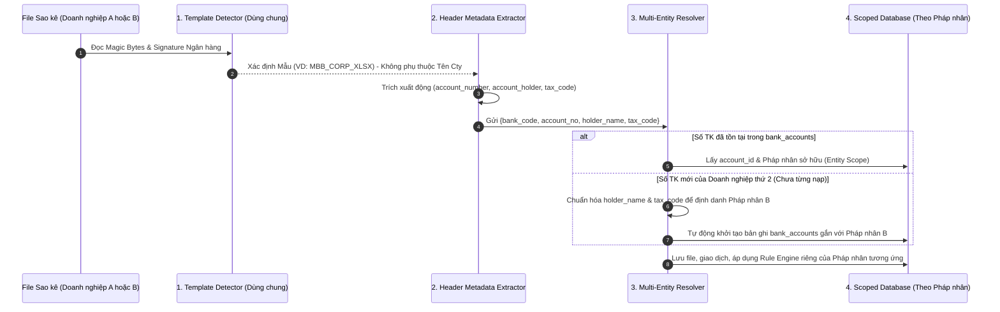

# TÀI LIỆU ĐẶC TẢ MA TRẬN ÁNH XẠ DỮ LIỆU SAO KÊ NGÂN HÀNG (BANK DATA MAPPING MATRIX)

> **Dự án:** Hệ thống Xử lý & Báo cáo Sao kê Ngân hàng Tự động (Bank Statement Processing & Reporting System)  
> **Mã dự án:** `BSP-2026`  
> **Mã tài liệu:** `DOC-BA-BMM-001`  
> **Phiên bản:** `1.0.0`  
> **Trạng thái:** Bản chính thức (Approved Specification Baseline)  
> **Chủ trì biên soạn:** Chuyên viên Phân tích Nghiệp vụ Tài chính (`@BusinessAnalyst`)  
> **Tài liệu tham chiếu:** [`docs/BRD.md`](./BRD.md), [`docs/SAD.md`](./SAD.md), [`database/schema.sql`](../database/schema.sql), [`agent/PRODUCT_SPEC.md`](../agent/PRODUCT_SPEC.md), [`agent/common_rules.md`](../agent/common_rules.md), [`agent/01_business_analyst/rules.md`](../agent/01_business_analyst/rules.md)

---

## 1. Kiểm soát Phiên bản & Truy vết Yêu cầu (Document Control & Traceability Matrix)

### 1.1. Lịch sử Phiên bản (Revision History)

| Phiên bản | Ngày cập nhật | Tác giả | Nội dung thay đổi |
| :---: | :---: | :---: | :--- |
| **1.0.0** | 2026-10-29 | `@BusinessAnalyst` | Ban hành chính thức Ma trận Ánh xạ Dữ liệu cho 7 mẫu sao kê thực tế thuộc 6 ngân hàng (`MBB_CORP`, `MBB_PERSONAL`, `MBV_CORP`, `VPB_CORP`, `TPB_CORP`, `CTG_EFAST`, `SHB_CORP`), tích hợp kiến trúc Mở rộng Mẫu Ngân hàng mới (Zero-Code Onboarding $\le 15$ phút) và Cơ chế Đa Doanh nghiệp / Đa Pháp nhân (Entity-Agnostic Multi-Company Mapping). |

### 1.2. Ma trận Truy vết Yêu cầu Kỹ thuật (Requirement Traceability Matrix)

| Mã Yêu cầu (`Unique ID`) | Phân hệ | Liên kết BRD / US | Mô tả Yêu cầu Kỹ thuật Định lượng |
| :--- | :--- | :---: | :--- |
| **`REQ-INGEST-001`** | Tiếp nhận & Nhận diện | `US-01.1`, `US-01.2` | Xác thực định dạng vật lý 2 lớp qua Magic Bytes (`.xlsx` PK Zip `50 4B 03 04` và `.xls` BIFF8 OLE2 `D0 CF 11 E0`) và tự động nhận diện đúng $100\%$ mẫu ngân hàng trong thời gian $\le 200\text{ms}$ đối với file $\le 25\text{MB}$. |
| **`REQ-INGEST-002`** | Chống trùng lặp File | `US-02.2` | Tính toán mã băm `file_sha256` (`CHAR(64)`) trên luồng byte gốc; chặn $100\%$ file trùng lặp với mã phản hồi HTTP `409 Conflict`. |
| **`REQ-PARSE-001`** | Bóc tách Siêu dữ liệu & Đa Pháp nhân | `US-03.1`, `BG-05` | Trích xuất động $100\%$ thông tin định danh Pháp nhân (`account_number`, `account_holder`, `tax_code`, `currency`) và kỳ sao kê (`statement_period_start`, `statement_period_end`) mà không gắn cứng tên doanh nghiệp trong Template. |
| **`REQ-PARSE-002`** | Bóc tách Bảng Giao dịch Động | `US-03.2`, `NFR-02` | Đọc dữ liệu theo luồng (Streaming Chunking $500 - 1.000$ dòng/lần), tự động xử lý ô gộp (Merged Cells) và dòng trống xen kẽ, giữ mức sử dụng RAM $\le 512\text{MB}$ cho file $50.000$ dòng trong thời gian $\le 30\text{s}$. |
| **`REQ-PARSE-003`** | Mở rộng Mẫu Ngân hàng Mới | `BG-05` | Cung cấp cấu hình Declarative YAML/JSON Schema 6 lớp kết hợp từ điển `header_aliases`, cho phép cấu hình thêm mẫu sao kê ngân hàng mới trong $\le 15$ phút mà không cần sửa đổi mã nguồn. |
| **`REQ-CLEAN-001`** | Chuẩn hóa Thời gian ISO 8601 | `US-04.1` | Chuyển đổi $100\%$ định dạng ngày giờ nguồn (`DD/MM/YYYY HH:mm:ss`, `DD/MM/YYYY HH:mm`, `DD-MM-YYYY HH:mm:ss`, `YYYY-MM-DD`) về chuẩn ISO 8601 có múi giờ `YYYY-MM-DDTHH:mm:ss+07:00`. |
| **`REQ-CLEAN-002`** | Chuẩn hóa Tiền tệ Độ chính xác Cao | `US-04.2`, `US-05.1` | Chuyển đổi $100\%$ chuỗi tiền tệ (US comma, VN dot, Space-tab, Scientific notation, số âm ngoặc đơn) sang kiểu `DECIMAL(18, 2)` với sai số làm tròn $= 0\text{ VND}$. Cấm tuyệt đối kiểu `FLOAT`/`DOUBLE`. |
| **`REQ-CLEAN-003`** | Nội suy Số dư & Đối soát 5 Chế độ | `US-04.3`, `NFR-01` | Hỗ trợ 5 chế độ đối soát (`MODE_1` $\rightarrow$ `MODE_5`), tự động nội suy `running_balance` hoặc `header_opening/closing_balance` cho các mẫu khuyết cột, đảm bảo độ lệch đối soát $\Delta = 0.00\text{ VND}$. |
| **`REQ-CLEAN-004`** | Băm Chống trùng Dòng Giao dịch | `US-04.4` | Sinh mã băm `dedup_hash` (`CHAR(64)`) kết hợp 6 thành phần định danh để phân biệt chính xác $100\%$ các giao dịch tách Phí/VAT có cùng mã tham chiếu và cùng giây giao dịch. |
| **`REQ-PERSIST-001`** | Đối ứng Sổ Quỹ Tiền mặt | `US-04.5` | Tự động ánh xạ $100\%$ giao dịch từ tài khoản `SPECIAL_CASH` (MBBank cá nhân `0869596789`) và các bút toán rút tiền mặt nhập quỹ sang bảng `cash_ledger`. |

---

## 2. Từ điển Dữ liệu Chuẩn Đích (Canonical Target Data Dictionary)

Tuân thủ Mục 1 của [`agent/01_business_analyst/rules.md`](../agent/01_business_analyst/rules.md) và [`database/schema.sql`](../database/schema.sql), toàn bộ dữ liệu sau khi bóc tách từ các mẫu sao kê nguồn phải được chuẩn hóa về **4 bảng đích cốt lõi** theo đặc tả Từ điển Dữ liệu 7 cột dưới đây:

### 2.1. Bảng `bank_accounts` (Danh mục Tài khoản & Định danh Pháp nhân)

| Tên trường kỹ thuật | Tên hiển thị | Kiểu dữ liệu | Bắt buộc (Nullable) | Độ dài tối đa | Định dạng / Regex | Ví dụ |
| :--- | :--- | :--- | :---: | :---: | :--- | :--- |
| `account_id` | Mã định danh TK | `BIGSERIAL` | `NOT NULL` (PK) | 20 | `^[1-9]\d*$` | `1` |
| `bank_code` | Mã ngân hàng | `VARCHAR(20)` | `NOT NULL` | 20 | `^[A-Z]{3,10}$` | `MBB`, `MBV`, `VPB`, `TPB`, `CTG`, `SHB` |
| `bank_name` | Tên ngân hàng | `VARCHAR(100)` | `NOT NULL` | 100 | `^.{3,100}$` | `Ngân hàng TMCP Quân Đội` |
| `account_number` | Số tài khoản | `VARCHAR(50)` | `NOT NULL` (UK) | 50 | `^[A-Z0-9]{6,30}$` | `111386888` |
| `account_holder` | Chủ tài khoản / Pháp nhân | `VARCHAR(150)` | `NOT NULL` | 150 | `^[A-Z0-9\s\.,&-]{3,150}$` | `CONG TY CO PHAN XI MANG SUNRISE` |
| `tax_code` | Mã số thuế Pháp nhân | `VARCHAR(50)` | `NULL` | 50 | `^[0-9-]{10,14}$` | `0109730501` |
| `account_type` | Phân loại tài khoản | `VARCHAR(20)` | `NOT NULL` | 20 | `^(CORPORATE\|SPECIAL_CASH)$` | `CORPORATE` |
| `currency` | Loại tiền tệ | `VARCHAR(5)` | `NOT NULL` | 5 | `^[A-Z]{3}$` | `VND` |
| `opening_balance` | Số dư khởi tạo | `DECIMAL(18,2)` | `NOT NULL` | 18 | `^-?\d{1,16}(\.\d{1,2})?$` | `159246321.00` |
| `current_balance` | Số dư hiện tại | `DECIMAL(18,2)` | `NOT NULL` | 18 | `^-?\d{1,16}(\.\d{1,2})?$` | `147097279.00` |

### 2.2. Bảng `bank_statement_files` (Siêu dữ liệu File Sao kê & Kết quả Đối soát)

| Tên trường kỹ thuật | Tên hiển thị | Kiểu dữ liệu | Bắt buộc (Nullable) | Độ dài tối đa | Định dạng / Regex | Ví dụ |
| :--- | :--- | :--- | :---: | :---: | :--- | :--- |
| `file_id` | Mã định danh File | `BIGSERIAL` | `NOT NULL` (PK) | 20 | `^[1-9]\d*$` | `101` |
| `file_uuid` | UUID File | `UUID` | `NOT NULL` (UK) | 36 | `^[0-9a-fA-F-]{36}$` | `550e8400-e29b-41d4-a716-446655440000` |
| `account_id` | Mã tài khoản liên kết | `BIGINT` | `NULL` (FK) | 20 | `^[1-9]\d*$` | `1` |
| `template_code` | Mã cấu hình mẫu nhận diện | `VARCHAR(50)` | `NULL` | 50 | `^[A-Z0-9_]{5,50}$` | `MBB_CORP_XLSX` |
| `reconciliation_mode` | Chế độ đối soát áp dụng | `VARCHAR(50)` | `NULL` | 50 | `^MODE_[1-5]_[A-Z_]+$` | `MODE_1_FULL_HEADER_FOOTER` |
| `original_filename` | Tên file gốc | `VARCHAR(255)` | `NOT NULL` | 255 | `^.+\.(xlsx\|xls\|csv)$` | `Bang ket qua giao dich - 111386888 (2).xlsx` |
| `storage_path` | Đường dẫn lưu trữ S3/MinIO | `VARCHAR(500)` | `NOT NULL` | 500 | `^/statements/[A-Z]+/\d{4}/\d{2}/.+$` | `/statements/MBB/2026/10/550e8400_sao_ke.xlsx` |
| `file_sha256` | Mã băm SHA-256 File | `CHAR(64)` | `NOT NULL` (UK) | 64 | `^[a-f0-9]{64}$` | `e3b0c44298fc1c149afbf4c8996fb92427ae41e4649b934ca495991b7852b855` |
| `statement_period_start` | Kỳ sao kê từ ngày | `DATE` | `NULL` | 10 | `^\d{4}-\d{2}-\d{2}$` | `2026-10-01` |
| `statement_period_end` | Kỳ sao kê đến ngày | `DATE` | `NULL` | 10 | `^\d{4}-\d{2}-\d{2}$` | `2026-10-26` |
| `header_opening_balance` | Số dư đầu kỳ trên file | `DECIMAL(18,2)` | `NULL` | 18 | `^-?\d{1,16}(\.\d{1,2})?$` | `159246321.00` |
| `header_closing_balance` | Số dư cuối kỳ trên file | `DECIMAL(18,2)` | `NULL` | 18 | `^-?\d{1,16}(\.\d{1,2})?$` | `147097279.00` |
| `calculated_closing_balance` | Số dư cuối kỳ tính toán | `DECIMAL(18,2)` | `NULL` | 18 | `^-?\d{1,16}(\.\d{1,2})?$` | `147097279.00` |
| `total_credit_amount` | Tổng phát sinh Có (Thu) | `DECIMAL(18,2)` | `NOT NULL` | 18 | `^\d{1,16}(\.\d{1,2})?$` | `14517810515.00` |
| `total_debit_amount` | Tổng phát sinh Nợ (Chi) | `DECIMAL(18,2)` | `NOT NULL` | 18 | `^\d{1,16}(\.\d{1,2})?$` | `14529959557.00` |
| `total_transactions_count` | Tổng số dòng giao dịch | `INT` | `NOT NULL` | 10 | `^\d+$` | `125` |
| `reconciliation_status` | Trạng thái đối soát | `VARCHAR(30)` | `NOT NULL` | 30 | `^(PENDING\|BALANCED\|DISCREPANCY)$` | `BALANCED` |
| `discrepancy_amount` | Số tiền chênh lệch ($\Delta$) | `DECIMAL(18,2)` | `NOT NULL` | 18 | `^\d{1,16}(\.\d{1,2})?$` | `0.00` |

### 2.3. Bảng `bank_transactions` (Dòng Giao dịch Chi tiết Chuẩn hóa)

| Tên trường kỹ thuật | Tên hiển thị | Kiểu dữ liệu | Bắt buộc (Nullable) | Độ dài tối đa | Định dạng / Regex | Ví dụ |
| :--- | :--- | :--- | :---: | :---: | :--- | :--- |
| `transaction_id` | Mã giao dịch nội bộ | `BIGSERIAL` | `NOT NULL` (PK) | 20 | `^[1-9]\d*$` | `10001` |
| `file_id` | Mã File nguồn | `BIGINT` | `NOT NULL` (FK) | 20 | `^[1-9]\d*$` | `101` |
| `account_id` | Mã Tài khoản | `BIGINT` | `NOT NULL` (FK) | 20 | `^[1-9]\d*$` | `1` |
| `category_id` | Mã Danh mục Thu/Chi | `BIGINT` | `NULL` (FK) | 20 | `^[1-9]\d*$` | `5` |
| `transaction_date` | Ngày giờ giao dịch | `TIMESTAMPTZ` | `NOT NULL` | 25 | `^\d{4}-\d{2}-\d{2}T\d{2}:\d{2}:\d{2}\+07:00$` | `2026-10-26T15:13:22+07:00` |
| `value_date` | Ngày hiệu lực / Hạch toán | `DATE` | `NULL` | 10 | `^\d{4}-\d{2}-\d{2}$` | `2026-10-26` |
| `reference_number` | Số bút toán / Mã tham chiếu | `VARCHAR(100)` | `NULL` | 100 | `^[^\s].{0,99}$` | `FT26299356920572` |
| `description` | Nội dung diễn giải chuẩn hóa | `TEXT` | `NOT NULL` | 2000 | `^.+$` | `nop tk \| ĐV: NGUYEN THI LAN ANH` |
| `debit_amount` | Phát sinh Nợ (Chi ra) | `DECIMAL(18,2)` | `NOT NULL` | 18 | `^\d{1,16}(\.\d{1,2})?$` | `2000000.00` |
| `credit_amount` | Phát sinh Có (Thu vào) | `DECIMAL(18,2)` | `NOT NULL` | 18 | `^\d{1,16}(\.\d{1,2})?$` | `144100000.00` |
| `running_balance` | Số dư lũy kế sau GD | `DECIMAL(18,2)` | `NOT NULL` | 18 | `^-?\d{1,16}(\.\d{1,2})?$` | `147097279.00` |
| `dedup_hash` | Mã băm chống trùng dòng | `CHAR(64)` | `NOT NULL` | 64 | `^[a-f0-9]{64}$` | `9f86d081884c7d659a2feaa0c55ad015a3bf4f1b2b0b822cd15d6c15b0f00a08` |
| `is_duplicate` | Cờ giao dịch trùng | `BOOLEAN` | `NOT NULL` | 5 | `^(true\|false)$` | `false` |
| `is_manual_override` | Cờ khóa ghi đè thủ công | `BOOLEAN` | `NOT NULL` | 5 | `^(true\|false)$` | `false` |
| `internal_note` | Ghi chú nội bộ kế toán | `TEXT` | `NULL` | 1000 | `^.*$` | `Tạm ứng công tác phí Sơn La` |

### 2.4. Bảng `cash_ledger` (Sổ Quỹ Tiền mặt Đối ứng)

| Tên trường kỹ thuật | Tên hiển thị | Kiểu dữ liệu | Bắt buộc (Nullable) | Độ dài tối đa | Định dạng / Regex | Ví dụ |
| :--- | :--- | :--- | :---: | :---: | :--- | :--- |
| `cash_entry_id` | Mã bút toán tiền mặt | `BIGSERIAL` | `NOT NULL` (PK) | 20 | `^[1-9]\d*$` | `501` |
| `linked_transaction_id` | Mã GD ngân hàng đối ứng | `BIGINT` | `NULL` (FK) | 20 | `^[1-9]\d*$` | `10003` |
| `entry_date` | Ngày ghi sổ quỹ | `DATE` | `NOT NULL` | 10 | `^\d{4}-\d{2}-\d{2}$` | `2026-10-26` |
| `entry_type` | Loại nhập/xuất quỹ | `VARCHAR(10)` | `NOT NULL` | 10 | `^(INFLOW\|OUTFLOW)$` | `INFLOW` |
| `amount` | Số tiền | `DECIMAL(18,2)` | `NOT NULL` | 18 | `^\d{1,16}(\.\d{1,2})?$` | `200000000.00` |
| `running_cash_balance` | Tồn quỹ tiền mặt lũy kế | `DECIMAL(18,2)` | `NOT NULL` | 18 | `^-?\d{1,16}(\.\d{1,2})?$` | `250000000.00` |
| `receiver_payer` | Người nhận / Người nộp | `VARCHAR(150)` | `NULL` | 150 | `^.{0,150}$` | `NGUYEN THI LAN ANH` |
| `reason` | Lý do thu/chi tiền mặt | `TEXT` | `NOT NULL` | 1000 | `^.+$` | `RUT TIEN (TT26299398710716)` |

---

## 3. Ma trận Nhận diện Tự động 7 Mẫu Sao kê Thực tế (Auto-Detection Signature Matrix)

Để đảm bảo yêu cầu `REQ-INGEST-001` và nguyên tắc **Entity-Agnostic Template** (nhận diện mẫu dựa trên đặc trưng ngân hàng, tuyệt đối không phụ thuộc vào tên doanh nghiệp hay số tài khoản cụ thể), hệ thống thực hiện quy trình nhận diện 2 bước:

1. **Bước 1 (Xác thực Magic Bytes Nhị phân):**
   - `50 4B 03 04` $\rightarrow$ Định dạng OOXML Workbook (`.xlsx`).
   - `D0 CF 11 E0 A1 B1 1A E1` $\rightarrow$ Định dạng Compound File Binary BIFF8 (`.xls`).
2. **Bước 2 (Quét Signature Ô Tiêu đề trong 25 dòng đầu tiên):**

| Thứ tự Ưu tiên | Mã Mẫu (`template_code`) | Mã NH (`bank_code`) | Định dạng Vật lý | Điều kiện Nhận diện Duy nhất (Signature Rules - Logic `AND`) | Phân biệt Chống Nhầm lẫn (Disambiguation) |
| :---: | :--- | :---: | :---: | :--- | :--- |
| **1** | **`MBB_PERSONAL_XLSX`** | `MBB` | `.xlsx` | - Ô `H3` chứa `"SỔ PHỤ CHI TIẾT KIÊM BÁO NỢ/BÁO CÓ"`<br/>- Ô `O3` chứa `"NGÂN HÀNG TMCP QUÂN ĐỘI"`<br/>- Dòng `19` có ô `B19` chứa `"STT"` và `E19` chứa `"Ngày giao dịch"` | Phân biệt với `MBB_CORP_XLSX` nhờ tiêu đề `"SỔ PHỤ CHI TIẾT"` tại `H3` và Header bảng tại dòng `19`. |
| **2** | **`MBB_CORP_XLSX`** | `MBB` | `.xlsx` | - Ô `C1` chứa `"SAO KÊ CHI TIẾT TÀI KHOẢN"`<br/>- Ô `H1` chứa `"NGÂN HÀNG TMCP QUÂN ĐỘI"`<br/>- Dòng `7` có `B7 == "NGÀY GIAO DỊCH"` và `D7 == "PHÁT SINH NỢ"` | Phân biệt với `MBV_CORP_XLSX` nhờ tên ngân hàng ở `H1` và cột `NGÀY GIAO DỊCH` nằm ở `B7` (không merge). |
| **3** | **`MBV_CORP_XLSX`** | `MBV` | `.xlsx` | - Ô `F1` chứa `"SAO KÊ CHI TIẾT TÀI KHOẢN"`<br/>- Ô `O1` chứa `"NGÂN HÀNG TNHH MỘT THÀNH VIÊN VIỆT NAM HIỆN ĐẠI"` (hoặc `"Modern Bank of Vietnam"`)<br/>- Dòng `7` có `D7 == "NGÀY GIAO DỊCH"` và `H7 == "PHÁT SINH NỢ"` | Phân biệt hoàn toàn với `MBB_CORP_XLSX` dù tên file giống nhau (`Bang ket qua giao dich...`). |
| **4** | **`VPB_CORP_XLSX`** | `VPB` | `.xlsx` | - Ô `A1` chứa `"VPBANK"` hoặc `"Việt Nam Thịnh Vượng"`<br/>- Dòng `18` có `D18 == "Số tiền ghi có"` và `E18 == "Số tiền ghi nợ"` | Duy nhất có Header song ngữ 2 dòng (`18` & `19`) và cột Ghi Có đứng trước Ghi Nợ. |
| **5** | **`TPB_CORP_XLSX`** | `TPB` | `.xlsx` | - Ô `A3` chứa `"CURRENT ACCOUNT TRANSACTION STATEMENT"`<br/>- Ô `A7` chứa `"Tài khoản giao dịch (account number):"`<br/>- Dòng `10` có `A10` chứa `"Ngày giao dịch"` (Không có cột STT) | Duy nhất bắt đầu bảng ngay bằng cột `Ngày giao dịch` tại `A10`. |
| **6** | **`CTG_EFAST_XLS`** | `CTG` | `.xls` (BIFF8) | - Sheet tên `"LICH SU GIAO DICH"` (hoặc ô `B3` chứa `"VIETINBANK"`, `A7` chứa `"VIETINBANK eFAST"`)<br/>- Dòng `25` có `A25 == "STT/No."` và `B25` chứa `"Ngày hạch toán"` | Phân biệt với `SHB_CORP_XLS` nhờ từ khóa `"VIETINBANK"` tại `B3`/`A7` và Header dòng `25`. |
| **7** | **`SHB_CORP_XLS`** | `SHB` | `.xls` (BIFF8) | - Ô `F2` chứa `"NGÂN HÀNG TMCP SÀI GÒN – HÀ NỘI"` (hoặc `"shb.com.vn"`)<br/>- Ô `C8` chứa `"SAO KÊ TÀI KHOẢN"`<br/>- Dòng `23` có `B23 == "STT"` và `C23 == "SỐ THAM CHIẾU"` | Bảng dữ liệu thụt lề bắt đầu từ cột `B` và chỉ có 7 cột (`B..H`). |

---

## 4. Chi tiết Ánh xạ 7 Mẫu Ngân hàng Thực tế (Template-by-Template Mapping Manifesto)

> [!IMPORTANT]
> Toàn bộ 7 bảng ánh xạ dưới đây tuân thủ nghiêm ngặt nguyên tắc **Entity-Agnostic (Độc lập Pháp nhân)**: Các giá trị trong cột *"Kết quả trên File Mẫu"* chỉ là minh họa từ bộ dữ liệu mẫu tại [`Resources/Samples_sao_ke`](../Resources/Samples_sao_ke); hệ thống thực thi bằng **Tọa độ Ô + Biểu thức Regex động**, áp dụng chung cho bất kỳ doanh nghiệp nào.

---

### 4.1. Mẫu 1: `MBB_CORP_XLSX` — Ngân hàng TMCP Quân Đội (MBBank Doanh nghiệp)
- **File mẫu kiểm chứng:** [`Bang ket qua giao dich - 111386888 (2).xlsx`](file:///c:/Users/Admin/OneDrive/Sao%20k%C3%AA/Resources/Samples_sao_ke/Bang%20ket%20qua%20giao%20dich%20-%20111386888%20(2).xlsx)
- **Định dạng & Sheet:** `.xlsx` (OOXML `sharedStrings.xml`), Sheet `Sheet1`.
- **Chế độ đối soát:** `MODE_1_FULL_HEADER_FOOTER` (Có đầy đủ Số dư ĐK ở Header, Tổng Nợ/Có và Số dư CK ở Footer, kèm cột Số dư lũy kế trên từng dòng).

#### A. Ánh xạ Siêu dữ liệu Header & Footer (`bank_accounts` & `bank_statement_files`)

| Trường Đích | Tọa độ Nguồn | Quy tắc Trích xuất (Regex / Logic) | Giá trị Gốc trên File Mẫu | Giá trị Đích Chuẩn hóa |
| :--- | :---: | :--- | :--- | :--- |
| `bank_code` | Ô `H1` | Kiểm tra chứa `"NGÂN HÀNG TMCP QUÂN ĐỘI"` $\rightarrow$ `'MBB'` | `"NGÂN HÀNG TMCP QUÂN ĐỘI\nMilitary..."` | `'MBB'` |
| `account_number` | Ô `H4` | Regex: `Account No:\s*([A-Z0-9]+)` | `"Tài khoản/Account No: 111386888\n..."` | `'111386888'` |
| `account_holder` | Ô `A4` | Regex: `Customer name:\s*([^\n\r]+)` | `"Tên khách hàng/Customer name: CONG TY CO PHAN XI MANG SUNRISE\n..."` | `'CONG TY CO PHAN XI MANG SUNRISE'` |
| `tax_code` *(Entity ID)* | Ô `H4` | Regex: `Tax code:\s*([0-9-]+)` | `"...\nMã số thuế/Tax code: 0109730501\n..."` | `'0109730501'` |
| `currency` | Ô `H4` | Regex: `Currency:\s*([A-Z]{3})` | `"...\nLoại tiền/Currency: VND"` | `'VND'` |
| `statement_period_start` | Ô `C2` | Regex: `From:\s*(\d{2}/\d{2}/\d{4})` | `"Từ ngày/From:01/10/2026 00:00:00..."` | `2026-10-01` |
| `statement_period_end` | Ô `C2` | Regex: `To:\s*(\d{2}/\d{2}/\d{4})` | `"...Đến ngày/To:26/10/2026 23:59:59"` | `2026-10-26` |
| `header_opening_balance` | Ô `A6` | Regex: `Opening Balance:\s*([\d,\.]+)` | `"...Opening Balance: 159,246,321 VND"` | `159246321.00` |
| `total_debit_amount` | Dòng `C == "TỔNG TIỀN"`, Cột `D` (`D133`) | Ép kiểu `Decimal` từ chuỗi số khoa học / float XML | `1.4529959557E10` | `14529959557.00` |
| `total_credit_amount` | Dòng `C == "TỔNG TIỀN"`, Cột `E` (`E133`) | Ép kiểu `Decimal` từ chuỗi số khoa học / float XML | `1.4517810515E10` | `14517810515.00` |
| `header_closing_balance` | Dòng ngay sau `TỔNG TIỀN`, Cột `A` (`A134`) | Regex: `Closing Balance:\s*([\d,\.]+)` | `"Số dư cuối kỳ/ Closing Balance: 147,097,279 VND..."` | `147097279.00` |

#### B. Ánh xạ Bảng Dòng Giao dịch (`bank_transactions`)
- **Dòng Tiêu đề (Header Row):** Dòng `7` (`A7:I7`).
- **Dòng Bắt đầu Dữ liệu (Data Start Row):** Dòng `8`.
- **Điều kiện Dừng (Stop Condition):** Dừng ngay khi gặp dòng có `C == "TỔNG TIỀN"` (hoặc cột `A` không phải số nguyên dương).

| Cột Excel | Tiêu đề Cột Gốc (Dòng 7) | Trường Đích (`bank_transactions`) | Kiểu Nguồn | Quy tắc Chuyển đổi & Làm sạch (`REQ-CLEAN-xxx`) | Ví dụ Dòng 8 (`STT = 1`) |
| :---: | :--- | :--- | :---: | :--- | :--- |
| `A` | `STT` | *(Thứ tự dòng)* | String/Int | Kiểm tra `^\d+$` để xác nhận dòng giao dịch hợp lệ. | `'1'` |
| `B` | `NGÀY GIAO DỊCH` | `transaction_date` | String | Parse `DD/MM/YYYY HH:mm:ss` $\rightarrow$ ISO 8601 `+07:00`. | `2026-10-26T15:13:22+07:00` |
| `C` | `NGÀY HẠCH TOÁN` | `value_date` | String | Parse `DD/MM/YYYY` $\rightarrow$ `YYYY-MM-DD`. | `2026-10-26` |
| `D` | `PHÁT SINH NỢ` | `debit_amount` | Numeric XML | Parse scientific/float string qua `Decimal(str(val))` làm tròn `ROUND_HALF_UP` 2 chữ số thập phân. | `0.00` |
| `E` | `PHÁT SINH CÓ` | `credit_amount` | Numeric XML | Parse scientific/float string qua `Decimal(str(val))` làm tròn `ROUND_HALF_UP` 2 chữ số thập phân. | `144100000.00` |
| `F` | `SỐ DƯ` | `running_balance` | Numeric XML | Parse scientific/float string qua `Decimal(str(val))` làm tròn `ROUND_HALF_UP` 2 chữ số thập phân. | `147097279.00` |
| `G` | `ĐƠN VỊ THỤ HƯỞNG/ĐƠN VỊ CHUYỂN` | Ghép vào `description` | String | Chuẩn hóa khoảng trắng. Nếu không rỗng, nối vào `description` theo chuẩn: `{H} [ĐV: {G}]`. | `'NGUYEN THI LAN ANH'` |
| `H` | `NỘI DUNG` | `description` | String | Xóa khoảng trắng kép `\s+` $\rightarrow$ `' '`, Trim 2 đầu. | `'nop tk [ĐV: NGUYEN THI LAN ANH]'` |
| `I` | `BÚT TOÁN` | `reference_number` | String | Trim khoảng trắng. | `'FT26299356920572'` |

---

### 4.2. Mẫu 2: `MBB_PERSONAL_XLSX` — MBBank Cá nhân (Sổ phụ kiêm Báo Nợ/Báo Có)
- **File mẫu kiểm chứng:** [`transaction_history 2.xlsx`](file:///c:/Users/Admin/OneDrive/Sao%20k%C3%AA/Resources/Samples_sao_ke/transaction_history%202.xlsx) (Tài khoản cá nhân bà Nguyễn Thị Lan Anh `0869596789` - `SPECIAL_CASH`).
- **Định dạng & Sheet:** `.xlsx` (OOXML `inlineStr`), Sheet `Sheet1`.
- **Đặc trưng kỹ thuật:** File xuất từ JasperReports có **Merged Cells** ngang trên từng dòng (`B:C`, `E:F`, `G:I`, `L:O`, `P:Q`, `R:U`) và có các dòng trống xen kẽ (ví dụ dòng `25`, `28`, `31` trống hoàn toàn).
- **Chế độ đối soát:** `MODE_4_TOTAL_FLOW_ONLY` (Không có Số dư ĐK, Số dư CK và không có cột `running_balance`; đối soát dựa trên Tổng phát sinh Nợ/Có ở dòng Footer `277`).

#### A. Ánh xạ Siêu dữ liệu Header & Footer (`bank_accounts` & `bank_statement_files`)

| Trường Đích | Tọa độ Nguồn | Quy tắc Trích xuất (Regex / Logic) | Giá trị Gốc trên File Mẫu | Giá trị Đích Chuẩn hóa |
| :--- | :---: | :--- | :--- | :--- |
| `bank_code` | Ô `O3` | Kiểm tra chứa `"NGÂN HÀNG TMCP QUÂN ĐỘI"` $\rightarrow$ `'MBB'` | `"NGÂN HÀNG TMCP QUÂN ĐỘI"` | `'MBB'` |
| `account_number` | Ô `B8` | Chuẩn hóa `\s+` $\rightarrow$ `' '`, Regex: `Account No:\s*([A-Z0-9]+)` | `"Số tài khoản ... /Account No: 0869596789"` | `'0869596789'` |
| `account_holder` | Ô `B10` | Chuẩn hóa `\s+` $\rightarrow$ `' '`, Regex: `Account name:\s*(.+)$` | `"Tên tài khoản ... /Account name: NGUYEN THI LAN ANH"` | `'NGUYEN THI LAN ANH'` |
| `account_type` | Cấu hình TK | Nếu TK đăng ký là quỹ tiền mặt cá nhân CEO $\rightarrow$ `'SPECIAL_CASH'` | - | `'SPECIAL_CASH'` |
| `currency` | Ô `B12` | Regex: `Currency:\s*([A-Z]{3})` | `"Loại tiền ... /Currency: VND"` | `'VND'` |
| `statement_period_start` | Ô `B13` | Regex: `From:\s*(\d{2}/\d{2}/\d{4})` | `"...Từ ngày/From: 01/09/2026..."` | `2026-09-01` |
| `statement_period_end` | Ô `B13` | Regex: `To:\s*(\d{2}/\d{2}/\d{4})` | `"...Đến ngày/To: 26/10/2026"` | `2026-10-26` |
| `header_opening_balance` | *(Không có)* | Gán `NULL` trên `bank_statement_files`; lấy `bank_accounts.opening_balance` để tính lũy kế | *(Không tồn tại trên file)* | `NULL` |
| `header_closing_balance` | *(Không có)* | Gán `NULL` trên `bank_statement_files` | *(Không tồn tại trên file)* | `NULL` |
| `total_debit_amount` | Dòng `E` chứa `"Tổng phát sinh"`, Cột `J` (`J277`) | Xóa dấu phẩy `,`, ép kiểu `Decimal(18,2)` | `"23,779,087,648.00"` | `23779087648.00` |
| `total_credit_amount` | Dòng `E` chứa `"Tổng phát sinh"`, Cột `K` (`K277`) | Xóa dấu phẩy `,`, ép kiểu `Decimal(18,2)` | `"23,778,585,069.00"` | `23778585069.00` |

#### B. Ánh xạ Bảng Dòng Giao dịch (`bank_transactions` & `cash_ledger`)
- **Dòng Tiêu đề (Header Row):** Dòng `19` (`B19:V19`).
- **Dòng Bắt đầu Dữ liệu (Data Start Row):** Dòng `20`.
- **Xử lý Dòng Trống Xen kẽ:** Nếu một dòng có toàn bộ các ô trống (do JasperReports page/row merge), **bỏ qua (skip)** và đọc tiếp dòng sau cho đến khi gặp `Stop Condition`.
- **Điều kiện Dừng (Stop Condition):** Dừng khi cột `E` chứa `"Tổng phát sinh trong kỳ"` (Dòng `277`).

| Cột Excel (Đầu vùng Merge) | Tiêu đề Cột Gốc (Dòng 19) | Trường Đích (`bank_transactions`) | Quy tắc Chuyển đổi & Làm sạch | Ví dụ Dòng 20 (`STT = 1`) |
| :---: | :--- | :--- | :--- | :--- |
| `B` (`B:C`) | `STT No` | *(Thứ tự dòng)* | Kiểm tra `^\d+$`. Nếu rỗng thì skip dòng trống. | `'1'` |
| `E` (`E:F`) | `Ngày giao dịch Transaction Date` | `transaction_date`, `value_date` | Parse `DD/MM/YYYY HH:mm` $\rightarrow$ thêm `:00+07:00` (`YYYY-MM-DDTHH:mm:00+07:00`). `value_date` = `DATE(E)`. | `2026-10-26T15:13:00+07:00` |
| `G` (`G:I`) | `Số bút toán Transaction No` | `reference_number` | Trim khoảng trắng. | `'FT26299356920572'` |
| `J` | `Phát sinh nợ Debit` | `debit_amount` | Chuỗi định dạng US (`144,100,000.00`): xóa `,` $\rightarrow$ `Decimal(18,2)`. | `144100000.00` |
| `K` | `Phát sinh có Credit` | `credit_amount` | Chuỗi định dạng US (`0.00`): xóa `,` $\rightarrow$ `Decimal(18,2)`. | `0.00` |
| `L` (`L:O`) | `Nội dung Details` | `description` | Chuẩn hóa khoảng trắng `\s+` $\rightarrow$ `' '`. Kết hợp thông tin đối ứng từ `P`, `R`, `V` nếu có: `{L} [ĐV: {P} - TK: {R} - NH: {V}]`. | `'CUSTOMER nop tk. DEN: CONG TY CO PHAN XI MANG SUNRISE [ĐV: CONG TY CO PHAN XI MANG SUNRISE - TK: 111386888 - NH: MB]'` |
| `P` (`P:Q`) | `Đơn vị thụ hưởng/Đơn vị chuyển` | Ghép vào `description` / `cash_ledger.receiver_payer` | Trim khoảng trắng. | `'CONG TY CO PHAN XI MANG SUNRISE'` |
| `R` (`R:U`) | `Tài khoản Account` | Ghép vào `description` | Số tài khoản đối ứng. | `'111386888'` |
| `V` | `Ngân hàng đối tác Remitter Bank` | Ghép vào `description` | Tên ngân hàng đối tác. | `'MB'` |
| *(Derived)* | *(Không có trên file)* | `running_balance` | **Giải quyết Gap `NOT NULL`:** Duyệt ngược từ dòng giao dịch cũ nhất (`Row 276`, `STT = 207`) lên dòng mới nhất (`Row 20`, `STT = 1`) với điểm neo `bank_accounts.opening_balance` (mặc định `0.00`): $\text{bal}_i = \text{bal}_{i+1} + \text{credit}_i - \text{debit}_i$. | `-502579.00` *(nếu ĐK = 0)* |

---

### 4.3. Mẫu 3: `MBV_CORP_XLSX` — Ngân hàng TNHH MTV Việt Nam Hiện Đại (MBV Business)
- **File mẫu kiểm chứng:** [`Bang ket qua giao dich - 86528888 2.xlsx`](file:///c:/Users/Admin/OneDrive/Sao%20k%C3%AA/Resources/Samples_sao_ke/Bang%20ket%20qua%20giao%20dich%20-%2086528888%202.xlsx)
- **Định dạng & Sheet:** `.xlsx` (OOXML `inlineStr`), Sheet `Sheet1`.
- **Đặc trưng kỹ thuật:** Sử dụng **Merged Cells** ngang trên dòng tiêu đề và dòng dữ liệu (`A:C`, `D:F`, `M:Q`, `R:T`), làm dịch tọa độ cột sang `A, D, G, H, I, J, K, L, M, R`.
- **Chế độ đối soát:** `MODE_2_INFERRED_OPENING_CLOSING` (Không in tường minh Số dư ĐK và Số dư CK ở Header/Footer, nhưng có cột `SỐ DƯ` (`J`) trên từng dòng và có dòng `TỔNG TIỀN` ở Footer `Row 28`).

#### A. Ánh xạ Siêu dữ liệu Header & Footer (`bank_accounts` & `bank_statement_files`)

| Trường Đích | Tọa độ Nguồn | Quy tắc Trích xuất (Regex / Logic) | Giá trị Gốc trên File Mẫu | Giá trị Đích Chuẩn hóa |
| :--- | :---: | :--- | :--- | :--- |
| `bank_code` | Ô `O1` / `A29` | Kiểm tra chứa `"VIỆT NAM HIỆN ĐẠI"` hoặc `"MBV Business"` $\rightarrow$ `'MBV'` | `"NGÂN HÀNG TNHH MỘT THÀNH VIÊN VIỆT NAM HIỆN ĐẠI..."` | `'MBV'` |
| `account_number` | Ô `Q4` (`Q4:T4`) | Regex: `Account No:\s*([A-Z0-9]+)` | `"Tài khoản /Account No: 86528888..."` | `'86528888'` |
| `account_holder` | Ô `A4` (`A4:O4`) | Regex: `Customer name:\s*([^\n\r]+?)(?:\s+Mã khách hàng\|$)` | `"Tên khách hàng /Customer name: CONG TY CO PHAN XI MANG SUNRISE..."` | `'CONG TY CO PHAN XI MANG SUNRISE'` |
| `tax_code` *(Entity ID)* | Ô `Q4` (`Q4:T4`) | Regex: `Tax code:\s*([0-9-]+)` | `"...Mã số thuế /Tax code: 0109730501..."` | `'0109730501'` |
| `currency` | Ô `Q4` (`Q4:T4`) | Regex: `Currency:\s*([A-Z]{3})` | `"...Loại tiền /Currency: VND"` | `'VND'` |
| `statement_period_start` | Ô `F2` (`F2:M2`) | Regex: `From:\s*(\d{2}/\d{2}/\d{4})` | `"Từ ngày /From: 29/07/2026 00:00:00..."` | `2026-07-29` |
| `statement_period_end` | Ô `F2` (`F2:M2`) | Regex: `To:\s*(\d{2}/\d{2}/\d{4})` | `"...Đến ngày /To: 26/10/2026 23:59:59"` | `2026-10-26` |
| `header_opening_balance` | **Nội suy từ dòng cũ nhất (`Row_last`, `STT = 20`)** | Công thức: $\text{Opening} = \text{RunningBalance}_{\text{oldest}} - \text{Credit}_{\text{oldest}} + \text{Debit}_{\text{oldest}}$ (`J27 - I27 + H27`) | `1,000,000 - 1,000,000 + 0` | `0.00` |
| `header_closing_balance` | **Nội suy từ dòng mới nhất (`Row 8`, `STT = 1`)** | Công thức: $\text{Closing} = \text{RunningBalance}_{\text{newest}}$ (`J8`) | `"373,333"` | `373333.00` |
| `total_debit_amount` | Dòng `G == "TỔNG TIỀN"`, Cột `H` (`H28`) | Xóa dấu phẩy `,`, ép kiểu `Decimal(18,2)` | `"65,290,610"` | `65290610.00` |
| `total_credit_amount` | Dòng `G == "TỔNG TIỀN"`, Cột `I` (`I28`) | Xóa dấu phẩy `,`, ép kiểu `Decimal(18,2)` | `"65,663,943"` | `65663943.00` |

#### B. Ánh xạ Bảng Dòng Giao dịch (`bank_transactions`)
- **Dòng Tiêu đề (Header Row):** Dòng `7`.
- **Dòng Bắt đầu Dữ liệu (Data Start Row):** Dòng `8`.
- **Điều kiện Dừng (Stop Condition):** Dừng khi gặp `G == "TỔNG TIỀN"` (Dòng `28`).

| Cột Excel (Đầu vùng Merge) | Tiêu đề Cột Gốc (Dòng 7) | Trường Đích (`bank_transactions`) | Quy tắc Chuyển đổi & Làm sạch | Ví dụ Dòng 12 (`STT = 5`) |
| :---: | :--- | :--- | :--- | :--- |
| `A` (`A:C`) | `STT` | *(Thứ tự dòng)* | Kiểm tra `^\d+$`. | `'5'` |
| `D` (`D:F`) | `NGÀY GIAO DỊCH` | `transaction_date` | Parse `DD/MM/YYYY HH:mm:ss` $\rightarrow$ ISO 8601 `+07:00`. | `2026-10-24T15:09:00+07:00` |
| `G` | `NGÀY HẠCH TOÁN` | `value_date` | Parse `DD/MM/YYYY` $\rightarrow$ `YYYY-MM-DD`. | `2026-10-24` |
| `H` | `PHÁT SINH NỢ` | `debit_amount` | Chuỗi định dạng US (`2,219,178`): xóa `,` $\rightarrow$ `Decimal(18,2)`. | `0.00` |
| `I` | `PHÁT SINH CÓ` | `credit_amount` | Chuỗi định dạng US (`26,630,137`): xóa `,` $\rightarrow$ `Decimal(18,2)`. | `26630137.00` |
| `J` | `SỐ DƯ` | `running_balance` | Chuỗi định dạng US (`27,003,265`): xóa `,` $\rightarrow$ `Decimal(18,2)`. | `27003265.00` |
| `K` | `ĐƠN VỊ THỤ HƯỞNG/ĐƠN VỊ CHUYỂN` | Ghép vào `description` | Ghép thông tin đối ứng nếu có. | `'CTY CP XI MANG SUNRISE'` |
| `L` | `NGÂN HÀNG` | Ghép vào `description` | Ngân hàng đối ứng. | `'NGAN HANG TMCP TIEN PHONG'` |
| `M` (`M:Q`) | `NỘI DUNG` | `description` | Chuẩn hóa `\s+` $\rightarrow$ `' '`, nối `{M} [ĐV: {K} - NH: {L}]`. | `'CTNB [ĐV: CTY CP XI MANG SUNRISE - NH: NGAN HANG TMCP TIEN PHONG]'` |
| `R` (`R:T`) | `BÚT TOÁN` | `reference_number` | Trim khoảng trắng (giữ nguyên hậu tố `\BNK` nếu có). | `'FT26297146157302\BNK'` |

---

### 4.4. Mẫu 4: `VPB_CORP_XLSX` — Ngân hàng TMCP Việt Nam Thịnh Vượng (VPBank Doanh nghiệp)
- **File mẫu kiểm chứng:** [`Saoketaikhoan_VPBank_446637355_20261026152303.xlsx`](file:///c:/Users/Admin/OneDrive/Sao%20k%C3%AA/Resources/Samples_sao_ke/Saoketaikhoan_VPBank_446637355_20261026152303.xlsx)
- **Định dạng & Sheet:** `.xlsx` (OOXML), chỉ đọc `Sheet1` (bỏ qua `Sheet2` rỗng).
- **Chế độ đối soát:** `MODE_5_CUTOFF_INTEREST_INCLUDED` (Bút toán trả lãi đầu kỳ `446637355-20260930` số tiền `29,018 VND` lúc `01/10/2026 02:58` đã được ngân hàng cộng sẵn vào `Opening balance: 214,218,071 VND` ở dòng `15`).

#### A. Ánh xạ Siêu dữ liệu Header & Footer (`bank_accounts` & `bank_statement_files`)

| Trường Đích | Tọa độ Nguồn | Quy tắc Trích xuất (Regex / Logic) | Giá trị Gốc trên File Mẫu | Giá trị Đích Chuẩn hóa |
| :--- | :---: | :--- | :--- | :--- |
| `bank_code` | Ô `A1` | Kiểm tra chứa `"VPBANK"` $\rightarrow$ `'VPB'` | `"Ngân hàng TMCP Việt Nam Thịnh Vượng -VPBANK"` | `'VPB'` |
| `account_number` | Ô `A6` | Regex: `Account number:\s*([A-Z0-9]+)` | `"Số tài khoản/Account number: 446637355"` | `'446637355'` |
| `account_holder` | Ô `F7` | Regex: `Account Name:\s*(.+)$` | `"Tên khách hàng/Account Name: CONG TY CO PHAN XI MANG SUNRISE"` | `'CONG TY CO PHAN XI MANG SUNRISE'` |
| `tax_code` *(Entity ID)* | Ô `F9` | Regex: `number:\s*([0-9-]+)` (Mã CIF tại `F6`: `19716098`) | `"Số giấy tờ pháp lý/Legal document number: 0109730501"` | `'0109730501'` |
| `currency` | Ô `A15` | Regex: `([A-Z]{3})\s*$` | `"...214 218 071 VND"` | `'VND'` |
| `statement_period_start` | Ô `A5` | Regex: `\[(\d{2}/\d{2}/\d{4})-` | `"Kỳ sao kê/ Statement period: [01/10/2026-26/10/2026]"` | `2026-10-01` |
| `statement_period_end` | Ô `A5` | Regex: `-(\d{2}/\d{2}/\d{4})\]` | `"Kỳ sao kê/ Statement period: [01/10/2026-26/10/2026]"` | `2026-10-26` |
| `header_opening_balance` | Ô `A15` | Regex `Opening balance:\s*([\d\s]+)` $\rightarrow$ xóa khoảng trắng/`\t` | `"Số dư đầu kỳ/ Opening balance: \t214 218 071 VND"` | `214218071.00` |
| `header_closing_balance` | Ô `A16` | Regex `Closing balance:\s*([\d\s]+)` $\rightarrow$ xóa khoảng trắng/`\t` | `"Số dư cuối kỳ/Closing balance: \t64 196 071 VND"` | `64196071.00` |
| `total_credit_amount` | Dòng `A` chứa `"Tổng số tiền"`, Cột `D` (`D25`) | Xóa `\t` và khoảng trắng `' '` $\rightarrow$ `Decimal(18,2)` | `"\t50 029 018"` | `50029018.00` |
| `total_debit_amount` | Dòng `A` chứa `"Tổng số tiền"`, Cột `E` (`E25`) | Xóa `\t` và khoảng trắng `' '` $\rightarrow$ `Decimal(18,2)` | `"\t200 022 000"` | `200022000.00` |

#### B. Ánh xạ Bảng Dòng Giao dịch (`bank_transactions`)
- **Dòng Tiêu đề (Header Rows):** Dòng `18` (Tiếng Việt) và Dòng `19` (Tiếng Anh).
- **Dòng Bắt đầu Dữ liệu (Data Start Row):** Dòng `20`.
- **Điều kiện Dừng (Stop Condition):** Dừng khi cột `A` chứa `"Tổng số tiền/Total"` (Dòng `25`).

| Cột Excel | Tiêu đề Cột Gốc (Dòng 18 / 19) | Trường Đích (`bank_transactions`) | Quy tắc Chuyển đổi & Làm sạch | Ví dụ Dòng 20 (`STT = 1`) |
| :---: | :--- | :--- | :--- | :--- |
| `A` | `STT` / `No` | *(Thứ tự dòng)* | Kiểm tra `^\d+$`. | `'1'` |
| `B` | `Số bút toán` / `Trans.ID` | `reference_number` | Trim khoảng trắng. | `'FT26299803290508'` |
| `C` | `Ngày giá trị` / `Value Date` | `value_date` | Parse `DD/MM/YYYY` $\rightarrow$ `YYYY-MM-DD`. | `2026-10-26` |
| `D` | `Số tiền ghi có` / `Credit Amount` | `credit_amount` | **Lưu ý cột Có đứng trước cột Nợ!** Xóa `\t` và dấu cách `' '`. Nếu rỗng `""` $\rightarrow$ `0.00`. | `50000000.00` |
| `E` | `Số tiền ghi nợ` / `Debit Amount` | `debit_amount` | Xóa `\t` và dấu cách `' '`. Nếu rỗng `""` $\rightarrow$ `0.00`. | `0.00` |
| `F` | `Nội dung giao dịch` / `Trans.Detail` | `description` | Chuẩn hóa khoảng trắng `\s+` $\rightarrow$ `' '`. | `'NHAN TU 0869596789 TRACE 313315 ND nop tk vp'` |
| `G` | `Số dư tham chiếu` / `Running.Balance` | `running_balance` | Xóa `\t` và dấu cách `' '` $\rightarrow$ `Decimal(18,2)`. | `64196071.00` |
| `H` | `Thời gian giao dịch` / `Trans.Time` | `transaction_date` | Parse `DD/MM/YYYY HH:mm` $\rightarrow$ thêm `:00+07:00`. | `2026-10-26T13:17:00+07:00` |
| `I` | `Số tài khoản cấp 2` / `Virtual Account` | Ghép vào `description` (nếu có) | Nếu không rỗng, nối `[VA: {I}]`. | `''` |

---

### 4.5. Mẫu 5: `TPB_CORP_XLSX` — Ngân hàng TMCP Tiên Phong (TPBank Doanh nghiệp)
- **File mẫu kiểm chứng:** [`TPBANK_HISTORY79868686889_27102026_135144876.xlsx`](file:///c:/Users/Admin/OneDrive/Sao%20k%C3%AA/Resources/Samples_sao_ke/TPBANK_HISTORY79868686889_27102026_135144876.xlsx)
- **Định dạng & Sheet:** `.xlsx` (OOXML), Sheet `Sheet1`.
- **Chế độ đối soát:** `MODE_1_FULL_HEADER_FOOTER` (Toàn bộ 4 chỉ số Số dư ĐK, Tổng Có, Tổng Nợ, Số dư CK nằm ở 4 dòng cuối cùng của bảng).

#### A. Ánh xạ Siêu dữ liệu Header & Footer (`bank_accounts` & `bank_statement_files`)

| Trường Đích | Tọa độ Nguồn | Quy tắc Trích xuất (Regex / Logic) | Giá trị Gốc trên File Mẫu | Giá trị Đích Chuẩn hóa |
| :--- | :---: | :--- | :--- | :--- |
| `bank_code` | Signature / Tên file | Nhận diện qua cấu trúc `A3` + `A5..A8` $\rightarrow$ `'TPB'` | - | `'TPB'` |
| `account_number` | Ô `C7` | Trim khoảng trắng trực tiếp | `'79868686889'` | `'79868686889'` |
| `account_holder` | Ô `C6` | Trim khoảng trắng trực tiếp | `'CONG TY CO PHAN XI MANG SUNRISE'` | `'CONG TY CO PHAN XI MANG SUNRISE'` |
| `currency` | Ô `C8` | Trim khoảng trắng trực tiếp | `'VND'` | `'VND'` |
| `statement_period_start` | Ô `C5` | Regex: `^(\d{2}/\d{2}/\d{4})\s*-` | `"27/07/2026 - 27/10/2026"` | `2026-07-27` |
| `statement_period_end` | Ô `C5` | Regex: `-\s*(\d{2}/\d{2}/\d{4})$` | `"27/07/2026 - 27/10/2026"` | `2026-10-27` |
| `header_opening_balance` | Footer dòng `A` chứa `"Beginning balance"`, Cột `C` (`C103`) | Ép kiểu `Decimal` từ chuỗi số XML | `'0'` | `0.00` |
| `total_credit_amount` | Footer dòng `A` chứa `"Total credit"`, Cột `C` (`C104`) | Ép kiểu `Decimal` từ chuỗi số khoa học XML | `'7.238585207E9'` | `7238585207.00` |
| `total_debit_amount` | Footer dòng `A` chứa `"Total debit"`, Cột `C` (`C105`) | Ép kiểu `Decimal` từ chuỗi số khoa học XML | `'7.229417732E9'` | `7229417732.00` |
| `header_closing_balance` | Footer dòng `A` chứa `"Ending balance"`, Cột `C` (`C106`) | Ép kiểu `Decimal` từ chuỗi số XML | `'9167475.0'` | `9167475.00` |

#### B. Ánh xạ Bảng Dòng Giao dịch (`bank_transactions`)
- **Dòng Tiêu đề (Header Row):** Dòng `10` (`A10:I10`). *(Lưu ý: Không có cột STT)*.
- **Dòng Bắt đầu Dữ liệu (Data Start Row):** Dòng `11`.
- **Điều kiện Dừng (Stop Condition):** Dừng khi gặp dòng trống (`Row 102`) hoặc cột `A` chứa `"Số dư đầu kỳ"`.

| Cột Excel | Tiêu đề Cột Gốc (Dòng 10) | Trường Đích (`bank_transactions`) | Quy tắc Chuyển đổi & Làm sạch | Ví dụ Dòng 16 (`Row 16`) |
| :---: | :--- | :--- | :--- | :--- |
| `A` | `Ngày giao dịch (Transaction Date)` | `transaction_date` | Kiểm tra khớp `\d{2}/\d{2}/\d{4} \d{2}:\d{2}:\d{2}` $\rightarrow$ ISO 8601 `+07:00`. | `2026-10-24T15:08:57+07:00` |
| `B` | `Ngày giá trị (Value Date)` | `value_date` | Parse `DD/MM/YYYY` $\rightarrow$ `YYYY-MM-DD`. | `2026-10-24` |
| `C` | `Diễn giải (Contents)` | `description` | Chuẩn hóa khoảng trắng, nối thông tin đối ứng `G`, `H`: `{C} [ĐV: {H} - TK: {G}]`. | `'nop tk tp [ĐV: NGUYEN THI LAN ANH - TK: 0869596789]'` |
| `D` | `Ghi nợ (Debit)` | `debit_amount` | Numeric XML $\rightarrow$ `Decimal(18,2)`. Ô rỗng/None $\rightarrow$ `0.00`. | `0.00` |
| `E` | `Ghi có (Credit)` | `credit_amount` | Numeric XML $\rightarrow$ `Decimal(18,2)`. Ô rỗng/None $\rightarrow$ `0.00`. | `60000000.00` |
| `F` | `Số dư (Balance)` | `running_balance` | Numeric XML $\rightarrow$ `Decimal(18,2)`. | `60513900.00` |
| `G` | `Tài khoản đối ứng (Counter account)` | Ghép vào `description` | Trim khoảng trắng. | `'0869596789'` |
| `H` | `Chủ TK đối ứng (Counter account owner)` | Ghép vào `description` | Trim khoảng trắng. | `'NGUYEN THI LAN ANH'` |
| `I` | `Mã giao dịch (Transaction code)` | `reference_number` | Trim khoảng trắng. | `'040ITC1262972473'` |

---

### 4.6. Mẫu 6: `CTG_EFAST_XLS` — Ngân hàng TMCP Công Thương Việt Nam (VietinBank eFAST)
- **File mẫu kiểm chứng:** [`lich-su-giao-dich(26-10-2026 04_12_20).xls`](file:///c:/Users/Admin/OneDrive/Sao%20k%C3%AA/Resources/Samples_sao_ke/lich-su-giao-dich(26-10-2026%2004_12_20).xls)
- **Định dạng & Sheet:** `.xls` (BIFF8 OLE2), Sheet `LICH SU GIAO DICH`.
- **Chế độ đối soát:** `MODE_1_FULL_HEADER_FOOTER` (Toàn bộ Số dư ĐK, Số dư CK, Tổng Có, Tổng Nợ nằm gọn ở vùng Header dòng `17..20`).

#### A. Ánh xạ Siêu dữ liệu Header (`bank_accounts` & `bank_statement_files`)

| Trường Đích | Tọa độ Nguồn | Quy tắc Trích xuất (Regex / Logic) | Giá trị Gốc trên File Mẫu | Giá trị Đích Chuẩn hóa |
| :--- | :---: | :--- | :--- | :--- |
| `bank_code` | Ô `B3` / `A7` | Kiểm tra chứa `"VIETINBANK"` $\rightarrow$ `'CTG'` | `"VIETINBANK"` | `'CTG'` |
| `account_number` | Ô `C12` | Trim khoảng trắng trực tiếp | `'111602218989'` | `'111602218989'` |
| `account_holder` | Ô `C11` | Trim khoảng trắng trực tiếp | `'CONG TY CO PHAN XI MANG SUNRISE'` | `'CONG TY CO PHAN XI MANG SUNRISE'` |
| `currency` | Ô `C14` | Trim khoảng trắng trực tiếp | `'VND'` | `'VND'` |
| `statement_period_start` | Ô `C19` | Regex: `^(\d{4}-\d{2}-\d{2})\s*-` | `"2026-10-01 - 2026-10-26"` | `2026-10-01` |
| `statement_period_end` | Ô `C19` | Regex: `-\s*(\d{4}-\d{2}-\d{2})$` | `"2026-10-01 - 2026-10-26"` | `2026-10-26` |
| `header_opening_balance` | Ô `C17` | Định dạng VN (`5.818.504.823,00`): xóa `.`, thay `,` bằng `.` $\rightarrow$ `Decimal(18,2)` | `"5.818.504.823,00"` | `5818504823.00` |
| `header_closing_balance` | Ô `C18` | Định dạng VN (`2.333.505,00`): xóa `.`, thay `,` bằng `.` $\rightarrow$ `Decimal(18,2)` | `"2.333.505,00"` | `2333505.00` |
| `total_credit_amount` | Ô `C20` | Định dạng VN: xóa `.`, thay `,` bằng `.` $\rightarrow$ `Decimal(18,2)` | `"28.452.846.229,00"` | `28452846229.00` |
| `total_debit_amount` | Ô `E20` | Định dạng VN: xóa `.`, thay `,` bằng `.` $\rightarrow$ `Decimal(18,2)` | `"34.269.017.547,00"` | `34269017547.00` |

#### B. Ánh xạ Bảng Dòng Giao dịch (`bank_transactions`)
- **Dòng Tiêu đề (Header Row):** Dòng `25` (`A25:L25`).
- **Dòng Bắt đầu Dữ liệu (Data Start Row):** Dòng `26`.
- **Điều kiện Dừng (Stop Condition):** Dừng khi cột `A` không phải số nguyên dương (Dòng `170` chứa câu ghi chú `"Từ ngày 21/03/2025..."`).

| Cột Excel | Tiêu đề Cột Gốc (Dòng 25) | Trường Đích (`bank_transactions`) | Quy tắc Chuyển đổi & Làm sạch | Ví dụ Dòng 160 (`STT = 135`) |
| :---: | :--- | :--- | :--- | :--- |
| `A` | `STT/No.` | *(Thứ tự dòng)* | Kiểm tra `^\d+$`. | `'135'` |
| `B` | `Ngày hạch toán/Accounting date` | `value_date` (và fallback `transaction_date`) | Parse `DD-MM-YYYY HH:mm:ss` $\rightarrow$ lấy `YYYY-MM-DD` cho `value_date`. | `2026-10-02` |
| `C` | `Mô tả giao dịch/ Transaction description` | `description` | Chuẩn hóa khoảng trắng, ghép đối ứng `H`, `I`: `{C} [ĐV: {I} - TK: {H}]`. | `'CT DI:129K26A01VR74SUC vtb-88 [ĐV: CONG TY CO PHAN XI MANG SUNRISE - TK: 111386888]'` |
| `D` | `Nợ/ Debit` | `debit_amount` | Định dạng VN (`499.999.999,00`): xóa `.`, thay `,` bằng `.` $\rightarrow$ `Decimal(18,2)`. | `499999999.00` |
| `E` | `Có / Credit` | `credit_amount` | Định dạng VN (`0,00`): xóa `.`, thay `,` bằng `.` $\rightarrow$ `Decimal(18,2)`. | `0.00` |
| `F` | `Số dư TK/ Account Balance` | `running_balance` | Định dạng VN (`2.436.261.422,00`): xóa `.`, thay `,` bằng `.` $\rightarrow$ `Decimal(18,2)`. | `2436261422.00` |
| `G` | `Số giao dịch/ Transaction number` | `reference_number` | Trim khoảng trắng. | `'129K26A01VR74SUC'` |
| `H` | `Số tài khoản đối ứng/ Corresponsive account` | Ghép vào `description` | Trim khoảng trắng. | `'111386888'` |
| `I` | `Tên tài khoản đối ứng/ Corresponsive name` | Ghép vào `description` | Trim khoảng trắng. | `'CONG TY CO PHAN XI MANG SUNRISE'` |
| `J`, `K` | `MTID/ CITAD`, `Mã định danh TK thụ hưởng` | Ghép vào `description` (nếu có) | Bổ sung nếu khác rỗng. | `''` |
| `L` | `Ngày phát sinh giao dịch/ Transaction date` | `transaction_date` | Ưu tiên lấy cột `L` (`DD-MM-YYYY HH:mm:ss` $\rightarrow$ `YYYY-MM-DDTHH:mm:ss+07:00`); nếu `L` rỗng thì lấy cột `B`. | `2026-10-02T10:21:08+07:00` |

---

### 4.7. Mẫu 7: `SHB_CORP_XLS` — Ngân hàng TMCP Sài Gòn – Hà Nội (SHB Doanh nghiệp)
- **File mẫu kiểm chứng:** [`TransactionHistory20264229_024204.xls`](file:///c:/Users/Admin/OneDrive/Sao%20k%C3%AA/Resources/Samples_sao_ke/TransactionHistory20264229_024204.xls)
- **Định dạng & Sheet:** `.xls` (BIFF8 OLE2), Sheet `Sheet1`.
- **Đặc trưng kỹ thuật:** Bảng dữ liệu thụt lề bắt đầu từ cột `B` (`B..H`), **không có cột Số dư lũy kế (`running_balance`)** trên bảng giao dịch, nhưng **có đầy đủ** `Opening Balance` (`D18`), `Closing Balance` (`D19`), `Total debit` (`D20`), `Total credit` (`D21`) ở vùng Header.
- **Chế độ đối soát:** `MODE_3_DERIVED_RUNNING_BALANCE` (Tính toán `running_balance` lũy kế ngược từ dòng cũ nhất `Row 48` lên dòng mới nhất `Row 24` dựa trên `Opening Balance` tại `D18`, đối soát khớp 100% với `Closing Balance` tại `D19`).

#### A. Ánh xạ Siêu dữ liệu Header (`bank_accounts` & `bank_statement_files`)

| Trường Đích | Tọa độ Nguồn | Quy tắc Trích xuất (Regex / Logic) | Giá trị Gốc trên File Mẫu | Giá trị Đích Chuẩn hóa |
| :--- | :---: | :--- | :--- | :--- |
| `bank_code` | Ô `F2` / `B51` | Kiểm tra chứa `"SÀI GÒN – HÀ NỘI"` hoặc `"shb.com.vn"` $\rightarrow$ `'SHB'` | `"NGÂN HÀNG TMCP SÀI GÒN – HÀ NỘI..."` | `'SHB'` |
| `account_number` | Ô `D15` | Regex: `\(Account number\):\s*([A-Z0-9]+)` | `"(Account number): 2283866789"` | `'2283866789'` |
| `account_holder` | Ô `D14` | Regex: `\(Full name\):\s*(.+)$` | `"(Full name): CONG TY CO PHAN XI MANG SUNRISE"` | `'CONG TY CO PHAN XI MANG SUNRISE'` |
| `currency` | Ô `D16` | Regex: `\(Currency\):\s*([A-Z]{3})` | `"(Currency): VND"` | `'VND'` |
| `statement_period_start` | Ô `E11` | Regex: `(\d{2}/\d{2}/\d{4})` | `"(From date): 01/08/2026 "` | `2026-08-01` |
| `statement_period_end` | Ô `G11` | Regex: `(\d{2}/\d{2}/\d{4})` | `"(To date): 29/10/2026"` | `2026-10-29` |
| `header_opening_balance` | Ô `D18` | Regex `:\s*([\d,]+)` $\rightarrow$ xóa `,` (US format trong Header SHB) | `"(Opening Balance): 785,868"` | `785868.00` |
| `header_closing_balance` | Ô `D19` | Regex `:\s*([\d,]+)` $\rightarrow$ xóa `,` | `"(Closing Balance): 703,630"` | `703630.00` |
| `total_debit_amount` | Ô `D20` | Regex `:\s*([\d,]+)` $\rightarrow$ xóa `,` *(Lưu ý SHB viết `Toltal debit`)* | `"(Toltal debit transaction amount): 7,758,896,490"` | `7758896490.00` |
| `total_credit_amount` | Ô `D21` | Regex `:\s*([\d,]+)` $\rightarrow$ xóa `,` | `"(Toltal credit transaction amount): 7,758,814,252"` | `7758814252.00` |

#### B. Ánh xạ Bảng Dòng Giao dịch (`bank_transactions`)
- **Dòng Tiêu đề (Header Row):** Dòng `23` (`B23:H23`).
- **Dòng Bắt đầu Dữ liệu (Data Start Row):** Dòng `24`.
- **Điều kiện Dừng (Stop Condition):** Dừng khi gặp dòng trống (`Row 49`) hoặc cột `B` không phải số nguyên dương (`B51 == "www.shb.com.vn"`).

| Cột Excel | Tiêu đề Cột Gốc (Dòng 23) | Trường Đích (`bank_transactions`) | Quy tắc Chuyển đổi & Làm sạch | Ví dụ Dòng 24 (`STT = 1`) |
| :---: | :--- | :--- | :--- | :--- |
| `B` | `STT` | *(Thứ tự dòng)* | Kiểm tra `^\d+$`. | `'1'` |
| `C` | `SỐ THAM CHIẾU` | `reference_number` | Trim khoảng trắng. | `'AASF300926006581'` |
| `D` | `NGÀY GIAO DỊCH` | `transaction_date` | Parse `DD/MM/YYYY HH:mm` $\rightarrow$ thêm `:00+07:00`. | `2026-10-01T02:37:00+07:00` |
| `E` | `NGÀY HẠCH TOÁN` | `value_date` | Parse `DD/MM/YYYY` $\rightarrow$ `YYYY-MM-DD`. | `2026-09-30` |
| `F` | `GHI NỢ` | `debit_amount` | Đọc `Value2` (kiểu số nguyên/thực trong BIFF8) hoặc xóa dấu `.` trong `Text` (`44.000`) $\rightarrow$ `Decimal(18,2)`. | `0.00` |
| `G` | `GHI CÓ` | `credit_amount` | Đọc `Value2` hoặc xóa dấu `.` trong `Text` (`2.819`) $\rightarrow$ `Decimal(18,2)`. | `2819.00` |
| `H` | `DIỄN GIẢI` | `description` | Trim khoảng trắng đầu/cuối, chuẩn hóa `\s+` $\rightarrow$ `' '`. | `'NHAP LAI TIEN GUI VAO GOC - 2283866789'` |
| *(Derived)* | *(Không có trên bảng)* | `running_balance` | **Giải quyết Gap (`MODE_3`):** Tính lũy kế ngược từ dòng cũ nhất (`Row 48`, `STT = 25`) lên dòng mới nhất (`Row 24`, `STT = 1`) bắt đầu từ `header_opening_balance` (`785,868.00`): $\text{bal}_i = \text{bal}_{i+1} + \text{credit}_i - \text{debit}_i$. Tại `Row 24` kết quả đạt `703,630.00` == `header_closing_balance` ($\Delta = 0$). | `703630.00` |

---

## 5. Kiến trúc Mở rộng Đa Doanh nghiệp / Đa Pháp nhân (Multi-Entity Mapping & Isolation Architecture)

Khi mở rộng hệ thống để quét **cùng một mẫu sao kê** (ví dụ `MBB_CORP_XLSX`, `SHB_CORP_XLS`, `CTG_EFAST_XLS`...) cho **2 hoặc $N$ doanh nghiệp khác nhau** (ví dụ: Doanh nghiệp A là `CONG TY CO PHAN XI MANG SUNRISE` và Doanh nghiệp B là `CONG TY TNHH MTV XI MANG TRUNG SON`), hệ thống vận hành theo cơ chế **3 Tầng Phân tách Pháp nhân** sau đây:

### 5.1. Cơ chế Định tuyến Pháp nhân Động (Dynamic Entity Resolution)



### 5.2. Quy tắc Chuẩn hóa Định danh Pháp nhân & Giao dịch Nội bộ Liên Doanh nghiệp

1. **Chuẩn hóa Tên Pháp nhân (`Canonical Entity Name`):**
   - Các ngân hàng khác nhau có thể viết tắt tên cùng một doanh nghiệp theo nhiều cách (ví dụ: `"CONG TY CO PHAN XI MANG SUNRISE"`, `"CTY CP XI MANG SUNRISE"`, `"SUNRISE CEMENT., JSC"`).
   - Hệ thống sử dụng tổ hợp **`tax_code` (Mã số thuế)** làm khóa định danh pháp nhân gốc (`Primary Entity Key`), kết hợp bảng từ điển đồng nghĩa tên doanh nghiệp (`entity_aliases`):
     - Doanh nghiệp 1 (`ENTITY_SUNRISE` - MST `0109730501`): Bao gồm các tài khoản `111386888` (`MBB`), `86528888` (`MBV`), `446637355` (`VPB`), `79868686889` (`TPB`), `111602218989` (`CTG`), `2283866789` (`SHB`) và tài khoản quỹ tiền mặt uỷ quyền `0869596789` (`MBB` - Bà Nguyễn Thị Lan Anh).
     - Doanh nghiệp 2 (`ENTITY_NEW_CORP` - MST mới): Khi nạp bất kỳ file sao kê nào mang Số TK và Tên Doanh nghiệp thứ 2, hệ thống tự động gom nhóm theo `account_holder` / `tax_code` của Doanh nghiệp 2 mà không cần sửa đổi bất kỳ cấu hình Template nào.
2. **Quy tắc Phân biệt Chuyển khoản Nội bộ (`CTNB`) vs Giao dịch Liên Công ty (`Inter-Company`):**
   - Một giao dịch chỉ được đánh dấu là **Chuyển tiền nội bộ (`INTERNAL_TRANSFER`)** khi:
     $$\text{Entity}(\text{Tài khoản nguồn}) == \text{Entity}(\text{Tài khoản đối ứng})$$
     *(Ví dụ: TK `79868686889` TPBank của Sunrise chuyển `26,630,137 VND` sang TK `86528888` MBV của chính Sunrise vào lúc `24/10/2026 15:09`)*.
   - Nếu Doanh nghiệp A chuyển tiền cho Doanh nghiệp B (cùng sử dụng phần mềm nhưng khác `Entity`), hệ thống ghi nhận độc lập: **Khoản Chi** trên báo cáo của Doanh nghiệp A và **Khoản Thu** trên báo cáo của Doanh nghiệp B.

---

## 6. Khung Cấu hình Động & Playbook Mở rộng Ngân hàng Mới (Zero-Code Bank Onboarding $\le 15$ phút)

Tuân thủ yêu cầu `REQ-PARSE-003` và Mục 8 của [`agent/01_business_analyst/rules.md`](../agent/01_business_analyst/rules.md), toàn bộ cấu hình của 7 mẫu hiện tại và các ngân hàng tương lai được định nghĩa trong tệp cấu hình chuẩn YAML/JSON Schema dưới đây:

### 6.1. Đặc tả Cấu hình Động Chuẩn (`bank_templates_config.yaml`)

```yaml
version: "1.0.0"
schema_type: "dynamic_bank_statement_mapping"

# 1. Từ điển Đồng nghĩa Cột Tự động (Hybrid Column Auto-Discovery)
# Giúp tự động nhận diện cột cho các mẫu ngân hàng mới (VCB, TCB, BIDV, ACB...)
canonical_header_aliases:
  transaction_date:
    - "NGÀY GIAO DỊCH"
    - "Ngày giao dịch"
    - "Transaction Date"
    - "Thời gian giao dịch"
    - "Trans.Time"
    - "Ngày phát sinh giao dịch"
  value_date:
    - "NGÀY HẠCH TOÁN"
    - "Ngày hạch toán"
    - "Ngày giá trị"
    - "Value Date"
    - "Accounting date"
    - "Ngày hiệu lực"
  debit_amount:
    - "PHÁT SINH NỢ"
    - "Phát sinh nợ"
    - "Debit"
    - "Số tiền ghi nợ"
    - "Debit Amount"
    - "Ghi nợ"
    - "Nợ/ Debit"
    - "GHI NỢ"
  credit_amount:
    - "PHÁT SINH CÓ"
    - "Phát sinh có"
    - "Credit"
    - "Số tiền ghi có"
    - "Credit Amount"
    - "Ghi có"
    - "Có / Credit"
    - "GHI CÓ"
  running_balance:
    - "SỐ DƯ"
    - "Số dư"
    - "Balance"
    - "Số dư tham chiếu"
    - "Running.Balance"
    - "Số dư TK"
    - "Account Balance"
  reference_number:
    - "BÚT TOÁN"
    - "Số bút toán"
    - "Transaction No"
    - "Trans.ID"
    - "Mã giao dịch"
    - "Transaction code"
    - "Số giao dịch"
    - "SỐ THAM CHIẾU"
    - "Số CT"
  description:
    - "NỘI DUNG"
    - "Nội dung"
    - "Details"
    - "Nội dung giao dịch"
    - "Trans.Detail"
    - "Diễn giải"
    - "Contents"
    - "Mô tả giao dịch"
    - "DIỄN GIẢI"

# 2. Danh sách 7 Mẫu Thực tế Đang Vận hành
templates:
  MBB_CORP_XLSX:
    bank_code: "MBB"
    bank_name: "Ngân hàng TMCP Quân Đội (Doanh nghiệp)"
    file_format: "XLSX"
    reconciliation_mode: "MODE_1_FULL_HEADER_FOOTER"
    number_format: "RAW_OR_US_COMMA"
    date_format: "DD/MM/YYYY HH:mm:ss"
    detection_rules:
      - cell: "C1"
        contains: "SAO KÊ CHI TIẾT TÀI KHOẢN"
      - cell: "H1"
        contains: "NGÂN HÀNG TMCP QUÂN ĐỘI"
    metadata_extractors:
      account_number: { cell: "H4", regex: "Account No:\\s*([A-Z0-9]+)" }
      account_holder: { cell: "A4", regex: "Customer name:\\s*([^\\n\\r]+)" }
      tax_code:       { cell: "H4", regex: "Tax code:\\s*([0-9-]+)" }
      currency:       { cell: "H4", regex: "Currency:\\s*([A-Z]{3})" }
      period_start:   { cell: "C2", regex: "From:\\s*(\\d{2}/\\d{2}/\\d{4})" }
      period_end:     { cell: "C2", regex: "To:\\s*(\\d{2}/\\d{2}/\\d{4})" }
      opening_balance: { cell: "A6", regex: "Opening Balance:\\s*([\\d,\\.]+)" }
      closing_balance: { row_anchor: "AFTER_TOTAL_ROW", col: "A", regex: "Closing Balance:\\s*([\\d,\\.]+)" }
      total_debit:     { row_anchor: "TOTAL_ROW", col: "D" }
      total_credit:    { row_anchor: "TOTAL_ROW", col: "E" }
    grid_boundaries:
      header_row: 7
      data_start_row: 8
      stop_condition: { col: "C", equals: "TỔNG TIỀN" }
    column_mappings:
      transaction_date: "B"
      value_date: "C"
      debit_amount: "D"
      credit_amount: "E"
      running_balance: "F"
      counterparty_name: "G"
      description: "H"
      reference_number: "I"

  MBB_PERSONAL_XLSX:
    bank_code: "MBB"
    bank_name: "Ngân hàng TMCP Quân Đội (Sổ phụ Cá nhân)"
    file_format: "XLSX"
    reconciliation_mode: "MODE_4_TOTAL_FLOW_ONLY"
    number_format: "US_COMMA_DECIMAL"
    date_format: "DD/MM/YYYY HH:mm"
    skip_empty_rows: true
    detection_rules:
      - cell: "H3"
        contains: "SỔ PHỤ CHI TIẾT KIÊM BÁO NỢ/BÁO CÓ"
      - cell: "O3"
        contains: "NGÂN HÀNG TMCP QUÂN ĐỘI"
    metadata_extractors:
      account_number: { cell: "B8", regex: "Account No:\\s*([A-Z0-9]+)" }
      account_holder: { cell: "B10", regex: "Account name:\\s*(.+)$" }
      currency:       { cell: "B12", regex: "Currency:\\s*([A-Z]{3})" }
      period_start:   { cell: "B13", regex: "From:\\s*(\\d{2}/\\d{2}/\\d{4})" }
      period_end:     { cell: "B13", regex: "To:\\s*(\\d{2}/\\d{2}/\\d{4})" }
      total_debit:    { row_anchor: "TOTAL_ROW", col: "J" }
      total_credit:   { row_anchor: "TOTAL_ROW", col: "K" }
    grid_boundaries:
      header_row: 19
      data_start_row: 20
      stop_condition: { col: "E", contains: "Tổng phát sinh trong kỳ" }
    column_mappings:
      transaction_date: "E"
      reference_number: "G"
      debit_amount: "J"
      credit_amount: "K"
      description: "L"
      counterparty_name: "P"
      counterparty_account: "R"
      counterparty_bank: "V"

  MBV_CORP_XLSX:
    bank_code: "MBV"
    bank_name: "Ngân hàng TNHH MTV Việt Nam Hiện Đại (MBV Business)"
    file_format: "XLSX"
    reconciliation_mode: "MODE_2_INFERRED_OPENING_CLOSING"
    number_format: "US_COMMA_INTEGER"
    date_format: "DD/MM/YYYY HH:mm:ss"
    detection_rules:
      - cell: "F1"
        contains: "SAO KÊ CHI TIẾT TÀI KHOẢN"
      - cell: "O1"
        contains: "VIỆT NAM HIỆN ĐẠI"
    metadata_extractors:
      account_number: { cell: "Q4", regex: "Account No:\\s*([A-Z0-9]+)" }
      account_holder: { cell: "A4", regex: "Customer name:\\s*([^\\n\\r]+?)(?:\\s+Mã khách hàng|$)" }
      tax_code:       { cell: "Q4", regex: "Tax code:\\s*([0-9-]+)" }
      currency:       { cell: "Q4", regex: "Currency:\\s*([A-Z]{3})" }
      period_start:   { cell: "F2", regex: "From:\\s*(\\d{2}/\\d{2}/\\d{4})" }
      period_end:     { cell: "F2", regex: "To:\\s*(\\d{2}/\\d{2}/\\d{4})" }
      total_debit:    { row_anchor: "TOTAL_ROW", col: "H" }
      total_credit:   { row_anchor: "TOTAL_ROW", col: "I" }
    grid_boundaries:
      header_row: 7
      data_start_row: 8
      stop_condition: { col: "G", equals: "TỔNG TIỀN" }
    column_mappings:
      transaction_date: "D"
      value_date: "G"
      debit_amount: "H"
      credit_amount: "I"
      running_balance: "J"
      counterparty_name: "K"
      counterparty_bank: "L"
      description: "M"
      reference_number: "R"

  VPB_CORP_XLSX:
    bank_code: "VPB"
    bank_name: "Ngân hàng TMCP Việt Nam Thịnh Vượng (VPBank)"
    file_format: "XLSX"
    target_sheet_index: 0
    reconciliation_mode: "MODE_5_CUTOFF_INTEREST_INCLUDED"
    number_format: "SPACE_TAB_SEPARATED"
    date_format: "DD/MM/YYYY HH:mm"
    detection_rules:
      - cell: "A1"
        contains: "VPBANK"
      - cell: "D18"
        equals: "Số tiền ghi có"
    metadata_extractors:
      account_number:  { cell: "A6", regex: "Account number:\\s*([A-Z0-9]+)" }
      account_holder:  { cell: "F7", regex: "Account Name:\\s*(.+)$" }
      tax_code:        { cell: "F9", regex: "number:\\s*([0-9-]+)" }
      period_start:    { cell: "A5", regex: "\\[(\\d{2}/\\d{2}/\\d{4})-" }
      period_end:      { cell: "A5", regex: "-(\\d{2}/\\d{2}/\\d{4})\\]" }
      opening_balance: { cell: "A15", regex: "Opening balance:\\s*([\\d\\s]+)" }
      closing_balance: { cell: "A16", regex: "Closing balance:\\s*([\\d\\s]+)" }
      total_credit:    { row_anchor: "TOTAL_ROW", col: "D" }
      total_debit:     { row_anchor: "TOTAL_ROW", col: "E" }
    grid_boundaries:
      header_row: 18
      subheader_row: 19
      data_start_row: 20
      stop_condition: { col: "A", contains: "Tổng số tiền" }
    column_mappings:
      reference_number: "B"
      value_date: "C"
      credit_amount: "D"
      debit_amount: "E"
      description: "F"
      running_balance: "G"
      transaction_date: "H"

  TPB_CORP_XLSX:
    bank_code: "TPB"
    bank_name: "Ngân hàng TMCP Tiên Phong (TPBank)"
    file_format: "XLSX"
    reconciliation_mode: "MODE_1_FULL_HEADER_FOOTER"
    number_format: "RAW_NUMERIC"
    date_format: "DD/MM/YYYY HH:mm:ss"
    detection_rules:
      - cell: "A3"
        contains: "CURRENT ACCOUNT TRANSACTION STATEMENT"
      - cell: "A7"
        contains: "Tài khoản giao dịch"
    metadata_extractors:
      account_number:  { cell: "C7", regex: "^([A-Z0-9]+)$" }
      account_holder:  { cell: "C6", regex: "^(.+)$" }
      currency:        { cell: "C8", regex: "^([A-Z]{3})$" }
      period_start:    { cell: "C5", regex: "^(\\d{2}/\\d{2}/\\d{4})" }
      period_end:      { cell: "C5", regex: "-\\s*(\\d{2}/\\d{2}/\\d{4})$" }
      opening_balance: { row_label_col: "A", label_contains: "Beginning balance", value_col: "C" }
      total_credit:    { row_label_col: "A", label_contains: "Total credit", value_col: "C" }
      total_debit:     { row_label_col: "A", label_contains: "Total debit", value_col: "C" }
      closing_balance: { row_label_col: "A", label_contains: "Ending balance", value_col: "C" }
    grid_boundaries:
      header_row: 10
      data_start_row: 11
      stop_condition: { col: "A", empty_or_contains: "Số dư đầu kỳ" }
    column_mappings:
      transaction_date: "A"
      value_date: "B"
      description: "C"
      debit_amount: "D"
      credit_amount: "E"
      running_balance: "F"
      counterparty_account: "G"
      counterparty_name: "H"
      reference_number: "I"

  CTG_EFAST_XLS:
    bank_code: "CTG"
    bank_name: "Ngân hàng TMCP Công Thương Việt Nam (VietinBank eFAST)"
    file_format: "XLS"
    reconciliation_mode: "MODE_1_FULL_HEADER_FOOTER"
    number_format: "VN_DOT_COMMA"
    date_format: "DD-MM-YYYY HH:mm:ss"
    detection_rules:
      - cell: "B3"
        contains: "VIETINBANK"
      - cell: "A25"
        equals: "STT/No."
    metadata_extractors:
      account_holder:  { cell: "C11", regex: "^(.+)$" }
      account_number:  { cell: "C12", regex: "^([A-Z0-9]+)$" }
      currency:        { cell: "C14", regex: "^([A-Z]{3})$" }
      opening_balance: { cell: "C17", regex: "^([\\d\\.,]+)$" }
      closing_balance: { cell: "C18", regex: "^([\\d\\.,]+)$" }
      period_start:    { cell: "C19", regex: "^(\\d{4}-\\d{2}-\\d{2})" }
      period_end:      { cell: "C19", regex: "-\\s*(\\d{4}-\\d{2}-\\d{2})$" }
      total_credit:    { cell: "C20", regex: "^([\\d\\.,]+)$" }
      total_debit:     { cell: "E20", regex: "^([\\d\\.,]+)$" }
    grid_boundaries:
      header_row: 25
      data_start_row: 26
      stop_condition: { col: "A", not_regex: "^\\d+$" }
    column_mappings:
      value_date: "B"
      description: "C"
      debit_amount: "D"
      credit_amount: "E"
      running_balance: "F"
      reference_number: "G"
      counterparty_account: "H"
      counterparty_name: "I"
      transaction_date: "L"

  SHB_CORP_XLS:
    bank_code: "SHB"
    bank_name: "Ngân hàng TMCP Sài Gòn - Hà Nội (SHB)"
    file_format: "XLS"
    reconciliation_mode: "MODE_3_DERIVED_RUNNING_BALANCE"
    number_format: "BIFF8_NUMERIC_OR_VN_DOT"
    date_format: "DD/MM/YYYY HH:mm"
    detection_rules:
      - cell: "F2"
        contains: "SÀI GÒN – HÀ NỘI"
      - cell: "B23"
        equals: "STT"
    metadata_extractors:
      period_start:    { cell: "E11", regex: "(\\d{2}/\\d{2}/\\d{4})" }
      period_end:      { cell: "G11", regex: "(\\d{2}/\\d{2}/\\d{4})" }
      account_holder:  { cell: "D14", regex: "\\(Full name\\):\\s*(.+)$" }
      account_number:  { cell: "D15", regex: "\\(Account number\\):\\s*([A-Z0-9]+)" }
      currency:        { cell: "D16", regex: "\\(Currency\\):\\s*([A-Z]{3})" }
      opening_balance: { cell: "D18", regex: ":\\s*([\\d,\\.]+)" }
      closing_balance: { cell: "D19", regex: ":\\s*([\\d,\\.]+)" }
      total_debit:     { cell: "D20", regex: ":\\s*([\\d,\\.]+)" }
      total_credit:    { cell: "D21", regex: ":\\s*([\\d,\\.]+)" }
    grid_boundaries:
      header_row: 23
      data_start_row: 24
      stop_condition: { col: "B", not_regex: "^\\d+$" }
    column_mappings:
      reference_number: "C"
      transaction_date: "D"
      value_date: "E"
      debit_amount: "F"
      credit_amount: "G"
      description: "H"
```

### 6.2. Playbook 4 Bước Onboarding Mẫu Ngân hàng Mới trong $\le 15$ Phút (`BG-05`)

Khi doanh nghiệp mở thêm tài khoản tại một ngân hàng mới (ví dụ: Vietcombank, Techcombank, BIDV, ACB, Agribank...):
1. **Bước 1 (Khảo sát 2 phút):** Mở file sao kê mẫu để xác định dòng tiêu đề bảng (`header_row`) và tọa độ ô chứa Số tài khoản, Chủ tài khoản, Số dư ĐK/CK.
2. **Bước 2 (Chọn Chế độ Đối soát & Định dạng 3 phút):**
   - Chọn 1 trong 5 `reconciliation_mode` (`MODE_1` $\rightarrow$ `MODE_5`) và 1 trong 4 `number_format` (`US_COMMA_DECIMAL`, `VN_DOT_COMMA`, `SPACE_TAB_SEPARATED`, `RAW_NUMERIC`).
3. **Bước 3 (Khai báo Block YAML 5 phút):** Thêm một block cấu hình mới vào `bank_templates_config.yaml` (hoặc để chế độ `auto_discover_columns: true` tự động map cột qua `canonical_header_aliases`).
4. **Bước 4 (Chạy Kiểm chứng Dry-Run 5 phút):** Chạy công cụ kiểm tra cấu hình để xác nhận $\Delta = 0.00\text{ VND}$ trước khi kích hoạt.

---

## 7. Quy tắc Làm sạch, Chuẩn hóa & 5 Chế độ Đối soát (`REQ-CLEAN-001` $\rightarrow$ `004`)

### 7.1. Ma trận Chuẩn hóa 5 Định dạng Số Tiền Tệ (`DECIMAL(18, 2)`)

| Mã Định dạng (`number_format`) | Mẫu Ngân hàng Áp dụng | Chuỗi Nguồn Thực tế | Thuật toán Làm sạch Sang `Decimal(18, 2)` | Kết quả Đích |
| :--- | :--- | :--- | :--- | :--- |
| **`RAW_OR_US_COMMA`** | `MBB_CORP_XLSX`, `TPB_CORP_XLSX` | `'1.441E8'`, `'4.99999999E8'`, `'159,246,321 VND'` | 1. Chỉ xóa từ khóa đơn vị tiền tệ (`(?i)(VND\|USD)`), khoảng trắng và dấu `,`. **TUYỆT ĐỐI KHÔNG** dùng Regex xóa `[A-Za-z]` làm mất ký tự số mũ `E`/`e` trong chuỗi khoa học (`1.441E8`).<br/>2. Đưa trực tiếp chuỗi vào `Decimal(clean_str)` (cấm ép qua `float` nhị phân).<br/>3. `.quantize(Decimal('0.01'), rounding=ROUND_HALF_UP)`. | `144100000.00`, `499999999.00`, `159246321.00` |
| **`US_COMMA_DECIMAL`** | `MBB_PERSONAL_XLSX`, `MBV_CORP_XLSX`, Header `SHB` | `'144,100,000.00'`, `'2,219,178'` | 1. Xóa toàn bộ dấu phẩy `,`.<br/>2. Ép kiểu `Decimal(clean_str).quantize(Decimal('0.01'))`. | `144100000.00`, `2219178.00` |
| **`SPACE_TAB_SEPARATED`** | `VPB_CORP_XLSX` | `'\t50 000 000'`, `'\t214 218 071 VND'`, `''` | 1. Nếu chuỗi rỗng `""` hoặc `None` $\rightarrow$ trả về `Decimal('0.00')`.<br/>2. Xóa `\t`, dấu cách `' '`, chữ `'VND'`.<br/>3. Ép kiểu `Decimal(clean_str).quantize(Decimal('0.01'))`. | `50000000.00`, `214218071.00`, `0.00` |
| **`VN_DOT_COMMA`** | `CTG_EFAST_XLS`, Text `SHB_CORP_XLS` | `'5.818.504.823,00'`, `'499.999.999'` | 1. Xóa toàn bộ dấu chấm `.` (phân cách hàng nghìn).<br/>2. Thay dấu phẩy `,` bằng dấu chấm `.` (phân cách thập phân).<br/>3. Ép kiểu `Decimal(clean_str).quantize(Decimal('0.01'))`. | `5818504823.00`, `499999999.00` |
| **`ACCOUNTING_NEGATIVE`** | Quy chuẩn dự phòng mọi ngân hàng | `'(1,500,000)'`, `'- 250.000 VND'` | Nhận diện chuỗi bọc trong ngoặc đơn `^\((.+)\)$` $\rightarrow$ chuyển thành dấu âm `-` trước khi chuẩn hóa dấu phân cách. | `-1500000.00`, `-250000.00` |

### 7.2. Ma trận 5 Chế độ Đối soát Cân bằng Kế toán (`reconciliation_mode`)

| Mã Chế độ | Ngân hàng Áp dụng | Công thức Tính Toán & Điều kiện Khớp (`BALANCED` khi $\Delta = 0.00$) |
| :--- | :--- | :--- |
| **`MODE_1_FULL_HEADER_FOOTER`** | `MBB_CORP_XLSX`, `TPB_CORP_XLSX`, `CTG_EFAST_XLS` | $$\text{Calc\_Closing} = \text{Header\_Opening} + \sum \text{Credit} - \sum \text{Debit}$$<br/>$$\Delta = |\text{Header\_Closing} - \text{Calc\_Closing}| == 0.00$$ |
| **`MODE_2_INFERRED_OPENING_CLOSING`** | `MBV_CORP_XLSX` | 1. Nội suy $\text{Header\_Opening} = \text{RunningBal}_{\text{oldest}} - \text{Credit}_{\text{oldest}} + \text{Debit}_{\text{oldest}}$.<br/>2. Nội suy $\text{Header\_Closing} = \text{RunningBal}_{\text{newest}}$.<br/>3. Kiểm tra $\text{Header\_Opening} + \sum \text{Credit} - \sum \text{Debit} == \text{Header\_Closing}$ và khớp dòng `TỔNG TIỀN` Footer. |
| **`MODE_3_DERIVED_RUNNING_BALANCE`** | `SHB_CORP_XLS` | 1. Lấy $\text{Header\_Opening}$ (`D18`) và $\text{Header\_Closing}$ (`D19`).<br/>2. Tính lũy kế `running_balance` từ dòng cũ nhất lên dòng mới nhất.<br/>3. Kiểm tra $\text{RunningBal}_{\text{newest}} == \text{Header\_Closing}$ và $\sum \text{Debit/Credit} == \text{Header\_Total\_Debit/Credit}$. |
| **`MODE_4_TOTAL_FLOW_ONLY`** | `MBB_PERSONAL_XLSX` | 1. Kiểm tra tổng phát sinh: $\sum \text{Debit}_{\text{rows}} == \text{Footer\_Total\_Debit}$ và $\sum \text{Credit}_{\text{rows}} == \text{Footer\_Total\_Credit}$.<br/>2. Tính `running_balance` nội suy từ `bank_accounts.opening_balance`. |
| **`MODE_5_CUTOFF_INTEREST_INCLUDED`** | `VPB_CORP_XLSX` | 1. Kiểm tra nếu dòng giao dịch cũ nhất (`Row_oldest`) là bút toán trả lãi đầu kỳ có $\text{RunningBal}_{\text{oldest}} == \text{Header\_Opening}$:<br/>   $$\text{Effective\_Opening} = \text{Header\_Opening} - \text{Credit}_{\text{oldest}} + \text{Debit}_{\text{oldest}}$$<br/>2. Đối soát: $\text{Effective\_Opening} + \sum \text{Credit} - \sum \text{Debit} == \text{Header\_Closing}$ ($\Delta = 0.00$). |

### 7.3. Thuật toán Sinh Mã Băm Chống Trùng Dòng Giao dịch (`dedup_hash`)
Để không bao giờ nhận nhầm các giao dịch tách Phí/VAT hoặc tách lệnh rút tiền có cùng mã tham chiếu và cùng thời điểm (như `SHB` dòng `27 & 28` cùng mã `CTSF090926055312`, `VPB` dòng `21 & 22` cùng mã `CHG26293YFQ8S`, `TPB` dòng `99 & 100` cùng mã `040WDDG262090021`), chuỗi canonical đầu vào của SHA-256 bắt buộc gồm 6 thành phần:

$$\text{dedup\_hash} = \text{SHA256}\left(\text{account\_number} \parallel \text{"|"} \parallel \text{transaction\_date\_iso} \parallel \text{"|"} \parallel \text{debit\_amount} \parallel \text{"|"} \parallel \text{credit\_amount} \parallel \text{"|"} \parallel \text{reference\_number} \parallel \text{"|"} \parallel \text{running\_balance}\right)$$

---

## 8. Tiêu chí Chấp nhận Kỹ thuật (Acceptance Criteria - Gherkin Syntax)

Tuân thủ Mục 2 của [`agent/01_business_analyst/rules.md`](../agent/01_business_analyst/rules.md), dưới đây là bộ kịch bản nghiệm thu chuẩn Gherkin:

```gherkin
Feature: Bóc tách, Chuẩn hóa và Đối soát Đa Mẫu Sao kê Ngân hàng & Đa Pháp nhân

  Scenario: [REQ-PARSE-001 & 002] Bóc tách và đối soát thành công 7 mẫu sao kê thực tế với sai số bằng 0
    Given Hệ thống đã nạp cấu hình "bank_templates_config.yaml" cho 7 mẫu sao kê (MBB_CORP, MBB_PERSONAL, MBV_CORP, VPB_CORP, TPB_CORP, CTG_EFAST, SHB_CORP)
    When Người dùng tải lên lần lượt 7 file sao kê mẫu từ thư mục "Resources/Samples_sao_ke"
    Then Hệ thống tự động nhận diện chính xác 100% mã mẫu (template_code) và mã ngân hàng (bank_code)
    And Bóc tách chính xác tổng số dòng giao dịch: MBB_CORP (125 dòng), MBB_PERSONAL (207 dòng), MBV_CORP (20 dòng), VPB_CORP (5 dòng), TPB_CORP (91 dòng), CTG_EFAST (144 dòng), SHB_CORP (25 dòng)
    And Toàn bộ trường tiền tệ được lưu dưới kiểu DECIMAL(18,2) và ngày giờ đạt chuẩn ISO 8601 "YYYY-MM-DDTHH:mm:ss+07:00"
    And Kết quả đối soát của cả 7 file đều đạt trạng thái "BALANCED" với độ lệch discrepancy_amount = 0.00 VND

  Scenario: [REQ-CLEAN-003] Tự động nội suy running_balance cho mẫu khuyết cột Số dư (SHB_CORP_XLS & MBB_PERSONAL_XLSX)
    Given File sao kê SHB "TransactionHistory20264229_024204.xls" có Opening Balance = 785,868 VND và Closing Balance = 703,630 VND nhưng bảng giao dịch không có cột Số dư
    When Động cơ Parser xử lý file theo chế độ "MODE_3_DERIVED_RUNNING_BALANCE"
    Then Hệ thống tự động tính toán trường "running_balance" (NOT NULL) lũy kế ngược từ dòng giao dịch thứ 25 lên dòng thứ 1
    And Giá trị "running_balance" tại dòng giao dịch mới nhất (STT = 1) bằng đúng 703630.00 VND khớp 100% với Closing Balance trên Header

  Scenario: [REQ-CLEAN-004] Bảo toàn các giao dịch tách Phí/VAT hoặc tách lệnh rút tiền có cùng Mã bút toán
    Given File sao kê SHB có dòng 27 (Ghi nợ 2,100,000,000) và dòng 28 (Ghi nợ 808,500) mang cùng mã tham chiếu "CTSF090926055312" và cùng thời gian "09/09/2026 14:03"
    And File sao kê VPBank có dòng 21 (Ghi nợ 20,000) và dòng 22 (Ghi nợ 2,000) mang cùng mã tham chiếu "CHG26293YFQ8S"
    When Hệ thống sinh mã băm chống trùng "dedup_hash" cho từng dòng giao dịch
    Then Hai dòng trong cùng một cặp có mã "dedup_hash" khác biệt hoàn toàn nhờ sự khác biệt của "debit_amount" và "running_balance"
    And Hệ thống lưu trữ đầy đủ cả 2 dòng mà không đánh dấu nhầm là giao dịch trùng lặp (is_duplicate = FALSE)

  Scenario: [REQ-PARSE-001] Quét cùng một mẫu sao kê cho 2 doanh nghiệp khác nhau (Multi-Entity Isolation)
    Given Mẫu cấu hình "MBB_CORP_XLSX" đang được dùng để quét sao kê cho Doanh nghiệp A ("CONG TY CO PHAN XI MANG SUNRISE", TK "111386888", MST "0109730501")
    When Người dùng tải lên một file sao kê MBBank mới có cùng cấu trúc "MBB_CORP_XLSX" nhưng thuộc Doanh nghiệp B ("CONG TY TNHH MTV XI MANG TRUNG SON", TK "999888777", MST "5500123456")
    Then Hệ thống vẫn nhận diện đúng mẫu "MBB_CORP_XLSX" mà không cần sửa cấu hình Template
    And Hệ thống tự động trích xuất động "account_number = 999888777", "account_holder = CONG TY TNHH MTV XI MANG TRUNG SON", "tax_code = 5500123456"
    And Toàn bộ giao dịch của file mới được gắn vào tài khoản của Doanh nghiệp B, hoàn toàn tách biệt với số dư và báo cáo của Doanh nghiệp A

  Scenario: [REQ-PARSE-003] Mở rộng thêm mẫu sao kê ngân hàng mới trong tương lai không cần sửa code (Zero-Code Onboarding)
    Given Quản trị viên bổ sung một khối cấu hình YAML mới cho ngân hàng thứ 8 (ví dụ: "VCB_CORP_XLSX") vào tệp "bank_templates_config.yaml"
    When Người dùng tải lên file sao kê của ngân hàng thứ 8
    Then Động cơ Universal Stream Parser tự động đọc cấu hình mới, nhận diện cột qua "canonical_header_aliases" hoặc "column_mappings" và bóc tách thành công trong thời gian cấu hình <= 15 phút mà không cần biên dịch lại mã nguồn
```
