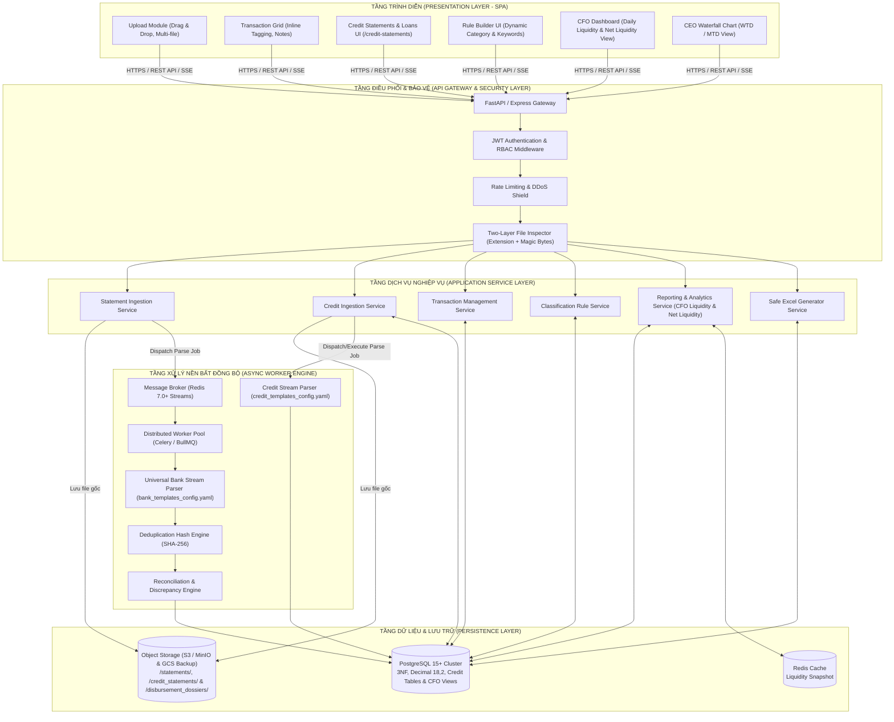
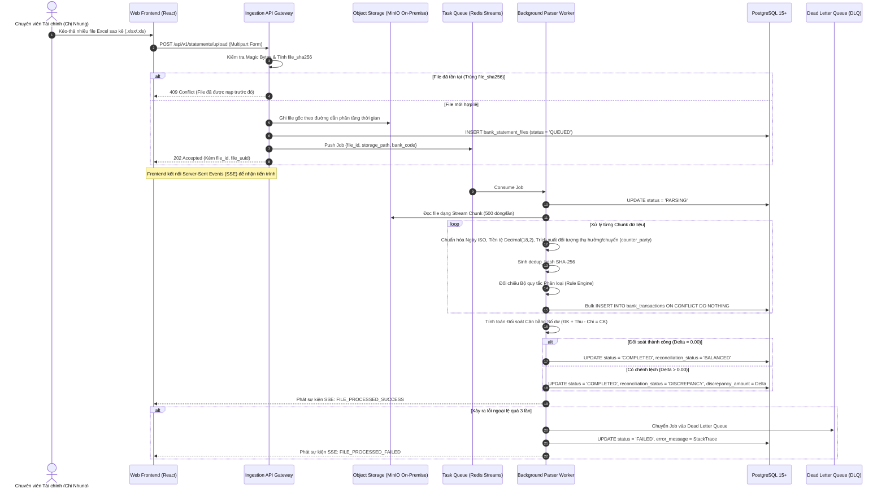
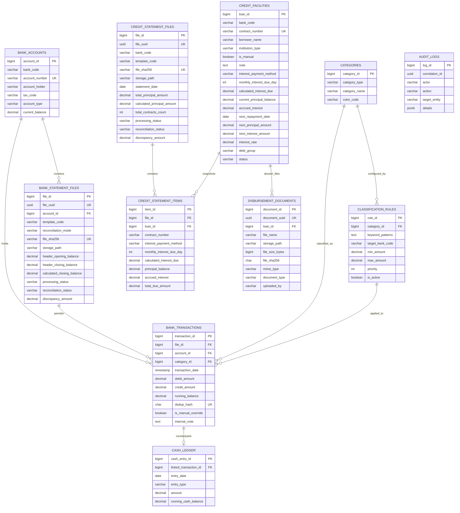
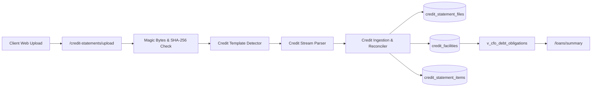

# TÀI LIỆU THIẾT KẾ KIẾN TRÚC PHẦN MỀM (SOFTWARE ARCHITECTURE DOCUMENT - SAD)

> **Dự án:** Hệ thống Xử lý & Báo cáo Sao kê Ngân hàng Tự động (Bank Statement Processing & Reporting System)  
> **Mã dự án:** `BSP-2026`  
> **Phiên bản:** 1.0.0  
> **Tiêu chuẩn kiến trúc:** IEEE 1471 / ISO/IEC/IEEE 42010 (Mô hình Kruchten 4+1 Views)  
> **Chủ trì (Lead System & Data Architect):** Đội ngũ Kiến trúc sư Hệ thống (`@SystemArchitect`)  
> **Tài liệu căn cứ:** [`docs/BRD.md`](./BRD.md), [`docs/Bank_Mapping_Matrix.md`](./Bank_Mapping_Matrix.md), [`database/schema.sql`](../database/schema.sql), [`docs/api_contracts.yaml`](./api_contracts.yaml), [`docs/security_threat_modeling.md`](./security_threat_modeling.md), [`agent/common_rules.md`](../agent/common_rules.md), [`Software Development Life Cycle (SDLC)`](../Software%20Developmemt%20Life%20Cycle%20SDLC/SDLC.md)

---

## 1. Kiểm soát Phiên bản & Lịch sử Phê duyệt (Document Control)

| Phiên bản | Ngày cập nhật | Người thực hiện | Nội dung thay đổi |
| :---: | :---: | :---: | :--- |
| **0.1.0** | 2026-10-27 | `@SystemArchitect` | Khởi thảo kiến trúc hệ thống sơ bộ (Draft Architecture Baseline) |
| **1.0.0** | 2026-10-29 | `@SystemArchitect` | Hoàn thiện tài liệu SAD chuẩn mực theo mô hình 4+1 Views: Tích hợp đầy đủ các bài toán nghiệp vụ thực tế từ BRD (7+ ngân hàng, tài khoản MBBank cá nhân, Tồn quỹ kép, Quy tắc nâng cao, Khóa ghi đè, Báo cáo CFO < 9h sáng, Biểu đồ Waterfall CEO và Xuất Excel an toàn) |
| **1.1.0** | 2026-10-29 | `@SystemArchitect` | Đồng bộ với `docs/Bank_Mapping_Matrix.md`: Chuẩn hóa Universal Config-Driven Stream Parser (`bank_templates_config.yaml`), 5 chế độ đối soát (`MODE_1`..`MODE_5`), cô lập dữ liệu Đa Pháp nhân (Multi-Entity Isolation qua `tax_code`/`account_holder`), và đồng nhất cấu trúc API Waterfall |
| **1.2.0** | 2026-10-30 | `@SystemArchitect` | Cập nhật cấu hình Hạ tầng Lưu trữ: Chuẩn hóa kiến trúc Hybrid Cloud Object Storage với MinIO On-Premise làm kho chính nội bộ (Primary) và tự động đồng bộ Backup lên Google Cloud Storage (GCS) phục vụ Disaster Recovery |
| **1.3.0** | 2026-10-30 | `@SystemArchitect` | Chuẩn hóa Hàng đợi Thông điệp: Lựa chọn dứt khoát Redis 7.0+ Streams làm Message Broker chính nhằm tinh gọn hạ tầng, tối ưu tài nguyên và chia sẻ chung cụm Redis với tầng Cache |
| **1.4.0** | 2026-10-30 | `@SystemArchitect` | Đồng bộ hoàn thiện Hợp đồng API chuẩn OpenAPI 3.0.3 (`docs/api_contracts.yaml`) và Tài liệu Đánh giá Rủi ro & Kiến trúc Bảo mật Đa tầng (`docs/security_threat_modeling.md`) tuân thủ nghiêm ngặt Giai đoạn 2 SDLC |
| **1.5.0** | 2026-10-31 | `@SystemArchitect` | Đồng bộ toàn diện theo sản phẩm thực tế: Bổ sung phân hệ Sao kê Tín dụng Doanh nghiệp (`CreditStatementService`, `CreditStreamParser`, `credit_templates_config.yaml`), cập nhật mô hình CSDL (`credit_statement_files`, `credit_facilities`, `credit_statement_items`, `v_cfo_debt_obligations`), chuẩn hóa Tồn quỹ CFO theo 2 Khối ngân hàng và tích hợp chỉ số Thanh khoản Ròng (Net Liquidity) trước 9h sáng |
| **1.6.0** | 2026-11-02 | `@SystemArchitect` | Mở rộng kiến trúc Quản lý Khoản vay: Bổ sung module Nhập lẻ khoản vay thủ công (Manual Loan Entry) từ các Ngân hàng, Công ty tài chính, Cho thuê tài chính; cập nhật schema `credit_facilities` (`institution_type`, `is_manual`, `note`), các REST endpoints CRUD và bộ lọc đa chiều |
| **1.7.0** | 2026-11-02 | `@SystemArchitect` | Bổ sung trường Hình thức trả lãi (`interest_payment_method`), Ngày trả lãi hằng tháng (`monthly_interest_due_day`), module tính số lãi cần trả theo Thông tư 14/2017/TT-NHNN (`loan_interest_service.py`), liên kết Hồ sơ giải ngân lưu tại Object Storage (`disbursement_documents` & thư mục `/disbursement_dossiers/`) |

---

## 2. Bối cảnh & Mục tiêu Kiến trúc (Architectural Goals & Constraints)

### 2.1. Mục tiêu Kiến trúc Cốt lõi (Core Architectural Goals)
1. **Độ chính xác số học Tuyệt đối ($100\%$ Absolute Precision):** Triệt tiêu hoàn toàn sai số trôi dấu phẩy động nhị phân; $100\%$ dữ liệu tiền tệ lưu trữ và tính toán bằng kiểu số thực có độ chính xác cao `DECIMAL(18, 2)` / `NUMERIC(18, 2)`.
2. **Hiệu năng & Khả năng chịu tải I/O (High-Throughput Streaming):** Xử lý đồng thời nhiều file sao kê dung lượng lớn từ $\ge 7$ ngân hàng thương mại với cơ chế đọc phân mảnh (Chunking Stream), giữ mức chiếm dụng bộ nhớ RAM luôn $\le 512\text{MB}$ chống tràn bộ nhớ (OOM).
3. **Phản hồi Tức thì cho Quản trị (< 100ms Query SLA):** Cung cấp Dashboard tổng hợp Tồn quỹ hợp nhất (2 khối tài khoản ngân hàng: Khối 1 Doanh nghiệp + Khối 2 Ủy quyền CEO, không tính quỹ tiền mặt) và Thanh khoản Ròng sau khi trừ nghĩa vụ nợ tín dụng đến hạn cho Giám đốc Tài chính (CFO) trước 9h00 sáng với thời gian truy vấn dưới $100\text{ms}$.
4. **Kiến trúc Phi trạng thái & Tách biệt Ranh giới (Stateless & Loose Coupling):** Phân tách tuyệt đối giữa hạ tầng lưu trữ nhị phân (Object Storage) và CSDL quan hệ (RDBMS). Mọi tác vụ bóc tách nặng đều xử lý qua Hàng đợi thông điệp bất đồng bộ (Async Message Queue).
5. **Bảo mật Đa tầng (Defense in Depth & DevSecOps):** Xác thực định dạng file qua Magic Bytes, chống SQL Injection, chống Cross-Site Scripting (XSS), và sanitize chống Formula/CSV Injection khi xuất Excel.

### 2.2. Ràng buộc Kỹ thuật Bắt buộc (Architectural Constraints)
- **Hệ điều hành & Nền tảng:** Đóng gói Container hóa chuẩn Docker / OCI.
- **Cơ sở dữ liệu:** PostgreSQL 15+ (Hỗ trợ chuẩn 3NF, kiểu `DECIMAL(18, 2)`, JSONB và GIN Indexing).
- **Lưu trữ Blob & Sao lưu (Hybrid Object Storage):** Sử dụng MinIO On-Premise (chuẩn S3 API) làm kho lưu trữ chính nội bộ (Primary Storage), tích hợp tiến trình tự động đồng bộ sao lưu dự phòng sang Google Cloud Storage (GCS Coldline/Archive) phục vụ phòng chống thảm họa (Disaster Recovery).
- **Hàng đợi Thông điệp:** Redis 7.0+ Streams (Tối ưu hóa tài nguyên RAM/CPU, thống nhất hạ tầng hàng đợi và cache, hỗ trợ Consumer Groups cho tác vụ bóc tách ngầm).
- **Backend Stack:** Python 3.11+ (FastAPI / Celery) hoặc Node.js 20+ (NestJS / BullMQ).
- **Frontend Stack:** Single Page Application (React 18+ / TypeScript / Vite / Tailwind CSS).

---

## 3. Mô hình Kiến trúc Kruchten 4+1 Views

```
                        ┌─────────────────────────────────┐
                        │      1. Logical View            │
                        │ (Phân tầng Dịch vụ & Domain)    │
                        └───────────────┬─────────────────┘
                                        │
        ┌───────────────────────────────┼───────────────────────────────┐
        ▼                               ▼                               ▼
┌───────────────────────┐   ┌───────────────────────┐   ┌───────────────────────┐
│    2. Process View    │   │  5. Use Case View     │   │  3. Development View  │
│(Đồng thời, Queue, DLQ)│◄──┤  (Kịch bản Nghiệp vụ  │──►│(Cấu trúc Module, Code)│
└───────────────────────┘   │   Cốt lõi - +1 View)  │   └───────────────────────┘
        ▲                   └───────────────────────┘                   ▲
        │                               │                               │
        └───────────────────────────────┼───────────────────────────────┘
                                        ▼
                        ┌─────────────────────────────────┐
                        │     4. Physical / Deploy View   │
                        │ (Container, Nginx, Cluster DB)  │
                        └─────────────────────────────────┘
```

---

### 3.1. Logical View (Góc nhìn Phân tầng Hệ thống)

Kiến trúc hệ thống được chia thành **5 tầng độc lập (Layered Architecture)** với ranh giới rõ ràng:



---

### 3.2. Process View (Góc nhìn Tiến trình, Đồng thời & Hàng đợi)

Để đảm bảo hệ thống không bị "đơ" hay timeout khi chị Cẩm Nhung nạp đồng thời file từ hơn 7 ngân hàng vào mỗi buổi sáng, toàn bộ luồng bóc tách được chuyển đổi thành mô hình **Xử lý Bất đồng bộ Hướng Sự kiện (Event-Driven Asynchronous Processing)**:



#### Cơ chế Idempotent & Xử lý Lỗi (Fault-Tolerance & DLQ):
1. **Tính Idempotent:** Mỗi Job bóc tách đều mang mã định danh duy nhất `file_id`. Worker kiểm tra trạng thái trước khi thực thi; nếu file đã ở trạng thái `COMPLETED`, Job sẽ tự động bị hủy bỏ để tránh bóc tách hai lần.
2. **Dead Letter Queue (DLQ) & Retry Policy:** 
   - Cấu hình cơ chế Retry tối đa **3 lần** với thuật toán lùi theo số mũ (Exponential Backoff: $2\text{s} \rightarrow 8\text{s} \rightarrow 32\text{s}$).
   - Sau 3 lần thất bại liên tiếp (ví dụ: file Excel bị hỏng cấu trúc zip, lỗi mạng I/O), Job được định tuyến sang `DLQ_statements_failed` để kỹ sư bảo trì kiểm tra, không gây tắc nghẽn hàng đợi chính.

---

### 3.3. Development View (Góc nhìn Tổ chức Thành phần & Mã nguồn)

Dự án được cấu trúc theo mô hình **Monorepo / Clean Architecture**, phân tách module rõ ràng:

```text
bank-statement-system/
├── backend/
│   ├── app/
│   │   ├── api/                     # Tầng Giao tiếp API Endpoints
│   │   │   ├── v1/
│   │   │   │   ├── statements.py    # Ingestion & Upload APIs
│   │   │   │   ├── credit_statements.py # Credit & Loan Statements APIs (/credit-statements, /loans)
│   │   │   │   ├── transactions.py  # Grid, Inline Tag & Note APIs
│   │   │   │   ├── rules.py         # Rule Builder & Categories APIs
│   │   │   │   └── reports.py       # CFO Dashboard & CEO Waterfall APIs
│   │   ├── core/                    # Cấu hình hệ thống, Bảo mật & Log
│   │   │   ├── config.py
│   │   │   ├── security.py          # JWT, CORS, Magic Bytes, Sanitizer
│   │   │   └── database.py          # SQLAlchemy Session & Pool
│   │   ├── models/                  # Định nghĩa ORM Entities (PostgreSQL)
│   │   │   ├── account.py
│   │   │   ├── statement_file.py
│   │   │   ├── transaction.py
│   │   │   ├── category_rule.py
│   │   │   ├── cash_ledger.py
│   │   │   └── credit.py            # CreditStatementFile, CreditFacility, CreditStatementItem
│   │   ├── schemas/                 # Pydantic Schemas (Data Contracts)
│   │   │   ├── account.py, transaction.py, statement.py, report.py
│   │   │   └── credit.py            # CreditFacilityItem, Summary, Upload schemas
│   │   └── services/                # Tầng Nghiệp vụ cốt lõi (Domain Logic)
│   │       ├── parser/              # Động cơ Bóc tách Mẫu Động (Bank & Credit)
│   │       │   ├── bank_templates_config.yaml   # Cấu hình 6 lớp cho 7 mẫu tài khoản
│   │       │   ├── credit_templates_config.yaml # Cấu hình mẫu tín dụng (CTG_LOAN_XLS, MBB_LOAN_LD_XLSX)
│   │       │   ├── template_detector.py         # Nhận diện Magic Bytes & Signature
│   │       │   ├── universal_stream_parser.py   # Đọc OOXML & BIFF8, Unmerge, Entity Resolver
│   │       │   └── credit_stream_parser.py      # Bóc tách khế ước LD & đối soát dư nợ
│   │       ├── cleansing_service.py # Chuẩn hóa Date ISO & Decimal
│   │       ├── reconciler.py        # Đối soát số dư 5 chế độ (MODE_1 .. MODE_5)
│   │       ├── credit_ingestion_service.py # Xử lý pipeline nạp & đối soát tín dụng
│   │       ├── rule_engine.py       # Bộ so khớp luật từ khóa nâng cao
│   │       └── excel_exporter.py    # Xuất file Excel chuẩn kế toán an toàn
│   └── workers/                     # Tác vụ Worker chạy nền (Celery / Bull)
│       ├── celery_app.py
│       └── statement_tasks.py
├── frontend/
│   ├── src/
│   │   ├── components/              # UI Components tái sử dụng
│   │   │   ├── layout/              # Sidebar, TopHeader, Navbar
│   │   │   ├── common/              # Button, Modal, Dropdown, Table
│   │   │   ├── upload/              # DragDropZone, ProgressTracker
│   │   │   ├── transactions/        # InlineTaggingRow, NoteEditor
│   │   │   ├── rules/               # RuleBuilderForm, CategoryManager
│   │   │   └── charts/              # WaterfallChart, LiquidityWidget
│   │   ├── pages/                   # Màn hình chức năng chính
│   │   │   ├── UploadPage.tsx
│   │   │   ├── TransactionsPage.tsx
│   │   │   ├── CreditStatementsPage.tsx # Màn hình Sao kê Tín dụng & Danh mục Nợ Vay
│   │   │   ├── RuleManagementPage.tsx
│   │   │   ├── CFODashboardPage.tsx # Báo cáo Tồn quỹ (<9h) & Thanh khoản Ròng
│   │   │   └── CEOWaterfallPage.tsx # Biểu đồ Thác nước WTD/MTD
│   │   ├── types/                   # TypeScript interfaces (credit.ts, index.ts)
│   │   └── services/                # Axios API Client & Endpoints
├── database/
│   ├── migrations/                  # Alembic / Flyway migration scripts
│   └── schema.sql                   # Bản DDL chuẩn hóa 3NF (Accounts, Transactions, Credit & Views)
└── docs/                            # Tài liệu dự án (BRD, SAD, API, Specs)
```

---

### 3.4. Physical & Deployment View (Góc nhìn Hạ tầng & Môi trường Triển khai)

Hệ thống được đóng gói dạng micro-services thông qua **Docker Compose** cho môi trường nội bộ doanh nghiệp (On-Premise) hoặc **Kubernetes / Cloud Run** trên nền tảng đám mây:

```mermaid
flowchart LR
    subgraph InternetZone["VÙNG TRUY CẬP (INTERNET / INTRANET)"]
        ClientBrowser["Trình duyệt Kế toán / CFO / CEO"]
    end

    subgraph DMZ["VÙNG ĐỆM AN NINH (DMZ)"]
        NginxProxy["Nginx Reverse Proxy & SSL Termination<br/>CORS, Gzip, Rate-limit, WAF"]
    end

    subgraph AppCluster["VÙNG ỨNG DỤNG (CONTAINER PODS)"]
        WebUI["Web Frontend Container<br/>Node.js / Nginx Static (Port 80)"]
        APIBackend["FastAPI Backend Container<br/>Gunicorn / Uvicorn Workers (Port 8000)"]
        WorkerNodes["Celery Worker Containers<br/>(Autoscaling 2-8 Replicas)"]
    end

    subgraph InfraCluster["VÙNG HẠ TẦNG LƯU TRỮ NỘI BỘ (ISOLATED)"]
        PostgresPod[("PostgreSQL 15 Cluster<br/>Primary-Replica (Port 5432)")]
        RedisPod[("Redis 7.0+ Sentinel<br/>Streams Broker & Cache (Port 6379)")]
        MinIOPod[("MinIO Cluster (Primary Object Storage)<br/>Encrypted On-Premise (Port 9000)")]
    end

    subgraph CloudDR["VÙNG ĐÁM MÂY DỰ PHÒNG THẢM HỌA (OFF-SITE BACKUP)"]
        GCSBackup[("Google Cloud Storage (GCS)<br/>Coldline/Archive Bucket (Encrypted)")]
    end

    ClientBrowser -->|HTTPS 443| NginxProxy
    NginxProxy -->|HTTP Static| WebUI
    NginxProxy -->|HTTP API / SSE| APIBackend
    APIBackend <--> RedisPod
    APIBackend <--> PostgresPod
    APIBackend --> MinIOPod
    WorkerNodes <--> RedisPod
    WorkerNodes <--> PostgresPod
    WorkerNodes <--> MinIOPod
    MinIOPod -.->|Đồng bộ sao lưu ngầm tự động (Replication/Cron)| GCSBackup
```

---

### 3.5. Use Case & Scenario View (Hiện thực hóa Kịch bản Nghiệp vụ Cốt lõi)

#### Kịch bản 1: Xử lý Luồng Tiền mặt qua Tài khoản MBBank của Bà Nguyễn Thị Lan Anh
- **Cấu hình dữ liệu:** Trong bảng `bank_accounts`, tài khoản MBBank mang cờ `account_type = 'SPECIAL_CASH'`.
- **Cơ chế xử lý:**
  1. $100\%$ giao dịch ghi nhận trên tài khoản này được gán trực tiếp là chi phí công ty (không qua bộ lọc loại trừ cá nhân).
  2. Bất kỳ giao dịch rút tiền mặt nào từ tài khoản này tự động sinh ra một bản ghi đối ứng kép trong bảng `cash_ledger` (Sổ quỹ tiền mặt):
     $$\text{Tồn quỹ tiền mặt mới} = \text{Tồn quỹ tiền mặt cũ} + \text{Số tiền rút}$$
  3. Báo cáo Tồn quỹ CFO sẽ hợp nhất:
     $$\mathbf{Tổng\ tồn\ quỹ} = \sum_{\text{All Accounts}} \text{Số dư ngân hàng} + \text{Tồn quỹ tiền mặt}$$

#### Kịch bản 2: Cơ chế Phân loại Từ khóa Nâng cao & Khóa Bảo vệ Ghi đè (`is_manual_override`)
- **Thuật toán Khớp luật:**
  ```python
  def classify_transaction(trans: BankTransaction, rules: List[ClassificationRule]):
      # NGUYÊN TẮC BẢO VỆ: Nếu người dùng đã gán tay -> KHÔNG ĐƯỢC PHÉP ĐÈ
      if trans.is_manual_override:
          return trans.category_id

      for rule in sorted(rules, key=lambda r: r.priority):
          if not rule.is_active:
              continue
          
          # Kiểm tra điều kiện ngân hàng / số TK
          if rule.target_bank_code and rule.target_bank_code != trans.bank_code:
              continue
          if rule.target_account_number and rule.target_account_number != trans.account_number:
              continue
              
          # Kiểm tra điều kiện luồng tiền (Thu/Chi)
          if rule.applies_to_flow == 'CREDIT' and trans.credit_amount <= 0:
              continue
          if rule.applies_to_flow == 'DEBIT' and trans.debit_amount <= 0:
              continue
              
          # Kiểm tra ngưỡng tiền (Min/Max)
          amount = trans.credit_amount if trans.credit_amount > 0 else trans.debit_amount
          if rule.min_amount and amount < rule.min_amount:
              continue
          if rule.max_amount and amount > rule.max_amount:
              continue

          # Kiểm tra từ khóa nội dung (Không phân biệt hoa/thường, hỗ trợ tiếng Việt)
          if match_keywords(trans.description, rule.keyword_patterns):
              trans.applied_rule_id = rule.rule_id
              return rule.category_id

      return None  # Giao dịch Chưa phân loại (Uncategorized)
  ```
- **Khi Chị Cẩm Nhung gán nhãn thủ công hoặc nhập Ghi chú (`internal_note`):**
  - Hệ thống thực hiện:
    ```sql
    UPDATE bank_transactions 
    SET category_id = :cat_id, 
        internal_note = :note, 
        is_manual_override = TRUE 
    WHERE transaction_id = :id;
    ```
  - Khi người dùng bấm nút *"Chạy lại quy tắc tự động"*, câu lệnh SQL quét lại chỉ chạm vào các dòng có `is_manual_override = FALSE`.

#### Kịch bản 3: Biểu đồ Thác nước (Waterfall Chart) Thu/Chi phục vụ CEO Nguyễn Thị Lan Anh
- Cấu trúc dữ liệu trả về từ API `/api/v1/reports/ceo/waterfall?timeframe=MTD` (đồng bộ hoàn toàn với `docs/api_contracts.yaml`):
  ```json
  {
    "timeframe": "MTD",
    "opening_balance": 110000000000.00,
    "income_components": [
      { "category_name": "Thu bán hàng & Đối tác", "amount": 65000000000.00 },
      { "category_name": "Thu hoàn ứng", "amount": 2500000000.00 }
    ],
    "expense_components": [
      { "category_name": "Chi Nhà cung cấp", "amount": 32000000000.00 },
      { "category_name": "Chi Lương & Phúc lợi", "amount": 12000000000.00 },
      { "category_name": "Chi Rút tiền mặt (MBBank)", "amount": 5000000000.00 },
      { "category_name": "Chi Thuế & Lãi vay", "amount": 3050000000.00 }
    ],
    "steps": [
      { "name": "Số dư Đầu kỳ", "type": "OPENING", "value": 110000000000.00 },
      { "name": "Thu bán hàng & Đối tác", "type": "INCOME", "value": 65000000000.00 },
      { "name": "Thu hoàn ứng", "type": "INCOME", "value": 2500000000.00 },
      { "name": "Chi Nhà cung cấp", "type": "EXPENSE", "value": -32000000000.00 },
      { "name": "Chi Lương & Phúc lợi", "type": "EXPENSE", "value": -12000000000.00 },
      { "name": "Chi Rút tiền mặt (MBBank)", "type": "EXPENSE", "value": -5000000000.00 },
      { "name": "Chi Thuế & Lãi vay", "type": "EXPENSE", "value": -3050000000.00 },
      { "name": "Số dư Cuối kỳ", "type": "CLOSING", "value": 125450000000.00 }
    ],
    "closing_balance": 125450000000.00
  }
  ```

#### Kịch bản 4: Định tuyến Đa Pháp nhân (Multi-Entity Isolation) & Mở rộng Mẫu Ngân hàng Mới (Zero-Code Onboarding)
- **Định tuyến Đa Pháp nhân (`Entity-Agnostic Template`):**
  - Toàn bộ 7 mẫu cấu hình hiện có (`MBB_CORP_XLSX`, `MBB_PERSONAL_XLSX`, `MBV_CORP_XLSX`, `VPB_CORP_XLSX`, `TPB_CORP_XLSX`, `CTG_EFAST_XLS`, `SHB_CORP_XLS`) tại [`docs/Bank_Mapping_Matrix.md`](./Bank_Mapping_Matrix.md) hoạt động ở tầng **Global Shared Layer**, không gắn cứng tên công ty hay số tài khoản.
  - Khi nạp file, `UniversalStreamParser` trích xuất động `(account_number, account_holder, tax_code)` từ Header sao kê để tự động phân vùng dữ liệu theo từng doanh nghiệp (`tax_code` / `account_holder`), cho phép dùng chung 1 mẫu sao kê để quét độc lập cho nhiều doanh nghiệp khác nhau.
- **Mở rộng Ngân hàng Mới ($\le 15$ phút):** Khi phát sinh ngân hàng mới (VCB, TCB, BIDV, ACB...), quản trị viên chỉ cần thêm 1 block cấu hình vào `bank_templates_config.yaml` với 1 trong 5 chế độ đối soát (`MODE_1` $\rightarrow$ `MODE_5`) mà không cần sửa đổi mã nguồn.

#### Kịch bản 5: Bóc tách Sao kê Tín dụng, Đối soát Dư nợ & Tích hợp Thanh khoản Ròng CFO (Net Liquidity)
- **Tiếp nhận & Nhận diện Mẫu:** Kế toán nạp file sao kê khoản vay/khế ước nhận nợ LD (`.xls`, `.xlsx`). `CreditStreamParser` tự nhận diện mẫu qua Magic Bytes và signatures (`CTG_LOAN_XLS`, `MBB_LOAN_LD_XLSX`).
- **Bóc tách & Đối soát Cân bằng Dư nợ:** Bóc tách từng khế ước vay, số tiền giải ngân, ngày đáo hạn, lãi suất, dư nợ gốc và lịch trả nợ; thực hiện đối soát tự động:
  $$\sum \text{Dư nợ gốc từng khoản vay} = \text{Tổng dư nợ ghi trên file} \quad (\Delta = 0.00\text{ VND})$$
  Đánh dấu file `BALANCED` nếu khớp 100%, hoặc `DISCREPANCY` kèm chênh lệch.
- **Đồng bộ Danh mục Khoản vay & Thanh khoản Ròng:** Tự động upsert dữ liệu vào `credit_facilities` và lưu snapshot vào `credit_statement_items`. CFO Dashboard tự động kết xuất chỉ số:
  $$\text{Thanh khoản Ròng (Net Liquidity)} = \text{Tổng tồn quỹ hợp nhất (2 khối NH)} - \text{Nghĩa vụ nợ gốc \& lãi đến hạn kỳ tới}$$
- **Nhập Lẻ Khoản Nợ / Vay Ngoài Sao Kê Tự Động (Manual Loan Entry):** Cho phép kế toán viên trực tiếp nhập thêm các khoản nợ từ các Ngân hàng thương mại, Công ty tài chính (FE Credit, Home Credit, HD SAISON...), Công ty cho thuê tài chính (VietinBank Leasing, Chailease, BSL Leasing...) với đầy đủ validation chống trùng lặp, cờ `is_manual = true`, tự động tính toán nghĩa vụ trả nợ và tích hợp ngay vào tổng dư nợ và báo cáo CFO.

---

## 4. Mô hình Thực thể - Quan hệ Chi tiết (Data Architecture & ERD)



---

## 5. Chiến lược Hiệu năng, Mở rộng & Tối ưu CSDL (Performance & Scalability)

| Thành phần | Kỹ thuật Tối ưu Hóa Áp dụng | Chỉ số Cam kết (SLA / Target) |
| :--- | :--- | :--- |
| **Stream Parser** | Kỹ thuật đọc chunk 500 dòng thông qua generator không tải cả file vào RAM | RAM $\le 512\text{MB}$; Xử lý file 50.000 dòng $\le 30\text{s}$ |
| **CFO Daily Query** | View `v_cfo_daily_liquidity` (2 khối NH) kết hợp `v_cfo_debt_obligations` truy vấn trực tiếp trên bảng đã đánh index | Thời gian truy vấn API $\le 100\text{ms}$ |
| **Báo cáo Giao dịch** | Composite Index trên `(account_id, transaction_date DESC)` và Phân trang Cursor/Offset | Tải trang danh sách 50 dòng $\le 200\text{ms}$ |
| **Full-text Search** | Chỉ mục GIN trên `to_tsvector('simple', description)` cho cột nội dung chuyển khoản | Tìm kiếm từ khóa tức thì trong hàng trăm ngàn dòng |
| **Connection Pool** | Cấu hình PgBouncer / SQLAlchemy Pool (Pool Size: 20, Max Overflow: 10) | Hỗ trợ 200+ yêu cầu đồng thời không nghẽn kết nối |

---

## 6. Kiến trúc Bảo mật & An toàn Thông tin (Security by Design)

1. **Phòng chống Formula/CSV Injection khi Xuất Excel:**
   - Kẻ tấn công có thể cố tình gửi tiền kèm nội dung `=cmd|'/C calc'!A0` để chiếm quyền điều khiển máy tính khi kế toán mở file Excel.
   - Giải pháp kiến trúc: Tầng `SafeExcelGeneratorService` tự động kiểm tra và thêm tiền tố nháy đơn `'` cho mọi ô text bắt đầu bằng `=`, `+`, `-`, `@`.
2. **Xác thực Định dạng File Đa tầng (Two-Layer Ingestion Validation):**
   - Tầng 1: Kiểm tra đuôi mở rộng file (`.xlsx`, `.xls`).
   - Tầng 2: Kiểm tra Magic Bytes nhị phân ở đầu file:
     - `.xlsx`: `50 4B 03 04` (PK Zip format header).
     - `.xls`: `D0 CF 11 E0 A1 B1 1A E1` (Compound File Binary Format).
   - Ngăn chặn hoàn toàn việc đổi tên mã độc `.exe`, `.sh` thành `.xlsx` để tải lên máy chủ.
3. **Phân quyền Truy cập & Kiểm soát Biên Dữ liệu (RBAC & Isolation):**
   - Chuyên viên Tài chính (Chị Nhung): Quyền tải file, sửa quy tắc, gán tag, nhập ghi chú, xuất báo cáo.
   - Ban Giám đốc (CFO Tuấn, CEO Lan Anh): Quyền xem Dashboard, biểu đồ và xuất báo cáo cấp cao.
   - Toàn bộ thao tác sửa đổi thủ công đều ghi nhận `audit_logs` kèm `correlation_id` phục vụ kiểm toán độc lập.

---

## 7. Kế hoạch Dự phòng & Phục hồi Thảm họa (Disaster Recovery & Backup)

- **Cơ sở dữ liệu (PostgreSQL):** Cấu hình cơ chế sao lưu liên tục Write-Ahead Logging (WAL-G / Barman) kết hợp bản Snapshot hằng ngày vào lúc 01h00 sáng. Đảm bảo RPO $\le 15$ phút và RTO $\le 30$ phút.
- **Hạ tầng File Gốc (Hybrid Object Storage Replication):**
  - **Kho chính nội bộ (Primary MinIO):** Kích hoạt tính năng **Object Versioning** và thiết lập chính sách lưu trữ bất biến (WORM - Write Once, Read Many). File gốc sau khi nạp không thể bị xóa hoặc sửa đổi bởi bất kỳ người dùng nào, đảm bảo bằng chứng pháp lý khi cơ quan Thuế / Kiểm toán nhà nước yêu cầu đối chiếu.
  - **Sao lưu đám mây ngoại vi (Off-site GCS Backup):** Thiết lập tiến trình đồng bộ bất đồng bộ tự động (sử dụng MinIO Bucket Replication hoặc Rclone cronjob) đẩy toàn bộ file gốc đã mã hóa sang Google Cloud Storage (GCS Coldline/Archive). Đảm bảo nếu trung tâm dữ liệu nội bộ gặp thảm họa (cháy nổ, hỏng ổ cứng, ransomware), toàn bộ kho dữ liệu sao kê gốc vẫn được khôi phục nguyên vẹn 100%.

---

## 8. Kiến trúc Phân hệ Sao kê Tín dụng Doanh nghiệp (Credit & Loan Facilities)



- **Mô hình Dữ liệu Tín dụng:**
  - `credit_statement_files`: Quản lý tệp sao kê tín dụng, băm SHA-256 chống trùng và đối soát tổng dư nợ báo cáo.
  - `credit_facilities`: Bảng danh mục khoản vay/khế ước hiện hành, lưu thông tin dư nợ gốc, lãi suất, hình thức trả lãi (`MONTHLY`/`END_OF_TERM`), ngày trả lãi hằng tháng, số tiền lãi tính theo Thông tư 14/2017/TT-NHNN (`calculated_interest_due`), ngày đáo hạn, gốc & lãi đến hạn, nhóm nợ.
  - `credit_statement_items`: Snapshot chi tiết từng đợt upload để truy vết kiểm toán độc lập kèm hình thức trả lãi và số lãi tính toán.
  - `disbursement_documents`: Bộ hồ sơ giải ngân của từng khoản vay lưu trữ trên Object Storage (MinIO On-Premise) với cấu trúc phân cấp `/disbursement_dossiers/{bank_code}/{contract_number}/...`, lưu trữ đầy đủ chữ ký số SHA-256 chống giả mạo.
- **Tính toán Lãi Vay Pháp lý (Thông tư 14/2017/TT-NHNN):** Áp dụng chuẩn thời gian cơ sở Actual/365, nguyên tắc tính ngày đầu bỏ ngày cuối cho cả 2 hình thức: trả lãi hằng tháng theo chu kỳ và trả lãi cuối kỳ khi đáo hạn.
- **Đối soát Tín dụng:** Khớp tổng dư nợ bóc tách được với tổng dư nợ khai báo trên file với độ lệch tuyệt đối `discrepancy_amount = 0.00 VND`.


