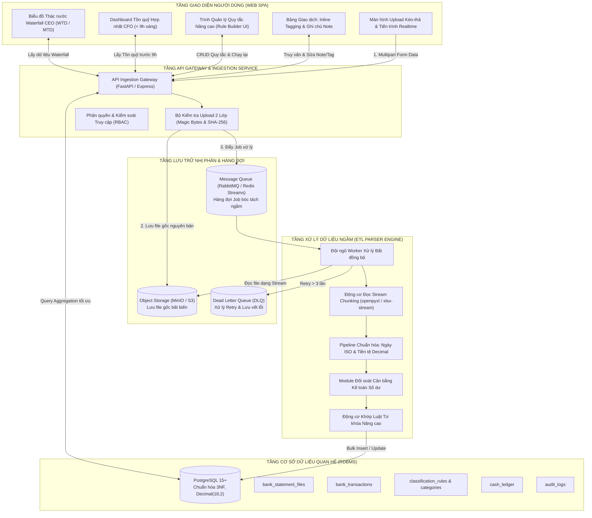

# TÀI LIỆU THIẾT KẾ KIẾN TRÚC HỆ THỐNG (SOFTWARE ARCHITECTURE SPECIFICATION)

> **Dự án:** Hệ thống Xử lý & Báo cáo Sao kê Ngân hàng Tự động (Bank Statement Processing & Reporting System)  
> **Phiên bản:** 1.0.0  
> **Trạng thái:** Bản thiết kế Kiến trúc Chính thức (Architectural Baseline)  
> **Chủ trì (Lead System Architect):** System & Data Architect Team (`@SystemArchitect`)  
> **Tài liệu căn cứ:** [`docs/BRD.md`](./BRD.md), [`docs/Bank_Mapping_Matrix.md`](./Bank_Mapping_Matrix.md), [`agent/PRODUCT_SPEC.md`](../agent/PRODUCT_SPEC.md), [`agent/common_rules.md`](../agent/common_rules.md), [`agent/02_system_architect/rules.md`](../agent/02_system_architect/rules.md)

---

## 1. Tổng quan Kiến trúc Hệ thống (System Architecture Overview)

Hệ thống được thiết kế theo mô hình **Kiến trúc Phân tầng Hướng Dịch vụ (Layered Service-Oriented Architecture)** kết hợp cơ chế **Xử lý Bất đồng bộ dựa trên Sự kiện (Event-Driven Async Processing)**, giải quyết triệt để bài toán nghẽn I/O khi xử lý đồng thời nhiều file Excel lớn từ $\ge 7$ ngân hàng.



---

## 2. Thiết kế Hạ tầng Lưu trữ & Phân tầng File Gốc (Object Storage Architecture)

Tuân thủ nghiêm ngặt nguyên tắc **Stateless & Tách biệt Hoàn toàn giữa Blob và RDBMS**:

1. **Quy tắc Phân cấp Đường dẫn Định danh (Deterministic Partitioning):**
   ```text
   s3://bank-statements/statements/{bank_code}/{YYYY}/{MM}/{file_uuid}_{sanitized_original_filename}.xlsx
   ```
   - `{bank_code}`: VCB, TCB, ACB, BIDV, MBB,...
   - `{YYYY}/{MM}`: Phân vùng theo năm và tháng nạp file để tối ưu tốc độ duyệt bucket.
   - `{file_uuid}`: UUIDv4 ngẫu nhiên chống ghi đè khi nạp các file trùng tên.

2. **Chống Trùng lặp File qua Mã Băm SHA-256:**
   - Khi tiếp nhận file tại Gateway, tính toán ngay chuỗi `file_sha256 = SHA256(file_content)`.
   - Kiểm tra nhanh trên bảng `bank_statement_files(file_sha256)`. Nếu đã tồn tại $\rightarrow$ Trả về mã lỗi `409 Conflict` kèm thông tin ngày giờ nạp trước đó, chặn hoàn toàn việc xử lý trùng lặp.

3. **Chính sách Truy cập An toàn (Security Policy):**
   - Bucket ở chế độ `Private`, không mở public.
   - Khi người dùng cần tải lại file gốc để đối chiếu, API Gateway sinh **Pre-signed URL** với thời gian sống (TTL) tối đa **15 phút**.

---

## 3. Kiến trúc Động cơ Xử lý Dữ liệu Ngầm (ETL & Parser Engine)

Động cơ đọc sao kê được thiết kế để giải quyết bài toán tải trọng nặng từ $\ge 7$ ngân hàng mỗi ngày:

1. **Kỹ thuật Đọc Stream Chunking (Chống Tràn Bộ Nhớ - OOM Prevention):**
   - TUYỆT ĐỐI KHÔNG nạp toàn bộ workbook Excel vào RAM (tránh dùng `pandas.read_excel()` thông thường).
   - Sử dụng cơ chế đọc theo luồng (Streaming generator) với kích thước chunk từ **500 đến 1.000 dòng/lần**:
     - Trong Python: `openpyxl` ở chế độ `read_only=True` kết hợp `itertools.islice`.
     - Trong TypeScript/Node.js: `exceljs` hoặc `xlsx-stream-reader`.
   - Giữ mức chiếm dụng bộ nhớ RAM luôn $\le 512\text{MB}$ ngay cả khi xử lý file sao kê hàng chục ngàn dòng.

2. **Quy tắc Ép Kiểu & Toàn vẹn Số học:**
   - Toàn bộ giá trị tiền tệ bắt buộc ép sang kiểu `Decimal` với thuật toán làm tròn ngân hàng chuẩn mực `ROUND_HALF_UP`.
   - Khi làm sạch chuỗi tiền tệ từ XML/Excel (như `'1.441E8'`, `'4.99999999E8'`), chỉ xóa từ khóa tiền tệ (`(?i)(VND|USD)`), khoảng trắng, `\t` và dấu phân cách; bảo toàn ký tự số mũ `E`/`e` trong Scientific Notation trước khi truyền vào `Decimal()`.
   - Xử lý số âm kế toán trong ngoặc đơn: Chuỗi `(1,500,000)` được chuyển đổi thành số âm chuẩn `-1500000.00`.

3. **Công thức Đối soát Kế toán Cân bằng Số dư 5 Chế độ (`MODE_1` $\rightarrow$ `MODE_5`):**
   $$\text{Số dư cuối kỳ tính toán} = \text{Số dư đầu kỳ (hoặc nội suy)} + \sum \text{Phát sinh Có (Thu)} - \sum \text{Phát sinh Nợ (Chi)}$$
   $$\text{Độ lệch} \ (\Delta) = |\text{Số dư cuối kỳ thực tế} - \text{Số dư cuối kỳ tính toán}|$$
   - Hỗ trợ đầy đủ 5 chế độ đối soát và nội suy số dư (`MODE_1_FULL_HEADER_FOOTER`, `MODE_2_INFERRED_OPENING_CLOSING`, `MODE_3_DERIVED_RUNNING_BALANCE`, `MODE_4_TOTAL_FLOW_ONLY`, `MODE_5_CUTOFF_INTEREST_INCLUDED`) theo đặc tả tại [`docs/Bank_Mapping_Matrix.md`](./Bank_Mapping_Matrix.md).
   - Nếu $\Delta = 0.00 \rightarrow$ Ghi nhận `reconciliation_status = 'BALANCED'`.
   - Nếu $\Delta \neq 0.00 \rightarrow$ Ghi nhận `reconciliation_status = 'DISCREPANCY'`, lưu giá trị $\Delta$ và kích hoạt cờ cảnh báo trên màn hình cho chị Cẩm Nhung.

4. **Chống Trùng lặp Giao dịch (Transaction Deduplication - 6-Tuple Canonical Hash):**
   - Tính toán chuỗi canonical hash 6 thành phần cho từng dòng giao dịch (phân biệt chính xác các bút toán tách Phí/VAT cùng mã tham chiếu):
     $$\text{dedup\_hash} = \text{SHA256}(\text{account\_number} \parallel \text{"|"} \parallel \text{trans\_date\_iso} \parallel \text{"|"} \parallel \text{debit} \parallel \text{"|"} \parallel \text{credit} \parallel \text{"|"} \parallel \text{ref\_no} \parallel \text{"|"} \parallel \text{running\_balance})$$
   - Tận dụng ràng buộc `UNIQUE(account_id, dedup_hash)` trên CSDL kết hợp cú pháp `ON CONFLICT DO NOTHING` hoặc gắn cờ `is_duplicate = TRUE`.

5. **Kiến trúc Đa Pháp nhân (Multi-Entity Isolation) & Mở rộng Ngân hàng Mới (Zero-Code):**
   - Cấu hình mẫu trong `bank_templates_config.yaml` hoàn toàn độc lập với Pháp nhân (`Entity-Agnostic`), tự động trích xuất động `(account_number, account_holder, tax_code)` từ Header sao kê để định tuyến và cô lập dữ liệu cho nhiều doanh nghiệp khác nhau trên cùng một mẫu.

---

## 4. Thiết kế Mô hình Dữ liệu Quan hệ (Relational Database Design - 3NF)

Cơ sở dữ liệu được tổ chức theo chuẩn **PostgreSQL 15+**, tuân thủ nghiêm ngặt chuẩn 3NF:

| Tên Bảng (Table Name) | Mục đích Quản lý | Khóa chính & Ràng buộc quan trọng |
| :--- | :--- | :--- |
| **`bank_accounts`** | Quản lý $\ge 7$ tài khoản ngân hàng và tài khoản cá nhân MBBank bà Lan Anh | `account_id (PK)`, `account_number (UNIQUE)` |
| **`bank_statement_files`** | Quản lý file gốc, metadata, kỳ sao kê và kết quả đối soát số dư | `file_id (PK)`, `file_sha256 (UNIQUE)` |
| **`categories`** | Danh mục Thu/Chi do người dùng tự tạo trên giao diện | `category_id (PK)`, `UNIQUE(category_type, category_name)` |
| **`classification_rules`** | Bộ quy tắc từ khóa kết hợp điều kiện nâng cao (AND/OR) | `rule_id (PK)`, `priority (ASC)` |
| **`bank_transactions`** | Chi tiết từng giao dịch sạch, Decimal(18,2), cờ khóa ghi đè | `transaction_id (PK)`, `UNIQUE(account_id, dedup_hash)` |
| **`cash_ledger`** | Sổ theo dõi dòng tiền mặt đối ứng từ TK MBBank bà Lan Anh | `cash_entry_id (PK)`, `linked_transaction_id (FK)` |
| **`audit_logs`** | Ghi nhận nhật ký kiểm toán toàn bộ thao tác hệ thống | `log_id (PK)`, `correlation_id (UUID)` |

*Chi tiết toàn bộ câu lệnh DDL khởi tạo đã được đóng gói hoàn chỉnh tại tệp mã nguồn: [`database/schema.sql`](../database/schema.sql).*

---

## 5. Hiện thực hóa các Yêu cầu Nghiệp vụ Đặc thù của Doanh nghiệp

### 5.1. Luồng Đối chiếu Dòng tiền Mặt qua TK Cá nhân MBBank (Bà Nguyễn Thị Lan Anh)
- **Thiết lập:** Cấu hình tài khoản MBBank với cờ `account_type = 'SPECIAL_CASH'`.
- **Logic tự động:**
  - $100\%$ các phát sinh chi tiền trên tài khoản MBBank của bà Lan Anh được tự động ghi nhận là chi phí hoạt động của công ty.
  - Các bút toán rút tiền mặt từ tài khoản này tự động sinh ra một bản ghi đối ứng trong bảng `cash_ledger` với `entry_type = 'INFLOW'` (Nhập quỹ tiền mặt).
  - Phân tách rõ ràng giữa:
    $$\mathbf{Tổng\ thanh\ khoản} = \mathbf{Tồn\ ngân\ hàng\ (\ge 7\ TK)} + \mathbf{Tồn\ quỹ\ tiền\ mặt\ (Cash\ on\ Hand)}$$

### 5.2. Động cơ Phân loại Từ khóa Nâng cao kết hợp Khóa Ghi đè (Override Protection)
- **Quy trình khớp luật:**
  1. Khi một giao dịch mới được nạp, kiểm tra cờ `is_manual_override`. Nếu `TRUE` $\rightarrow$ **Bỏ qua, không can thiệp**.
  2. Quét lần lượt các quy tắc trong bảng `classification_rules` theo thứ tự `priority ASC`.
  3. Kiểm tra đồng thời các điều kiện:
     $$\text{Match} = (\text{Chứa từ khóa}) \land (\text{Khớp TK/Ngân hàng}) \land (\text{Khớp ngưỡng tiền}) \land (\text{Khớp chiều Thu/Chi})$$
  4. Nếu khớp $\rightarrow$ Gán `category_id` và gán `applied_rule_id`, dừng quét.
  5. Nếu không khớp bất kỳ luật nào $\rightarrow$ Giữ `category_id = NULL` (Nhóm *Chưa phân loại*).
- **Phân loại thủ công (Manual Tagging):** Khi chị Cẩm Nhung click chọn danh mục hoặc sửa Ghi chú trên UI:
  - Cập nhật `category_id` và `internal_note`.
  - Tự động set `is_manual_override = TRUE`.
  - Khi người dùng bấm nút *"Chạy lại quy tắc"*, câu lệnh SQL cập nhật có điều kiện bảo vệ:
    ```sql
    UPDATE bank_transactions 
    SET category_id = :new_cat_id 
    WHERE is_manual_override = FALSE AND ...;
    ```

### 5.3. Báo cáo CFO Trần Ngọc Tuấn (Sẵn sàng trước 9h00 Sáng)
- Tạo sẵn Database View chuyên dụng: `v_cfo_daily_liquidity`.
- Tốc độ phản hồi API `/api/v1/reports/cfo/daily-liquidity` đạt $\le 100\text{ms}$ nhờ cấu trúc chỉ mục trên `bank_accounts(current_balance)` và `cash_ledger(running_cash_balance)`.

### 5.4. Biểu đồ Thác nước (Waterfall Chart) Phân rã Thu/Chi cho CEO Nguyễn Thị Lan Anh
- API `/api/v1/reports/ceo/waterfall?timeframe=MTD` thực hiện truy vấn nhóm theo `category_name`:
  - Điểm neo xuất phát: $\text{Opening Balance}$.
  - Nhánh Dương (Cột xanh tăng): $\sum \text{Credit}$ theo từng Danh mục Thu.
  - Nhánh Âm (Cột đỏ giảm): $\sum \text{Debit}$ theo từng Danh mục Chi (bao gồm cả dòng chi tiền mặt MBBank).
  - Điểm neo kết thúc: $\text{Closing Balance}$.

### 5.5. Module Xuất Excel Chuẩn Mực Kế toán & Phòng chống Tấn công Formula Injection
- **Chuẩn định dạng:**
  - Ngày: `DD/MM/YYYY`, căn giữa.
  - Tiền tệ: Format `#,##0.00`, căn phải.
  - Dòng tổng cộng: Sử dụng công thức `SUBTOTAL(9, C2:C1000)` để khi người dùng lọc bảng trên Excel, con số tổng vẫn nhảy chính xác theo bộ lọc.
- **Kỹ thuật chống Formula/CSV Injection:**
  Trước khi ghi bất kỳ chuỗi ký tự nào (Diễn giải, Ghi chú nội bộ, Tên danh mục) vào ô Excel, kiểm tra ký tự đầu tiên:
  ```python
  if value and str(value)[0] in ('=', '+', '-', '@', '\t', '\r'):
      value = "'" + str(value)  # Escape bằng dấu nháy đơn
  ```

---

## 6. Kế hoạch Kiểm định Kiến trúc & Bàn giao Kỹ thuật (Technical Sign-off)

1. **Hợp đồng API:** Đã ban hành toàn bộ tại [`docs/api_contracts.yaml`](./api_contracts.yaml).
2. **Cơ sở Dữ liệu:** Đã biên soạn mã DDL tại [`database/schema.sql`](../database/schema.sql).
3. **Sẵn sàng chuyển giao:** Toàn bộ bản thiết kế đã đáp ứng trọn vẹn $100\%$ các User Stories trong [`docs/BRD.md`](./BRD.md), sẵn sàng để **Data Parser Engineer (`@DataParserEngineer`)** xây dựng động cơ bóc tách và **Fullstack Developer (`@FullstackDeveloper`)** triển khai giao diện.

