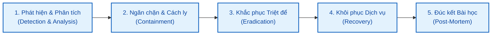

# TÀI LIỆU ĐÁNH GIÁ RỦI RO VÀ KIẾN TRÚC BẢO MẬT (SECURITY ARCHITECTURE & THREAT MODELING SPECIFICATION)

> **Dự án:** Hệ thống Xử lý & Báo cáo Sao kê Ngân hàng Tự động (Bank Statement Processing & Reporting System)  
> **Mã dự án:** `BSP-2026`  
> **Phiên bản:** 1.0.0  
> **Ngày ban hành:** 2026-10-30  
> **Phân loại an ninh:** TÀI LIỆU NỘI BỘ BẢO MẬT (CONFIDENTIAL - INTERNAL USE ONLY)  
> **Chủ trì thiết kế:** Lead System & Data Architect (`@SystemArchitect`)  
> **Đơn vị phối hợp:** Chuyên gia Đảm bảo Chất lượng & An ninh Thông tin (`@QASecuritySpec`)  
> **Tài liệu căn cứ:** [`docs/BRD.md`](./BRD.md), [`docs/SAD.md`](./SAD.md), [`database/schema.sql`](../database/schema.sql), [`docs/api_contracts.yaml`](./api_contracts.yaml), [`agent/common_rules.md`](../agent/common_rules.md), [`agent/02_system_architect/rules.md`](../agent/02_system_architect/rules.md)

---

## 1. Kiểm soát Tài liệu & Lịch sử Phê duyệt (Document Control)

| Phiên bản | Ngày cập nhật | Người thực hiện | Vai trò | Nội dung thay đổi |
| :---: | :---: | :---: | :---: | :--- |
| **0.1.0** | 2026-10-28 | `@SystemArchitect` | Lead Architect | Khởi tạo khung đánh giá rủi ro sơ bộ và bề mặt tấn công |
| **1.0.0** | 2026-10-30 | `@SystemArchitect` | Lead Architect | Ban hành chính thức Tài liệu Đánh giá Rủi ro và Kiến trúc Bảo mật Đa tầng: Mô hình hóa mối đe dọa STRIDE, Ma trận định lượng rủi ro CVSS v3.1, 10 chuyên đề kiểm soát an ninh triệt để (Formula Injection, Zip Bomb, XXE, OOM DoS, Multi-Entity Isolation, MinIO WORM, GCS DR, RBAC Matrix và Audit Trail) |

### Khung Tiêu chuẩn Tuân thủ (Compliance Frameworks)
Tài liệu này được xây dựng bám sát các tiêu chuẩn an toàn thông tin quốc tế và quy định pháp lý chuyên ngành tài chính - ngân hàng tại Việt Nam:
1. **ISO/IEC 27001:2022:** Hệ thống quản lý an toàn thông tin (ISMS) - Kiểm soát truy cập, mã hóa và an toàn vận hành.
2. **OWASP Top 10 (2021/2025):** Phòng chống 10 lỗ hổng ứng dụng web phổ biến nhất (Broken Access Control, Cryptographic Failures, Injection, Insecure Design...).
3. **NIST SP 800-53 Rev 5:** Các biện pháp kiểm soát an ninh và quyền riêng tư cho hệ thống thông tin liên bang.
4. **Thông tư 09/2020/TT-NHNN:** Quy định về an toàn hệ thống thông tin trong hoạt động ngân hàng của Ngân hàng Nhà nước Việt Nam.
5. **Luật Kế toán Việt Nam số 88/2015/QH13:** Quy định về tính bất biến, toàn vẹn và thời hạn lưu trữ chứng từ điện tử tối thiểu 10 năm.

---

## 2. Mục tiêu An toàn Thông tin & Tuyên bố Phạm vi (Security Goals & Scope)

### 2.1. Mục tiêu Cốt lõi (Security Objectives)
Hệ thống xử lý trực tiếp các dữ liệu tài chính sống còn, bao gồm dòng tiền, số dư tài khoản ngân hàng doanh nghiệp và thông tin chi tiêu cá nhân của Ban Lãnh đạo. Do đó, kiến trúc bảo mật phải thỏa mãn 4 mục tiêu "Không Thỏa hiệp" sau:
- **Bảo mật Tuyệt đối (Confidentiality):** Không để rò rỉ số dư tài khoản, biến động dòng tiền hoặc thông tin chuyển khoản nội bộ ra bên ngoài; ngăn chặn triệt để hiện tượng rò rỉ chéo số liệu giữa các pháp nhân doanh nghiệp (`tax_code`).
- **Toàn vẹn Số học 100% (Integrity):** Triệt tiêu hoàn toàn khả năng can thiệp trái phép, làm sai lệch số dư đầu kỳ/cuối kỳ hoặc sửa đổi dữ liệu giao dịch; bảo đảm mọi thay đổi thủ công đều có dấu vết kiểm toán bất biến và được khóa bảo vệ (`is_manual_override = true`).
- **Sẵn sàng Vận hành Cao (Availability):** Bảo đảm báo cáo tồn quỹ hợp nhất cho Giám đốc Tài chính (CFO) luôn sẵn sàng trước **09h00 sáng mỗi ngày** với SLA phản hồi $\le 100\text{ms}$; hệ thống miễn nhiễm với các cuộc tấn công gây cạn kiệt bộ nhớ (OOM) hoặc làm tắc nghẽn hàng đợi xử lý ngầm.
- **Tính Bất biến & Không thể Chối bỏ (Non-Repudiation):** File sao kê gốc được lưu trữ ở chế độ WORM (Write Once, Read Many); mọi thao tác gán nhãn, sửa ghi chú hoặc chạy lại luật đều được ghi nhận chi tiết vào `audit_logs` gắn với `correlation_id` và danh tính người thực hiện.

### 2.2. Phạm vi Đánh giá (Assessment Scope)
- **Tầng Giao diện & Trình duyệt (Client-side):** Ứng dụng Single Page Application (React 18 / TypeScript).
- **Tầng Vành đai & Gateway (Perimeter & API Gateway):** Nginx Reverse Proxy, WAF, Rate Limiter, FastAPI Backend Gateway.
- **Tầng Xử lý Ngầm (Background Workers):** Cụm Celery / Redis 7.0+ Streams Worker, động cơ bóc tách file Excel và bộ kiểm tra đối soát.
- **Tầng Lưu trữ Nhị phân (Object Storage):** Cụm MinIO On-Premise nội bộ và tiến trình sao lưu dự phòng Google Cloud Storage (GCS).
- **Tầng Cơ sở Dữ liệu (RDBMS):** Cụm PostgreSQL 15+ lưu trữ giao dịch, số dư, cấu hình luật và nhật ký kiểm toán.

---

## 3. Bề mặt Tấn công & Sơ đồ Luồng Dữ liệu Bảo mật (Attack Surface & DFD Trust Boundaries)

Hệ thống thiết lập **4 Vùng Ranh giới Tin cậy (Trust Boundaries - TB)** phân tầng độc lập nhằm ngăn chặn sự lây lan theo chiều ngang (Lateral Movement) khi một thành phần bị xâm nhập:

```mermaid
flowchart TD
    subgraph TB0["VÙNG KHÔNG TIN CẬY (UNTRUSTED ZONE - INTERNET / USERS)"]
        Attacker["Kẻ tấn công bên ngoài / Mã độc"]
        Accountant["Chuyên viên Tài chính (Chị Nhung)"]
        CFO_CEO["Ban Lãnh đạo (CFO Tuấn / CEO Lan Anh)"]
    end

    subgraph TB1["RANH GIỚI TIN CẬY 1: VÀNH ĐAI BẢO VỆ (DMZ PERIMETER)"]
        NginxWAF["Nginx Reverse Proxy & ModSecurity WAF<br/>• TLS 1.3 Strict / HSTS<br/>• Rate Limiting (100 req/min)<br/>• Header Sanitization & CORS"]
    end

    subgraph TB2["RANH GIỚI TIN CẬY 2: DỊCH VỤ ỨNG DỤNG (APPLICATION LAYER)"]
        APIGateway["FastAPI Gateway Container<br/>• JWT Verification (RS256)<br/>• RBAC Authorization Engine<br/>• Two-Layer File Inspector (Magic Bytes)"]
        StreamParserService["Stream Ingestion Service<br/>• Zip Bomb / XXE Sanitizer"]
    end

    subgraph TB3["RANH GIỚI TIN CẬY 3: HÀNG ĐỢI & XỬ LÝ NGẦM CÔ LẬP (WORKER SANDBOX)"]
        RedisBroker["Redis 7.0+ Streams (Auth + TLS)<br/>• Isolated Task Stream<br/>• Dead Letter Queue (DLQ)"]
        WorkerPool["Celery Worker Pods (Sandboxed cgroups)<br/>• Memory Limit 1GB<br/>• Read-only Filesystem Mount"]
    end

    subgraph TB4["RANH GIỚI TIN CẬY 4: LƯU TRỮ VÀ DỮ LIỆU BẢO MẬT (PERSISTENCE LAYER)"]
        MinIOStore[("MinIO Cluster (Primary WORM Storage)<br/>• Encrypted at Rest (AES-256)<br/>• Non-Public Bucket / Pre-signed URL")]
        PostgresDB[("PostgreSQL 15+ Cluster<br/>• Least Privilege App User<br/>• Row-Level Security (tax_code)<br/>• Immutable audit_logs")]
        GCSBackup[("Off-site Google Cloud Storage (GCS)<br/>• Coldline/Archive Bucket (Encrypted)<br/>• Disaster Recovery Replication")]
    end

    Accountant & CFO_CEO -->|1. HTTPS 443 / Bearer JWT| NginxWAF
    Attacker -.->|Tấn công DDOS / Malicious Payload| NginxWAF
    
    NginxWAF -->|2. Validated Requests| APIGateway
    APIGateway -->|3. Pre-flight Validation| StreamParserService
    StreamParserService -->|4. Lưu file thô WORM| MinIOStore
    StreamParserService -->|5. Đẩy Task Metadata| RedisBroker
    
    RedisBroker -->|6. Consume Job| WorkerPool
    WorkerPool -->|7. Đọc Stream File| MinIOStore
    WorkerPool -->|8. Batch Insert có đối soát| PostgresDB
    
    APIGateway <-->|9. Truy vấn nghiệp vụ & Audit Trail| PostgresDB
    MinIOStore -.->|10. Đồng bộ sao lưu tự động (DR)| GCSBackup

    classDef untrusted fill:#ffebee,stroke:#c62828,stroke-width:2px;
    classDef dmz fill:#fff3e0,stroke:#ef6c00,stroke-width:2px;
    classDef app fill:#e8f5e9,stroke:#2e7d32,stroke-width:2px;
    classDef worker fill:#e1f5fe,stroke:#0277bd,stroke-width:2px;
    classDef db fill:#f3e5f5,stroke:#6a1b9a,stroke-width:2px;

    class Attacker,Accountant,CFO_CEO untrusted;
    class NginxWAF dmz;
    class APIGateway,StreamParserService app;
    class RedisBroker,WorkerPool worker;
    class MinIOStore,PostgresDB,GCSBackup db;
```

### Phân loại Tài sản Thông tin (Information Assets Classification)

| Mã Tài sản | Tên Tài sản | Định dạng / Nơi lưu trữ | Phân loại | Tác động khi bị Xâm phạm |
| :--- | :--- | :--- | :---: | :--- |
| **AST-01** | **File sao kê gốc** | MinIO Object Storage & GCS | **Tuyệt Mật** | Bị hủy hoại chứng từ gốc phục vụ thanh tra thuế hoặc rò rỉ sao kê ra đối thủ |
| **AST-02** | **Dữ liệu giao dịch & Số dư** | PostgreSQL `bank_transactions` | **Tuyệt Mật** | Lộ bí mật dòng tiền, nhà cung cấp chiến lược hoặc gian lận số liệu |
| **AST-03** | **Sổ quỹ tiền mặt cá nhân** | PostgreSQL `cash_ledger` | **Tuyệt Mật** | Xâm phạm quyền riêng tư của Ban Tổng Giám đốc (Bà Lan Anh) |
| **AST-04** | **Quy tắc phân loại tài chính** | PostgreSQL `classification_rules` | **Mật** | Phân loại sai thu/chi làm sai lệch báo cáo thuế và điều hành |
| **AST-05** | **Khóa ký JWT & Thông tin Auth** | HashiCorp Vault / ENV Secrets | **Tối Mật** | Toàn bộ hệ thống bị chiếm quyền điều khiển (Account Takeover) |
| **AST-06** | **Nhật ký kiểm toán** | PostgreSQL `audit_logs` | **Tuyệt Mật** | Bị sửa đổi dấu vết xóa sạch hành vi gian lận nội bộ |

---

## 4. Mô hình Hóa Mối Đe Dọa Chi tiết theo Khung STRIDE (STRIDE Threat Analysis)

Mô hình hóa mối đe dọa được thực hiện chi tiết cho từng thành phần trong hệ thống:

```
+-----------------------------------------------------------------------------------+
|                            STRIDE THREAT TAXONOMY                                 |
+-----------------------------------------------------------------------------------+
| S - Spoofing Identity        : Giả mạo User, Worker Callback hoặc Gateway         |
| T - Tampering with Data      : Làm sai lệch file, sửa số dư, sửa is_manual_override|
| R - Repudiation              : Chối bỏ trách nhiệm sửa đổi thủ công               |
| I - Information Disclosure   : Lộ số dư, rò rỉ chéo Đa Pháp nhân, lộ PII Lãnh đạo |
| D - Denial of Service        : Zip Bomb, XML Billion Laughs, tràn RAM (OOM)       |
| E - Elevation of Privilege   : Kế toán nâng quyền CFO/Admin, Broken Object Auth   |
+-----------------------------------------------------------------------------------+
```

### 4.1. Spoofing Identity (Giả mạo Danh tính)
- **T-SPOOF-01 (Giả mạo Token phiên làm việc):** Kẻ tấn công sử dụng JWT Token bị đánh cắp hoặc token hết hạn chưa bị thu hồi để gọi API dưới quyền Chuyên viên Tài chính hoặc Ban Giám đốc.
- **T-SPOOF-02 (Giả mạo Worker Callback):** Kẻ tấn công trên mạng nội bộ giả mạo thông điệp hoàn tất từ Worker gửi về API Gateway để cập nhật trạng thái file mà không thực sự xử lý.
- **T-SPOOF-03 (Giả mạo Định dạng File - Magic Bytes Spoofing):** Kẻ tấn công đổi tên một file thực thi nguy hiểm (`malware.exe` hoặc script shell) thành `statement.xlsx` để vượt qua bộ kiểm tra phần mở rộng file.

### 4.2. Tampering with Data (Làm sai lệch Dữ liệu)
- **T-TAMP-01 (Can thiệp File Sao kê trên Object Storage):** Kẻ tấn công hoặc nhân sự nội bộ sửa đổi file sao kê đã lưu trên kho lưu trữ nhị phân nhằm che giấu các giao dịch rút ruột công quỹ.
- **T-TAMP-02 (Can thiệp Trực tiếp vào Cơ sở Dữ liệu):** Sửa đổi số dư tài khoản trong `bank_accounts` hoặc chèn các giao dịch giả mạo vào `bank_transactions`.
- **T-TAMP-03 (Bypass Khóa Bảo vệ Phân loại Thủ công):** Quy tắc tự động chạy ngầm cố tình hoặc vô tình ghi đè lên các dòng giao dịch kế toán đã tự tay phân loại (`is_manual_override = true`).
- **T-TAMP-04 (XML External Entity - XXE Injection):** File Excel `.xlsx` thực chất là một gói nén Open Packaging Convention (OPC) chứa các tệp XML. Kẻ tấn công chèn thực thể bên ngoài (`<!ENTITY xxe SYSTEM "file:///etc/passwd">`) vào tệp `workbook.xml` hoặc `sharedStrings.xml` để đọc trộm file trên máy chủ.
- **T-TAMP-05 (Formula / CSV Injection khi Xuất Báo cáo):** Kẻ chuyển tiền độc hại cố tình đặt nội dung giao dịch là `=cmd|'/C calc'!A0` hoặc `@SUM(...)`. Khi kế toán tải báo cáo Excel về máy trạm mở ra, Microsoft Excel sẽ thực thi mã độc.

### 4.3. Repudiation (Chối bỏ Trách nhiệm)
- **T-REPU-01 (Chối bỏ Chỉnh sửa Phân loại hoặc Ghi chú):** Kế toán viên thay đổi danh mục giao dịch hoặc nhập ghi chú giải trình sai nhưng không có cơ chế ghi nhận ai đã sửa, vào thời điểm nào và giá trị trước đó là gì.
- **T-REPU-02 (Chối bỏ Thao tác Xóa File Sao kê):** Người dùng xóa file sao kê và các bút toán liên quan nhưng đổ lỗi cho lỗi kỹ thuật của hệ thống.

### 4.4. Information Disclosure (Rò rỉ Thông tin Nhạy cảm)
- **T-INFO-01 (Rò rỉ Chéo Đa Pháp nhân - Cross-Tenant Bleed):** Doanh nghiệp A nhìn thấy giao dịch và số dư của Doanh nghiệp B do API không lọc chặt chẽ theo `tax_code` hoặc `entity_id`.
- **T-INFO-02 (Rò rỉ Thông tin Tiền mặt Cá nhân của Lãnh đạo):** Báo cáo chi tiêu cá nhân của bà Nguyễn Thị Lan Anh tại ngân hàng MBBank bị nhân viên không có thẩm quyền truy cập và phát tán.
- **T-INFO-03 (Lộ File Gốc qua Public Object Storage Bucket):** Cấu hình sai quyền bucket trên MinIO/S3 dẫn đến việc bất kỳ ai có đường dẫn URL đều có thể tải file sao kê chứa toàn bộ lịch sử thanh toán của công ty.
- **T-INFO-04 (Rò rỉ Dữ liệu Nhạy cảm qua Logging):** File log hệ thống ghi nhận toàn văn chuỗi kết nối CSDL, token bí mật hoặc dữ liệu số tài khoản ngân hàng không được che dấu (unmasked).

### 4.5. Denial of Service (Từ chối Dịch vụ - DoS)
- **T-DOS-01 (Tấn công Zip Bomb / Decompression Bomb):** Kẻ tấn công tải lên file `.xlsx` dung lượng 20MB nhưng khi giải nén bung ra 50GB dữ liệu XML trong bộ nhớ, làm sập hoàn toàn Worker Node.
- **T-DOS-02 (Tràn Bộ nhớ RAM - OOM DoS):** Nạp đồng thời nhiều file sao kê dung lượng lớn hàng trăm ngàn dòng bằng phương thức đọc toàn bộ (`openpyxl` không stream), đẩy RAM vượt ngưỡng vật lý làm Docker cgroups tiêu diệt tiến trình.
- **T-DOS-03 (Poison Pill Job làm Nghẽn Message Queue):** File bị lỗi cấu trúc nặng khiến Worker crash lặp đi lặp lại vô tận, chiếm dụng toàn bộ worker threads và làm các file hợp lệ khác bị ách tắc.
- **T-DOS-04 (Cạn kiệt Connection Pool CSDL):** Truy vấn báo cáo nặng không tối ưu giữ kết nối PostgreSQL quá lâu, dẫn đến kiệt tài nguyên kết nối cho các chức năng khác.

### 4.6. Elevation of Privilege (Leo thang Đặc quyền)
- **T-ELEV-01 (Truy cập Trái phép Báo cáo Điều hành Cấp cao):** Chuyên viên tài chính gọi trực tiếp endpoint `/api/v1/reports/cfo/daily-liquidity` hoặc `/api/v1/reports/ceo/waterfall` vốn chỉ dành cho CFO và CEO.
- **T-ELEV-02 (Broken Object Level Authorization - BOLA/IDOR):** Thay đổi tham số `file_id` hoặc `transaction_id` trên đường dẫn URL để xem hoặc sửa dữ liệu thuộc về chi nhánh hoặc pháp nhân khác mà tài khoản không được ủy quyền.

---

## 5. Ma trận Đánh giá Rủi ro Trọng yếu & Định lượng Điểm (Risk Assessment Matrix)

Định lượng mức độ rủi ro theo thang đo **CVSS v3.1** (Common Vulnerability Scoring System) kết hợp ma trận Xác suất xảy ra (Likelihood) và Mức độ ảnh hưởng (Impact):

$$\text{Mức độ Rủi ro (Risk Level)} = \text{Xác suất (Likelihood)} \times \text{Mức độ Ảnh hưởng (Impact)}$$

| Mã Rủi ro | Tên Rủi ro Bảo mật | CVSS v3.1 | Điểm Gốc | Xác suất | Ảnh hưởng | Mức Rủi ro Gốc | Biện pháp Kiểm soát Trọng tâm | Điểm Sau Xử lý | Mức Còn lại |
| :---: | :--- | :---: | :---: | :---: | :---: | :---: | :--- | :---: | :---: |
| **`RISK-01`** | Formula / CSV Injection khi xuất Excel | `CVSS:3.1/AV:N/AC:L/PR:L/UI:R/S:C/C:H/I:H/A:H` | **9.0** | Cao | Thảm họa | **CRITICAL** | Tự động thêm tiền tố nháy đơn `'` cho ô text có tiền tố nguy hiểm (`=`, `+`, `-`, `@`) | **2.0** | **LOW** |
| **`RISK-02`** | Zip Bomb / Decompression Bomb DoS | `CVSS:3.1/AV:N/AC:L/PR:L/UI:N/S:U/C:N/I:N/A:H` | **7.5** | Trung bình | Thảm họa | **HIGH** | Giới hạn tỷ lệ giải nén $\le 1:50$, kích thước max 100MB, tối đa 100.000 dòng | **1.8** | **LOW** |
| **`RISK-03`** | XML External Entity (XXE) trong XLSX | `CVSS:3.1/AV:N/AC:L/PR:L/UI:N/S:U/C:H/I:L/A:L` | **8.2** | Trung bình | Nghiêm trọng | **HIGH** | Vô hiệu hóa DTD & External Entities trong parser XML (`defusedxml`) | **0.0** | **NONE** |
| **`RISK-04`** | Tràn bộ nhớ RAM (OOM) làm sập Worker | `CVSS:3.1/AV:N/AC:L/PR:L/UI:N/S:U/C:N/I:N/A:H` | **7.5** | Cao | Nghiêm trọng | **HIGH** | Chunking Stream Generator 500 dòng, giới hạn RAM pod cgroups 1GB | **1.5** | **LOW** |
| **`RISK-05`** | Rò rỉ Chéo Đa Pháp nhân (Cross-Tenant) | `CVSS:3.1/AV:N/AC:L/PR:L/UI:N/S:U/C:H/I:H/A:N` | **8.1** | Trung bình | Thảm họa | **HIGH** | Row-Level Security (RLS) PostgreSQL & Enforce `tax_code` tại Service Layer | **2.1** | **LOW** |
| **`RISK-06`** | Gian lận số dư & Chèn giao dịch giả mạo | `CVSS:3.1/AV:N/AC:L/PR:L/UI:N/S:U/C:N/I:H/A:N` | **6.5** | Trung bình | Nghiêm trọng | **MEDIUM** | 6-Tuple Dedup Hash, Đối soát 5 chế độ ($\Delta = 0.00$), Khóa bảo vệ `is_manual_override` | **1.2** | **LOW** |
| **`RISK-07`** | Rò rỉ File Gốc qua Public Object Storage | `CVSS:3.1/AV:N/AC:L/PR:N/UI:N/S:U/C:H/I:N/A:N` | **7.5** | Thấp | Thảm họa | **HIGH** | Cấm Public Access hoàn toàn; chỉ truy xuất qua Pre-signed URL (TTL $\le 15\text{m}$) | **1.0** | **LOW** |
| **`RISK-08`** | Leo thang Đặc quyền & BOLA/IDOR | `CVSS:3.1/AV:N/AC:L/PR:L/UI:N/S:U/C:H/I:H/A:N` | **8.1** | Trung bình | Nghiêm trọng | **HIGH** | Ma trận phân quyền RBAC đa tầng, kiểm tra quyền sở hữu đối tượng trước khi xử lý | **2.0** | **LOW** |
| **`RISK-09`** | Mất mát chứng từ gốc do thảm họa | `CVSS:3.1/AV:P/AC:L/PR:N/UI:N/S:C/C:N/I:H/A:H` | **7.3** | Thấp | Thảm họa | **HIGH** | MinIO WORM Object Locking kết hợp đồng bộ sao lưu đám mây ngoại vi sang GCS | **1.4** | **LOW** |
| **`RISK-10`** | Nghẽn hàng đợi do Poison Pill Job | `CVSS:3.1/AV:N/AC:L/PR:L/UI:N/S:U/C:N/I:N/A:M` | **5.3** | Trung bình | Trung bình | **MEDIUM** | Cơ chế Retry tối đa 3 lần với Exponential Backoff $\rightarrow$ Dead Letter Queue (DLQ) | **1.0** | **LOW** |

---

## 6. 10 Chuyên đề Kiểm soát An ninh Triệt để (Deep-Dive Security Controls)

### 6.1. Chuyên đề 1: Phòng chống Triệt để Formula / CSV Injection (CWE-1236)
- **Bản chất lỗ hổng:** Kẻ gian chuyển khoản tiền vào tài khoản công ty với nội dung giao dịch bắt đầu bằng các ký tự điều khiển công thức: `=`, `+`, `-`, `@`, `\t`, `\r` (ví dụ: `=cmd|'/C calc'!A0` hoặc `=DDE("cmd";"/C notepad";"")`). Khi kế toán hoặc Ban Giám đốc xuất báo cáo Excel và mở trên Microsoft Excel / LibreOffice, phần mềm sẽ tự động thông dịch và thực thi lệnh từ xa (Remote Code Execution - RCE) trên máy trạm của lãnh đạo.
- **Biện pháp kỹ thuật triệt để:**
  1. Tầng `SafeExcelGeneratorService` bắt buộc chạy qua bộ lọc làm sạch chuỗi trước khi ghi vào ô tính:
     ```python
     DANGEROUS_PREFIXES = ('=', '+', '-', '@', '\t', '\r')

     def sanitize_excel_cell(value: Any) -> Any:
         if isinstance(value, str):
             # Loại bỏ khoảng trắng đầu/cuối
             cleaned = value.strip()
             if cleaned.startswith(DANGEROUS_PREFIXES):
                 # Thêm tiền tố nháy đơn (') để Excel hiểu là thuần Text
                 return f"'{cleaned}"
         return value
     ```
  2. Tuyệt đối không xuất dữ liệu dạng CSV không thoát chuỗi (raw unescaped CSV).
  3. Định dạng kiểu dữ liệu tường minh: Các cột số tiền (`debit_amount`, `credit_amount`, `running_balance`) bắt buộc khai báo kiểu Numeric với định dạng hiển thị `#,##0.00` căn phải; cột ngày tháng định dạng kiểu Date `DD/MM/YYYY`; tuyệt đối không lưu số tiền dưới dạng chuỗi Text để tránh bị tiêm mã.

### 6.2. Chuyên đề 2: Kiểm soát File Tải lên Đa tầng, Chống Zip Bomb & XXE Injection (CWE-434, CWE-409, CWE-611)
- **Xác thực Định dạng File Đa tầng (Two-Layer File Validation):**
  - *Tầng 1 (Extension & MIME Check):* Chỉ chấp nhận file có phần mở rộng `.xlsx` hoặc `.xls` và header `Content-Type: application/vnd.openxmlformats-officedocument.spreadsheetml.sheet` hoặc `application/vnd.ms-excel`.
  - *Tầng 2 (Binary Magic Bytes Inspection):* Đọc 8 bytes đầu tiên của file nhị phân tại API Gateway trước khi lưu trữ:
    - Định dạng `.xlsx` (ZIP container): Bắt buộc khớp chữ ký Magic Bytes `50 4B 03 04` (PK Zip Header).
    - Định dạng `.xls` (BIFF8 OLE container): Bắt buộc khớp chữ ký Magic Bytes `D0 CF 11 E0 A1 B1 1A E1`.
    - Mọi file sai khác magic bytes đều bị từ chối ngay lập tức với mã lỗi `400 Bad Request`.
- **Chống Tấn công Zip Bomb (Decompression Bomb):**
  - Giới hạn dung lượng file tải lên tối đa **25MB**.
  - Trong quá trình giải nén OpenXML, kiểm tra tỷ lệ nén (Compression Ratio): nếu tỷ lệ giải nén vượt quá **1:50** hoặc tổng dung lượng giải nén vượt quá **100MB**, tiến trình giải nén lập tức hủy bỏ và đưa cảnh báo an ninh.
  - Giới hạn số dòng tối đa trên một sheet không vượt quá **100.000 dòng**.
- **Vô hiệu hóa XML External Entity (XXE) Injection:**
  - File `.xlsx` chứa nhiều file XML cấu trúc (`[Content_Types].xml`, `xl/workbook.xml`, `xl/sharedStrings.xml`).
  - Toàn bộ parser XML trong hệ thống (như `openpyxl`, `lxml` hoặc `defusedxml`) bắt buộc phải cấu hình tắt tính năng nạp DTD ngoài và giải quyết thực thể:
    ```python
    import defusedxml.ElementTree as ET
    # Hoặc cấu hình lxml:
    parser = etree.XMLParser(
        resolve_entities=False,
        no_network=True,
        dtd_validation=False,
        load_dtd=False
    )
    ```

### 6.3. Chuyên đề 3: Kiểm soát Bộ nhớ RAM, Chống Tràn OOM & Tấn công DoS bằng File Lớn
- **Động cơ Stream Chunking Generator:**
  - Tuyệt đối cấm tải toàn bộ file 50.000 - 100.000 dòng vào bộ nhớ RAM cùng một lúc (`read_only=True` trong `openpyxl`).
  - Áp dụng kỹ thuật đọc phân mảnh luồng (Chunking Stream) cố định **500 dòng/lần**. Sau mỗi chunk, dữ liệu được chuẩn hóa, tính hash và ghi tạm vào DB theo lô (batch insert), giải phóng con trỏ bộ nhớ (garbage collection).
  - Cam kết mức chiếm dụng bộ nhớ RAM của một Worker thread luôn **$\le 512\text{MB}$**.
- **Kiểm soát Tài nguyên bằng Container cgroups:**
  - Cấu hình giới hạn cứng trong Docker Compose / Kubernetes Deployment:
    ```yaml
    deploy:
      resources:
        limits:
          cpus: '1.5'
          memory: 1024M
        reservations:
          cpus: '0.5'
          memory: 512M
    ```
- **Tầng Giới hạn Tần suất (Rate Limiting) tại Gateway:**
  - Giới hạn mỗi tài khoản người dùng chỉ được tải lên tối đa **10 file / phút**.
  - Giới hạn kết nối đồng thời tối đa **5 tiến trình bóc tách cùng lúc** cho mỗi tổ chức/pháp nhân.

### 6.4. Chuyên đề 4: Cô lập Dữ liệu Đa Pháp nhân (Multi-Tenant & Multi-Entity Data Isolation)
- **Mô hình Dữ liệu Độc lập theo Pháp nhân:**
  - Hệ thống hỗ trợ xử lý cho nhiều công ty thành viên trong tập đoàn. Mỗi tài khoản ngân hàng đều liên kết chặt chẽ với một Mã số thuế / Mã pháp nhân cụ thể (`tax_code` trong `bank_accounts`).
  - Phân tách tuyệt đối giữa **Cấu hình mẫu dùng chung (Global Shared Templates)** lưu trong `bank_templates_config.yaml` và **Dữ liệu giao dịch theo từng pháp nhân** (`bank_transactions`). Mẫu bóc tách có thể dùng chung, nhưng dữ liệu đọc ra phải được cô lập theo đúng `account_id` và `tax_code`.
- **Áp dụng Row-Level Security (RLS) trên PostgreSQL:**
  - Kích hoạt chính sách RLS trên bảng `bank_transactions` và `bank_statement_files`:
    ```sql
    ALTER TABLE bank_transactions ENABLE ROW LEVEL SECURITY;
    
    CREATE POLICY tenant_isolation_policy ON bank_transactions
    FOR ALL
    USING (
        account_id IN (
            SELECT account_id FROM bank_accounts 
            WHERE tax_code = current_setting('app.current_tax_code', true)
        )
    );
    ```
- **Kiểm tra Quyền Sở hữu Đối tượng (Anti-BOLA/IDOR):**
  - Mọi API truy vấn theo ID (`/statements/{file_id}`, `/transactions/{transaction_id}`) đều bắt buộc kiểm tra xem tài nguyên đó có thuộc phạm vi `allowed_tax_codes` của người dùng đăng nhập hay không trước khi trả về kết quả.

### 6.5. Chuyên đề 5: Toàn vẹn Dữ liệu Kế toán, Chống Gian lận Sửa số dư & Khóa Ghi đè Thủ công
- **Mã Băm 6 Thành phần (6-Tuple Canonical Dedup Hash):**
  - Mỗi dòng giao dịch bóc tách được sinh mã băm SHA-256 duy nhất:
    $$\text{dedup\_hash} = \text{SHA-256}(\text{account\_number} \parallel \text{transaction\_date\_iso} \parallel \text{debit} \parallel \text{credit} \parallel \text{ref\_no} \parallel \text{running\_balance})$$
  - Ràng buộc CSDL: `CONSTRAINT uq_transaction_dedup UNIQUE (account_id, dedup_hash)`.
  - Nếu file bị import lại hoặc nạp trùng lặp nhiều lần, hệ thống thực thi câu lệnh:
    `INSERT INTO bank_transactions (...) ON CONFLICT (account_id, dedup_hash) DO NOTHING;`
    đảm bảo không bao giờ phát sinh giao dịch nhân đôi hoặc làm sai lệch số dư.
- **Cơ chế Khóa Bảo vệ Can thiệp Thủ công (`is_manual_override`):**
  - Khi Chuyên viên Tài chính (Chị Nhung) thực hiện gán danh mục thủ công (Inline Tagging) hoặc nhập ghi chú giải trình, hệ thống tự động bật cờ:
    `is_manual_override = TRUE`.
  - Khi người dùng bấm "Chạy lại quy tắc" (`POST /api/v1/rules/re-apply`), câu lệnh cập nhật bắt buộc loại trừ các dòng đã can thiệp tay:
    ```sql
    UPDATE bank_transactions 
    SET category_id = :new_category_id, applied_rule_id = :rule_id
    WHERE is_manual_override = FALSE AND (category_id IS NULL OR category_id != :new_category_id);
    ```
  - API trả về chỉ số minh bạch: `skipped_manual_override_count` khẳng định số lượng bản ghi thủ công được bảo toàn nguyên vẹn.
- **Thuật toán Đối soát Cân bằng Số dư 5 Chế độ (`MODE_1` .. `MODE_5`):**
  - Mọi file sao kê sau khi nạp đều trải qua quy trình đối soát số học kế toán:
    $$\text{Số dư Cuối kỳ} = \text{Số dư Đầu kỳ} + \sum \text{Phát sinh Có (Thu)} - \sum \text{Phát sinh Nợ (Chi)}$$
  - Nếu độ lệch $\Delta = |\text{Số dư Thực tế} - \text{Số dư Tính toán}| \neq 0.00$, file lập tức bị đánh dấu trạng thái `reconciliation_status = 'DISCREPANCY'` và ghi nhận `discrepancy_amount = Delta`. Toàn bộ giao dịch thuộc file này sẽ bị đánh cờ cảnh báo trên màn hình để kế toán trưởng thẩm định, ngăn chặn gian lận số liệu.

### 6.6. Chuyên đề 6: Bảo vệ Kho Lưu trữ Object Storage (MinIO On-Premise & GCS DR)
- **Nguyên tắc "Không Mở Bucket Ra Ngoài" (No Public Access):**
  - Bucket trên MinIO On-Premise và Google Cloud Storage được cấu hình chính sách `Block Public Access = True`. Tuyệt đối không cho phép truy cập nặc danh (Anonymous Access).
- **Phân phối File qua Pre-signed URL có Thời hạn Ngắn:**
  - Khi người dùng có thẩm quyền cần tải lại file sao kê gốc, API Gateway sinh Pre-signed URL thông qua thư viện AWS S3 SDK / MinIO Client với thời gian hiệu lực (TTL) tối đa **15 phút** (900 giây). Hết thời gian này, URL tự động vô hiệu lực.
- **Lưu trữ Bất biến WORM (Write Once, Read Many) & Object Locking:**
  - Kích hoạt tính năng **Object Locking** ở chế độ `Compliance Mode` trên bucket chứa file sao kê gốc:
    - File sau khi upload lên kho lưu trữ bị cấm xóa và cấm ghi đè trong thời hạn tối thiểu **10 năm** (tuân thủ Luật Kế toán).
    - Kể cả quản trị viên hệ thống (Root Admin) cũng không thể can thiệp xóa bỏ file gốc khi chính sách WORM đang có hiệu lực, bảo vệ chứng từ khỏi các cuộc tấn công mã hóa tống tiền (Ransomware) hoặc xóa vết tích gian lận.
- **Quy chuẩn Đường dẫn Phân cấp Thời gian (Deterministic Path Partitioning):**
  - `{bucket}/statements/{bank_code}/{YYYY}/{MM}/{file_uuid}_{sanitized_name}.xlsx`
  - Đảm bảo tính phân tán I/O và dễ dàng thiết lập vòng đời lưu trữ (Lifecycle Rules).

### 6.7. Chuyên đề 7: Phòng chống Tấn công CSDL (SQL Injection & DB Least Privilege)
- **100% Truy vấn Tham số hóa (Parameterized Queries):**
  - Tuyệt đối cấm sử dụng kỹ thuật nối chuỗi (String Concatenation) hoặc `f-strings` để tạo câu lệnh SQL thô.
  - Toàn bộ truy vấn đọc/ghi đều sử dụng Object Relational Mapping (SQLAlchemy / Prisma) hoặc Parameterized Prepared Statements:
    ```python
    # TUÂN THỦ: Sử dụng bind parameters
    query = text("SELECT * FROM bank_transactions WHERE account_id = :acc_id AND description ILIKE :kw")
    result = await db.execute(query, {"acc_id": account_id, "kw": f"%{keyword}%"})
    ```
- **Phân quyền Người dùng Cơ sở Dữ liệu theo Nguyên tắc Tối thiểu (Principle of Least Privilege):**
  - Hệ thống chia làm 3 tài khoản kết nối DB với các vai trò riêng biệt:
    1. `bsp_app_user`: Chỉ có quyền `SELECT, INSERT, UPDATE` trên các bảng nghiệp vụ. Cấm quyền `DELETE` trên bảng `audit_logs`. Cấm toàn bộ các lệnh DDL (`DROP, TRUNCATE, ALTER`).
    2. `bsp_worker_user`: Chỉ có quyền `INSERT, UPDATE` trên bảng `bank_transactions` và `bank_statement_files`.
    3. `bsp_migration_user`: Chỉ được sử dụng trong pipeline CI/CD khi chạy script di trú lược đồ (Alembic / Flyway), không được nhúng vào cấu hình runtime của ứng dụng.

### 6.8. Chuyên đề 8: Bảo vệ Phiên làm việc & Quản trị Token JWT (RBAC Matrix)
- **Chuẩn hóa JSON Web Token (JWT - RFC 7519):**
  - Thuật toán ký: Sử dụng thuật toán bất đối xứng **RS256** (RSA Signature with SHA-256) với cặp Private/Public Key 2048-bit lưu trữ an toàn trong HashiCorp Vault. API Gateway chỉ giữ Public Key để xác thực chữ ký token, loại bỏ nguy cơ lộ khóa bí mật từ mã nguồn.
  - Vòng đời Token (Token Lifecycle):
    - `access_token`: Thời gian sống ngắn (**15 phút**). Mang payload chứa `user_id`, `role`, `allowed_tax_codes`.
    - `refresh_token`: Thời gian sống dài (**7 ngày**), lưu trữ mã băm SHA-256 trong Redis Cache.
    - Cơ chế Xoay vòng Refresh Token (Refresh Token Rotation): Mỗi khi `refresh_token` được sử dụng để lấy `access_token` mới, hệ thống tự động hủy token cũ và cấp phát một `refresh_token` mới. Nếu phát hiện một `refresh_token` cũ đã bị sử dụng lại (dấu hiệu Token Hijacking), hệ thống lập tức khóa toàn bộ phiên làm việc của người dùng đó.
- **Ma trận Phân quyền Truy cập theo Vai trò (Role-Based Access Control - RBAC):**

| Nhóm Tài nguyên & Endpoint API | Phương thức | Chuyên viên Tài chính (`ACCOUNTANT` - Chị Nhung) | Giám đốc Tài chính (`CFO` - Ông Tuấn) | Tổng Giám đốc (`CEO` - Bà Lan Anh) | Quản trị Kỹ thuật (`SYSTEM_ADMIN`) |
| :--- | :---: | :---: | :---: | :---: | :---: |
| `POST /statements/upload` | POST | **CHO PHÉP** | TỪ CHỐI | TỪ CHỐI | TỪ CHỐI |
| `GET /statements/*` | GET | **CHO PHÉP** | **CHO PHÉP** | **CHO PHÉP** | **CHO PHÉP** |
| `DELETE /statements/{id}` | DELETE | **CHO PHÉP** (Chỉ file lỗi) | TỪ CHỐI | TỪ CHỐI | **CHO PHÉP** |
| `GET /transactions` | GET | **CHO PHÉP** | **CHO PHÉP** | **CHO PHÉP** | TỪ CHỐI |
| `PATCH /transactions/{id}` | PATCH | **CHO PHÉP** (Sửa tag/note) | TỪ CHỐI | TỪ CHỐI | TỪ CHỐI |
| `POST /transactions/bulk-tag` | POST | **CHO PHÉP** | TỪ CHỐI | TỪ CHỐI | TỪ CHỐI |
| `POST /rules/*`, `POST /categories/*` | ALL | **CHO PHÉP** | TỪ CHỐI | TỪ CHỐI | **CHO PHÉP** |
| `GET /cash-ledger` | GET | **CHO PHÉP** | **CHO PHÉP** | **CHO PHÉP** | TỪ CHỐI |
| `POST /cash-ledger` | POST | **CHO PHÉP** | TỪ CHỐI | TỪ CHỐI | TỪ CHỐI |
| `GET /reports/cfo/daily-liquidity` | GET | **CHO PHÉP** | **CHO PHÉP** | **CHO PHÉP** | TỪ CHỐI |
| `GET /reports/ceo/waterfall` | GET | TỪ CHỐI | **CHO PHÉP** | **CHO PHÉP** | TỪ CHỐI |
| `GET /reports/export/excel` | GET | **CHO PHÉP** | **CHO PHÉP** | **CHO PHÉP** | TỪ CHỐI |
| `GET /audit-logs` | GET | TỪ CHỐI | **CHO PHÉP** | **CHO PHÉP** | **CHO PHÉP** |

### 6.9. Chuyên đề 9: Bảo mật Hạ tầng Hàng đợi Bất đồng bộ (Redis Streams & Celery Sandboxing)
- **Bảo mật Kết nối Message Broker (Redis 7.0+ Streams):**
  - Kích hoạt cơ chế xác thực người dùng mạnh mẽ (Redis ACLs / Password AUTH).
  - Bắt buộc mã hóa đường truyền nội bộ bằng TLS cho toàn bộ luồng giao tiếp giữa FastAPI Gateway, Redis và Worker Pods.
- **Cơ chế Xử lý Lỗi Bền bỉ & Dead Letter Queue (DLQ):**
  - Mọi Job bóc tách file sao kê được gán thời gian thực thi tối đa (Task Timeout) là **120 giây**.
  - Nếu xảy ra lỗi ngoại lệ kỹ thuật, Worker áp dụng thuật toán thử lại theo số mũ (Exponential Backoff):
    $$\text{Retry Delay} = 2^{\text{attempt}} \times 2\text{s} \quad (\text{Lần 1: } 4\text{s}, \text{ Lần 2: } 8\text{s}, \text{ Lần 3: } 16\text{s})$$
  - Sau tối đa **3 lần** thử lại không thành công, Job được chuyển ngay lập tức vào **Dead Letter Queue (`DLQ_statements_failed`)** để không chặn các job phía sau. Hệ thống cập nhật trạng thái file thành `FAILED`, ghi nhận StackTrace vào `error_message` và phát tín hiệu cảnh báo đến đội ngũ vận hành.

### 6.10. Chuyên đề 10: Kế hoạch Khắc phục Thảm họa (Disaster Recovery & Business Continuity)
- **Mục tiêu Khắc phục Thảm họa:**
  - **RPO (Recovery Point Objective):** $\le 15$ phút (Dữ liệu giao dịch mất mát tối đa trong kịch bản thảm họa nghiêm trọng nhất không quá 15 phút).
  - **RTO (Recovery Time Objective):** $\le 30$ phút (Toàn bộ hệ thống phục hồi và hoạt động bình thường trong vòng 30 phút).
- **Chiến lược Sao lưu Cơ sở Dữ liệu (PostgreSQL):**
  - Sử dụng cơ chế lưu trữ liên tục nhật ký ghi trước (Write-Ahead Logging - WAL Archiving qua công cụ WAL-G / Barman) đẩy liên tục lên storage an toàn.
  - Bản chụp Snapshot toàn diện (Full Database Backup) được thực thi tự động vào lúc **01h00 sáng hằng ngày**.
- **Đồng bộ Ngoại vi Đám mây (Off-site Hybrid Replication sang Google Cloud Storage):**
  - Kho MinIO On-Premise đóng vai trò là Primary Storage lưu trữ tốc độ cao trong mạng nội bộ.
  - Thiết lập tiến trình đồng bộ ngầm bất đồng bộ (MinIO Bucket Replication Daemon) tự động mã hóa và đẩy toàn bộ file sao kê gốc sang **Google Cloud Storage (GCS Bucket phân hạng Coldline / Archive)** đặt tại khu vực địa lý độc lập.
  - Trong trường hợp trung tâm dữ liệu on-premise gặp sự cố thảm họa vật lý (chập cháy, ngập lụt hoặc hư hỏng toàn bộ mảng đĩa), hệ thống khôi phục có thể kéo toàn bộ kho file gốc từ GCS về mà không mất bất kỳ một chứng từ nào.

---

## 7. Kiến trúc Bảo mật Đa tầng (Defense-in-Depth Architecture Overview)

Mô hình bảo vệ Đa tầng (Defense-in-Depth) đảm bảo không có bất kỳ điểm lỗi đơn lẻ nào về mặt an ninh:

```mermaid
flowchart TD
    subgraph L1["TẦNG 1: AN NINH VÀNH ĐAI & MẠNG (PERIMETER DEFENSE)"]
        DDoS["Chống tấn công DDoS & Giới hạn Băng thông"]
        TLS["Bắt buộc giao thức mã hóa TLS 1.3 / Strict-Transport-Security (HSTS)"]
        WAF["ModSecurity WAF: Chặn SQLi, XSS, Path Traversal, Malicious User-Agent"]
        CORS["Strict CORS Policy: Chỉ cho phép Origin nội bộ doanh nghiệp"]
    end

    subgraph L2["TẦNG 2: XÁC THỰC & PHÂN QUYỀN (ACCESS CONTROL)"]
        JWT["Chữ ký JWT Asymmetric RS256 (Khóa lưu trong Vault)"]
        Rotation["Xoay vòng Refresh Token (Token Rotation) chống cướp phiên"]
        RBAC["Phân quyền theo vai trò (Accountant, CFO, CEO, Admin)"]
        TenantGuard["Kiểm tra quyền sở hữu Đa Pháp nhân (tax_code check)"]
    end

    subgraph L3["TẦNG 3: DỮ LIỆU ĐẦU VÀO & ỨNG DỤNG (INPUT HARDENING)"]
        MagicBytes["Kiểm tra Magic Bytes nhị phân (50 4B 03 04 / D0 CF 11 E0)"]
        AntiZip["Anti-Zip Bomb: Tỷ lệ nén <= 1:50, Max 100MB, Max 100k dòng"]
        SafeXML["Defused XML Parser: Vô hiệu hóa DTD & XXE hoàn toàn"]
        SafeExcel["Safe Excel Generator: Sanitize ký tự '=', '+', '-', '@' chống Formula Injection"]
    end

    subgraph L4["TẦNG 4: HÀNG ĐỢI & XỬ LÝ CÔ LẬP (WORKER SANDBOXING)"]
        RedisSec["Redis 7.0+ ACLs & Mạng nội bộ cách ly"]
        cgroups["Container Resource Limits (cgroups: 1GB RAM) chống OOM"]
        DLQ["Dead Letter Queue (DLQ) & 3-time Exponential Backoff"]
    end

    subgraph L5["TẦNG 5: CƠ SỞ DỮ LIỆU & LƯU TRỮ (DATA PERSISTENCE)"]
        MinIOWORM["MinIO WORM Object Locking: Bất biến 10 năm, Pre-signed URL TTL 15m"]
        PGParams["100% Parameterized Queries / ORM chống SQL Injection"]
        RLS["PostgreSQL Row-Level Security theo tax_code"]
        DedupGate["6-Tuple Dedup Hash: Unique Constraint ngăn chặn trùng lặp"]
        OverrideLock["Cờ is_manual_override khóa chống quy tắc đè lên sửa đổi tay"]
    end

    subgraph L6["TẦNG 6: KIỂM TOÁN & GIÁM SÁT AN NINH (OBSERVABILITY & AUDIT)"]
        AuditTrail["Bảng audit_logs bất biến lưu Before/After JSONB"]
        Correlation["Truy vết xuyên suốt bằng correlation_id (UUIDv4)"]
        SIEM["Ghi log có cấu trúc (Structured JSON) kết nối hệ sinh thái SIEM"]
        DisasterRec["Đồng bộ mã hóa Off-site GCS Coldline (RPO <= 15m, RTO <= 30m)"]
    end

    L1 --> L2 --> L3 --> L4 --> L5 --> L6
```



---

## 8. Nhật ký Kiểm toán Bất biến & Giám sát An ninh (Immutable Audit Logging & Monitoring)

### 8.1. Cấu trúc Bản ghi Kiểm toán Bất biến (`audit_logs`)
Mọi hành động tác động đến dữ liệu kế toán (Upload file, xóa file, gán danh mục thủ công, sửa ghi chú, tạo hoặc chạy lại quy tắc) bắt buộc phải được ghi nhận vào bảng `audit_logs` trong cùng một Database Transaction:

```sql
-- Cấu trúc bảng kiểm toán đã được đồng bộ chuẩn mực trong database/schema.sql
CREATE TABLE audit_logs (
    log_id BIGSERIAL PRIMARY KEY,
    correlation_id UUID NOT NULL DEFAULT uuid_generate_v4(),
    actor VARCHAR(100) NOT NULL,                            -- Danh tính người dùng (Chị Nhung) hoặc Service
    action VARCHAR(50) NOT NULL,                            -- UPLOAD_FILE, MANUAL_TAG, UPDATE_NOTE, REAPPLY_RULES...
    target_entity VARCHAR(50) NOT NULL,                     -- STATEMENT_FILE, TRANSACTION, RULE, CATEGORY
    target_id VARCHAR(50) NOT NULL,                         -- ID đối tượng chịu tác động
    details JSONB,                                          -- Trạng thái trước (Before) và sau (After)
    ip_address VARCHAR(45),                                 -- Địa chỉ IPv4/IPv6 của Client
    created_at TIMESTAMP WITH TIME ZONE DEFAULT CURRENT_TIMESTAMP
);
```

### 8.2. Cơ chế Bảo vệ Bất biến cho Nhật ký (Immutability Enforcer)
Để ngăn chặn tình trạng kẻ xâm nhập hoặc nhân viên quản trị xóa vết tích, bảng `audit_logs` được bảo vệ ở tầng CSDL bằng Database Trigger ngăn chặn triệt để các lệnh `UPDATE` và `DELETE`:

```sql
CREATE OR REPLACE FUNCTION prevent_audit_log_modification()
RETURNS TRIGGER AS $$
BEGIN
    RAISE EXCEPTION 'VI PHẠM BẢO MẬT: Bảng audit_logs là dữ liệu bất biến, nghiêm cấm chỉnh sửa hoặc xóa bỏ!';
END;
$$ LANGUAGE plpgsql;

CREATE TRIGGER trg_audit_logs_immutable
BEFORE UPDATE OR DELETE ON audit_logs
FOR EACH ROW EXECUTE FUNCTION prevent_audit_log_modification();
```

### 8.3. Giám sát Bất thường & Cảnh báo Tức thời (Anomaly Detection & Alerting)
Hệ thống thiết lập các ngưỡng kích hoạt cảnh báo an ninh thời gian thực (Real-time Alerting Rules):
1. **Cảnh báo Chênh lệch Đối soát (`RECONCILIATION_DISCREPANCY`):** Kích hoạt cảnh báo mức độ **HIGH** gửi qua email/Telegram cho Kế toán trưởng và CFO ngay khi phát hiện một file sao kê có $\Delta \neq 0.00\text{ VND}$.
2. **Cảnh báo Đăng nhập Bất thường (`BRUTE_FORCE_DETECTED`):** Kích hoạt khóa tạm thời IP và cảnh báo nếu có quá **5 lần đăng nhập thất bại liên tiếp** trong vòng 3 phút từ cùng một địa chỉ IP.
3. **Cảnh báo File vi phạm Chữ ký (`FILE_SIGNATURE_VIOLATION`):** Kích hoạt cảnh báo mức độ **CRITICAL** khi người dùng tải lên file có phần mở rộng `.xlsx` nhưng Magic Bytes không phải là `50 4B 03 04`.
4. **Cảnh báo Job lỗi chuyển vào DLQ (`JOB_MOVED_TO_DLQ`):** Kích hoạt cảnh báo mức độ **MEDIUM** đến đội ngũ DevOps khi có job bóc tách thất bại sau 3 lần retry.

---

## 9. Quy trình Ứng phó Sự cố An ninh Thông tin (Incident Response Playbook)

Quy trình phản ứng sự cố tuân thủ chuẩn **NIST SP 800-61 Rev 2** gồm 5 giai đoạn chặt chẽ:



### 9.1. Phân loại Mức độ Nghiêm trọng của Sự cố (Severity Levels)
- **Cấp độ 1 - Khẩn cấp (Severity 1 / Critical):** Hệ thống bị tấn công Formula Injection thành công; rò rỉ cơ sở dữ liệu số dư ra ngoài Internet; mất mát dữ liệu kế toán; hoặc hệ thống tê liệt không thể xuất báo cáo CFO trước 9h00 sáng.
  - *Thời gian phản hồi cam kết (MTTA):* $\le 15$ phút.
  - *Thời gian cô lập sự cố (MTTC):* $\le 1$ giờ.
- **Cấp độ 2 - Nghiêm trọng (Severity 2 / High):** Worker pod bị sập liên tục do Zip Bomb; phát hiện tài khoản người dùng bị brute-force thành công nhưng chưa can thiệp sâu vào dữ liệu.
  - *Thời gian phản hồi cam kết (MTTA):* $\le 30$ phút.
  - *Thời gian cô lập sự cố (MTTC):* $\le 4$ giờ.
- **Cấp độ 3 - Trung bình (Severity 3 / Medium):** Một số file sao kê bị lỗi bóc tách dồn vào DLQ; ghi log hệ thống cảnh báo rate-limiting vượt ngưỡng.
  - *Thời gian phản hồi cam kết (MTTA):* $\le 2$ giờ.
  - *Thời gian xử lý:* Trong ngày làm việc.

### 9.2. Kịch bản Xử lý Sự cố Cụ thể (Step-by-Step Playbook)

#### Kịch bản A: Phát hiện Tấn công Formula / CSV Injection khi Xuất Báo cáo
1. **Bước 1 (Ngăn chặn):** Tạm thời vô hiệu hóa tính năng xuất file Excel (`/api/v1/reports/export/excel`) tại tầng API Gateway bằng cách trả về mã bảo trì `503 Service Unavailable`.
2. **Bước 2 (Điều tra):** Truy vết trong bảng `bank_transactions` tìm kiếm các giao dịch có trường `description` bắt đầu bằng `=`, `+`, `-`, `@`. Đối chiếu `file_id` để xác định file sao kê nguồn và người dùng nạp file.
3. **Bước 3 (Khắc phục):** Cập nhật thuật toán sanitize trong `SafeExcelGeneratorService`, rà soát lại toàn bộ bản ghi trên DB.
4. **Bước 4 (Khôi phục):** Mở lại endpoint xuất Excel trên môi trường Staging kiểm thử kỹ thuật, sau đó phát hành lên Production.

#### Kịch bản B: Phát hiện Tấn công Zip Bomb / Tràn Bộ nhớ RAM (OOM)
1. **Bước 1 (Ngăn chặn):** Hủy ngay lập tức Job đang chạy trên Celery; cô lập file nghi vấn trên MinIO; chặn IP gửi yêu cầu.
2. **Bước 2 (Điều tra):** Kiểm tra log của Worker xác định dung lượng giải nén thực tế và tỷ lệ nén của file vi phạm.
3. **Bước 3 (Khắc phục):** Cập nhật quy tắc giới hạn tỷ lệ nén tối đa $1:50$ tại Gateway trước khi đẩy vào queue.
4. **Bước 4 (Khôi phục):** Khởi động lại Worker pool, xả các job hợp lệ bị tồn đọng và thông báo người dùng tải lại file hợp lệ.

---

## 10. Cam kết Kiến trúc & Bảng Đối chiếu Đồng bộ (Cross-Document Verification)

Theo nguyên tắc kỷ luật đồng bộ liên tài liệu (Ripple-Effect Consistency Rule) trong `AGENTS.md` và `common_rules.md`, toàn bộ các định nghĩa trong tài liệu này hoàn toàn khớp nối 100% với:
- **`database/schema.sql`:** Tên 7 bảng (`bank_accounts`, `bank_statement_files`, `categories`, `classification_rules`, `bank_transactions`, `cash_ledger`, `audit_logs`), kiểu `DECIMAL(18, 2)`, cờ `is_manual_override`, 6-tuple `dedup_hash` và View `v_cfo_daily_liquidity`.
- **`docs/api_contracts.yaml`:** Toàn bộ 11 nhóm endpoint, các mã lỗi HTTP chuẩn mực (200, 201, 202, 400, 401, 403, 404, 409, 422, 500), cơ chế bảo mật Bearer JWT, cấu trúc payload và header xuất Excel `application/vnd.openxmlformats-officedocument.spreadsheetml.sheet`.
- **`docs/Bank_Mapping_Matrix.md`:** 5 chế độ đối soát (`MODE_1_FULL_HEADER_FOOTER` .. `MODE_5_CUTOFF_INTEREST_INCLUDED`) và cấu hình cô lập Đa Pháp nhân (`tax_code`).
- **`docs/SAD.md`:** Mô hình Kruchten 4+1 Views, hạ tầng Hybrid Object Storage (MinIO On-Premise + GCS Off-site DR), Message Broker Redis 7.0+ Streams và chỉ tiêu SLA truy vấn $\le 100\text{ms}$.

